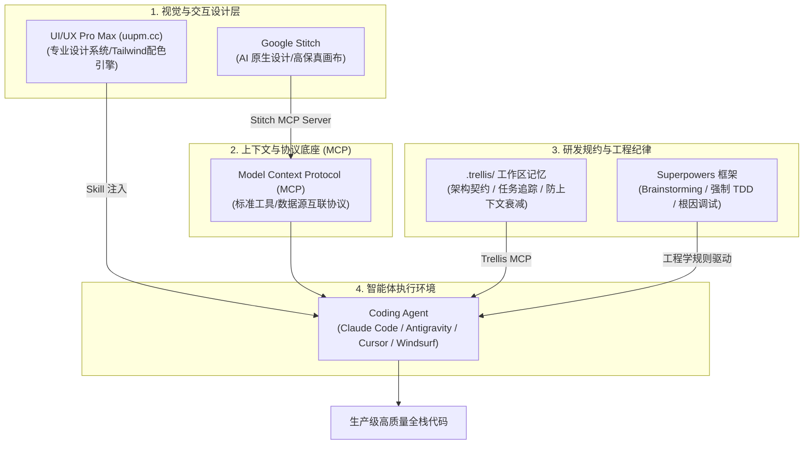
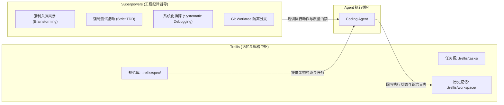
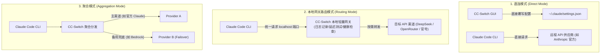
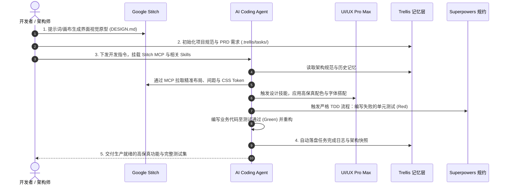

# Vibe Coding 与 MCP 生态实战：Stitch + Superpowers + Trellis + UI/UX Pro Max

## 使用入口：先解决问题，再做验证

组织 AI 辅助开发的上下文、工具和验证流程。

**先做基本操作**：先完成一个小范围可审阅改动，验证工具权限和结果，再按真实需求增加扩展与工作流。初次学习可先完成[本模块基础实践](/doc/AI/模型调用RAG与评测基础)。

**再逐步深入**：基本 API 与输入输出 → 常见失败和使用边界 → 场景排查与优化 → 本文机制分析与源码。面试先讲用途和自己的操作过程，再回答场景与原理追问。

近年来，AI 辅助编程从单纯的代码补全（Copilot）演进为全新的开发范式 —— **Vibe Coding（氛围编程）**。开发者不再需要逐行敲写业务样板代码，而是扮演**“总架构师与工程导演”**，通过自然语言、高阶规范与智能代理（Agent）共同驱动复杂软件的从零到一交付。

然而，野蛮生长的“裸奔 Vibe Coding”极易带来**上下文丢失、幻觉泛滥、架构腐烂、修 A 崩 B 以及 UI 极其廉价同质化**等致命痛点。

本篇系统拆解由 **MCP（Model Context Protocol）** 驱动的工业级 Vibe Coding 全家桶：**Google Stitch（设计直通代码）、Superpowers（工程纪律规训）、Trellis（持久化记忆与任务规约）、UI/UX Pro Max（高颜值设计智能）**，打造高质、可靠、美观的现代 Agentic 编程工作流。

---

## 🎯 核心概念与技术矩阵



---

## 一、 Google Stitch & Stitch MCP：设计稿直接生成生产代码

### 1. 什么是 Google Stitch？
**Google Stitch** 是 Google Labs 推出的面向 AI 时代的全新 UI/UX 原型与设计工具。
- **核心特点**：允许开发者通过自然语言交互、语音描述或画布拖拽，秒级生成极高保真的 Web 与移动端交互界面、组件库以及设计规范。
- **输出成果**：自动生成标准结构化设计规范文档（`DESIGN.md`）与 CSS/Tailwind 布局元数据。

### 2. Stitch MCP 的革命性价值
以往开发者需要将 Figma/Stitch 导出的 ZIP 压缩包解压，手动复制 HTML/CSS，过程极易丢失交互逻辑。**Stitch MCP** 将 Stitch 云端画布直接抽象为 MCP 工具集，使 AI Coding Agent 拥有了**“看懂设计稿并提取样式”**的能力。

#### 核心工作流：
1. Agent 通过 MCP 读取 Stitch 画布上的屏幕列表（Screens）、组件树与变体样式。
2. 自动拉取组件的精确间距、色彩 Token、响应式断点。
3. 零人工干预直接将其编译生成生产级 Vue / React / Flutter 前端代码。

#### 典型 MCP 配置示例 (`mcpServers`):
```json
{
  "mcpServers": {
    "stitch": {
      "command": "npx",
      "args": ["-y", "@google/stitch-mcp"],
      "env": {
        "STITCH_API_KEY": "your_stitch_api_key_here"
      }
    }
  }
}
```

---

## 二、 Superpowers (by Jesse Vincent)：规训 Agent 的工程纪律框架

### 1. 为什么纯 Prompt 编程会失控？
未受约束的 AI Agent 往往具有以下缺陷：
- **拿到一句话就盲目动手**：不假思索直接修改核心文件，引发灾难性回归。
- **假测试或不写测试**：随意 Mock 结果，甚至只写永远返回 `true` 的断言。
- **治标不治本的补丁式修复**：遇到报错乱试 Try-Catch，掩盖核心逻辑缺陷。

### 2. Superpowers 的核心思想
由开源界著名工程师 Jesse Vincent（`@obra`）创建的 **Superpowers**（`obra/superpowers`），是一套将顶级软件工程最佳实践强制固化到 Agent 认知中的框架：

| 核心模块 | 执行规则与纪律要求 |
| :--- | :--- |
| **Brainstorming (头脑风暴)** | 在编写任何代码之前，必须与开发者对齐架构边界、异常情况、接口契约，严禁直接动工。 |
| **Writing Plans (任务拆解)** | 强制生成结构化的 Step-by-Step 实施步骤与检查清单，明确每个子步骤的交付物。 |
| **Strict TDD (强制测试驱动)** | **必须先写一个会失败的单元测试（Red）**，运行确认报错后，再编写最小业务实现（Green），最后重构（Refactor）。 |
| **Systematic Debugging (系统排障)** | 严禁凭空乱猜。必须构建最小可复现用例（MRE），逐步追踪执行栈与日志定位根因。 |
| **Git Worktree 隔离执行** | 复杂任务创建独立的 Git Worktree 隔离分支，由专用 Subagent 完成测试验证后才合并回主分支。 |

---

## 三、 Trellis：解决上下文衰减的工程化工作区记忆层

随着对话轮次增加，AI 会不可避免地出现**上下文遗忘（Context Decay）**与认知漂移。Trellis 改变了传统单一大文件（如膨胀至上千行的 `CLAUDE.md` 或 `.cursorrules`）的做法，建立了结构化的工作区存储层：

```text
.trellis/
├── spec/               # 架构规范与业务不变量契约 (Architecture & Constraints)
│   ├── frontend.md     # 前端编码风格与状态管理规范
│   └── backend.md      # API 设计与数据库事务安全军规
├── tasks/              # 需求拆解与进行中的 Task 看板
│   ├── PRD-001.md      # 需求上下文与验收标准
│   └── tracker.json    # 任务完成状态机
└── workspace/          # 跨会话沉淀的工程经验与踩坑快照 (Journal)
    └── changelog.md    # 历史踩坑与关键技术决策记录
```

### Trellis 与 MCP 的联动
通过接入 **Trellis MCP**，Agent 在执行任何写代码动作之前，都会自动通过标准化接口查询当前任务所属的 Spec，并在操作完成后自动同步进度到 Task Tracker，彻底告别“重开一个窗口 AI 就不知道前面做了什么”的尴尬。

---

## 四、 深度辨析：Superpowers vs Trellis 的本质区别与优缺点全景

在 Vibe Coding 社区中，许多开发者容易将 **Superpowers** 和 **Trellis** 混淆，甚至误以为它们是相互替代的关系。实际上，**两者的关注维度完全不同，属于高度互补的“纪律层”与“记忆层”**。



### 1. 通俗心智模型与隐喻对比

* **Superpowers 就像一位坐在 AI 旁边的“严厉首席测试架构师”**：
  * 它手里拿着工程皮鞭，时刻盯着 AI：“停！思路没说清楚前别敲键盘！”、“先写单元测试，测试没红不准写业务实现！”、“报错了别乱猜，先找最小复现排查根因！”
  * **核心管的是：Agent 的行为习惯与代码执行质量（How to code responsibly）。**

* **Trellis 就像整个项目的“Jira 任务看板 + Confluence 架构文档 + 永久记忆闪存盘”**：
  * 它默默地整理好文档与任务抽屉，在每次开工前把资料递给 AI：“这是本 Sprint 正在进行的第 3 个任务，这是系统底层的数据库事务契约，上次会话你在第 4 步暂停了，请接着干！”
  * **核心管的是：项目的上下文结构、状态追踪与跨会话记忆（What to build & Where we are）。**

---

### 2. 核心维度全景对比矩阵

| 比较维度 | Superpowers（Jesse Vincent） | Trellis（Mindfold AI） |
| :--- | :--- | :--- |
| **本质定位** | **Agent 行为工程学与质量规训方法论** | **工作区规格契约、任务状态机与持久记忆层** |
| **核心解决痛点** | • AI 瞎动代码、修 A 崩 B<br>• 不写测试或伪造假测试<br>• 遇到 Bug 盲目打补丁 | • 对话过长导致上下文衰减（Context Decay）<br>• 新建会话或换工具后“失忆”<br>• `CLAUDE.md` 膨胀几千行混乱不堪 |
| **落地形态** | Skills 技能库 / Prompt 行为指令集 / Hooks 钩子 | `.trellis/` 结构化文件树 + 专用 **Trellis MCP Server** |
| **关注周期** | **单次任务的执行过程**（从接到需求到跑通测试） | **项目的全生命周期**（跨会话、跨天、跨平台协同） |
| **是否关心测试** | **极其强硬**（强制 TDD，无测试不收工） | **不关心**（只记录任务是不是 Done，不管怎么写的） |
| **跨工具通用性** | 偏向提示词与规则层，可适配所有 Agent | 纯通用目录与 MCP 规范，可无缝对接 Claude Code / Cursor / Windsurf |

---

### 3. Superpowers 的优缺点深度剖析

#### 优点（Pros）：
1. **真实代码质量极高**：通过严格的 TDD 约束，杜绝了 AI 常见的“假装测试通过”，重构和回归 Bug 率大幅降低。
2. **防止任务漂移与破坏性变更**：强制要求在动工前进行头脑风暴和分步骤 Plan，确保人类对改动范围拥有 100% 确定感。
3. **原生 Git Worktree 隔离机制**：复杂逻辑自动切到独立 Worktree，测试全部绿灯后才合并，绝不污染干净的主分支代码。

#### 缺点（Cons）：
1. **开发节奏偏慢、交互重**：即使改动两行代码，如果触发完整流程也会走一遍需求澄清与测试步骤，极客快速写 Demo 时会略显繁琐。
2. **Token 消耗与推理成本高**：因为每一步都需要前置规划、写失败测试、写实现、重构，Prompt 调用轮次显著增多。
3. **无跨会话记忆**：自身不维护长期 PRD 目录，窗口一旦关闭，上次做过什么决策依然容易遗忘。

---

### 4. Trellis 的优缺点深度剖析

#### 优点（Pros）：
1. **根治 AI“失忆症”**：即使关掉窗口重开、甚至从 Cursor 换到 Claude Code，Agent 只要读取 `.trellis/`，秒级复活上下文。
2. **规范解耦与按需注入**：将原本堆在一块的巨型规则拆分为 `spec/`、`tasks/`、`workspace/`，极大节约单次调用的上下文窗口。
3. **人机协作友好的项目资产**：`.trellis` 里的 Markdown 与 JSON 结构清晰，人类工程师阅读与评审任务进展极其直观。
4. **原生 MCP 自动化**：提供 MCP Server，Agent 能自动读写任务状态，无需人类反复提醒“记得更新进度”。

#### 缺点（Cons）：
1. **只防遗忘，不防手贱**：Trellis 本身不限制 AI 怎么写代码。如果 AI 逻辑薄弱写出了垃圾代码或不写测试，Trellis 无法进行拦截。
2. **增加仓库目录成本**：项目中需要额外管理 `.trellis` 文件夹，微型项目或单文件小脚本会显得“过度工程化”。

---

### 5. 最佳实践：Superpowers + Trellis 强强联手（1 + 1 > 2）

顶尖 Vibe Coding 玩家绝不做二选一，而是将两者组合为**“黄金搭档”**：

```text
1. [需求发起]  开发者在 .trellis/tasks/ 登记需求与验收标准
2. [记忆加载]  Trellis MCP 将当前任务与 .trellis/spec/ 架构契约注入 Agent
3. [纪律规训]  Superpowers 接管控制流：
              ├─ 1. 强制对齐 Spec 并输出实施 Plan
              ├─ 2. 强制在 Git Worktree 创建失败测试 (Red)
              ├─ 3. 编写功能代码使测试变绿 (Green)
              └─ 4. 跑通完整自动化测试集 (Refactor)
4. [状态落盘]  Trellis MCP 自动将任务标记为已完成，并在 .trellis/workspace/ 记录本次经验
```

---

## 五、 UI/UX Pro Max (`uupm.cc`)：专业级界面设计技能注入

- **官方网站**：[uupm.cc](https://uupm.cc/)
- **开源仓库**：[GitHub / nextlevelbuilder/ui-ux-pro-max-skill](https://github.com/nextlevelbuilder/ui-ux-pro-max-skill)

### 1. 核心价值与痛点解决
默认情况下，大模型生成的前端界面往往具有极浓厚的“AI 玩具感”：惨白的背景、生硬的无序边框、不协调的高饱和度色彩以及混乱的排版层次。

**UI/UX Pro Max** 是一款专为 AI Coding Agent 打造的**设计智能扩展包（Skill / Toolkit）**：
- **设计系统注入**：为 Agent 提供数百套精选的行业级配色方案、字体配对（Font Pairing）与阴影层次。
- **现代化组件风格**：原生理解 Tailwind CSS、shadcn/ui、UnoCSS、Radix 等现代组件库的最佳视觉呈现。
- **无障碍（a11y）合规**：自动核验 WCAG 2.1 颜色对比度标准，产出兼具美感与工业可用性的优质前端代码。

### 2. 快速安装与使用

#### 方式 A：通过 Agent 插件市场安装（如 Claude Code / Antigravity CLI）
```bash
# 添加官方技能市场源
/plugin marketplace add nextlevelbuilder/ui-ux-pro-max-skill

# 安装 UI/UX Pro Max 技能包
/plugin install ui-ux-pro-max@ui-ux-pro-max-skill
```

#### 方式 B：通过 Node.js CLI 本地初始化
```bash
npx uipro-cli init
```

安装后，只需在日常 Prompt 中添加设计需求，Agent 会自动调用技能知识库进行推理：
> “使用 Vue 3 + Tailwind CSS 帮我开发一个 SaaS 用户计费订阅看板，请激活 ui-ux-pro-max 技能，选择高级暗黑科技风格（Dark Cyber），确保对比度符合 WCAG 标准。”

---

## 六、 CC-Switch：AI Coding 终端多模型与多账号一键切换利器

在重度使用 **Claude Code、Codex、Gemini CLI** 等终端 AI 工具时，开发者经常需要在不同供应商（Anthropic 官方、AWS Bedrock、Google Cloud Vertex AI、DeepSeek、OpenRouter 或企业自建 OneAPI/NewAPI 聚合网关）之间来回切换。

手动去修改 `~/.claude/settings.json`、改环境变量（`ANTHROPIC_API_KEY` / `ANTHROPIC_BASE_URL`）极其痛苦且容易出错。**CC-Switch** 专为解决这一痛点而生。

- **官方网站**：[ccswitch.io](https://ccswitch.io/)
- **GitHub 仓库**：[github.com/farion1231/cc-switch](https://github.com/farion1231/cc-switch)

### 1. 核心特性
1. **多供应商与渠道一键秒切**：预设并一键切换 Anthropic 官方、DeepSeek（通过 OpenAI 兼容转接）、OpenRouter、SiliconFlow（硅基流动）等各种中转/代理服务。
2. **多账号管理与配额看板**：支持个人账号、公司企业账号分流，图形化监控 Claude Code 的 5 小时与周度使用限额（Rate Limits）。
3. **MCP 与 Skills 可视化管理**：集中管理 Claude Code 挂载的 MCP 服务器（自动写 `claude mcp add` 配置）和常用 Skill 插件。
4. **内置轻量本地网关（Local Proxy Gateway）**：支持健康探测、延迟测速、失败自动故障转移（Failover）和请求日志分析。

### 2. 软件安装方式

* **macOS（首选 Homebrew 安装）**：
  ```bash
  brew install --cask cc-switch
  ```
* **Windows / Linux**：
  直接在 [GitHub Releases 页面](https://github.com/farion1231/cc-switch/releases) 下载 `.msi`、`.exe`、`.deb`、`.rpm` 或 AppImage。
* **Arch Linux (AUR)**：
  ```bash
  paru -S cc-switch-bin
  ```

### 3. 三大连接工作模式详解

CC-Switch 在桌面端顶部提供了三种与底层 CLI 对接的工作模式：



1. **直连模式（Direct Mode）**：
   - 切换预设时，CC-Switch 自动读取并覆写目标工具的本地配置文件：
     - Claude Code：`~/.claude/settings.json`
     - Codex：`~/.codex/config.toml`
     - Gemini CLI：`~/.gemini/.env`
   - **优势**：零额外网络跳数与中间层，与原生 CLI 行为 100% 一致。
2. **本地路由模式（Routing Mode - 强烈推荐）**：
   - Claude Code 的 endpoint 统一固定指向 CC-Switch 本地启动的轻量网关（如 `http://127.0.0.1:端口/v1`）。
   - 在 CC-Switch 图形界面里随意切换供应商，无需频繁修改或覆写底层 JSON 配置文件，支持查看每次 Prompt 的详细消耗日志与重试。
3. **聚合模式（Aggregation Mode）**：
   - 支持多账号轮询与主备兜底（例如平时使用高性价比中转，遇到限流或超额时自动无缝降级到官方后备通道）。

### 4. 典型配置：以在 Claude Code 中使用 DeepSeek / 中转 API 为例

在 CC-Switch 中点击 **Add Provider**，填入以下参数即可一键生效：
* **Provider Name**: `DeepSeek (via CC-Switch)`
* **Base URL**: `https://api.deepseek.com`（或你的中转站如 `https://openrouter.ai/api/v1`）
* **API Key**: `sk-xxxxxxxxx`
* **Model Mapping**: 将 `claude-3-7-sonnet` 映射为 `deepseek-chat` 或 `deepseek-reasoner`
* 点击 **Apply / Switch**，重新打开终端运行 `claude` 即可直接以对应模型进行编码！

---

## 七、 Vibe Coding 现代化黄金工作流实战

将上述利器串联起来，即可形成现代硅谷全栈极客最推崇的高效交付流：



---

## 八、 常用 Vibe Coding 顶级 MCP 插件生态速查表

| MCP 服务名称 | 官方/开源地址 | 核心赋予 Agent 的能力 |
| :--- | :--- | :--- |
| **Stitch MCP** | `@google/stitch-mcp` | 跨端设计稿拉取、视觉组件解析、直接将画布转化为代码 |
| **Trellis MCP** | `mindfold-ai/trellis` | 项目规格契约持久化、多端任务上下文同步、防遗忘 |
| **Sequential Thinking** | `@modelcontextprotocol/server-sequential-thinking` | 赋予 Agent 类似人类思维链的深度非线性反思、假设推导与动态自我纠错能力 |
| **Chrome DevTools / Puppeteer**| `puppeteer-mcp` | 浏览器真机模拟、前端截图比对、Console 报错捕获与无头自动化测试 |
| **Filesystem & Git MCP** | `@modelcontextprotocol/server-filesystem` | 深度受控的文件操作、Git Worktree 隔离分支切换与安全审查 |
| **Qdrant Vector MCP** | `qdrant/mcp-server-qdrant` | 本地知识库语义搜索、向量近邻检索与元数据 Payload 过滤 |
