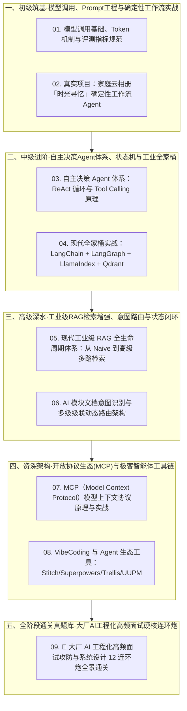

# AI 原生与大模型工程架构全景指南

欢迎来到 **AI 原生应用与大模型工程化进阶专栏**。

本专栏面向 **3~5 年及以上全栈工程师、移动端/后端技术人员以及渴望突破大模型落地瓶颈的 AI 应用工程师**，严格摒弃“背诵空洞 Prompt”与“仅调 OpenAI API 的玩具 Demo”，全面接轨一线大厂（字节跳动、阿里巴巴、腾讯、美团）工业级高频考核深水区。

本专栏完全以真实高并发落地项目 —— **家庭云相册「时光寻忆」（拾光寻忆）** 为实战锚点，建立起**从原生调用到确定性工作流、从自主 ReAct 智能体到企业级全家桶（LangChain/LangGraph/LlamaIndex/Qdrant）、从工业级 RAG 到 MCP 开放协议、再到大厂高频面试攻防**的系统化纵深认知。

---

## 🗺️ AI 原生与大模型工程全阶段技术图谱

---

## 📚 专栏章节索引

### 一、初级筑基·模型调用、Prompt 工程与确定性工作流实战
1. [01. 模型调用基础、Token 机制与评测指标规范](/doc/AI/模型调用RAG与评测基础)
   - 最小稳定调用模板、超时/重试与防重发设计
   - Token、上下文窗口、Temperature、Embedding 边界
   - 结构化输出与业务规则独立校验
2. [02. 真实项目：家庭云相册「时光寻忆」确定性工作流 Agent 落地实战](/doc/AI/结构化工作流编排型Agent落地实战-家庭云相册时光寻忆)
   - 生产项目 `AlbumAiService` 源码级逐行剖析
   - 分词展开与语义泛化（Token Expansion）
   - **视觉门禁与一票否决权（Visual Gating）**：彻底解决“穿黄色衣服的铭铭”相关性被相册名稀释问题
   - **SQLite 64-Join 瓶颈攻坚**：Prisma 关系折叠聚合（Relational Folding）
   - 多协议大模型网关（云端 Qwen 145 tok/s 极速推理 vs 本地离线 Ollama 热切换）
   - SSE 图文多通道通信（`memories` 照片元数据事件与 `message` 增量流文本事件分离）

### 二、中级进阶·自主决策 Agent 体系、状态机与工业全家桶
3. [03. 自主决策 Agent 体系：ReAct 循环、Tool Calling 原理与生产级选型思辨](/doc/AI/自主决策Agent体系-ReAct与ToolCalling原理解析)
   - 智能体大脑四大构件：Planning（规划）、Memory（记忆）、Tools（工具）、Reflection（反思）
   - ReAct 认知循环底层：`Thought ➔ Action ➔ Observation`
   - Function Calling / Tool Calling 规范（JSON Schema）与底层交互时序
   - **手写纯代码实战**：60 行纯 TypeScript 零依赖实现一个可运行的最小 ReAct 智能体循环
   - 深度辩证：为什么高频 C 端相册坚决采用“确定性流水线”而非“纯 ReAct”？
   - 终极架构：工作流外骨骼（Pipeline）+ 局部微智能体（Micro-Agent）
4. [04. 现代 AI 工程全家桶实战：LangChain + LangGraph + LlamaIndex + Qdrant](/doc/AI/大模型技术栈LangChain-LangGraph-LlamaIndex-Qdrant实战)
   - 四大框架定位心智模型：嘴巴与底座（LangChain）、大脑图状态机（LangGraph）、眼睛与检索（LlamaIndex）、高维仓库（Qdrant）
   - Qdrant 极速部署、Rust 原生性能与 Payload 标量联合过滤
   - LlamaIndex 专业切块、Node 解析与 VectorStoreIndex 问答引擎
   - LangChain LCEL 管道语法与 Pydantic 结构化输出强类型链
   - LangGraph 有向循环图（DCG）、State 状态机与自省纠错（Self-RAG）
   - **重构实战演练**：如何用 (LangGraph + LlamaIndex + Qdrant) 重新架构家庭云相册「时光寻忆」

### 三、高级深水·工业级 RAG 检索增强、意图路由与状态闭环
5. [05. 现代工业级 RAG 全生命周期体系：从 Naive RAG 到高级多路检索与评测](/doc/AI/现代工业级RAG全生命周期体系)
   - Naive RAG 的三大死穴：检索不到、检索不准、生成幻觉
   - Ingestion 切分进阶：固定切分 vs 递归切分 vs 语义切分 vs 父子文档（Parent-Child）vs 句子窗口
   - Pre-Retrieval 增强：Multi-Query 泛化扩展与 HyDE 假设性文档嵌入
   - Retrieval 混合检索：Dense 稠密向量 + Sparse 稀疏向量（BM25）与 RRF 倒数排名融合算法
   - Post-Retrieval 精排：Cross-Encoder Reranker 交叉注意力重排、Lost in the Middle 治理与视觉一票否决门禁
   - Generation 防护：强制引用标注（Citation）与拒答边界
   - Ragas 框架自动化量化评测体系：忠实度、答案相关性、上下文精准率与召回率
6. [06. AI 模块文档意图识别与多级级联动态路由架构](/doc/AI/AI模块文档意图识别与动态路由)
   - 为什么“不做意图识别的 RAG 只是玩具架构”？
   - 多级级联路由器：L1 规则正则引擎（<1ms）➔ L2 语义向量路由（5~15ms）➔ L3 轻量分类模型（100~300ms）➔ L4 复合规划
   - 多意图拆解为 LangGraph DAG 状态图
   - 线上意图分类误判 1 分钟热修复止血 SOP

### 四、资深架构·开放协议生态 (MCP) 与极客智能体工具链
7. [07. MCP（Model Context Protocol）模型上下文协议：原理、生态与开发实战](/doc/AI/MCP模型上下文协议与开发实战)
   - 诞生背景：大模型工具接入的“巴别塔”困境与“AI 时代的 USB-C 接口”
   - Host-Client-Server 分层拓扑与 JSON-RPC 2.0 通信（stdio / SSE）
   - 三大核心原语：Tools（执行函数）、Resources（只读上下文数据）、Prompts（模版）
   - **动手实操**：用 TypeScript 编写可运行的“家庭云相册 MCP Server”，在 Claude Desktop / Antigravity 挂载实测
   - 生产级安全边界：stdio 管道隔离、Human-in-the-Loop 审批防线
8. [08. VibeCoding 与 Agent 生态工具实战：Stitch、Superpowers、Trellis 与 UI-UX-Pro-Max](/doc/AI/VibeCoding与MCP生态实战-Stitch-Superpowers-Trellis与UIUXProMax)
   - 人机协作新范式：VibeCoding 与 Spec 驱动开发
   - Stitch 设计系统、Superpowers 技能树与 Trellis 规范驱动开发
   - UI-UX-Pro-Max 智能设计系统在现代跨端应用中的工程化落地

### 五、全阶段通关真题库·大厂 AI 工程化高频面试硬核连环炮
9. [09. 🎯 大厂 AI 工程化高频面试攻防与系统设计 12 连环炮全景通关](/doc/AI/大厂AI工程化高频面试攻防与系统设计)
   - Q1: 确定性流水线工作流 Agent vs 开放自主 ReAct Agent 选型辩证
   - Q2: 生产环境 RAG 检索命中但大模型仍答错或产生幻觉的根本原因与治理
   - Q3: 为什么百万长上下文（1M~2M）时代 RAG 依然无可替代？
   - Q4: 向量数据库底层原理（HNSW 算法）与四大引擎选型矩阵（Qdrant/Milvus/PGVector/Chroma）
   - Q5: 为什么必须使用混合检索（BM25 + Dense）？RRF 融合算法数学原理
   - Q6: 大模型输出 JSON 结构化数据 99.99% 稳定性的工程防御体系
   - Q7: LangGraph State 与 Checkpointer 原理：Time Travel 与 Human-in-the-Loop 落地
   - Q8: MCP 协议相比传统 OpenAPI / Swagger 工具调用的代际优势
   - Q9: 智能相册多模态“穿黄色衣服的铭铭”属性解耦与一票否决视觉门禁实战（本项目杀手锏）
   - Q10: 海量分词查询下 ORM 突破 SQLite 64-Join 物理限制与关系折叠优化（本项目杀手锏）
   - Q11: 大模型流式输出（SSE）长链接心跳保活、背压治理（Backpressure）与断线重连
   - Q12: Ragas 四大核心指标计算逻辑与线上 CI/CD 自动化评测门禁

---

## 🎯 系统控制权与自主性权衡象限

在开启具体学习前，牢记这张**系统控制权与自主性权衡象限**：

| 模式 | 典型代表 | 决策大脑 | 首字延迟 | 适用业务场景 | 致命缺陷与风险 |
| :--- | :--- | :--- | :--- | :--- | :--- |
| **纯原生调用** | 单次问答、文本摘要、翻译 | 外部代码硬编码 | ~200ms | 简单的无状态单步任务 | 无法感知外部世界与私有动态数据 |
| **确定性工作流 Agent** | **时光寻忆家庭相册**、电商订单查询、客服标准流 | **工程确定性代码**（TypeScript/Python 流水线控制步骤） | **100~300ms** | **高频 C 端、低延迟要求、强隐私权限、结果要求绝对可控** | 只能处理预设流程，无法应对开放式未知探索 |
| **自主决策 Agent** | 代码助手（Devin/Cursor）、自动化调研 Agent | **大模型概率决策**（LLM 自主决定何时调工具） | **2000~5000ms+**（多次 LLM 往返） | **探索性、非标准、多路径尝试的后台长流程任务** | 死循环、参数幻觉、Token 账单失控、黑盒不可测 |
| **图状态机 Agent** | **LangGraph** 多智能体协作系统 | **图状态机 + 局部 LLM 决策** | 按节点分段流式 | 复杂多角色企业级流程、需要人工审批介入（Human-in-the-loop） | 状态设计与状态转移设计复杂度高 |

> [!IMPORTANT]
> **架构黄金定律**：在企业生产落地的第一原则是**“能用确定性代码解决的，绝不交给大模型猜；能用单次往返 Pipeline 解决的，绝不用多轮 ReAct 循环”**。大模型应该作为流水线中负责“语义理解与温情文案生成”的专职部件，而非系统流程的总控调度。
