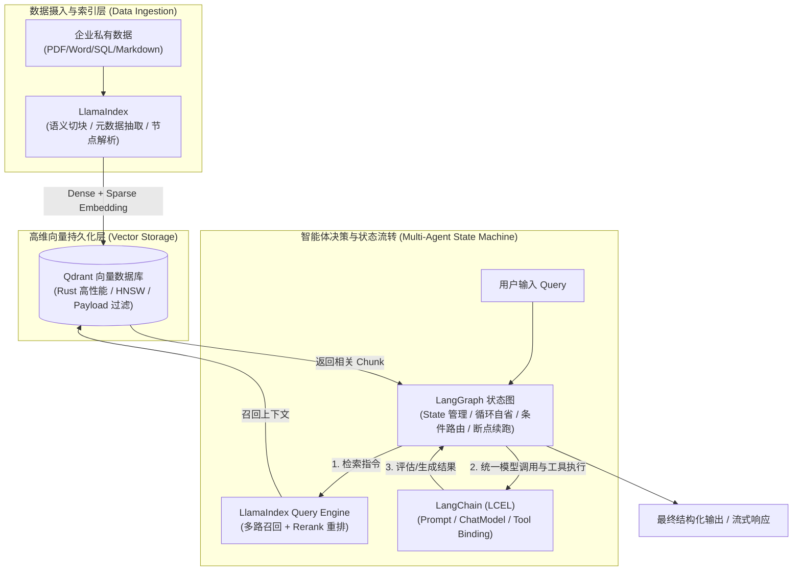
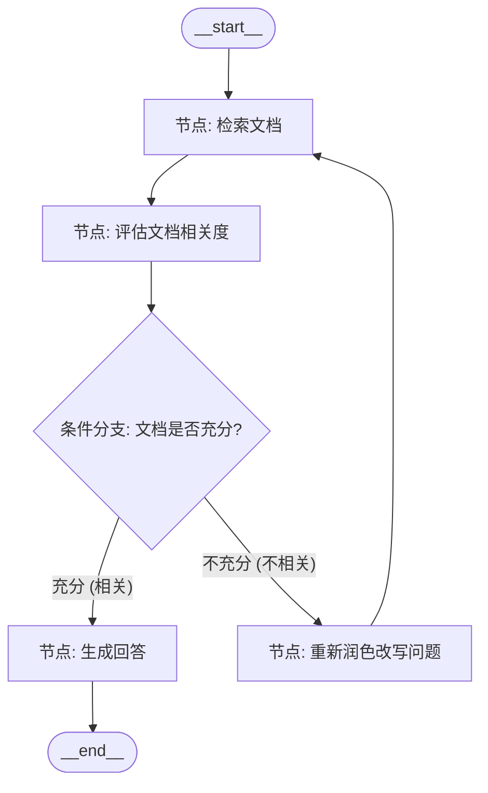

# 现代AI大模型工程技术栈实战：LangChain + LangGraph + LlamaIndex + Qdrant

## 使用入口：先解决问题，再做验证

用检索证据与受控工作流完成知识问答。

**先做基本操作**：先验证一次模型调用与一个小型 RAG，检查引用与权限，再按需求选框架和向量数据库。初次学习可先完成[本模块基础实践](/doc/AI/模型调用RAG与评测基础)。

**再逐步深入**：基本 API 与输入输出 → 常见失败和使用边界 → 场景排查与优化 → 本文机制分析与源码。面试先讲用途和自己的操作过程，再回答场景与原理追问。

随着大语言模型（LLM）从简单的“单轮对话与玩具演示”全面迈入**企业级复杂业务场景**，如何解决**大模型幻觉、私有数据时效性、长上下文遗忘、复杂任务不可控与多步骤执行崩溃**，成为了现代 AI 工程师的核心攻坚方向。

业界逐渐形成了以 **LangChain（模型门面与管道底座）+ LangGraph（多智能体与图状态机）+ LlamaIndex（专业级 RAG 检索管线）+ Qdrant（高性能云原生向量数据库）** 为代表的工业级标准技术栈。

---

## 🎯 架构实战与核心技术归纳

- **核心设问与思考**：“大模型项目已经有了 LangChain，为什么还要引入 LlamaIndex？这两者的底层设计哲学和分工边界是什么？”
- **深水区追问**：“传统 ReAct 单 Agent 架构在生产中为什么经常陷入死循环或任务漂移？LangGraph 的**有向循环图（DAG/DCG）状态机**是如何做到可控与断点回溯（Human-in-the-loop）的？生产级 RAG 为什么推荐使用 Qdrant 配合 Payload 过滤，而不是传统的内存向量库？”

---

## 一、 四大核心技术栈定位与分工心智模型

在实际企业架构中，盲目混用框架会导致代码结构臃肿失控。必须清晰理清各框架的最佳职责边界：



### 四大组件职责对比矩阵

| 技术框架 | 核心定位 | 解决的核心痛点 | 最佳使用场景 | 避免使用的场景 |
| :--- | :--- | :--- | :--- | :--- |
| **Qdrant** | **高性能向量数据库**<br>(基于 Rust 编写) | 传统数据库无法高效处理高维向量近邻搜索；传统内存向量库无法处理千万级数据与复杂元数据过滤 | 生产级向量存储、多模态检索、带业务字段（租户/时间/权限）的 Payload 联合过滤 | 单纯的几十行文本测试（此时用临时内存列表即可） |
| **LlamaIndex** | **专业级 RAG 与数据框架** | 大模型对私有专业领域数据的理解匮乏；文本切分生硬导致上下文语义割裂、召回精度低 | 文档解析提取、高级切分（父子文档/句子窗口/语义切分）、混合检索与重排序（Rerank） | 复杂多步骤 Agent 规划与多智能体分工协同 |
| **LangChain** | **大模型通用抽象与管道底座** | 各大模型厂商 API（OpenAI/Claude/Gemini/本地 Ollama）接口不统一；Prompt 与输出格式缺乏规范 | 统一模型调用门面、LCEL 管道编排、格式化 Prompt 模版、Pydantic 结构化输出解析 | 复杂的非线性多轮循环图流转（极易陷入黑盒） |
| **LangGraph** | **有向图状态机与多 Agent 框架** | 传统 Agent 容易陷入死循环、缺乏持久化状态、无法中途人工干预（Human-in-the-loop） | 多 Agent 协作（主管+执行者模式）、带自省纠错（Self-Reflection）的工作流、长流程任务 | 简单的“提问-回答”单一调用链（徒增架构复杂度） |

---

## 二、 Qdrant 向量数据库：极速部署与原生 MVP 实战

**Qdrant** 是目前业界公认在吞吐量、内存控制（Rust 原生、支持 mmap 与标量量化）和**标量过滤（Payload-based Filtering）**方面表现最出色的向量数据库。

### 1. Docker 一键启动 Qdrant 容器
```bash
docker run -d \
  --name qdrant-server \
  -p 6333:6333 \
  -p 6334:6334 \
  -v $(pwd)/qdrant_storage:/qdrant/storage \
  qdrant/qdrant:latest
```
- **6333 端口**：HTTP REST API 与 Web UI 控制台（可在浏览器访问 `http://localhost:6333/dashboard`）。
- **6334 端口**：高性能 gRPC 通信端口。

### 2. Python 最小运行 MVP：集合创建、向量插入与元数据过滤检索
```python
# 安装依赖: pip install qdrant-client
from qdrant_client import QdrantClient
from qdrant_client.models import Distance, VectorParams, PointStruct, Filter, FieldCondition, MatchValue

# 1. 初始化客户端 (连接本地 Qdrant 服务)
client = QdrantClient(host="localhost", port=6333)
collection_name = "enterprise_knowledge"

# 2. 创建 Collection (定义向量维度 1536，距离度量方式为余弦 Cosine)
if not client.collection_exists(collection_name):
    client.create_collection(
        collection_name=collection_name,
        vectors_config=VectorParams(size=4, distance=Distance.COSINE)  # 此处用 4 维作为演示
    )

# 3. 写入带 Payload 业务元数据的向量点 (Points)
points = [
    PointStruct(
        id=1,
        vector=[0.05, 0.61, 0.76, 0.17],
        payload={"department": "hr", "year": 2026, "text": "公司年假规定：工龄满1年享受5天带薪年假。"}
    ),
    PointStruct(
        id=2,
        vector=[0.19, 0.81, 0.75, 0.11],
        payload={"department": "finance", "year": 2026, "text": "报销规范：发票抬头必须包含完整企业税号。"}
    ),
]
client.upsert(collection_name=collection_name, points=points)

# 4. 执行带 Payload 标量过滤的近邻向量检索 (核心生产特性: 仅在 hr 部门内进行高维相似度检索)
search_result = client.query_points(
    collection_name=collection_name,
    query=[0.08, 0.65, 0.72, 0.15], # 查询向量
    query_filter=Filter(
        must=[
            FieldCondition(key="department", match=MatchValue(value="hr"))
        ]
    ),
    limit=1
)

for hit in search_result.points:
    print(f"匹配得分 (Score): {hit.score:.4f} | 内容: {hit.payload['text']}")
```

---

## 三、 LlamaIndex + Qdrant：企业级专业 RAG 检索管线 MVP

在实际应用中，绝不能用朴素的“字符长度粗暴切分”。LlamaIndex 提供了业界领先的**文档解析、分块、嵌入转换与 Qdrant 向量仓储对接**能力。

### 最小 MVP：文档入库、向量化与精准问答
```python
# 安装依赖: pip install llama-index llama-index-vector-stores-qdrant llama-index-embeddings-openai llama-index-llms-openai qdrant-client
import os
from llama_index.core import Document, VectorStoreIndex, StorageContext, Settings
from llama_index.core.node_parser import SentenceSplitter
from llama_index.vector_stores.qdrant import QdrantVectorStore
from qdrant_client import QdrantClient

# 配置环境变量
os.environ["OPENAI_API_KEY"] = "your_openai_api_key_here"

# 1. 模拟企业核心知识文档
raw_documents = [
    Document(
        text="分布式事务落地军规：核心支付链路禁止使用两阶段提交（2PC），必须采用基于本地消息表+MQ消息通知的最终一致性方案。",
        metadata={"category": "architecture", "author": "架构委"}
    ),
    Document(
        text="MySQL深分页优化方案：当 offset 超过 10 万时，采用延迟关联策略（通过主键索引覆盖查询子查询）替代全表回表扫描。",
        metadata={"category": "database", "author": "DBA"}
    )
]

# 2. 设置高级切块策略 (SentenceSplitter 保留标点完整度与重叠窗口)
Settings.node_parser = SentenceSplitter(chunk_size=256, chunk_overlap=30)

# 3. 初始化 Qdrant 客户端并绑定 LlamaIndex 向量仓
qdrant_client = QdrantClient(host="localhost", port=6333)
vector_store = QdrantVectorStore(client=qdrant_client, collection_name="tech_spec_docs")
storage_context = StorageContext.from_defaults(vector_store=vector_store)

# 4. 构建索引并入库 (自动执行切块、Embedding 生成与 Qdrant 存储)
index = VectorStoreIndex.from_documents(
    raw_documents,
    storage_context=storage_context
)

# 5. 构建专业 QueryEngine 进行问答
query_engine = index.as_query_engine(similarity_top_k=2)
response = query_engine.query("支付业务如何处理分布式事务？")

print(f"AI 回答:\n{response.response}")
for node in response.source_nodes:
    print(f"引用来源 (Score {node.score:.4f}): {node.text}")
```

---

## 四、 LangChain (LCEL)：现代化管道与结构化输出 MVP

LangChain 核心优势在于 **LCEL（LangChain Expression Language）** 管道符语法 `|`，将 Prompt、模型和解析器无缝串联，并原生支持流式输出与结构化转换。

### 最小 MVP：Pydantic 强类型结构化解析链
```python
# 安装依赖: pip install langchain-core langchain-openai pydantic
import os
from typing import List
from pydantic import BaseModel, Field
from langchain_core.prompts import ChatPromptTemplate
from langchain_core.output_parsers import PydanticOutputParser
from langchain_openai import ChatOpenAI

os.environ["OPENAI_API_KEY"] = "your_openai_api_key_here"

# 1. 定义期望大模型输出的强类型结构 (Pydantic Schema)
class CodeReviewResult(BaseModel):
    has_bug: bool = Field(description="代码是否存在潜在 Bug 或安全隐患")
    issues: List[str] = Field(description="发现的缺陷清单")
    optimization_suggestions: str = Field(description="重构与性能优化建议")

parser = PydanticOutputParser(pydantic_object=CodeReviewResult)

# 2. 声明提示词模版 (注入 format_instructions)
prompt = ChatPromptTemplate.from_messages([
    ("system", "你是一名资深全栈架构师。分析提供的代码并严格按指定的 JSON 结构返回。\n{format_instructions}"),
    ("user", "代码片段如下：\n```{code}```")
])

# 3. 初始化大模型
model = ChatOpenAI(model="gpt-4o-mini", temperature=0)

# 4. 使用 LCEL 管道语法组合执行链 (Prompt | Model | Parser)
chain = prompt | model | parser

# 5. 执行并直接获得强类型 Python 对象
bad_code = """
def getUserById(userId):
    # 存在 SQL 注入风险
    sql = "SELECT * FROM users WHERE id = " + userId
    return db.execute(sql)
"""

result: CodeReviewResult = chain.invoke({
    "code": bad_code,
    "format_instructions": parser.get_format_instructions()
})

print(f"是否有缺陷: {result.has_bug}")
print(f"问题分析: {result.issues}")
print(f"重构建议: {result.optimization_suggestions}")
```

---

## 五、 LangGraph：多智能体与“自纠错循环图（Self-RAG）” MVP

当业务需要**“检查检索结果质量，如果匹配不佳则重写查询并重新检索”**时，传统的单向线性 Chain 会彻底失效。**LangGraph** 基于图结构（State、Node、Edge）完美实现自纠错闭环。



### 最小 MVP：带“自省重试”的 Self-RAG 状态图完整实现
```python
# 安装依赖: pip install langgraph langchain-core langchain-openai
import os
from typing import TypedDict, List
from langgraph.graph import StateGraph, END
from langchain_core.messages import HumanMessage
from langchain_openai import ChatOpenAI

os.environ["OPENAI_API_KEY"] = "your_openai_api_key_here"
llm = ChatOpenAI(model="gpt-4o-mini", temperature=0)

# 1. 定义图全局状态 (Graph State)
class AgentState(TypedDict):
    question: str
    documents: List[str]
    is_relevant: bool
    answer: str
    retry_count: int

# 2. 声明节点逻辑 (Nodes)
def retrieve_node(state: AgentState):
    """模拟从 Qdrant 检索知识"""
    query = state["question"]
    print(f"\n[Node: 检索] 正在检索: {query} (当前重试轮次: {state['retry_count']})")
    
    # 模拟：若包含关键词则检索成功，否则模拟未召回到关键信息
    if "分布式事务" in query:
        docs = ["支付链路规范：必须采用基于本地消息表+MQ的最终一致性方案。"]
    else:
        docs = ["无关文档：今天天气不错，机房空调运行正常。"]
    return {"documents": docs}

def grade_node(state: AgentState):
    """评估检索到的文档是否能回答问题 (反思自省)"""
    docs_text = "\n".join(state["documents"])
    prompt = f"问题: {state['question']}\n文档: {docs_text}\n请判断文档是否能支撑回答问题？只能回答'YES'或'NO'。"
    res = llm.invoke([HumanMessage(content=prompt)]).content.strip().upper()
    is_relevant = "YES" in res
    print(f"[Node: 质检] 文档与问题是否相关: {is_relevant}")
    return {"is_relevant": is_relevant}

def rewrite_node(state: AgentState):
    """当检索效果不好时，重写提问 (Query Rewrite)"""
    new_query = "支付核心系统如何落地分布式事务？"  # 模拟经过 LLM 丰富关键词后的改写
    print(f"[Node: 改写] 原始提问匹配度不足，改写提问为 -> '{new_query}'")
    return {"question": new_query, "retry_count": state["retry_count"] + 1}

def generate_node(state: AgentState):
    """最终基于有效文档生成专业回答"""
    print("[Node: 生成] 依据高质量召回文档生成最终回答...")
    prompt = f"基于背景信息：{state['documents']}\n回答问题：{state['question']}"
    answer = llm.invoke([HumanMessage(content=prompt)]).content
    return {"answer": answer}

# 3. 动态条件边判断 (Conditional Edge)
def route_after_grade(state: AgentState):
    # 若相关，直接走向生成；若不相关且重试少于2次，回退重写问题；超过2次强制兜底
    if state["is_relevant"]:
        return "generate"
    elif state["retry_count"] < 2:
        return "rewrite"
    else:
        return "generate"

# 4. 构建有向图 (StateGraph)
workflow = StateGraph(AgentState)

workflow.add_node("retrieve", retrieve_node)
workflow.add_node("grade", grade_node)
workflow.add_node("rewrite", rewrite_node)
workflow.add_node("generate", generate_node)

# 设置边连接
workflow.set_entry_point("retrieve")
workflow.add_edge("retrieve", "grade")
workflow.add_conditional_edges(
    "grade",
    route_after_grade,
    {
        "generate": "generate",
        "rewrite": "rewrite"
    }
)
workflow.add_edge("rewrite", "retrieve") # 形成循环闭环！
workflow.add_edge("generate", END)

# 编译图执行器
app = workflow.compile()

# 5. 触发执行（从一个模糊的问题开始，观察自动自省循环）
initial_input: AgentState = {
    "question": "怎么做支付转账？", # 初始模糊提问，将触发改写循环
    "documents": [],
    "is_relevant": False,
    "answer": "",
    "retry_count": 0
}

final_output = app.invoke(initial_input)
print(f"\n🎉 最终产出结果:\n{final_output['answer']}")
```

---

## 六、 典型工业级生产落地场景

| 场景分类 | 推荐核心架构 | 业务价值与工程落地优势 |
| :--- | :--- | :--- |
| **企业私有知识库 / 智能客服** | **LlamaIndex + Qdrant** | • **精准溯源**：规避幻觉，每个回答精确标记到源 PDF 的页码与 Chunk ID。<br>• **多租户隔离**：利用 Qdrant Payload 字段（如 `tenant_id`、`role_permission`）实现数据库级行权限物理过滤。 |
| **复杂工程任务 / 多 Agent 助理** | **LangGraph + LangChain** | • **确定性状态机**：避免传统单一 Agent 自由发挥导致流程跑偏。<br>• **断点恢复 (Human-in-the-loop)**：在敏感操作（如“下单支付”、“删除数据库”、“发送群邮件”）前将状态持久化暂停，待审批人员确认后继续。 |
| **代码审查与自动化漏洞修复** | **LangGraph 循环图** | 编写代码 -> 运行单元测试（Tool 节点） -> 报错捕获 -> 反思纠错（Reflection 节点） -> 重新生成代码，直到测试全绿退出。 |
| **多模态与亿级商品检索** | **Qdrant (Rust 引擎)** | 高维图像 Embedding 匹配 + 价格/库存/类目标量过滤，千万级索引秒级内存加载，支持量化压缩。 |

---

## 七、 生产级避坑军规与核心实战总结

> [!CAUTION] 避坑 1：不要对所有场景都盲目上 Agent
> 简单的单轮问答、纯语义搜索，**LlamaIndex + Qdrant 的 QueryEngine 即可解决 95% 的问题**。只有流程具备**“非线性分支、循环自省纠错、需要调用第三方 API 工具”**时，才引入 LangGraph，否则只会徒增系统延迟和 Token 消耗。

> [!TIP] 避坑 2：Qdrant 内存控制与生产性能调优
> - **开启标量量化（Scalar Quantization）**：将 32 位浮点（float32）向量量化压缩为 8 位整型（int8），**内存占用直降 75%**，检索精度损失低于 1%。
> - **启用存储映射（mmap）**：配置 `on_disk: true` 将向量原始文件保存在 NVMe 磁盘上，仅将 HNSW 索引放入内存，大幅降低机器硬件成本。

> [!IMPORTANT] 避坑 3：RAG 召回精度差与检索漂移治理
> 绝不能仅靠单一路余弦相似度。生产标准方案是：
> 1. **混合检索（Hybrid Search）**：Qdrant 稠密向量（语义匹配） + 稀疏向量/BM25（专有名词精确匹配）。
> 2. **重排序（Reranking）**：召回 Top 20 后，通过 `bge-reranker-large` 等交叉编码器重新打分，仅取 Top 3~5 喂给 LLM。
