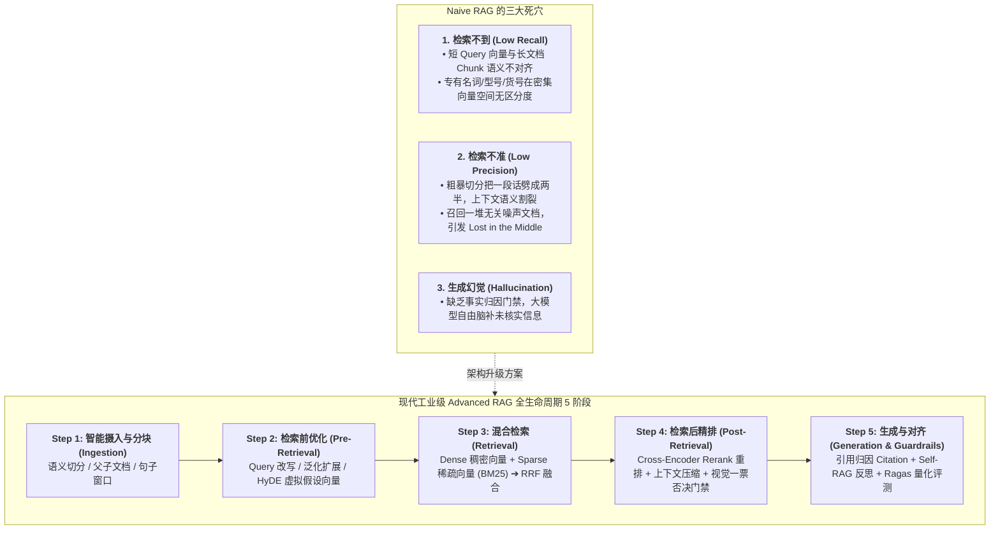
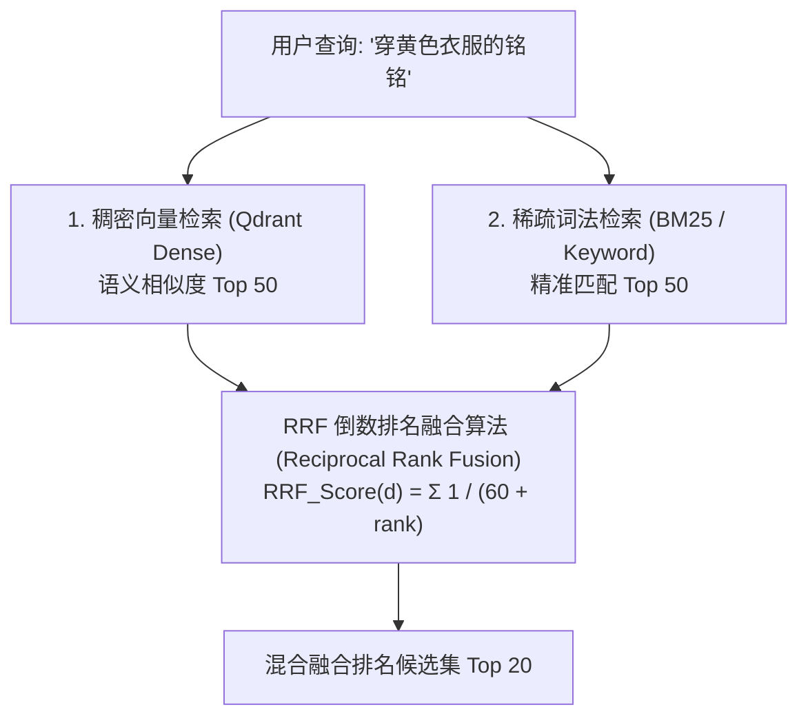
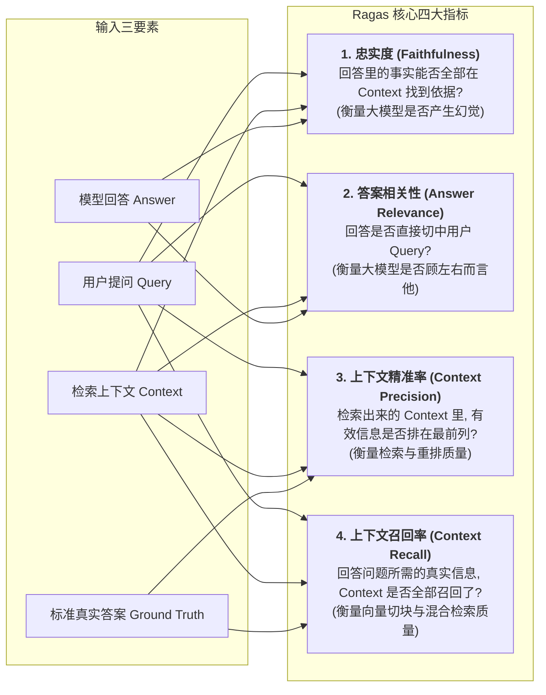

# 现代工业级 RAG 全生命周期体系：从 Naive RAG 到高级多路检索与评测

在企业级 AI 工程化落地中，**RAG（Retrieval-Augmented Generation，检索增强生成）** 是解决大语言模型“知识过期、私有领域知识盲区、大模型幻觉”的最核心底座。

然而，90% 刚刚接触 AI 的开发者搭建的都是 **Naive RAG（朴素 RAG）**：
> “把一堆 PDF/Markdown 读进来 ➔ 暴力按 500 字符切块 ➔ 调 OpenAI Embedding 存入向量库 ➔ 用户提问时直接取 Top-3 ➔ 拼进 Prompt 丢给大模型回答。”

这种玩具架构一推上线就会遭遇惨败：**“明明相册或知识库里有这张照片或这条规定，但模型硬是搜不到；搜到了相关内容，模型却把无关背景杂音误当答案，开始一本正经胡说八道。”**

本文将为你建立工业级的高可用 RAG 全生命周期技术全貌。

---

## 架构实战与核心技术归纳

- **核心设问与思考**：“为什么业界公认‘暴力切分 + 纯向量余弦检索’在生产中准确率通常不足 50%？有哪些工程范式能将召回精度提升至 90% 以上？”
- **深水区追问**：“什么是父子文档（Parent-Child）与句子窗口（Sentence Window）？混合检索中的 RRF 算法如何实现？如何用 Ragas 框架量化评估一套 RAG 系统的好坏？”

---

## 一、 Naive RAG 的三大死穴与工业级演进全景



---

## 二、 阶段 1：智能切分与摄入（Ingestion）

文本切块（Chunking）是 RAG 的地基。切分太碎，丢失上下文；切分太大，向量相似度被稀释。

### 1. 常见切块策略对比

| 切块策略 | 原理机制 | 优缺点 | 最佳适用场景 |
| :--- | :--- | :--- | :--- |
| **固定字符切块**<br>(Fixed-size) | 按字符数（如 500 字）加固定重叠（Overlap 50 字）粗暴切分 | 实现极简；但极易在句子正中间、公式表格处强行截断，破坏语义 | 仅限本地玩具 Demo |
| **递归字符切分**<br>(Recursive Split) | 优先在段落分隔符（`\n\n`）、单换行（`\n`）、句号（`。!?`）、空格依次尝试切分 | 尽量保持段落和句子的完整性，是目前最通用的基础切分方式 | 通用长文章、技术文档 |
| **语义切分**<br>(Semantic Chunking) | 计算连续两个句子之间的 Embedding 相似度，当相似度突变跌破阈值时触发切分点 | 纯根据语义边界断句；但计算开销大（每句话都要算 Embedding） | 逻辑严谨的合同法条、学术论文 |
| **父子文档 / 分层切块**<br>(Parent-Child / Hierarchical) | **大块（Parent Chunk）作为知识背景，小块（Child Chunk）作为检索索引** | **极高精度**：小块保证向量检索精准，命中后将所属的完整父块喂给 LLM | **生产级企业知识库标准推荐** |
| **句子窗口检索**<br>(Sentence Window) | 仅对单一句子建立向量索引；检索命中该句后，动态把其前后 $K$ 个句子一同送入上下文 | 向量表示极聚焦（没有长文本稀释），生成又有完整上下文上下文 | FAQ 问答、条例规章、相册描述 |

### 2. 生产级父子文档切分 Python 实战

```python
# parent_child_chunking.py
from llama_index.core.node_parser import HierarchicalNodeParser, get_leaf_nodes
from llama_index.core import Document

doc_text = """
第一章：家庭云相册架构规范
1.1 存储分级策略
家庭云相册对于冷热数据进行分级。最近3个月的照片属于热数据，存储在高速 NVMe SSD；超过一年的照片自动转入对象存储压缩归档。
1.2 多模态检索规范
所有上传的照片必须在后台经过轻量视觉模型提取 tags、colors 和 people 字段，写入本地 SQLite 索引或 Qdrant 向量仓。
"""

# 1. 配置层级切块解析器 (父节点 512 字符，子节点 128 字符)
node_parser = HierarchicalNodeParser.from_defaults(
    chunk_sizes=[512, 128]
)

doc = Document(text=doc_text, metadata={"category": "spec"})
nodes = node_parser.get_nodes_from_documents([doc])
leaf_nodes = get_leaf_nodes(nodes)

print(f"总节点数: {len(nodes)}, 叶子检索节点数: {len(leaf_nodes)}")
# 检索时：向量库仅对 leaf_nodes (128字符小片) 进行近邻检索
# 生成时：通过 node.parent_node 拿到 512 字符的完整章节父块喂给 LLM
```

---

## 三、 阶段 2：检索前优化（Pre-Retrieval）

用户输入的原始提问往往短小、口语化甚至有错别字（如“黄色衣服”、“怎么搞转账”），直接拿去算向量很容易与长篇技术文档产生语义鸿沟。

### 1. 查询重写与扩展（Multi-Query Expansion）
利用轻量 LLM 将一个问题扩展出 3 个维度的变体，并行检索后合并结果：
```python
# 原始提问: "穿黄色衣服的"
# 扩展提问:
# 1. "穿黄色羽绒服或外套的人物照片"
# 2. "身着亮黄色服装的小孩"
# 3. "yellow clothing or yellow jacket"
```

### 2. 假设性文档嵌入（HyDE - Hypothetical Document Embeddings）
- **核心思想**：大模型“即使在不知道答案的情况下，编一个符合语法规范的假答案，其高维向量特征也远远比原始短问题更接近真实文档”。
- **流程**：
  1. 用户提问 ➔ Prompt：“请先假设性回答该问题：如何处理分布式事务？”
  2. LLM 生成一段虚构但专业的假设答案（Hypothetical Document）。
  3. **将这段假设答案转化成向量**，去向量数据库里检索真实的匹配文档！
  4. 实验证明：HyDE 能大幅消灭短查询与长正文之间的语义距离偏差。

---

## 四、 阶段 3：混合检索（Hybrid Search）与 RRF 融合

单纯靠语义向量检索（Dense Retrieval）有一个致命硬伤：**对专有名词、手机型号、人名、错误码极度迟钝**（例如：在相册中搜 `IMG_20261110_001`，或者在系统排错中搜 `Error 64-Join limit`，向量检索往往会召回一堆无关的“系统错误”文章，反而把精确包含该错误码的文章排在后面）。

因此，现代工业级 RAG 必须采用**混合检索（Hybrid Search）**：
- **稠密向量检索（Dense Vector）**：基于 Embedding 捕捉概念语义（“海边” $\approx$ “沙滩”）。
- **稀疏关键词检索（Sparse / BM25）**：精确捕获专有名词、人名、特定颜色与唯一标识。



### RRF 算法核心公式与 Python 原生实现

对于任何文档 $d$，其综合得分通过在不同检索通道里的名次（Rank）倒数累加计算：
$$RRF\_Score(d \in D) = \sum_{m \in M} \frac{1}{k + r_m(d)}$$
其中常数 $k$ 工业上通常取值 60，用于防止排名前列的文档得分过于畸高：

```python
# rrf_fusion.py
def reciprocal_rank_fusion(dense_results: list, sparse_results: list, k=60):
    scores = {}
    
    # 累加向量路排名
    for rank, doc_id in enumerate(dense_results):
        scores[doc_id] = scores.get(doc_id, 0.0) + 1.0 / (k + rank + 1)
        
    # 累加关键词路排名
    for rank, doc_id in enumerate(sparse_results):
        scores[doc_id] = scores.get(doc_id, 0.0) + 1.0 / (k + rank + 1)
        
    # 按综合得分从高到低排序
    sorted_docs = sorted(scores.items(), key=lambda x: x[1], reverse=True)
    return sorted_docs
```

---

## 五、 阶段 4：检索后精排（Post-Retrieval）与安全门禁

混合检索出来的 Top 20 仍然包含噪音。如果全部喂给 LLM，会引发著名的 **Lost in the Middle（大模型往往只关注提示词开头和结尾，忽视中间信息）** 现象，且徒增 Token 成本。

### 1. Cross-Encoder 重排器（Rerank）
- **为什么需要 Rerank？**
  - **Bi-Encoder（向量检索）**：Query 和 Document 分别计算向量，最后算点积/余弦。速度极快（毫秒级），但牺牲了 Query 和 Document 词与词之间的深度交叉注意力。
  - **Cross-Encoder（重排模型，如 BGE-Reranker-Large、Cohere Rerank）**：将 `[CLS] + Query + [SEP] + Document` 一同送入 Transformer，进行全词对齐注意力计算，打分极其精准，但速度稍慢。
- **最佳实践**：**“Bi-Encoder 粗筛（Top 100 ➔ 20ms） + Cross-Encoder 精排（Top 20 ➔ Top 3 ➔ 50ms）”**。

### 2. 结合时光寻忆的“一票否决视觉门禁（Visual Gating）”
在家庭相册实战中，我们遭遇了“铭铭穿黄色衣服”却召回穿黑白衣服照片的 Bug。
在重排阶段，我们设计了硬规则**单票否决逻辑**：
> 当查询包含强排他属性（如目标色“黄色”）时，只要照片的视觉特征明确显示“穿了其他颜色且不含目标色”，不论其相册名匹配度多高，**重排得分直接归零，剥夺其进入 Top-$K$ 的资格**。

---

## 六、 阶段 5：生成防护与事实对齐（Guardrails）

在最终生成答案时，必须设立两道硬围栏：

1. **引用归因（Citation Grounding）**：
   在 System Prompt 中强制要求大模型标注证据来源：“请在每一句陈述后面附带证据标记 `[Doc#id]`，严禁引用列表中未提及的信息。”
2. **拒绝回答机制（Refusal Boundary）**：
   明确告知大模型：“如果检索到的资料无法得出明确结论，必须诚实回答‘根据现有资料无法确认’，绝不允许根据常识自行揣测。”

---

## 七、 RAG 工业级量化评测体系：Ragas 框架

你如何向领导或面试官证明“你优化后的 RAG 比原来更好”？绝不能靠拍脑袋或者测两道题，必须建立**自动化、可量化的基准评测体系（Ragas）**。



### 生产级评测调优对照表

| 指标打分低 | 暴露的核心缺陷 | 针对性调优策略 |
| :--- | :--- | :--- |
| **Faithfulness 极低 (< 0.7)** | 大模型在胡说八道，无视检索上下文 | • 降低 Temperature（降至 0）<br>• 加强 Prompt 约束（“只能根据上述材料，不可脑补”）<br>• 增加一票否决门禁过滤无关噪声 |
| **Context Recall 极低 (< 0.6)** | 底层没检索到正确材料 | • 优化切块（换用父子文档 / 句子窗口）<br>• 引入 BM25 + Dense 混合检索<br>• 引入 Query 改写与 HyDE 虚拟假设向量 |
| **Context Precision 极低 (< 0.6)** | 检索到了一堆无关垃圾，且排在前排 | • 引入 Cross-Encoder Rerank 重新打分<br>• 过滤相似度阈值（Cosine < 0.6 直接剔除） |
| **Answer Relevance 极低 (< 0.7)** | 模型答非所问、过度唠叨 | • 优化模型微调或调整 Few-Shot 示例<br>• 增加意图识别路由器，避免路由到错误分支 |
