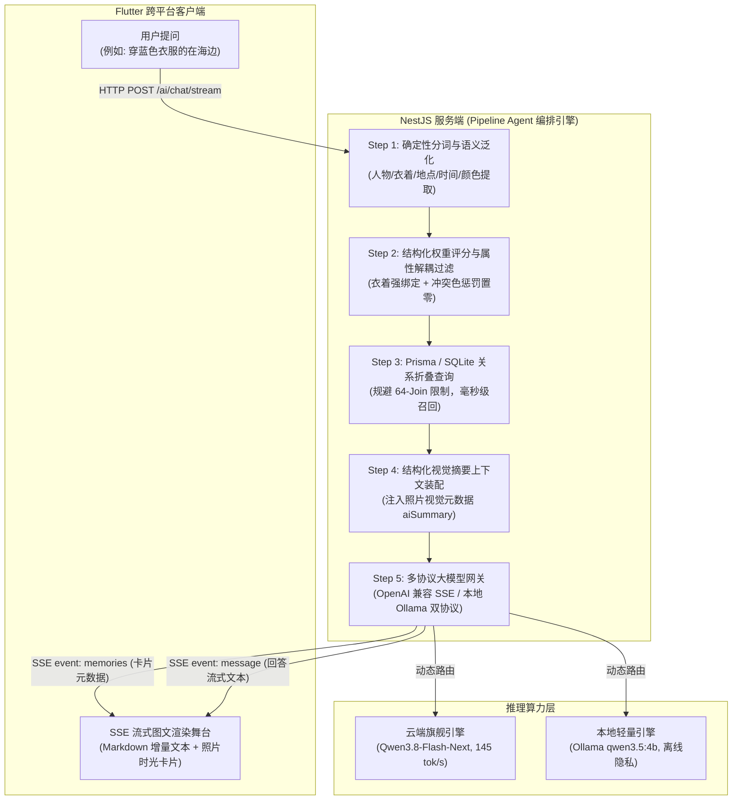
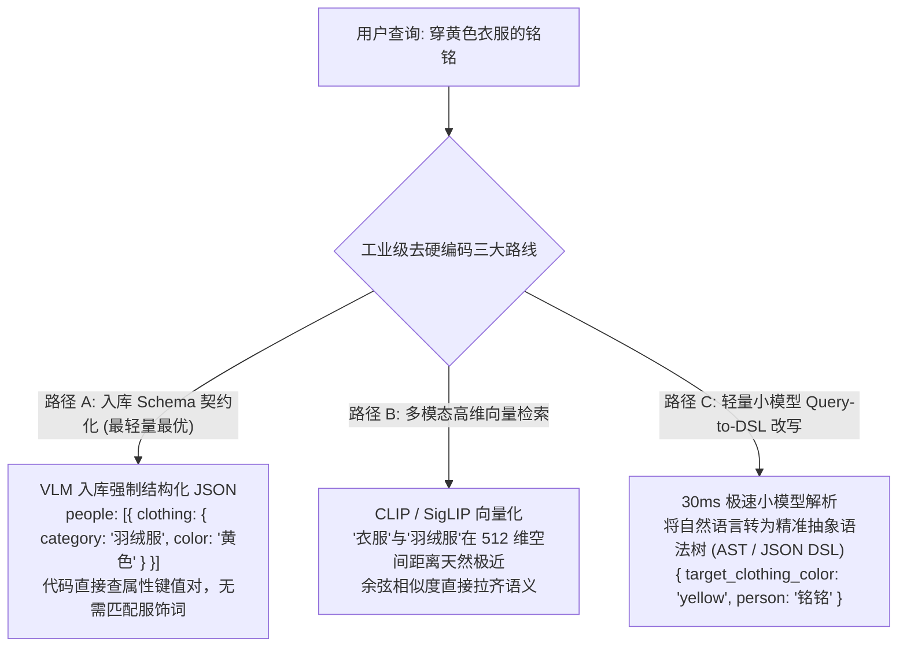
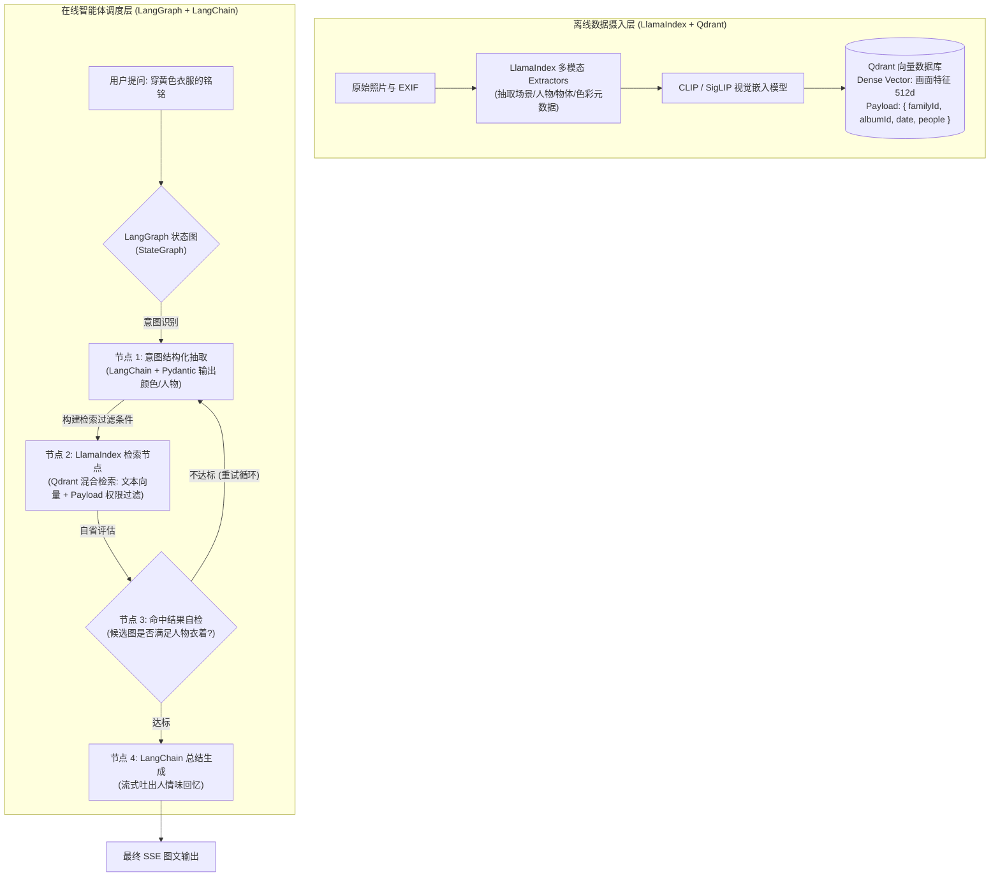

# 结构化工作流编排型 Agent 落地实战：家庭云相册「时光寻忆」

在消费级 AI 应用与垂直场景智能化落地的浪潮中，大模型常被神化为“万能思考器”。然而，在真实的移动端高频检索业务（如家庭智能相册、私有照片语义搜索、企业资产检索）中，盲目采用开放式自主决策 Agent（ReAct / Function Calling 循环）往往会导致**首字延迟极高（3~5s）、工具参数频繁幻觉、死循环失控以及隐私越权**等严重工程灾难。

本文以生产级项目 **“拾光家庭云（AI 时光寻忆）”** 为落地原型，深度剖析如何通过 **“结构化工作流编排（Deterministic Pipeline Workflow）”** 构建毫秒级响应、零幻觉、支持端到端图文混排的工业级 Agent。

---

## 架构实战与核心技术归纳

- **核心设问与思考**：“在低延迟（< 300ms 首字）与强隐私约束下，为什么结构化固定编排 Agent 远优于开放式 ReAct Agent？”
- **深水区追问**：“当用户输入‘穿蓝色衣服的’时，如何从工程层面杜绝‘玩具是蓝色但人穿黄色衣服’的视觉属性混淆？在 SQLite 数据库 64 表 Join 物理限制下，ORM（Prisma）如何优雅重构？如何实现云端高性能多模态网关与本地离线 Ollama 的动态零重启热切换？”

---

## 一、 系统架构：固定工作流编排 vs. 自主 ReAct Agent

在系统选型初期，团队必须对两种 Agent 模式的边界有清醒的认知：



### 两种 Agent 架构维度的全方位对比

| 评测维度 | 结构化固定编排型 Agent（本项目选型） | 开放式自主决策 Agent（ReAct / Auto-Agent） |
| :--- | :--- | :--- |
| **决策控制权** | **工程确定性代码**（TypeScript 流水线决定执行步骤） | **大模型概率决策**（LLM 自主决定何时调何工具） |
| **网络往返 (RTT)** | **单次往返（1 次 LLM 调用）**，首字延迟 100~200ms | **多轮往返（至少 2~4 次 LLM 调用）**，延迟 2~5s |
| **执行可预测性** | **100% 确定性**，无死循环、无未知分支 | **非确定性**，可能出现工具参数拼错、反复调用同工具 |
| **业务逻辑控制** | 细粒度控制特征权重（如衣着权重 50、背景权重 10） | 只能通过 Prompt 弱指导，无法强约束底层数据库算子 |
| **数据安全性** | 租户隔离、相册权限由 API 网关硬编码校验，杜绝越权 | LLM 生成 SQL 或过滤参数，容易造成跨租户数据越权 |
| **工程落地成本** | 代码逻辑清晰，单元测试与排查定位极快 | 需完善的 Agent 状态机、容错重试与断循环熔断机制 |

> **架构结论**：在家庭相册、电商搜索、金融查询等**高频、确定性强、注重低延迟与隐私**的垂直业务场景中，**结构化工作流编排型 Agent 是压倒性的工程最优解**。

---

## 二、 核心流水线设计与源码级剖析

本系统的核心由 `AlbumAiService` 统一编排，整个 Pipeline 包含五个正交阶段：

### 阶段 1：确定性分词与语义泛化（Token Expansion）

自然语言具有高度多样性（如“海边”与“沙滩”、“海滩”、“ocean”），但不能直接交给 LLM 做大语言模糊匹配，否则每次查询都要消耗高额 Token。
我们在工程层引入确定性词表泛化：

```typescript
private expandTokens(tokens: string[]): string[] {
  const groups = [
    ['海边', '海滩', '沙滩', 'beach', 'seaside', 'ocean', 'sea'],
    ['草地', '公园', '森林', 'park', 'grass', 'forest'],
    ['生日', '蛋糕', '聚会', 'birthday', 'party', 'cake'],
    ['蓝', '蓝色', '深蓝', '浅蓝', 'blue'],
    ['黄', '黄色', 'yellow'],
    ['红', '红色', 'red'],
  ];
  const set = new Set<string>(tokens);
  for (const token of tokens) {
    for (const group of groups) {
      if (group.some(w => w.includes(token) || token.includes(w))) {
        for (const item of group) set.add(item);
      }
    }
  }
  return Array.from(set);
}
```

### 阶段 2：视觉属性解耦与一票否决权（Visual Gating & Anti-Confusion Matrix）

#### 经典复合查询 Bug 场景回放
用户提问：“**穿黄色衣服的铭铭**”。
该 Query 同时包含了两个异构约束：
- **强视觉属性**：`穿黄色衣服`
- **相册/元数据归属**：`铭铭`

##### 踩坑根因分析：
1. **元数据稀释视觉强约束**：相册中所有照片都存放在名为「铭铭」的相册里。旧逻辑在多条件加权时，无论照片是否穿黄色，仅因命中相册名 `铭铭` 就直接拿到了 15~20 分的及格保底分，导致穿蓝色衣服或未被索引的照片统统蒙混过关挤入前排。
2. **大模型回复与卡片割裂**：LLM 本身非常聪明，基于 Prompt 上下文只精准解读了真正穿黄衣服的那两张照片，但由于后端 `search` 粗筛漏过了 7 张只靠相册名及格的无关照片，前端强行渲染了 9 张照片卡片，形成严重的图文违和。

#### 解决方案：视觉准入门槛（Visual Gate）与一票否决权
我们在工程层确立铁律：**当查询包含强视觉约束（服饰/颜色）时，视觉匹配是一票否决的前置硬门槛**。只有在视觉确认命中后，相册名与人物元数据才能作为“锦上添花”的加分项，绝不允许单靠相册名混入候选集：

```typescript
// 核心打分与一票否决逻辑 (album-ai.service.ts)
if (ctx.isClothingQuery && ctx.colorTerms.length > 0) {
  if (parsed) {
    // 1. 精准校验人物或物品是否穿戴目标颜色服饰
    const peopleDirectMatch = (parsed.peopleList || []).some(
      (p) => ctx.colorTerms.some((t) => p.includes(t)) && this.clothingTerms.some((c) => p.includes(c)),
    );
    const objectDirectMatch = (parsed.objectsList || []).some(
      (o) => ctx.colorTerms.some((t) => o.includes(t)) && this.clothingTerms.some((c) => o.includes(c)),
    );
    const peopleHasTargetColor = ctx.colorTerms.some((t) => parsed.people.includes(t));
    const peopleHasOtherColor = otherColors.some((t) => parsed.people.includes(t));

    // 冲突色惩罚：人物穿了其他颜色且不含目标色 -> 一票否决
    if (peopleHasOtherColor && !peopleHasTargetColor) {
      return { score: 0, hits: [] };
    }

    if (peopleDirectMatch) {
      score += 50;
    } else if (objectDirectMatch) {
      score += 35;
    } else if (peopleHasTargetColor) {
      score += 20;
    } else {
      // 人物与服饰完全不匹配目标颜色 -> 一票否决（绝不允许单靠相册名'铭铭'混入）
      return { score: 0, hits: [] };
    }
  } else {
    // 未进行 AI 索引或索引失败的照片：必须在标题/备注中明确包含目标颜色与服饰词才允许匹配
    const metaHasColor = ctx.colorTerms.some((t) => metaText.includes(t));
    const metaHasClothing = this.clothingTerms.some((c) => metaText.includes(c));
    if (!metaHasColor || !metaHasClothing) {
      return { score: 0, hits: [] }; // 坚决阻断未索引照片泄漏
    }
    score += 30;
  }

  // 视觉特征已确认命中后，再叠加相册名等元数据加分
  for (const token of ctx.rawTokens) {
    if (metaText.includes(token)) score += 10;
  }
  return { score, hits };
}
```

---

### 阶段 3：SQLite 64-Table Join 物理瓶颈攻坚

#### 故障现场
在多分词联合查询时，Prisma ORM 将嵌套的 `OR` 条件平铺生成了巨型 SQL：
```sql
SELECT ... FROM "Photo" 
LEFT JOIN "Album" ON ... 
LEFT JOIN "PhotoAiIndex" ON ... 
-- 重复 LEFT JOIN 超过 64 次
WHERE ...
```
在 SQLite 底层抛出致命异常：`SqliteError: at most 64 tables in a join`。

#### 根因与优化：关系折叠聚合（Relational Folding）
Prisma 在处理跨表外键过滤时，如果在顶层数组中展开 `{ album: { name: 'A' } }, { album: { name: 'B' } }`，底层查询构建器会为每个条件生成一个独立的别名 `LEFT JOIN`。
**优化方案**：在代码层将多条件折叠到**单个关系对象内部的 OR 数组**中，无论外面扩展了多少个分词，底层数据库始终仅维持 2 个稳定的物理 JOIN：

```typescript
// 优化前：生成 24 * 3 = 72 个物理 Join (崩盘)
const whereOr = tokens.flatMap(token => [
  { album: { name: { contains: token } } },
  { aiIndex: { is: { summary: { contains: token } } } }
]);

// 优化后：折叠聚合，严格将物理 Join 限制为 2 个 (稳定)
const where = {
  familyId,
  OR: [
    { album: { OR: tokens.map(t => ({ name: { contains: t } })) } },
    {
      aiIndex: {
        is: {
          status: 'READY',
          OR: tokens.flatMap(t => [
            { summary: { contains: t } },
            { tags: { contains: t } },
            { colors: { contains: t } }
          ])
        }
      }
    }
  ]
};
```

---

### 阶段 4：结构化元数据 Prompt 注入（防幻觉锚点）

许多大模型在结合检索结果对话时，会脑补不存在的照片。
我们通过在 System Prompt 中注入严格的**照片视觉摘要清单（Grounding Context）**，并设立强事实围栏：

```typescript
const photoDescriptions = memories.map((m, idx) => 
  `[照片#${idx + 1}] ID:${m.id} | 时间:${m.date} | 画面主体:${m.aiSummary || m.summary} | 人物与衣着:${m.peopleSummary || '无特定人物'}`
).join('\n');

const systemPrompt = `你是一个充满温情的家庭云相册智能助手。
当前根据用户的记忆检索，系统已从相册中精确召回了以下 ${memories.length} 张真实照片：
${photoDescriptions}

【回答严守铁律】：
1. 只能基于上方列出的真实照片进行回答与解读，严禁虚构或推测列表中不存在的照片！
2. 如果召回照片完全能印证用户所问，请先热情指出是哪几张照片（如照片#1、照片#2），并描绘当时温馨的画面细节。
3. 如果未检索到符合条件的照片，必须诚实告知用户，切勿捏造回忆。`;
```

---

### 阶段 5：多协议大模型网关与热切换设计

为了兼顾“极致推理速度（云端专有卡，145 tok/s）”与“私有化数据绝不出网（本地 Ollama）”，后端统一抽象了多协议适配网关：

```mermaid
classDiagram
    class OllamaAiService {
        +getActiveConfig(): ActiveAiConfig
        +setAiConfig(preset, custom): Promise
        +testConnection(preset): Promise
        +streamChat(messages, onChunk, signal): Promise
    }
    class OpenAICompatibleProtocol {
        +POST /v1/chat/completions
        +Parse SSE: data: {"choices":[{"delta":{"content":...}}]}
    }
    class OllamaNativeProtocol {
        +POST /api/chat
        +Parse NDJSON: {"message":{"content":...}}
    }
    OllamaAiService --> OpenAICompatibleProtocol : preset = 'cloud' | 'custom'
    OllamaAiService --> OllamaNativeProtocol : preset = 'local'
```

- **配置持久化**：使用 `data/ai-config.json` 结合环境变量 `.env`，修改模型无需重启进程，内存与磁盘同步热生效。
- **协议透明转换**：无论上游接入的是 `Qwen3.8-Flash-Next`（OpenAI 协议）还是 `qwen3.5:4b`（Ollama 协议），对 Controller 和业务编排层暴露统一的异步生成器/流式回调接口。

---

## 三、 SSE 双通道通信协议设计

在客户端与后端的流式交互中，前端不仅需要打字机一样的文本流，还需要结构化的**照片卡片数据**用于点击大图预览与时光轴联动。

我们设计了清晰解耦的双通道 SSE 规范：

```http
HTTP/1.1 200 OK
Content-Type: text/event-stream; charset=utf-8
Cache-Control: no-cache
Connection: keep-alive

event: memories
data: [{"id":"p_101","thumbnailUrl":"/media/thumb/101.jpg","day":"2024-06-01","summary":"宝宝在沙滩穿蓝色防晒衣吃西瓜"}]

event: message
data: {"content":"为您找到啦！"}

event: message
data: {"content":"在2024年六一儿童节那天，"}

event: message
data: {"content":"宝宝穿着蓝色的防晒衣在海边玩沙子，当时笑得特别开心。"}

event: done
data: {}
```

- **第一阶段（Event: `memories`）**：Pipeline 完成数据库打分检索后，在调用大模型之前，**以 0 延迟率先下发候选照片卡片**，前端骨架屏立刻渲染出照片流。
- **第二阶段（Event: `message`）**：大模型开始吐字，文本按 Token 流式打在照片下方，用户体验行云流水。

---

## 四、 面试高频问题深度复盘（回答模板）

### Q1：为什么你们不使用 LangChain / AutoGPT 这类现成 Agent 框架？
> **答题话术**：
> “框架只是工具，关键看业务边界。在消费级相册检索场景下，核心指标是**毫秒级首字延迟**与**极简无冗余依赖**。LangChain 这类重型框架底层封装了大量复杂的 Chain 抽象与动态解析逻辑，容易带来不透明的性能开销与调试黑盒。
> 我们选择**自研 Pipeline 编排**，整个链路从分词、加权检索到 Prompt 拼接仅几十行核心代码，冷启动零开销，首字延迟压到 200ms 以内，且更容易针对 SQLite 64-Join 这类数据库物理特性做极致针对性优化。”

### Q2：视觉搜索大模型存在属性错位（如颜色张冠李戴），如何解决？
> **答题话术**：
> “这是纯大模型检索最典型的痛点。大模型擅长意图理解，但不擅长细粒度事实过滤。我们采取的是**‘结构化先验特征 + 确定性加权过滤’**：
> 在图片离线入库索引时，通过视觉模型将图片结构化为 `people`（人物及对应衣着色系）、`objects` 和 `colors`（背景色）。在在线查询时，如果识别到用户在搜索人物特征（如‘穿蓝衣服’），我们优先匹配 `people` 字段赋予 50 分高权重；如果发现画面虽然含有蓝色但人物本身穿的是黄色等冲突颜色，直接在工程层执行**冲突色惩罚，打分置零踢出候选集**。用工程的确定性兜底模型的概率性。”

### Q3：面对离线私有化（数据不出门）与云端极致性能的需求，你们如何设计模型层？
> **答题话术**：
> “我们设计了一套**多协议模型自适应网关**。向上屏蔽协议差异，提供统一的流式调用契约；向下支持双协议驱动：
> 一路走 OpenAI 兼容规范，对接云端专有 GPU 加速集群（如 Qwen3.8-Flash-Next），提供 145 token/s 的极致推理与强大 Vision 能力；
> 另一路走本地 Ollama 原生协议，对接本机运行的轻量量化模型（如 qwen3.5:4b），满足断网离线与极致隐私诉求。
> 同时在应用层支持零重启的热切换配置与即时连通性测速，兼顾了极客用户的灵活性与普通用户的开箱即用。”

---

## 五、 深度技术反思：为什么代码中存在硬编码词表？如何优雅“去硬编码”？

在开发类似检索逻辑时，很多工程师会在代码中写下类似于 `clothingTerms`（服饰词表）、`colorGroups`（颜色同义词表）的静态数组。这引发了一个深刻的架构追问：**为什么现代 AI 架构下还需要硬编码词表？能不能彻底干掉它？**

### 1. 为什么初期会采用硬编码词表？（工程妥协的真相）
- **传统 SQL 引擎缺乏语义感知**：在 SQLite 等关系型数据库中，底层只有基于文本的物理字符检索（`LIKE '%...%'`）。当用户搜索泛化词“衣服”，而照片 AI 识别出的是具体特指词“羽绒服”时，SQL 引擎无法感知二者之间的上下位包含关系。
- **极致的性能与 0 Token 成本**：在内存中对一个 20 项的数组执行 `Array.includes()` 耗时仅 **0.001 毫秒**，且消耗 **0 Token**。在没有引入重量级向量数据库的 MVP 阶段，硬编码词表是用最低成本连接“自然语言”与“关系数据库”的权宜之计。

### 2. 硬编码词表的致命工程代价
- **打地鼠式维护（Whac-A-Mole）**：今天用户搜“穿黄衣服”，你写了 `clothingTerms`；明天搜“戴蓝帽子”，你要加 `hatTerms`；后天搜“背黑包包”，你得加 `bagTerms`……代码很快充斥着几十个维护成本极高的散装词表。
- **语义盲区与口语化失效**：面对网络流行语（如“黄马甲”、“冲锋衣”、“背带裤”）或方言，词表只要未覆盖就会发生严重漏召回。

### 3. 工业级演进路径：彻底告别硬编码的三大方案



- **路径 A：入库 Schema 强契约化（当前系统演进首选）**：
  在多模态模型提取图片元数据时，通过 Function Calling 或 JSON Schema 强制其输出固定契约：
  `people: [{ role: "child", clothing: { color: "黄色", type: "羽绒服" } }]`
  后端代码不再需要判断哪些词属于衣服，直接按 `clothing.color === '黄色'` 进行精准求值。
- **路径 B：多模态向量嵌入（CLIP Embedding + 向量数据库）**：
  图片与查询文本均投影到连续高维语义空间。“衣服”与“羽绒服”、“冲锋衣”在数学空间上天然聚类，通过近邻搜索（ANN）自动拉齐语义差距。
- **路径 C：前置小模型意图改写（Query-to-DSL）**：
  在检索前增加极速小模型通道（~30ms），将非结构化提问转化为结构化查询 DSL，解耦业务逻辑与词汇表。

---

## 六、 架构全景横评：自研轻量编排 vs. (LangChain + LangGraph + LlamaIndex + Qdrant) 全家桶

在面试中，面试官往往会追问：**“业界已经有非常成熟的 LangChain、LangGraph、LlamaIndex 和 Qdrant 组合，你们为什么还要自研编排？两套体系的优劣势和分工边界是什么？”**

### 1. 核心定位与技术底座对比矩阵

| 评测维度 | 本项目：**自研轻量确定性编排 (Custom Pipeline Agent)** | 工业级成熟技术栈：**(LangChain + LangGraph + LlamaIndex + Qdrant)** |
| :--- | :--- | :--- |
| **底层组成** | TypeScript + NestJS + Prisma + SQLite | **LangChain**（通用门面）+ **LangGraph**（图状态机）+ **LlamaIndex**（专业 RAG）+ **Qdrant**（Rust 向量库） |
| **架构心智模型** | **线性装配流水线 (Pipeline / DAG)**，代码显式掌控每一步 | **事件驱动 / 状态图 (DCG / StateGraph)**，支持循环思考、自省与多智能体分工 |
| **首字响应延迟 (TTFT)** | **极速：100 ~ 200 ms**（单次 LLM 往返，无中间黑盒解析） | **中等至高：1.5 ~ 4.0 s**（多节点状态同步、多次 Prompt 构造与链式回调开销） |
| **冷启动与依赖体量** | **零外部重型依赖**，打包镜像体积仅 ~150MB | **庞大生态依赖**，Python/Node 依赖包体大，需部署独立 Qdrant 容器服务 |
| **语义泛化能力** | **中等**（依赖入库结构化标签与词表泛化，对隐喻表述较弱） | **极高**（CLIP 高维向量空间，自动识别“灿烂阳光下奔跑”、“温馨午后”等抽象概念） |
| **复杂逻辑与断点恢复** | **较弱**（适合明确的单向流水线，难以支持复杂多轮反思循环） | **极强**（LangGraph 内置 Checkpointer，支持时间旅行、人工介入与断点续跑） |
| **调试与排障透明度** | **100% 透明**，打断点或加 Console 即可逐行排查打分原因 | **黑盒较重**，框架嵌套封装深，排查 Chain 中间层或 Prompt 模板漂移成本高 |

---

### 2. “全家桶”四大组件在相册场景下的真实角色剖析

如果将本项目全面重构成 `(LangChain + LangGraph + LlamaIndex + Qdrant)` 技术栈，四大组件的职责分工如下：



#### 各组件在相册业务中的权衡分析：
1. **Qdrant（真正带来质变的核心组件）**：
   - **价值极高**：利用其高维向量索引（HNSW）彻底干掉 `clothingTerms` 硬编码；同时利用 **Payload-based Filtering**，在查询向量相似度的毫秒级瞬间，硬性过滤 `familyId` 和 `albumId`，完美兼顾“语义模糊检索”与“严格租户权限隔离”。
2. **LlamaIndex（数据预处理与多路召回利器）**：
   - **价值较高**：原生提供出色的多模态 Document 抽象，能将照片 EXIF、地理位置、OCR 文字与视觉描述结构化拼接，构建层次化检索索引。
3. **LangChain（模型门面封装）**：
   - **价值中等**：在需要动态对接不同云厂商大模型（OpenAI, Claude, Qwen, 本地 Ollama）时提供统一调用抽象；但对于本项目已经自研了轻量双协议适配器的场景，引入它会增加依赖包体积。
4. **LangGraph（在简单检索场景下“杀鸡用牛刀”）**：
   - **需谨慎使用**：对于单次“搜索-展示-解读”的确定性相册检索，自研几十行 TypeScript Pipeline 无论在延迟还是可维护性上都碾压复杂的 Graph 状态机；只有在**需要多步骤复杂创作**（如“帮我挑选 10 张去年全家出游的照片，按时间顺序制作一篇家庭年刊故事，要求风格温馨且每张图配诗”）时，LangGraph 的循环自省与多 Agent 协作才能真正发挥威力。

---

### 3. 面试终极追问：何时选自研编排？何时选工业全家桶？

> **面试官提问**：“既然社区有 LangChain + LangGraph + LlamaIndex + Qdrant 这么成熟的生态，你为什么在简历的项目中选择自研工作流编排？如果重构你会怎么选？”
>
> **满分回答思路**：
> 1. **切入业务场景与核心指标**：
>    “技术选型必须服务于核心业务指标。在家庭云相册的**高频交互检索场景**中，用户对**首字延迟（< 200ms）**和**私有化轻量部署（家庭 NAS / 本地小主机，零外部重型依赖）**有着极致的要求。如果盲目引入全家桶，会导致服务冷启动极慢、内存占用大、且多层框架抽象会导致首字延迟劣化数倍。”
> 2. **指出自研编排的阶段性与掌控力**：
>    “我们选择自研 Pipeline 编排，核心代码仅数百行，不仅做到了极致的冷启动与毫秒级延迟，更让我们能针对 SQLite 64-Join 这类数据库底层物理限制、以及视觉颜色张冠李戴等垂直业务 Bug 实施**细粒度的一票否决权控制**，这是黑盒 Agent 框架难以优雅做到的。”
> 3. **展现系统演进与前瞻视野（体现技术深度）**：
>    “当然，这套自研架构在应对‘泛化语义理解’时存在需要维护词表的局限。我们规划的下一代演进路线是**‘分层吸收精华’**：
>    - **引入 Qdrant**：替换 SQLite 纯文本匹配，解决语义聚类与去硬编码问题，保留其强大的 Payload 权限硬过滤；
>    - **保持调度轻量**：在线实时链路继续维持自研的高性能极简 Pipeline；
>    - **引入 LangGraph 于离线批处理**：在离线端执行复杂的‘每周家庭回忆周报生成’、‘多相册故事线自动剪辑’等多 Agent 循环创作场景。做到**在线要快、离线要深**。”
