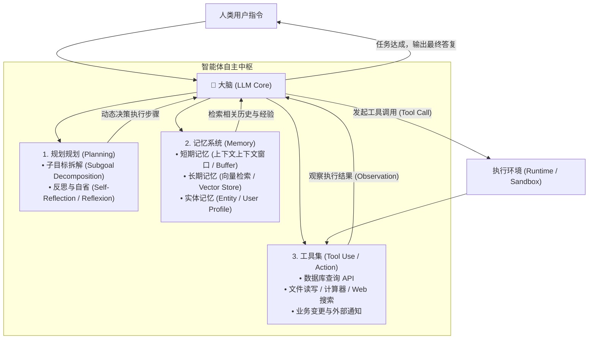
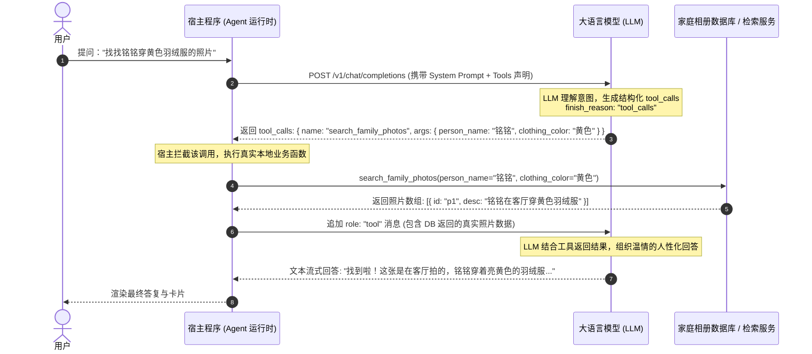
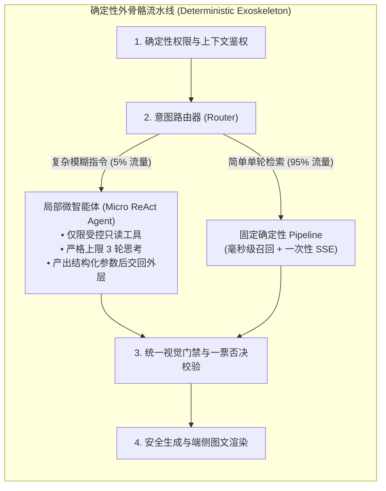

# 自主决策 Agent 体系：ReAct 循环、Tool Calling 原理与生产级选型思辨

在上一章 [结构化工作流编排型Agent：时光寻忆实战](/doc/AI/结构化工作流编排型Agent落地实战-家庭云相册时光寻忆) 中，我们通过一个高频 C 端家庭相册项目，演示了如何通过**确定性代码流水线**实现 200ms 极速响应与零幻觉。

但如果业务面对的是一个**开放式、多分支、步骤未知的复杂探索任务**（例如：“帮我分析最近一个月家庭相册中所有海边照片，挑选出 5 张最适合做家庭年鉴封面的照片，并根据构图写出 3 篇适合发小红书的配文，生成排版报告发送到我的邮箱”），单一写死的固定 Pipeline 就会瞬间失效。

此时，系统必须赋予大语言模型（LLM）“主动思考、自主拆解、动态调度工具、根据环境反馈修正计划”的自主性——这就是**自主决策智能体（Autonomous Agent）**的用武之地。

---

## 架构实战与核心技术归纳

- **核心设问与思考**：“大模型本身只是一个接收文本并预测下一个 Token 的概率模型，它究竟是如何‘自主’调用外部工具和数据库的？”
- **深水区追问**：“ReAct 循环中的 `Thought ➔ Action ➔ Observation` 是如何通过 Prompt 和 Function Calling 协议实现的？为什么大厂的生产级客服和相册系统往往抗拒纯 ReAct，而内部长任务 Agent（如数据分析、代码审计）却积极拥抱它？”

---

## 一、 自主 Agent 的四大核心构件（The Anatomy of an Agent）

根据业界公认的智能体架构标准（如 Lilian Weng 的 Agent 概念模型），一个完整的自主智能体由四大支柱构成：



### 1. 大脑与规划（Planning）
- **单步推理（Single-Step Reasoning）**：直接依据当前 Prompt 决定下一步动作。
- **任务分解（Task Decomposition）**：将复合需求分解为若干可独立解决的小任务（如 Plan-and-Solve 提示法、CoT 思维链）。
- **动态修正（Dynamic Re-planning）**：当某个工具调用失败或返回空数据时，大模型能感知到 `Observation: 检索为空`，并自主尝试换用备用关键词或备用工具。

### 2. 记忆系统（Memory）
- **短期工作记忆（Short-Term Working Memory）**：利用 LLM 的上下文窗口（Context Window）记录当前的 `Thought-Action-Observation` 历史轨迹。
- **长期语义记忆（Long-Term Semantic Memory）**：将跨会话的历史经验、用户习惯、偏好沉淀到向量数据库（如 Qdrant），在需要时通过 RAG 动态召回。
- **实体状态记忆（Entity Memory）**：专门记录结构化实体（如相册中的人名映射：`铭铭 -> 儿子, 生日 2024-05-10`）。

### 3. 工具使用（Tools Execution）
- 模型本身不具备执行能力，它输出的是**调用外部工具的结构化参数指令（JSON）**。
- 由外部宿主程序（如 Node.js / Python 运行时）捕获该指令，校验权限、执行真实物理操作（执行 SQL、发 HTTP 请求、操作文件），并将执行结果回灌给模型。

### 4. 反思与纠错（Reflection / Critique）
- 智能体通过专门的 Prompt 诱导自己审视上一轮的执行结果：“当前输出是否真正满足了用户的约束？”
- 若未满足，强制进入自我修正分支（Self-Correction），避免将错误答案直接交付用户。

---

## 二、 核心驱动引擎：ReAct 范式底层原理

ReAct 是 **Reasoning（推理）+ Acting（行动）** 的缩写（由 Yao et al., 2022 提出）。它是自主 Agent 最经典的认知交互循环。

### 1. 认知循环的三步心跳

```text
[用户输入] ➔ 
  ┌──> 1. Thought: 模型分析当前现状，思考下一步该做什么
  │    2. Action: 决定调用哪一个外部工具及入参
  │    3. Action Input: 具体的 JSON 参数
  │    [宿主环境执行工具]
  └─── 4. Observation: 工具返回的真实物理数据或错误信息
       (循环判断：任务是否已完成？若未完成，回到 1；若完成，输出 Final Answer)
```

### 2. 原生 Prompt 诱导机制（在没有原生 Function Calling 时的实现）

在 OpenAI 推出原生 Tool Calling API 之前，智能体完全是通过精心设计的系统提示词（System Prompt）让大模型按照固定语法输出的：

```text
Answer the following questions as best you can. You have access to the following tools:

search_album: 用于在家庭相册中检索照片，输入参数为关键词 query (string)
get_photo_detail: 获取指定照片的详细视觉特征与人物，参数为 photo_id (string)

Use the following format:

Question: the input question you must answer
Thought: you should always think about what to do
Action: the action to take, should be one of [search_album, get_photo_detail]
Action Input: the input to the action
Observation: the result of the action
... (this Thought/Action/Action Input/Observation can repeat N times)
Thought: I now know the final answer
Final Answer: the final answer to the original input question

Begin!
Question: 找一下铭铭穿黄衣服的照片
```

---

## 三、 现代原生工具调用：Function / Tool Calling 协议

现代大模型（GPT-4o、Claude 3.5、Qwen 2.5、DeepSeek-V3）均通过专门的微调（RLHF）支持了**原生 Tool Calling**。大模型直接输出结构化的 `tool_calls` 消息，完全摆脱了脆弱的字符串正则解析。

### 1. 工具声明规范（JSON Schema）

开发者向大模型发送请求时，附带 `tools` 字段，严格使用 JSON Schema 描述函数的名称、功能描述与参数类型：

```json
{
  "tools": [
    {
      "type": "function",
      "function": {
        "name": "search_family_photos",
        "description": "在家庭云相册中按人物、衣着颜色、场景检索相关照片",
        "parameters": {
          "type": "object",
          "properties": {
            "person_name": {
              "type": "string",
              "description": "相册中人物的名字，如 '铭铭'"
            },
            "clothing_color": {
              "type": "string",
              "description": "衣着的目标颜色，如 '黄色'、'蓝色'"
            },
            "scene": {
              "type": "string",
              "description": "照片所处场景，如 '公园'、'海边'"
            }
          },
          "required": ["person_name"]
        }
      }
    }
  ]
}
```

### 2. 底层通讯交互时序



---

## 四、 动手实战：徒手实现一个纯原生 TypeScript ReAct 智能体

为了彻底破除对复杂第三方库的黑盒敬畏，我们不依赖 LangChain 或任何重量级框架，使用纯 Node.js/TypeScript 手写一个**支持多轮自省、工具调用、熔断防死循环**的最小 ReAct 运行循环：

```typescript
// mini-react-agent.ts
import { OpenAI } from 'openai';

interface ToolDefinition {
  name: string;
  description: string;
  parameters: Record<string, any>;
  execute: (args: any) => Promise<any>;
}

export class MiniReActAgent {
  private openai: OpenAI;
  private tools: Map<string, ToolDefinition> = new Map();
  private maxLoops: number;

  constructor(apiKey: string, baseURL: string, maxLoops = 5) {
    this.openai = new OpenAI({ apiKey, baseURL });
    this.maxLoops = maxLoops;
  }

  // 1. 注册可用工具
  public registerTool(tool: ToolDefinition) {
    this.tools.set(tool.name, tool);
  }

  // 2. 核心自主运行循环
  public async run(userPrompt: string): Promise<string> {
    const messages: OpenAI.Chat.ChatCompletionMessageParam[] = [
      {
        role: 'system',
        content: `你是一个智能相册管家。充分利用提供的工具回答用户问题。
遇到需要外部数据时，积极调用工具。任务完成后直接给出最终温情回答。`,
      },
      { role: 'user', content: userPrompt },
    ];

    const toolsSchema = Array.from(this.tools.values()).map((t) => ({
      type: 'function' as const,
      function: {
        name: t.name,
        description: t.description,
        parameters: t.parameters,
      },
    }));

    let loopCount = 0;

    while (loopCount < this.maxLoops) {
      loopCount++;
      console.log(`\n🔄 [ReAct 循环 第 ${loopCount} 轮] 大模型正在思考...`);

      // 调用大模型
      const response = await this.openai.chat.completions.create({
        model: 'qwen3.8-flash-next',
        messages,
        tools: toolsSchema.length > 0 ? toolsSchema : undefined,
      });

      const choice = response.choices[0];
      const assistantMessage = choice.message;
      messages.push(assistantMessage);

      // 判定情况 A: 大模型直接完成了回答，不需要调工具
      if (!assistantMessage.tool_calls || assistantMessage.tool_calls.length === 0) {
        console.log(`✅ [ReAct 循环结束] 大模型已得出最终结论。`);
        return assistantMessage.content || '任务完成';
      }

      // 判定情况 B: 大模型发起了工具调用 (Action)
      for (const toolCall of assistantMessage.tool_calls) {
        const toolName = toolCall.function.name;
        const toolArgs = JSON.parse(toolCall.function.arguments);
        console.log(`🛠️ [Action 工具调用]: ${toolName}, 参数:`, toolArgs);

        const targetTool = this.tools.get(toolName);
        let observationResult: any;

        if (!targetTool) {
          observationResult = `错误: 未找到名为 ${toolName} 的工具`;
        } else {
          try {
            // 执行真实物理操作
            observationResult = await targetTool.execute(toolArgs);
          } catch (err: any) {
            observationResult = `工具执行异常: ${err.message}`;
          }
        }

        console.log(`👁️ [Observation 观察反馈]:`, observationResult);

        // 将观察结果回灌给大模型短期记忆
        messages.push({
          role: 'tool',
          tool_call_id: toolCall.id,
          content: JSON.stringify(observationResult),
        });
      }
    }

    throw new Error(`⚠️ ReAct 循环超出最大上限 (${this.maxLoops} 轮)，触发安全熔断！`);
  }
}

// ==================== 运行测试 ====================
async function main() {
  const agent = new MiniReActAgent('fake-key', 'http://192.168.167.110:8080/v1');

  // 模拟注册家庭相册检索工具
  agent.registerTool({
    name: 'queryPhotos',
    description: '按人物与颜色检索相册照片库',
    parameters: {
      type: 'object',
      properties: {
        name: { type: 'string', description: '人名' },
        color: { type: 'string', description: '衣服颜色' },
      },
      required: ['name', 'color'],
    },
    execute: async (args) => {
      // 模拟数据库返回
      if (args.name === '铭铭' && args.color.includes('黄')) {
        return [
          { id: '101', title: '小黄鸭', date: '2026-11-10', desc: '穿黄色连帽羽绒服，贴着小贴纸' },
          { id: '102', title: '穿大人鞋子', date: '2026-11-09', desc: '穿黄色棉衣，踩着大拖鞋' },
        ];
      }
      return [];
    },
  });

  const reply = await agent.run('找找铭铭穿黄色衣服的照片，挑一张最可爱的并夸夸他！');
  console.log('\n最终回复:\n', reply);
}
```

---

## 五、 为什么生产级“时光寻忆”没有采用纯 ReAct？

既然 ReAct 如此灵活强大，为什么在家庭相册的移动端检索场景中，我们坚决选择了**第一章中的确定性工作流（Pipeline）**？

| 核心痛点 | 自主 ReAct Agent 的致命表现 | 时光寻忆确定性 Pipeline 的应对 |
| :--- | :--- | :--- |
| **首字延迟 (TTFT)** | **极高（2500ms ~ 6000ms）**。<br>至少经历：思考 ➔ 调工具 ➔ 等待宿主返回 ➔ 再思考 ➔ 输出。在移动端上用户面对的是长达数秒的卡顿。 | **极低（150ms ~ 300ms）**。<br>后端 Node 代码在 20ms 内直接完成分词与 SQL 过滤，第一轮 LLM 请求直接以 SSE 吐出首字。 |
| **死循环与任务漂移** | 模型可能反复用不同的微调词查询相册 4~5 次（“铭铭黄衣”、“铭铭 yellow”、“孩子黄色”），消耗大量 Token 且无法收敛。 | **物理熔断**。一次确定性泛化（expandTokens）一次聚合查库，杜绝任何递归循环。 |
| **工具参数幻觉** | 大模型容易拼错参数名，或者编造出相册库里根本没有的人物字段。 | 强类型代码控制，Prisma 严格字段映射与类型检查。 |
| **Token 账单** | 每轮循环都要将历史所有 Tool Calls 和 Observation 全量重发，Token 消耗呈指数级膨胀。 | 严格单次交互，仅在上下文注入召回的 Top-$K$ 张照片摘要，Token 消耗确定可预测。 |
| **权限穿透风险** | 开放式 Agent 在动态拼接查询参数时，容易在多租户下发生 Prompt 注入，泄露其他家庭成员的私密相册。 | 业务代码在 Controller 层强校验 `session.familyId`，大模型完全没有越权操作底层的权限。 |

---

## 六、 架构升华：工作流外骨骼 + 局部微智能体（Hybrid Agent）

纯粹的工作流与纯粹的自主 Agent 并非水火不容。现代工业界的最高境界是**“外骨骼工作流（Outer Pipeline）+ 局部微决策智能体（Inner Micro-Agent）”**：



- **外骨骼（Deterministic Exoskeleton）**：负责租户鉴权、流量限流、重试重连、视觉门禁硬校验、SSE 长链接保活。这些关乎安全与稳定性的环节，**必须由确定性代码掌控**。
- **微智能体（Micro-Agent）**：当遇到用户输入歧义极大（例如“把我上个月给老人挑的衣服照片发给小姨”）时，外骨骼调用一个小型的局部 ReAct 循环，限定最多 2 轮调用，仅用于“消歧与参数提炼”，提炼完成后立即返回给外骨骼执行真实业务。
