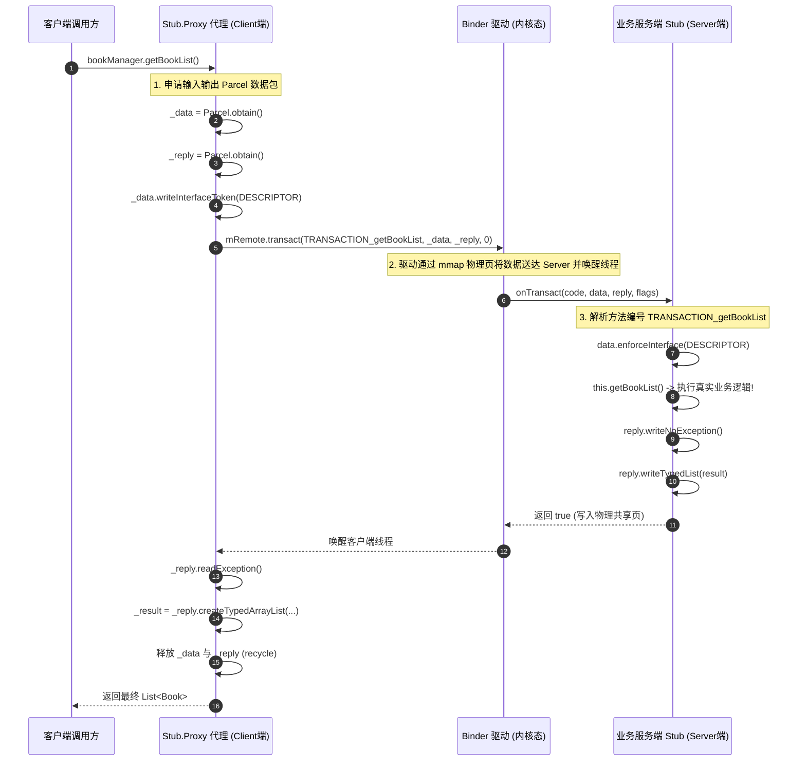

# AIDL底层编译架构与Stub-Proxy模型逐行剖析

AIDL（Android Interface Definition Language，Android 接口定义语言）是 Android 平台为了简化跨进程调用而设计的接口描述语言。开发者编写 `.aidl` 接口文件后，Android SDK 构建工具（`aidl` 编译器）会在 `build/generated` 目录下自动生成一份完整的 Java 接口类。深入理解其内部生成的 **`Stub` 与 `Proxy` 双层架构**，是透彻掌握 Android IPC 与四大组件通信的必经之路。

---

## 核心底层机制与全景架构

### 1. AIDL 生成类的整体类图拓扑

假设定义了一个跨进程计算接口 `IBookManager.aidl`：

```mermaid
classDiagram
    class IInterface {
        <<interface>>
        +asBinder() IBinder
    }
    class IBookManager {
        <<interface>>
        +getBookList() List~Book~
        +addBook(Book book) void
    }
    class Binder {
        +transact(...)
        #onTransact(...)
    }
    class Stub {
        <<abstract>>
        +asInterface(IBinder) IBookManager
        +onTransact(int, Parcel, Parcel, int) boolean
    }
    class Proxy {
        -mRemote: IBinder
        +getBookList() List~Book~
        +addBook(Book book) void
    }

    IInterface <|-- IBookManager
    IBookManager <|.. Stub
    Binder <|-- Stub
    IBookManager <|.. Proxy
    Stub +-- Proxy
```

- **`IBookManager`**：继承自 `IInterface`，对外声明业务方法的门面；
- **`Stub`（存根类）**：是 `IBookManager` 的静态抽象内部类，继承自 `android.os.Binder`，**运行在服务端进程**。负责接收底层驱动派发的请求并调度真实的业务逻辑；
- **`Stub.Proxy`（代理类）**：是 `Stub` 的私有内部类，同样实现了 `IBookManager` 接口，内部持有一个远程引用 `IBinder mRemote`，**运行在客户端进程**。负责将方法调用参数封装为 `Parcel` 并向驱动发起跨进程调用。

---

## 源码级架构逐行物理拆解

### 1. 客户端入口：`Stub.asInterface()` 的同进程与跨进程抉择

当客户端通过 `bindService` 拿到 `IBinder service` 时，必须调用 `Stub.asInterface(service)` 获取接口实例：

```java
public static IBookManager asInterface(android.os.IBinder obj) {
    if ((obj == null)) {
        return null;
    }
    // 1. 查询本地是否已经存在该接口实现 (针对同一个进程内的调用)
    android.os.IInterface iin = obj.queryLocalInterface(DESCRIPTOR);
    if (((iin != null) && (iin instanceof IBookManager))) {
        // 同进程: 直接强转为本地原始 Java 对象，绝不走跨进程与序列化开销！
        return ((IBookManager) iin);
    }
    // 2. 跨进程: 包装为 Proxy 代理对象返回
    return new IBookManager.Stub.Proxy(obj);
}
```

- **同进程判定**：如果 Client 和 Service 运行在**同一个进程**内，`queryLocalInterface` 会直接返回服务端的真实 `Stub` 实例，后续的方法调用是**原生的 JVM 栈帧调用**，零 IPC 损耗；
- **跨进程判定**：如果跨越了进程边界，驱动返回给 Client 的是一个 `BinderProxy` 对象，其 `queryLocalInterface` 返回 null，此时创建并返回 `Stub.Proxy` 代理对象。

---

### 2. 跨进程核心流转：Proxy 的 `transact` 与 Stub 的 `onTransact`

以 `getBookList()` 方法调用为例，展示全链路数据流转：



#### 关键源码细节：
- **`writeInterfaceToken(DESCRIPTOR)` 与 `enforceInterface`**：向数据包头部写入接口描述字符串，服务端接收后校验，防止客户端恶意向错误的 Service 发送非法指令；
- **方法编号常量 `TRANSACTION_xxx`**：AIDL 编译器为每个方法分配一个唯一的整型 Code（从 `FIRST_CALL_TRANSACTION = 1` 开始递增），服务端通过 `switch(code)` 高速分发，避免昂贵的字符串反射寻址。

---

### 3. 数据流向修饰符：`in`、`out`、`inout` 的底层物理差异

AIDL 参数支持定向修饰符，不同标记在底层有着完全不同的 `Parcel` 传输开销：

| 修饰符 | 数据流动方向 | 底层 Parcel 物理行为与传输开销 | 适用场景 |
| :--- | :--- | :--- | :--- |
| **`in`（默认）** | **Client $\rightarrow$ Server** | 客户端写入 `_data`，服务端从 `data` 读出；**服务端修改该对象，客户端完全无感知** | 最常见的纯入参传递 |
| **`out`** | **Server $\rightarrow$ Client** | 客户端**不向 `_data` 写入任何内容**（仅传递空壳）；服务端创建对象填充数据写入 `_reply`，客户端再从 `_reply` 读取覆盖本地对象 | 仅作为输出容器获取服务端数据 |
| **`inout`** | **双向流动** | 客户端先将数据完整写入 `_data`；服务端修改后又将全量数据完整写入 `_reply` 带回 | **开销最大（发生两次序列化与反序列化）**，慎用！ |

---

## 社招高频硬核连环追问

### Q1: 客户端调用 AIDL 接口是同步的还是异步的？在主线程调用安全吗？
- **考点**：Binder 线程模型与 ANR 防范。
- **解析**：
  - **默认是完全同步的（Synchronous）**。客户端发起 `mRemote.transact()` 后，客户端当前线程会**挂起阻塞（Sleep）**，直到服务端处理完毕返回 `_reply` 才会唤醒。
  - **严禁在客户端主线程（UI 线程）调用可能耗时的 AIDL 方法**。若服务端发生卡顿、查库或执行耗时计算，客户端主线程超过 5 秒将直接触发 **ANR（Application Not Responding）**。
  - **异步化方案**：
    1. 在子线程调用 AIDL 接口；
    2. 在 AIDL 中将方法声明为 `oneway`：`oneway void updateStatus(int code);`。被 `oneway` 修饰的方法为单向非阻塞调用，客户端写完 Binder 驱动后立即返回，不等待服务端执行结果。

### Q2: 跨进程抛出异常时，AIDL 是如何将异常从服务端传递给客户端的？
- **考点**：`Parcel.readException()` 机制。
- **解析**：
  - AIDL 内部约定：在 `_reply` 数据包的第一个整型位置存放异常代码（`Exception Code`）。
  - 若服务端发生异常，`onTransact` 不会写入正常返回值，而是调用 `reply.writeException(e)` 将异常类型码（如 `EX_SECURITY`, `EX_NULL_POINTER`, `EX_ILLEGAL_ARGUMENT`）及异常信息写入头部；
  - 客户端在读取结果前，首先执行 `_reply.readException()`。若发现头部异常码非 0，则直接在客户端本地线程重新抛出对应的 Java 异常，使得异常在客户端看起来如同本地调用抛出一样。

---

## 生产级避坑指南与安全防范 SOP

### 1. 服务端跨进程鉴权防御（防止未授权 App 盗调）

**安全漏洞**：将 Service 在 `AndroidManifest.xml` 中配置为 `android:exported="true"` 后，手机上任意第三方 App 均可绑定该服务并执行 AIDL 接口。

#### 生产标准防御 SOP：
1. **基于自定义 Permission 校验**：
   在服务端的 `onTransact` 方法（或具体业务方法）中，使用 `checkCallingPermission` 校验调用方包签名与权限：
   ```java
   @Override
   public boolean onTransact(int code, Parcel data, Parcel reply, int flags) throws RemoteException {
       // 1. 校验包权限
       int check = checkCallingOrSelfPermission("com.example.permission.ACCESS_BOOK_SERVICE");
       if (check == PackageManager.PERMISSION_DENIED) {
           return false; // 拒绝服务，客户端直接收到 SecurityException
       }
       
       // 2. 校验调用方包名 (防伪造)
       String[] packages = getPackageManager().getPackagesForUid(getCallingUid());
       if (packages != null && packages.length > 0) {
           if (!packages[0].equals("com.example.trusted.client")) {
               return false;
           }
       }
       return super.onTransact(code, data, reply, flags);
   }
   ```
