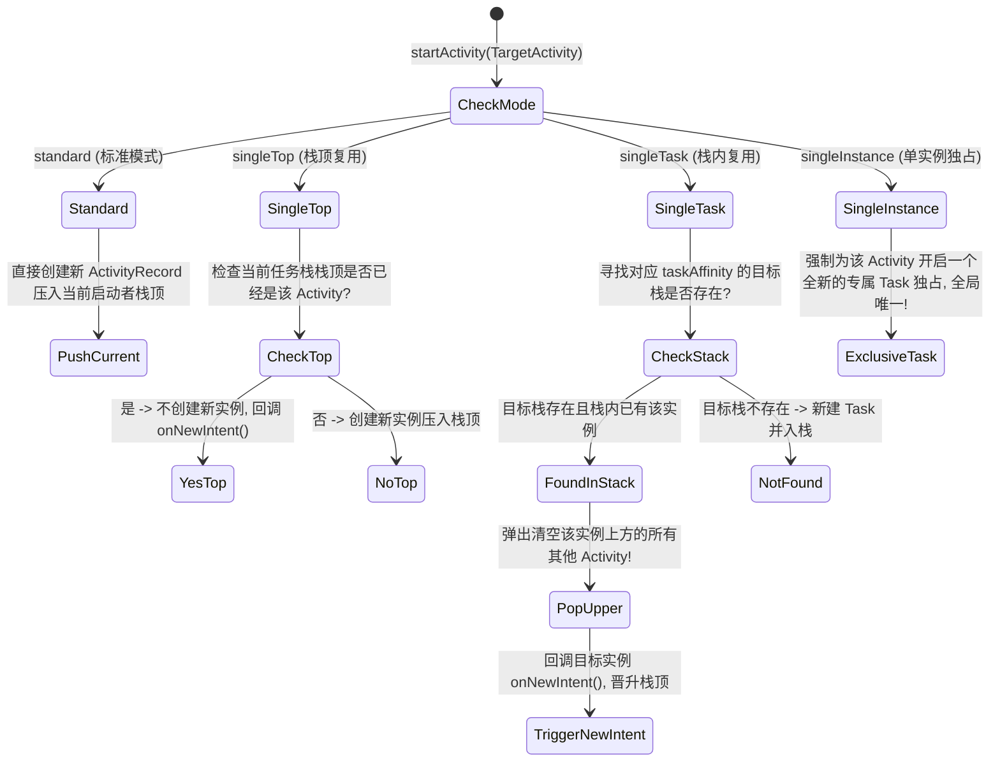

# AMS与ATMS任务栈管理与LaunchMode底层状态机

在 Android Framework 演进历程中，**ActivityManagerService（AMS）** 曾是系统最庞大的“上帝类”。自 Android 10（API 29）起，Google 实施了架构解耦，将原本杂糅在 AMS 中的 Activity 任务栈管理、生命周期状态机与窗口层级剥离，诞生了独立的 **ActivityTaskManagerService（ATMS）**。深入理解四大启动模式在 ATMS 内部任务栈数据结构中的流转推导，是构建大型 App 页面路由体系、规避状态错乱的核心功底。

---

## 核心底层机制与全景架构

### 1. ATMS 内部任务栈数据结构树状拓扑

在现代 Android 架构中，系统以树状分层结构组织管理多屏幕、多任务与 Activity 实例：

```mermaid
flowchart TD
    Root[RootWindowContainer: 根窗口容器] --> Display[DisplayContent: 物理/虚拟显示屏]
    Display --> Area[TaskDisplayArea: 任务显示区域]
    
    Area --> Task1[Task (原 ActivityStack) 1: 任务栈 A<br/>taskAffinity = com.example.app]
    Area --> Task2[Task 2: 独立任务栈 B<br/>taskAffinity = com.example.share]
    
    Task1 --> Record1[ActivityRecord: MainActivity<br/>栈底]
    Task1 --> Record2[ActivityRecord: GoodsDetailActivity<br/>栈顶]
    
    Task2 --> Record3[ActivityRecord: SingleInstanceActivity<br/>独占整个栈]
```

- **`ActivityRecord`**：对应客户端一个具体的 `Activity` 实例，记录其生命周期状态、启动模式与 Window Token；
- **`Task`（原 ActivityStack）**：承载一组具有亲和度（`taskAffinity`）的 ActivityRecord 列表，遵循后进先出（LIFO）的栈操作；
- **`TaskDisplayArea`**：管理多窗口分屏（Split Screen）与自由浮窗（Freeform）。

---

## 源码级架构物理拆解

### 1. 四大启动模式（LaunchMode）底层状态机推导

四大启动模式定义在 `AndroidManifest.xml` 中，决定了新 Activity 实例化时如何在 `Task` 中分配席位：



---

### 2. 核心 Intent Flag 与静态配置的交织判定

除了静态配置，客户端在调用 `startActivity()` 时常常通过 `Intent.addFlags()` 动态覆盖启动行为：

| 动态 Flag 标识 | 物理底层行为与经典搭配 | 常见踩坑点 |
| :--- | :--- | :--- |
| **`FLAG_ACTIVITY_NEW_TASK`** | 如果目标 Activity 没有显式指定 `taskAffinity`，且启动方是普通 Activity，**它依然运行在原 Task 中，不会新建栈！** 只有 `taskAffinity` 与当前栈不同，或者从非 Activity 环境（Service/Application Context）启动时，才会新建 Task。 | 非 Activity Context（如 Application）启动 Activity **必须强制加此 Flag**，否则崩溃抛出 `AndroidRuntimeException`。 |
| **`FLAG_ACTIVITY_CLEAR_TOP`** | 如果目标 Activity 在栈中已存在，则关闭其上方的所有 Activity。 | **配合 standard 模式的大坑**：若目标是 standard 模式且未加 `FLAG_ACTIVITY_SINGLE_TOP`，系统会**将目标自身也一并销毁并重新创建新实例**！若想复用必须配合使用。 |
| **`FLAG_ACTIVITY_SINGLE_TOP`** | 等价于在清单中静态配置 `singleTop`。 | 仅在目标正好处于栈顶时起效。 |

---

## 社招高频硬核连环追问

### Q1: 为什么从 ApplicationContext 或 Service 启动 Activity 必须加 `FLAG_ACTIVITY_NEW_TASK`？
- **考点**：Activity 栈亲和性与无任务栈 Context。
- **解析**：
  - `Activity` 本身也是一个 `Context`，它内部持有一个与其绑定的真实 `Task`（`ActivityRecord.getTask()`）；因此从一个 Activity 启动另一个 Activity 时，系统默认将其压入当前这个已有的任务栈中。
  - **`Application` 与 `Service` 是进程级组件，物理上没有依附任何任务栈（Task）！**
  - 如果从 Application 启动一个没有声明新建栈的 Activity，系统根本找不到“当前栈”安放该 ActivityRecord，因此在 `Instrumentation.checkStartActivityResult()` 校验中直接抛出：
    `Calling startActivity() from outside of an Activity context requires the FLAG_ACTIVITY_NEW_TASK flag.`

### Q2: 什么是 Task Hijacking（任务栈劫持漏洞）？如何防御？
- **考点**：`taskAffinity` 安全隔离与跨应用任务劫持。
- **解析**：
  - **攻击原理**：恶意 App 在其自己的 `AndroidManifest.xml` 中将某个窃密 Activity 的 `android:taskAffinity` 恶意设置为知名银行/社交 App 的包名，并配置为 `singleTask`。
  - 当用户在手机桌面点击受害者 App 图标时，Launcher 发起启动，系统检查发现已有同名亲和度的任务栈存在，于是直接将恶意 App 伪造的钓鱼登录界面顶到前台，诱骗用户输入密码！
  - **大厂防御规约**：
    1. 核心敏感 Activity（如登录页、支付页）显式声明全局独占属性 `android:taskAffinity=""`（清空亲和度，拒绝被任何其他栈挂载）；
    2. 配合 `android:exported="false"`，杜绝被外部三方应用以任何形式隐式调用。

---

## 生产级避坑指南与排障 SOP

### 1. 深度排查线上任务栈错乱（使用 dumpsys activity）

**现象**：用户点击返回键（Back）没有回到首页，或者 Activity 发生了多次重复创建、通知栏点击跳转页面丢失。

#### 排障执行命令：
```bash
adb shell dumpsys activity activities | grep -E "Stack|Task|Running"
```
#### 核心分析三要素：
1. **查看 Task id 列表**：确认当前有几个活跃栈；
2. **确认目标 Activity 的 `affinity` 与 `intent-flags`**：排查是否存在因隐式 Flag 导致脱离主任务栈的孤儿 Activity；
3. **检查 `Hist #x` 栈内倒序列表**：清晰查看从栈底到栈顶每个 ActivityRecord 的驻留顺序，准确定位多余实例插入的切入点。
