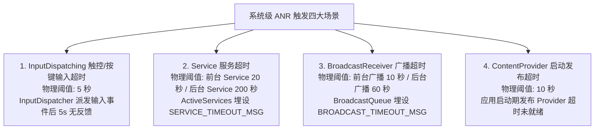
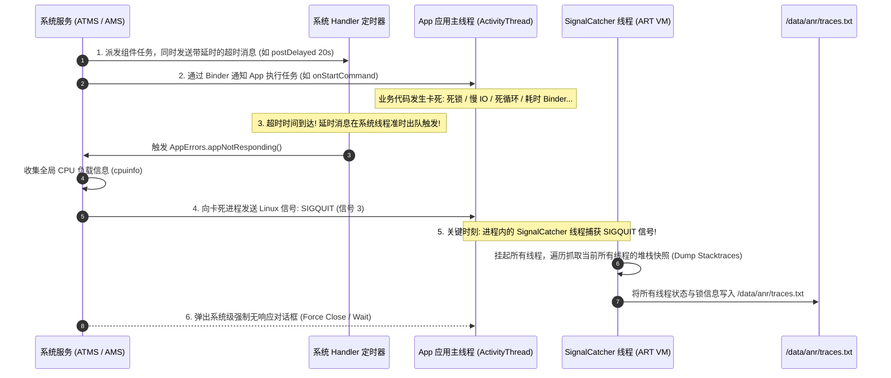

# ANR触发四大场景底层超时机制与traces物理排障SOP

**ANR（Application Not Responding，应用无响应）** 是 Android 平台上最严重、最具杀伤力的系统级故障。一旦发生 ANR，不仅意味着当前业务完全中断，系统还会直接弹出醒目的系统级弹窗阻断用户交互，甚至直接被用户或系统看门狗杀死，是各大应用商店（Google Play / 应用宝）衡量应用质量并实行降权推荐的核心红线指标。本文深入解构 **四大 ANR 触发场景在系统服务中的超时定时器实现**，并给出工业级 **`/data/anr/traces.txt` 日志物理逆向排查 SOP**。

---

## 核心底层机制与全景架构

### 1. 四大核心 ANR 场景与物理超时阈值矩阵

系统在调度不同组件时，均会在底层埋设一个倒计时定时器（`Handler.sendMessageDelayed`）。若在规定时间内应用层未能回传“执行完毕”的确认信号，系统直接引爆 ANR：



---

## 源码级架构物理拆解

### 1. ANR 发生的系统级物理调度时序



---

### 2. `traces.txt` 文件物理分析三部曲

当线上上报一份数兆大小的 `traces.txt` 时，工程师必须直奔核心关键信息：

#### 第一步：定位进程头部与主线程状态
搜索关键词 `"main" prio=5 tid=1`：
```text
----- pid 12345 at 2026-11-16 10:00:00 -----
Cmd line: com.example.app
"main" prio=5 tid=1 Native  <-- 关注当前线程物理状态!
  | group="main" sCount=1 dsCount=0 flags=1 obj=0x73a5a1b0 self=0x7c98814c00
  | sysTid=12345 nice=-10 cgrp=default sched=0/0 handle=0x7d206034f8
  | state=D schedstat=( 1234567 89012 345 ) utm=10 stm=5 core=2 HZ=100
  ... 堆栈详情 ...
```

#### 第二步：四种线程状态的根因物理推导：
- **`state = BLOCKED (on object monitor)`**：
  - **直接根因**：**主线程发生死锁或死等互斥锁**！堆栈中必然会出现：
    `waiting to lock <0x0a1b2c3d> (a java.lang.Object) held by thread 12`；
  - 顺藤摸瓜去搜索 `tid=12`，即可定位是哪个后台线程拿走了锁未释放。
- **`state = WAITING / TIMED_WAITING`**：
  - 主线程调用了 `Thread.sleep()`、`Object.wait()` 或 `CountDownLatch.await()` 等待异步结果，主线程被主动挂起超时。
- **`state = NATIVE`**：
  - 主线程正停留在底层的 Native 系统调用中；
  - 常见于：**同步网络请求、慢文件 I/O、或者正在执行 `android.os.BinderProxy.transact` 跨进程调用**系统服务卡死。
- **`state = RUNNABLE`**：
  - 主线程处于计算就绪状态；
  - 常见于：**代码中写了死循环、复杂的算法遍历、或者是超深层 View 树的无限重复测量**。

#### 第三步：结合 CPU 负载（CPU Usage）综合定性：
在日志头部查看 CPU 统计：
```text
CPU usage from 5000ms to 0ms ago:
  98% TOTAL: 85% user + 10% kernel + 3% iowait
```
- **若 CPU Usage 接近 100%（且主要是该 App）**：说明主线程陷入了死循环或超高频计算；
- **若 `iowait` 比例极高（如 60%+）**：说明系统物理磁盘 I/O 拥塞打满；
- **若 CPU 使用率极低（如 2%~5%）**：说明主线程处于**死锁或同步等待挂起**状态。

---

## 社招高频硬核连环追问

### Q1: 为什么有时候发生了 ANR，但 `traces.txt` 中的主线程堆栈打印的却是一行看似完全无害的代码（如 `view.setText()`）？
- **考点**：ANR 超时的累积效应与“替罪羊”假象。
- **解析**：
  - **ANR 的本质是“累积超时”**；
  - 假设一个 Service 限制 20 秒超时。在 `onCreate()` 中，前面的业务逻辑依次执行了：网络请求（12秒）+ 慢 SQL（7秒），此时已经耗费了整整 19 秒；
  - 紧接着执行到最后一行 `textView.setText("Done")` 时，耗费了 2 毫秒，**恰好在这个瞬间 20 秒倒计时炸弹引爆！**
  - 系统抓取的瞬间快照恰好落在了 `setText` 上；
  - **排查秘诀**：绝不能只盯住快照堆栈上的最后一行，必须排查该消息从进入队列到引爆这 20 秒期间执行的所有上游逻辑！

### Q2: 什么是 Silent ANR（静默 ANR）？
- **考点**：后台进程的 ANR 降级机制。
- **解析**：
  - 当一个应用处于**纯后台状态（对用户完全不可见，没有前台服务）**时发生 Service 或 Receiver 超时；
  - 系统为了保障正在前台使用的用户的良好体验，**绝对不会弹出烦人的“应用无响应”弹窗打断前台操作**；
  - 系统会在后台默默生成 traces 日志，并**静默将该后台进程直接杀死（Kill Process）**；
  - 很多开发者在线下完全看不到弹窗，误以为没有 ANR，实际线上后台崩溃率早已被严重污染。

---

## 生产级避坑指南与排障 SOP

### 1. 利用 Watchdog 原理构建自研主线程卡死监控

当系统还没触发 5 秒 ANR 之前，应用层可在 2~3 秒时提前进行自救预警：

```java
public class AppWatchdog extends Thread {
    private final Handler mainHandler = new Handler(Looper.getMainLooper());
    private volatile boolean isTick = false;

    private final Runnable ticker = () -> isTick = true;

    @Override
    public void run() {
        while (!isInterrupted()) {
            isTick = false;
            // 向主线程投递心跳标记
            mainHandler.post(ticker);
            try {
                // 等待 2 秒
                Thread.sleep(2000);
            } catch (InterruptedException e) {
                break;
            }

            // 2 秒后检查主线程是否完成了心跳重置
            if (!isTick) {
                // 警报！主线程已经卡顿超过 2 秒，立即抓取当前全线程堆栈预警！
                Map<Thread, StackTraceElement[]> traces = Thread.getAllStackTraces();
                reportPreAnrLag(traces);
            }
        }
    }
}
```
通过该自研哨兵机制，可在 2 秒敏感期内将潜在卡死精准拦截在摇篮之中。
