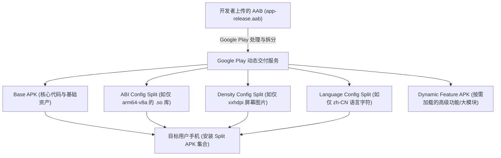

# Android APK打包安装与签名

`APK`、签名、安装流程、AAB、混淆压缩，是 Android 面试里“工程化”方向的常见题，尤其适合区分是否真正做过发布和上线。

## 1. APK 是什么？

- APK 本质上是一个 zip 格式的安装包。
- 里面通常包含：
  - `classes.dex`
  - `AndroidManifest.xml`
  - `res/`
  - `assets/`
  - `lib/`
  - `META-INF/`

## 2. 打包流程大致经历什么？

典型流程：

1. 编译源码和资源。
2. 资源打包，生成 R 文件及资源索引。
3. Java/Kotlin 字节码转成 DEX。
4. 进行混淆、压缩、优化。
5. 把资源、DEX、so 等文件打进 APK。
6. 对 APK 做签名。
7. 对齐优化后输出安装包。

## 3. DEX 是什么？

- Android 运行时不直接执行 `.class`，而是执行 `.dex`。
- DEX 是 Dalvik/ART 运行时使用的字节码格式。
- 方法数过多会触发 64K 问题，这就引出 MultiDex。

## 4. APK 为什么必须签名？

- 用于保证安装包来源可信和内容完整。
- 系统通过签名判断升级包是否和旧版本属于同一开发者。
- 签名不一致就无法覆盖安装。

## 5. debug 签名和 release 签名的区别

- debug 签名通常由开发环境自动生成，只用于开发测试。
- release 签名用于正式发布，必须妥善保管。
- 一旦正式签名丢失，后续升级会非常麻烦。

## 6. v1、v2、v3 签名有什么区别？

- `v1` 基于 Jar 签名，兼容老系统。
- `v2` 直接对整个 APK 内容块签名，校验更快、更安全。
- `v3` 在 v2 基础上增加更多版本级能力。
- 现代项目一般至少开启 `v2`，通常会同时兼容多种签名方案。

## 7. 安装流程大致发生了什么？

1. 用户触发安装。
2. 系统校验 APK 合法性和签名。
3. 解析 `AndroidManifest.xml`。
4. 安装到指定目录，提取 so、编译优化 DEX。
5. 在 PMS 中完成包信息注册。
6. 安装完成后桌面出现图标。

## 8. Android App Bundle (AAB / Bundle 包) 深度原理

### 8.1 什么是 AAB？
- **AAB（Android App Bundle，扩展名为 `.aab`）** 是 Google 推出并强制在 Google Play 上发布的**现代分发格式**。
- 它**不是**设备可直接安装执行的格式（Android 手机上运行的永远是 APK），而是一种**包含应用所有编译代码和资源归档的发布包**。
- 由 Google Play 或分发服务器根据每个终端设备的具体硬件特征，动态生成并下发最匹配该设备的精简组合包。

### 8.2 AAB 核心底层原理：动态交付（Dynamic Delivery）与 Split APKs

在 Android 5.0（Lollipop，API 21）中，系统底层引入了 **Split APKs（分包机制）**，使得一个应用可以由多个互相关联的 APK 组成并共享同一个包名、进程与上下文：

1. **Base APK（基础包）**：
   - 包含所有用户都会运行的核心代码（DEX）、AndroidManifest.xml 与基础公共资源。
2. **Configuration Split APKs（配置分包）**：
   - **架构 ABI 分包**：只下发当前设备所需的 CPU 架构（如 `arm64-v8a`），不再将 `armeabi-v7a`、`x86`、`x86_64` 等臃肿的 `.so` 动态链接库全部打包给用户。
   - **屏幕密度（Screen Density）分包**：只下载目标设备需要的图片资源（如 `xxhdpi`），不下载 `hdpi`、`xhdpi`、`xxxhdpi` 等冗余图片。
   - **语言分包（Language）**：只下发用户系统当前设置的语言包（如中文），省去几十种甚至上百种国际化语言资源。
3. **Feature Split APKs（动态功能模块 / Dynamic Feature Modules）**：
   - 开发者可将非核心功能（如大额退款复杂流程、AR 体验、专业视频滤镜）剥离为独立模块。
   - 支持**按需下载（On-demand）**、**条件下载（如仅带陀螺仪的手机才下发）**或**安装时延后静默下载**。

### 8.3 Google Play 签名托管（Play App Signing）原理
传统 APK 模式下，开发者直接将私钥签名的 APK 交付给用户，一旦签名私钥泄露，应用身份全部沦陷；若私钥丢失，则应用永远无法升级。

在 AAB 模式下，采用**双密钥体系**：
- **Upload Key（上传密钥）**：开发者保留，仅用于将 `.aab` 上传至 Google Play 控制台。
- **App Signing Key（应用签名私钥）**：由 Google 严格存储在与 Google 核心基础设施同等安全级别的密钥管理服务（KMS）中。Google Play 接收到 AAB 后，拆分出 Split APK，并用该 App Signing Key 为每个 Split APK 完成最终签名。
- **好处**：即使开发者的上传证书遗失或电脑损坏，也可以向 Google 申请重置 Upload Key，不会影响线上老用户的平滑升级覆盖。

### 8.4 AAB 与传统 Fat APK 对比

| 对比维度 | 传统单体 APK（Fat APK） | Android App Bundle（AAB） |
| :--- | :--- | :--- |
| **文件格式** | `.apk`（可直接通过 `adb install` 安装） | `.aab`（不可直接安装，需转成 Split APKs） |
| **设备下发产物** | 所有机型下载完全相同的完整包 | 针对机型硬件按需组装拆分包组合 |
| **ABI so库冗余** | 包含全部 ABI（armeabi-v7a, arm64-v8a 等） | **只下发匹配当前硬件的那 1 套 so 库** |
| **分辨率资源冗余**| 包含 mdpi 到 xxxhdpi 所有图集 | **只下发匹配当前手机屏幕密度的资源** |
| **平均体积节约** | 0%（全量膨胀） | **平均减少 15% ~ 35%+ 的下载体积** |
| **生态兼容性** | 国内所有应用市场通用 | Google Play 官方强制；国内市场通常以传统 APK 为主 |

## 9. 混淆、压缩、瘦身为什么重要？

- 减少 APK 体积。
- 增加逆向成本。
- 降低下载耗时和安装成本。

常见手段：

- R8 / ProGuard
- 资源压缩
- 无用资源清理
- ABI 拆分

## 10. 常见面试题

### Q1: APK 和 AAB 的区别是什么？
A: APK 是最终安装包，AAB 是发布包。AAB 主要用于让应用商店按设备维度做更细粒度分发。

### Q2: 为什么签名不一致会导致安装失败？
A: 因为系统用签名来确认升级包是不是同一个开发者发布的，签名不一致就会被视为不同应用身份。

### Q3: 方法数超过 64K 怎么办？
A: 常见做法是开启 MultiDex，并进一步优化依赖和无用代码，避免 DEX 膨胀失控。

### Q4: 为什么正式签名很重要？
A: 因为它关系到后续版本升级能力、渠道发版和安全信任链，一旦丢失会直接影响线上维护。

### Q5: 为什么线上包通常会做 zipalign？
A: 因为对齐后资源读取效率更高，有助于系统按页映射和访问优化。

## 11. 小结与工程实战

这类题的关键不仅是理解概念，更是讲清楚 APK 结构、签名机制、安装流程和工程化发布链路。

::: tip 深入工程实践
关于 **Keystore 签名生成命令、v2/v3 验签、zipalign 对齐、Gradle 多渠道打包（Product Flavors / Walle）及 APK 自动重命名** 的具体脚本与命令行实操，请参阅：
👉 [Android发包打包、签名与ADB调试命令全集](/doc/Android/Android发包打包与ADB调试命令全集)
:::
