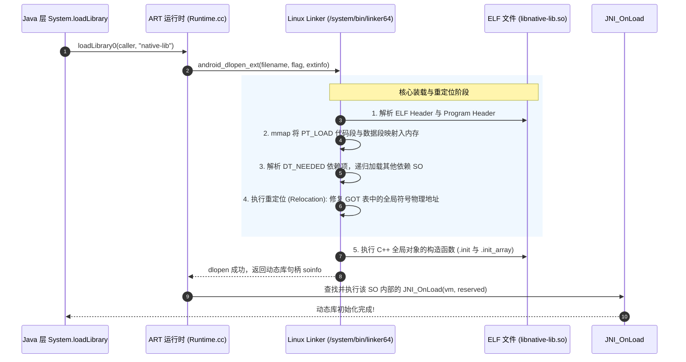

# Android-Linker与SO加载流程PLT-GOT-Hook与Inline-Hook

在 Android 高级逆向攻防、大厂性能监控 APM（内存泄漏捕捉、文件 IO 慢操作拦截、线程创建堆栈追踪）以及安全防护体系中，Native 层的 Hook 与动态拦截技术是终极核心底牌。要彻底理解 Native Hook，必须首先通晓 Linux Linker（动态链接器）是如何解析 **ELF 格式动态链接库（.so 文件）** 的。本文深入拆解 **`System.loadLibrary` 底层执行链路、PLT/GOT 延迟绑定与覆盖原理，以及 Inline Hook 的汇编级指令重写技术**。

---

## 核心底层机制与全景架构

### 1. `System.loadLibrary` 底层 Linker 执行全流程

当在 Java 层调用 `System.loadLibrary("native-lib")` 时，控制权迅速下沉至 Linux 内核与动态链接器：



---

## 源码级架构物理拆解

### 1. PLT/GOT Hook（导入表拦截）物理机制

ELF 动态库为了实现代码段在不同进程间的只读共享（Position Independent Code，PIC 地址无关代码），不能将外部函数的物理地址硬编码在代码段中，而是设计了两个跳转表：
- **`PLT`（Procedure Linkage Table，过程链接表）**：位于只读的代码段（`.text`），是一段小跳板指令；
- **`GOT`（Global Offset Table，全局偏移表）**：位于**可读写的数据段（`.data` / `.got`）**，用于存放外部函数的真实物理绝对地址。

```mermaid
flowchart TD
    subgraph 原始未 Hook 状态
        Code[业务代码调用 malloc] --> PLT[PLT 表项: 读取 GOT 表保存的函数地址]
        PLT --> GOT[GOT 表项: 初始指向 libc.so 中真实的 malloc 物理地址 0x7FFF...]
        GOT --> RealFunc[libc.so 真实 malloc 执行]
    end

    subgraph PLT/GOT Hook 发生后 (如 bytehook / xHook)
        Code --> PLT
        PLT --> GOT_Hacked[修改 GOT 表项的值!<br/>将地址直接覆写为自定义 proxy_malloc 的地址 0x1234...]
        GOT_Hacked --> ProxyFunc[自定义 proxy_malloc 函数<br/>记录分配堆栈、统计耗时、监控泄漏]
        ProxyFunc -->|可选择继续调用原函数| RealFunc
    end
```

#### PLT/GOT Hook 的物理边界与局限：
1. **天然优势**：稳定性极高。因为修改的是数据段的一段指针（4/8字节），不触碰 CPU 可执行代码段的汇编指令，几乎不会发生奔溃；
2. **致命局限**：**只能 Hook 跨 SO 调用的外部导入函数**！如果 `libA.so` 内部有一个未导出的私有静态函数 `static void doInternal()`，它的调用是基于相对偏移直接跳转的，**根本不走 GOT 导入表，PLT/GOT Hook 对此完全无能为力！**

---

### 2. Inline Hook（内联汇编覆盖 Hook）物理机制

为了突破 PLT/GOT 无法拦截内部函数的限制，**Inline Hook** 直接在物理 CPU 的指令层展开手术：

```mermaid
flowchart LR
    subgraph 原函数内存指令 (ARM64)
        Op1[0x1000: STP X29, X30, [SP, #-16]!]
        Op2[0x1004: SUB SP, SP, #32]
        Op3[0x1008: LDR X0, [X1]]
        Op4[0x100C: ADD X0, X0, #1]
    end

    subgraph 暴力覆写 16 字节跳转 (Inline Hook)
        HookOp[通过 mprotect 将内存页改为可写<br/>强行覆写为 ARM64 跳转指令:<br/>LDR X16, 8<br/>BR X16<br/>0x7FFF8888 (目标 Hook 函数地址)]
    end

    subgraph Trampoline 跳板构建
        T1[恢复执行被覆盖的原始 2 条指令] --> T2[跳转回 0x1008 继续执行原函数后续指令]
    end
```

#### 关键技术挑战：
1. **指令对齐与跨架构兼容**：ARM32（4字节指令）、Thumb-2（2/4字节混合指令）、ARM64（4字节指令）的机器码构造完全不同；
2. **PC 相对寻址指令修复（PC-relative Instruction Relocation）**：如果被覆盖的原指令中包含如 `ADR`, `LDR (literal)`, `CBZ`, `B.cond` 等基于当前 PC 指针偏移计算的相对寻址指令，直接搬迁到跳板（Trampoline）会导致寻址目标错误崩溃，**必须由 Hook 框架在汇编层面进行动态重定位修正**。

---

## 两大 Native Hook 技术横向对比

| 核心评估维度 | **PLT / GOT Hook（导入表 Hook）** | **Inline Hook（内联指令覆盖）** |
| :--- | :--- | :--- |
| **主流代表框架** | 字节跳动 **bhook**、爱奇艺 **xHook** | **ShadowHook**、Dobby、Frida |
| **底层实现机制** | 修改 ELF 的 GOT 数据段指针 | **修改函数入口处的机器码汇编指令** |
| **可拦截范围** | **仅限跨动态库的外部导入函数**（如拦截 `open`, `malloc`） | **理论上可拦截进程内存中的任意函数（包括私有静态函数）** |
| **稳定性与崩溃率** | **极高**，属于大厂线上 APM 生产环境标配 | 较低，受 CPU 指令集缓存同步（Clear Cache）与多线程指令踩踏影响 |
| **主要应用场景** | **线上 APM 慢 IO 监控、内存分配泄漏追踪、Native 线程创建监控** | **安全攻防、加固脱壳、游戏外挂拦截、深入私有逆向分析** |

---

## 社招高频硬核连环追问

### Q1: 在执行 Inline Hook 覆写汇编指令后，为什么必须强制调用 `__builtin___clear_cache()`？
- **考点**：现代 CPU 架构中的 I-Cache（指令缓存）与 D-Cache（数据缓存）分离机制（哈佛架构）。
- **解析**：
  - 现代 ARM 处理器为了极致性能，硬件上将高速缓存拆分为独立的 **I-Cache（用于取指令执行）** 与 **D-Cache（用于读写内存数据）**；
  - 当我们通过 C++ 代码向目标内存地址写入新的机器指令时，该写操作被写入了 **D-Cache（数据缓存）**，尚未完全刷入物理主存；
  - 此时 CPU 的指令预取器依然从 **I-Cache** 中读取旧的机器指令执行；
  - **严重后果**：导致 CPU 执行了半新半旧、甚至破碎的无效指令，瞬间引爆 `SIGILL（非法指令）` 崩溃！
  - **解决方案**：在覆写指令后，必须显式调用系统提供的 `__builtin___clear_cache(start, end)`，强制将 D-Cache 刷入主存，并使 I-Cache 对应行立即失效刷新。

---

## 生产级避坑指南与排障 SOP

### 1. 使用 PLT Hook 监控线上“主线程慢文件 I/O”实战

在主线程执行 `open`、`read`、`write` 等磁盘操作是卡顿的重要诱因。利用 PLT Hook 拦截 `libc.so` 的 `read`：

```c
// 伪代码实战逻辑
static ssize_t (*original_read)(int fd, void *buf, size_t count);

ssize_t proxy_read(int fd, void *buf, size_t count) {
    // 1. 判断是否处于主线程
    if (getpid() == gettid()) {
        long start = get_current_time_ms();
        ssize_t ret = original_read(fd, buf, count);
        long cost = get_current_time_ms() - start;
        // 2. 超过阈值报警
        if (cost > 10) {
            log_warn("主线程发生慢 IO 读操作, 耗时: %ld ms", cost);
        }
        return ret;
    }
    return original_read(fd, buf, count);
}
```
通过该方案可零侵入捕获线上所有未规范的文件读取操作。
