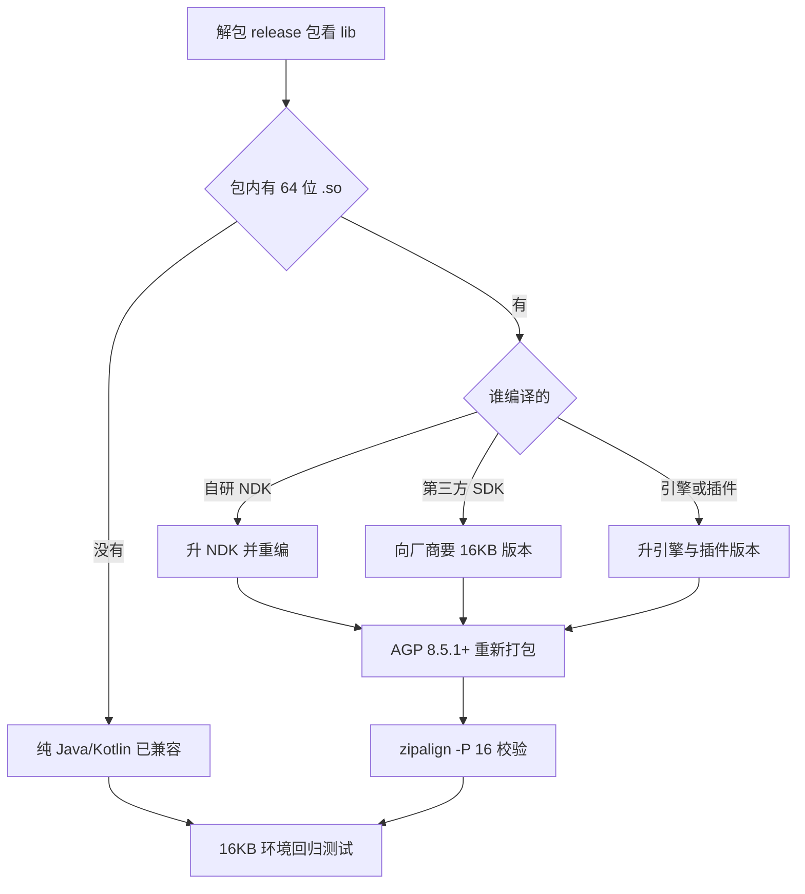
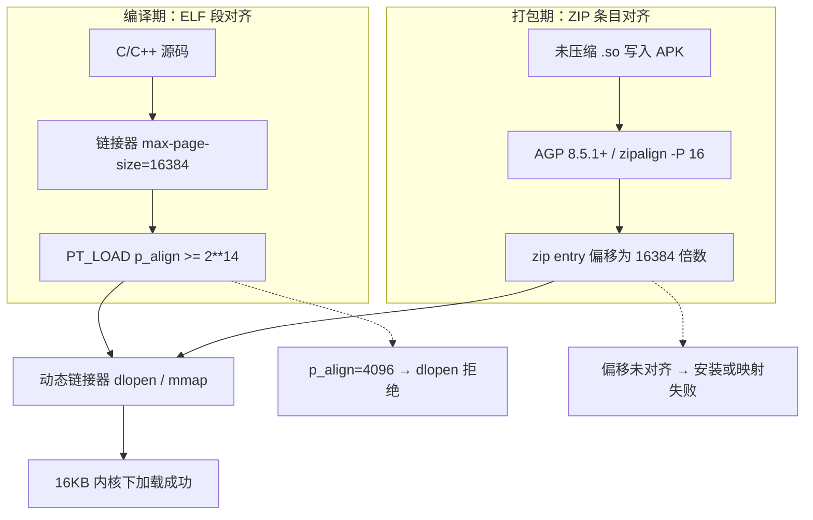
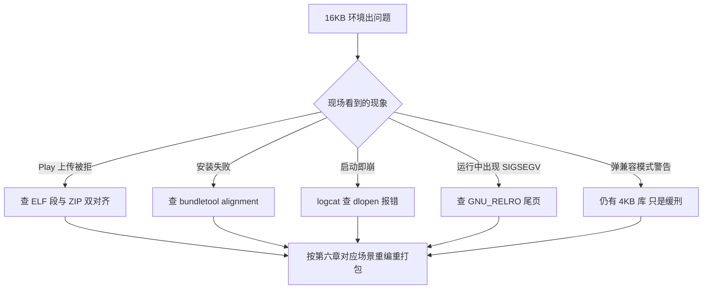

# Android 16KB 页面大小兼容影响与治理全解

## 使用入口：先解决问题，再做验证

让含 Native 库的应用在目标页面大小设备上正常安装与运行。

**先做基本操作**：先盘点所有直接和传递依赖的 so，检查 ELF 与打包对齐，在实际 16KB 环境验证再排查加载机制。初次学习可先完成[本模块基础实践](/doc/Android/Android应用基本开发与验证)。

**再逐步深入**：基本 API 与输入输出 → 常见失败和使用边界 → 场景排查与优化 → 本文机制分析与源码。面试先讲用途和自己的操作过程，再回答场景与原理追问。

> **一句话结论**：这不是「性能优化选择题」，而是**上架硬门槛**。只要你的 APK / AAB 里含 64 位 `.so`（自己写的，或第三方 SDK 悄悄带进来的），就必须同时满足 **ELF 段 16KB 对齐（编译期）** 与 **ZIP 条目 16KB 对齐（打包期）**，否则轻则在 16KB 设备上 `dlopen` 直接失败、重则 Google Play 拒绝更新。最短路径：**AGP 8.5.1+ → NDK r28+ → 换掉不兼容 SDK → 在 16KB 环境跑一遍全链路回归**。

> 本文事实核对时间：**2026-11-10**。政策日期调整过多次，最终以你自己 Play Console 里「政策状态 / App bundle explorer」显示的期限为准。

---

## 30 秒速览

| 结论（一眼记住） | 最常见误判 |
|---|---|
| **谁必须改**：含 64 位 `.so` 且 `targetSdkVersion >= 35` 的应用 | 「我只写 Kotlin，肯定不用改」——但 AAR 传递依赖常带 `.so` |
| **谁天然合规**：全部代码与全部 SDK 都是 Java/Kotlin、包里无 `.so` | 仍建议做一次 16KB 回归，防止依赖升级后引入 `.so` |
| **要过几道关**：**两道且互相独立** —— ELF 段对齐、ZIP 条目对齐 | 只查 `zipalign` 就以为完事，结果 ELF 段仍是 4KB |
| **最短修复**：`AGP 8.5.1+` + `NDK r28+` + 16KB 兼容的预编译依赖 | 以为「升 targetSdk」能解决（完全无关） |
| **编译期要求**：每个 `PT_LOAD` 的 `p_align >= 2**14`（16384） | 网上说「NDK r27 默认支持」是错的，**官方是 r28+** |
| **打包期要求**：未压缩 `.so` 在 ZIP 里的起始偏移为 16384 的倍数 | AGP 8.3~8.5 看似对齐，Play 用 AAB 重打的 APK 却装不上 |
| **代码层要求**：去掉 `PAGE_SIZE` / `4096` 硬编码，改 `sysconf(_SC_PAGESIZE)` | 静态检查全过，运行时 `mmap` 仍按 4KB 算，逻辑错或内存暴涨 |
| **验收标准**：`zipalign -c -P 16 -v 4` 输出 `Verification successful`，且 `adb shell getconf PAGE_SIZE` 返回 `16384` 后回归通过 | 只在 4KB 手机上测，上线才炸 |
| **当期状态**：已是生效中的发布要求；官方指南写明 **2027-02-01 起不兼容更新无法发布** | 还在引用「2025-11-01」当唯一截止日 |

---

## 一、一张图看懂：我该走哪条路



**读法**：左边「有没有 `.so`」决定你是否入局；中间「谁编译的」决定你能否自己修；右边是所有人都要走的两道验收。**第三方 SDK 是绝大多数团队真正卡住的地方**——你改不动它的二进制。

---

## 二、为什么会有 16KB：从页表到 `.so` 加载

### 2.1 底层动机

页（page）是操作系统管理内存的最小粒度，Android 历史上一直按 **4KB** 设计。随着设备 RAM 越来越大，页表项数量与 TLB miss 成为瓶颈；ARM64 原生支持 16KB 页，用更少、更大的页能降低内存管理开销。

从 **Android 15（API 35）** 起 AOSP 变成 page-size-agnostic，厂商可以选用 16KB 内核。Google 官方测得的收益：

| 指标 | 16KB 设备上的变化 |
|---|---|
| 内存压力下应用启动 | 平均快 **3.16%**，部分应用最高 **30%** |
| 应用启动功耗 | 平均降低 **4.56%** |
| 相机热启动 / 冷启动 | 平均快 **4.48% / 6.60%** |
| 系统启动 | 平均快 **8%**（约 **950ms**） |
| 代价 | 平均内存占用**略增**（更早的官方博客给过 ~9% 额外内存 / 5-10% 整体性能提升的口径） |

同一个适配后的二进制可**同时运行在 4KB 与 16KB 设备**上，不需要分包——这是好消息。

### 2.2 关键机制：为什么 4KB 的 `.so` 会直接加载失败

现代构建默认 `extractNativeLibs=false`，`.so` **不解压到磁盘**，动态链接器直接从 APK 里 `mmap` 映射。于是产生两条互相独立的对齐要求：



- **ELF 段对齐**：`p_align=4096` 的段，在 16KB 页的内核上无法满足段边界，linker 直接拒绝；
- **ZIP 条目对齐**：即使 `.so` 内部段都对齐了，若它在 APK 里的起始偏移只是 4KB 倍数，从 APK 直接映射同样失败。

> **这是全篇最容易混淆的一点**：`zipalign` 检查的是「包怎么装」，`llvm-objdump` 检查的是「库怎么编译」。**一个通过、另一个失败是完全可能的**，而 Google Play 两个都查，且只针对 64 位 ABI。

---

## 三、政策时间线与影响面

### 3.1 时间线（日期变过，别背旧答案）

| 时间 | 事件 | 对开发者的意义 |
|---|---|---|
| Android 15（API 35） | AOSP 开始支持 16KB 页设备 | 系统能力起点；不重编的 native 应用在这些设备上跑不起来 |
| 2025-05 官方公告 | 宣布 **2025-11-01** 起提交 Play、targeting Android 15+ 的新应用与更新须支持 16KB；后续博客收窄表述为「使用 native C/C++ 代码的应用」 | 这是网上流传最广的日期，属于**要求生效**节点，不是唯一截止日 |
| 过渡期 | 开发者可申请延期，最晚到 **2026-05-31** | 给存量应用留缓冲，不代表豁免 |
| 官方《支持 16 KB 页面大小》指南（2026-10 更新） | 写明 **自 2027-02-01 起，不支持 16KB 的应用更新将无法发布** | 当前官方文档中的**硬性阻断日**，针对「应用更新」 |
| Android 17 | 可强制关闭 16KB 向后兼容，不兼容二进制**立即中止** | 兼容模式不再是长期退路 |
| **现在（2026-11）** | 已是生效中的发布门槛 | 新版本上传前必须过检，别等最后期限 |

> 面试时说「2025-11-01 起生效、官方当前写明 2027-02-01 起不兼容更新无法发布、期间有延期机制、以 Play Console 为准」，比只背一个日期更可信。

### 3.2 影响面判定

| 应用形态 | 是否受影响 | 说明 |
|---|---|---|
| 纯 Java/Kotlin，且**所有库与 SDK** 都无 native 代码 | 不受影响 | 官方明确「已支持 16KB 设备」，但仍建议回归 |
| 自研 C/C++ / NDK | 受影响 | 需重编，且要清理代码里的页大小假设 |
| 引入第三方 SDK（推送、地图、支付、音视频、风控、ML、SQLite 替代方案等） | **最易中招** | 你没写 NDK，但 AAR 里的 `.so` 是别人用旧 NDK 编的 |
| Flutter / React Native / uni-app / Unity | 看引擎与插件 | 主流引擎新版本多已适配，**坑在原生插件与绑定库** |
| 把 `.so` 放 `assets/` 动态加载 | 受影响且**极易漏检** | APK Analyzer 只扫 `lib/`，不扫 `assets/`；`System.load` 时照样触发 `dlopen` 对齐校验 |

**关键提醒**：`targetSdkVersion` 决定你是否落入规则范围，但**升 targetSdk 本身不解决任何对齐问题**。两件事完全独立。

---

## 四、影响清单：到底会怎么坏



| # | 故障 | 现象 / 典型报错 | 根因 | 修复层 |
|---|---|---|---|---|
| 1 | Play 拒绝发布 | `Your app's native libraries are not aligned to 16 KB. Recompile your app with 16 KB native library alignment.` 并列出具体 `.so` 路径 | 64 位 `.so` 的 ELF 段或 ZIP 对齐不达标 | 编译 + 打包 |
| 2 | 安装失败 | 本地装得上，Play 用 AAB 生成的 APK 装不上 | **AGP 8.3~8.5 陷阱**：默认看似 16KB 对齐，但 `bundletool` 不做 zipalign 优化 | 升 AGP 8.5.1+ |
| 3 | 启动即崩 | `dlopen failed: program alignment (4096) cannot be smaller than system page size (16384)`、`java.lang.UnsatisfiedLinkError`、崩溃在 `__linker_init` | `PT_LOAD p_align` 仍是 4096 | 重编 `.so` |
| 4 | 运行中 `SIGSEGV` | 静态检查全过，写 `.data/.bss` 时崩溃 | **RELRO 尾页问题**：`GNU_RELRO` 结束地址未按 16KB 对齐，链接器把整页置只读，同页的可写数据被连带保护（NDK r27 及以下常见） | 重编 + 启用 RELRO 对齐 |
| 5 | 逻辑错乱 / 内存浪费 | 缓冲区算错、`mmap` 失败、RSS 异常上涨 | 代码硬编码 `4096` / `PAGE_SIZE`，或自定义分配器按 4KB 设计 | 改源码 |
| 6 | 用户可见警告 | 首次启动弹「正以 16KB 向后兼容模式运行」 | 系统检测到 4KB LOAD 段或 4KB ZIP 对齐的未压缩 `.so`，自动进入 compat 模式 | **不是修复，只是缓刑** |
| 7 | 静默漏检 | 上线后特定机型闪退 | `.so` 藏在 `assets/` 或由插件运行时下发 | 全量扫包 + 16KB 真机回归 |

> 「16KB 向后兼容模式」只是让部分应用暂时能跑：系统会对 4KB 对齐的包开兼容通道并弹提示，官方明确表示为了可靠性仍应按 16KB 对齐。Android 17 起还能设 `bionic.linker.16kb.app_compat.enabled=fatal` 让不兼容二进制立即中止。

---

## 五、检测：三层门禁，逐层收口

### 5.1 第一层：包内静态检查（不用设备）

> 前置：`Android SDK Build-Tools 35.0.0+` 才有 `zipalign -P 16`；NDK 自带 `llvm-objdump` / `llvm-readelf`。

| 目的 | 命令 | 期望结果 |
|---|---|---|
| 有没有 `.so` | `unzip -l app-release.apk \| grep '\.so'`，或 Android Studio `Build > Analyze APK` 看 `lib/` | 列出全部 arm64-v8a / x86_64 库；「对齐」列无警告 |
| ZIP 对齐 | `zipalign -c -P 16 -v 4 app-release.apk` | 最后一行 `Verification successful` |
| AAB 对齐 | `bundletool dump config --bundle=app-release.aab \| grep alignment` | `PAGE_ALIGNMENT_16K`（出现 `PAGE_ALIGNMENT_4K` 即不合格） |
| ELF 段批量 | `check_elf_alignment.sh app-release.apk` | 所有库输出 `ALIGNED`，无 `UNALIGNED` |
| 单个 ELF 段 | `llvm-objdump -p libfoo.so \| grep LOAD` | 每行 `align 2**14` 或更大；出现 `2**13`/`2**12` 即不合格 |
| RELRO | `llvm-readelf -Wl libfoo.so \| grep 'LOAD\|RELRO\|Type'` | 见下方三条件 |

**RELRO 合规三条件**（满足任一即可）：

1. 程序头里根本没有 `GNU_RELRO` 段；
2. `(GNU_RELRO.VirtAddr + GNU_RELRO.MemSiz) % 0x4000 == 0`；
3. `GNU_RELRO` 独占其所在 `LOAD` 段的剩余部分，后面没有可写 `.data/.bss`。

### 5.2 第二层：源码扫描

```bash
# 找出所有对页大小的硬编码假设
grep -rnE 'PAGE_SIZE|0x1000|4096|MAP_FIXED|mmap\(' \
  app/src/main/cpp/ --include='*.c' --include='*.cc' --include='*.cpp' --include='*.h'
```

重点看：`mmap()` 的 `offset` / `length` 是否按页对齐、是否用 `PAGE_SIZE` 当「随便一个方便数值」、自定义分配器的释放阈值是否写死字节数。

### 5.3 第三层：16KB 运行时环境

```bash
# 先确认测试环境真的是 16KB，必须返回 16384
adb shell getconf PAGE_SIZE
```

三种搭环境的方式：

1. **模拟器**：SDK Manager → SDK Platforms → Show Package Details → Android VanillaIceCream 或更高 → 勾选
   `Google APIs Experimental 16 KB Page Size ARM 64 v8a System Image`（模拟 Pixel 用这个）或 `Intel x86_64 Atom System Image`；创建 AVD 时在 **Other Images** 里选它。
2. **真机开发者选项**：设置 → 系统 → 开发者选项 → 打开「以 16KB 页面大小启动设备」。支持机型：Pixel 8 / 8 Pro / 8a（Android 15 QPR1+）、Pixel 9 / 9 Pro / 9 Pro XL（QPR2+）、Pixel 9a（Android 16+）；先做系统更新。
3. **Cuttlefish / Samsung Remote Test Lab**：CI 或没有 Pixel 时的替代。

**向后兼容模式开关**（调试用，别拿来当修复）：

```bash
# 强制关闭兼容模式，让问题立刻暴露
adb shell setprop bionic.linker.16kb.app_compat.enabled false
adb shell setprop pm.16kb.app_compat.disabled true

# Android 17：不兼容二进制立即中止
adb shell setprop bionic.linker.16kb.app_compat.enabled fatal
```

也可在 `AndroidManifest.xml` 用 `android:pageSizeCompat` 针对单个应用开关（设置后不再弹兼容警告）。

### 5.4 CI 门禁脚本（可直接放流水线）

```bash
#!/usr/bin/env bash
set -euo pipefail
APK="app/build/outputs/apk/release/app-release.apk"

# 1) ZIP 对齐
zipalign -c -P 16 -v 4 "$APK" | tail -1 | grep -q "Verification successful"

# 2) ELF 段对齐（Google 提供的 check_elf_alignment.sh）
check_elf_alignment.sh "$APK" | tee /tmp/elf-align.log
! grep -q "UNALIGNED" /tmp/elf-align.log

# 3) 测试设备必须是 16KB
PAGESIZE=$(adb shell getconf PAGE_SIZE | tr -d '\r')
[ "$PAGESIZE" = "16384" ] || { echo "测试设备不是 16KB: $PAGESIZE"; exit 1; }

echo "16KB 门禁通过"
```

> 把 1、2 步接在 `assembleRelease` 之后，能把「上传 Play 才被拒」提前到「提 MR 就报」。

---

## 六、解决办法：按场景对号入座

### 场景 A：纯 Java/Kotlin，包里确实没有 `.so`

无需改动即可满足要求，但要做两件事：

1. 用 `./gradlew :app:dependencies` 或直接解包 release APK，扫一遍 **AAR 传递依赖**（统计、崩溃上报、加解码、支付、地图、风控 SDK 最容易夹带 `.so`）；
2. 仍跑一次 16KB 环境回归，防止后续依赖升级引入 native 库。

### 场景 B：自研 NDK（推荐路径）

**第一步：升级工具链**。官方给的组合是 **AGP 8.5.1+ 且 NDK r28+**，配合已兼容的预编译依赖，应用默认就是 16KB 兼容的。

```groovy
// build.gradle（项目级）
plugins {
    id 'com.android.application' version '8.5.1' apply false
}

// build.gradle（app 级）
android {
    ndkVersion "28.0.12433566"   // r28 及以上：默认编译 16KB 对齐
}
```

**第二步：无法升 NDK 时，显式加链接器 flag**（r27 及以下必须做）：

```cmake
# CMakeLists.txt
target_link_options(${CMAKE_PROJECT_NAME} PRIVATE
    "-Wl,-z,max-page-size=16384"
    "-Wl,-z,common-page-size=16384"
)
```

```makefile
# Android.mk（ndk-build）
LOCAL_LDFLAGS += -Wl,-z,max-page-size=16384 -Wl,-z,common-page-size=16384
```

> **两个易踩的坑**
> 1. 网上不少文章写「NDK r27 起默认 16KB 对齐」，与官方文档不符：**r28+ 才默认**，r27 及以下必须手动加 flag。
> 2. NDK r26 及更低版本自带的 `libc++_shared.so` 本身可能未 16KB 对齐。升级 NDK 是首选；实在不能升，可把 C++ 标准库**静态链接**进自己的 `.so`，或使用官方 CI 提供的 r23/r25 Canary（内含对齐版 `libc++_shared.so`）。

**第三步：清理代码里的页大小假设**

```cpp
// ❌ 4KB 假设：在 16KB 设备上算错偏移、浪费内存甚至崩溃
constexpr size_t PAGE = 4096;
void* p = mmap(nullptr, PAGE, PROT_READ | PROT_WRITE,
               MAP_PRIVATE | MAP_ANONYMOUS, -1, 0);

// ✅ 运行时查询真实页大小
#include <unistd.h>
size_t page = static_cast<size_t>(sysconf(_SC_PAGESIZE));   // 或 getpagesize()
void* q = mmap(nullptr, page, PROT_READ | PROT_WRITE,
               MAP_PRIVATE | MAP_ANONYMOUS, -1, 0);
```

补充规则：

- 移除所有引用 `PAGE_SIZE` 常量、硬编码 `4096` / `0x1000` 的逻辑；NDK r27+ 在 16KB 模式下 `PAGE_SIZE` **未定义**，正好能帮你在编译期揪出来。
- 若 `PAGE_SIZE` 原本只是「一个方便的值」（与真实页无关），换个语义明确的常量名，别继续借用它。
- 复查所有 `mmap()` 及要求页对齐参数的 API；不经 `MAP_FIXED` 传给内核时，内核仍会占用整页。

**第四步：检查 RELRO**。用第五层的 `llvm-readelf -Wl` 命令，若 `(VirtAddr + MemSiz) % 0x4000 != 0` 且同页还有可写数据，按上面的 16KB 对齐参数重编该 `.so` 并启用 RELRO 标志。

### 场景 C：第三方 SDK / 跨端引擎（最常卡住的场景）

自己做一张**归属表**，逐个销项：

| `.so` 路径 | 归属 SDK / 插件 | 当前版本 | 厂商是否提供 16KB 版 | 处置 |
|---|---|---|---|---|
| `lib/arm64-v8a/libxxx.so` | 某扫码 SDK | 3.2.1 | 否 | 升到 4.x 或换供应商 |
| `lib/arm64-v8a/libflutter.so` | Flutter 引擎 | 3.x | 是 | 升引擎版本 |
| `lib/arm64-v8a/libc++_shared.so` | NDK 运行时 | — | 视 NDK 版本 | 升 NDK |

要点：

- **改自己的 NDK 代码不会让整个包合规**——Play 扫的是最终 AAB 里**每一个** 64 位 `.so`。
- 主流引擎（Flutter、React Native、Unity）新版本多已提供 16KB 对齐二进制，但**原生插件 / binding 库**常是旧 NDK 编的，必须逐个核对，不能只看引擎版本。
- 预构建库必须以相同方式重编后重新导入；厂商不给兼容版本就升级、替换或推动对方出包。
- 别漏 `assets/` 下的 `.so`：APK Analyzer 扫不到，`System.load()` 时照样走 `dlopen` 校验。

### 场景 D：AGP 实在升不到 8.5.1（临时兜底）

改用**压缩共享库**规避 ZIP 对齐问题：

```kotlin
// build.gradle.kts
android {
    packagingOptions {
        jniLibs {
            useLegacyPackaging = true
        }
    }
}
```

AGP 8.0 及更低还要在 `gradle.properties` 加：

```properties
android.bundle.enableUncompressedNativeLibs=false
```

> **代价要写进评审记录**：压缩 `.so` 安装后会被解压复制到磁盘，占用更多空间、安装失败率上升、启动变慢。这只是缓冲，不是长期方案。另外 AGP 8.3~8.5 有个隐蔽陷阱：默认看似 16KB 对齐，但 `bundletool` 不做 zipalign，Play 从 AAB 生成的 APK 会装不上——**别在这个版本区间停留**。

### 场景 E：自定义内存分配器（游戏引擎 / 嵌入式 DB / jemalloc / mimalloc）

用系统标准分配器 `scudo` 的可跳过。自研分配器在 16KB 下最小物理分配单元变成 4 倍，按 4KB 设计会把小对象摊到多个页、RSS 与 ZRAM 效率恶化：

| 领域 | 建议 |
|---|---|
| 释放阈值 | 别写死「活跃对象 < 8KB 才 `madvise(MADV_DONTNEED)`」，用 `sysconf(_SC_PAGESIZE)` 动态算 |
| 分配顺序 | 优先从最满的页 / slab 分配，让轻用页自然排空后整页归还 |
| 池与 span | 所有池、slab 边界、buffer 对齐按运行时页大小的整数倍；size class 尽量可被 16KB 整除 |
| 大缓冲缓存 | 保留虚拟地址，但归还缓存时立即 `madvise(MADV_DONTNEED/FREE)` 释放物理页 |
| 内存清零 | 在 `free()` 时清零而非 `malloc()` 时，提升 ZRAM 压缩比 |

### 场景 F：向后兼容模式 / 兼容警告

系统对「4KB LOAD 段」或「4KB ZIP 对齐的未压缩 `.so`」会启用 16KB 向后兼容模式并在首次启动弹警告。可在应用信息页「高级 → 以页面大小兼容模式运行应用」开关，或用 `android:pageSizeCompat` 关闭警告。**这些都不改变二进制不合规的事实**，只能作为排查手段。

---

## 七、上线前 Checklist

- [ ] 解包 release APK / AAB，列出全部 64 位 `.so` 及归属（含 `assets/`）
- [ ] `zipalign -c -P 16 -v 4` 输出 `Verification successful`
- [ ] `bundletool dump config` 显示 `PAGE_ALIGNMENT_16K`
- [ ] `check_elf_alignment.sh` 无 `UNALIGNED`；`llvm-objdump` 全部 `align 2**14+`
- [ ] `llvm-readelf -Wl` 确认 RELRO 三条件满足其一
- [ ] AGP >= 8.5.1、NDK >= r28（或已加两个链接器 flag）
- [ ] 第三方 SDK / 插件 / 引擎全部确认为 16KB 兼容版本
- [ ] 源码无 `PAGE_SIZE` / `4096` / 错误 `mmap` 偏移；自定义分配器已评估
- [ ] `adb shell getconf PAGE_SIZE` 返回 `16384` 的环境里跑完核心链路回归
- [ ] Play Console 的 App bundle explorer 与政策状态无 16KB 警告
- [ ] 记录构建身份（AGP / NDK / Gradle / 各 SDK 版本）与上述校验输出，存档备查

---

## 八、高频追问（含高分 / 低分特征）

| 追问 | 高分回答要点 | 低分回答特征 |
|---|---|---|
| 16KB 页到底是限制什么？ | 限制的是 **native 库的加载方式**：ELF `PT_LOAD.p_align` 与未压缩 `.so` 的 ZIP 偏移都要 >= 16384；源于 `extractNativeLibs=false` 下直接从 APK `mmap` | 「限制 APK 大小」「限制内存 16KB」 |
| 我全用 Kotlin，为什么还被 Play 警告？ | 依赖树里的 AAR 传递带 `.so`（统计/地图/音视频/风控/ML 常见）；要解包看 `lib/`，并查 `assets/` | 「Google 误判」 |
| `zipalign -P 16` 过了就万事大吉？ | 不够。那只验证打包层；还要 `llvm-objdump` 看 ELF 段 `2**14`、RELRO 尾页、以及运行时页大小假设 | 只背一条命令 |
| 为什么本地能装、Play 装的包就失败？ | AGP 8.3~8.5 下 `bundletool` 默认不做 zipalign，本地 APK 与 Play 从 AAB 生成的 APK 不是同一个包 | 「渠道包问题」含糊带过 |
| 静态检查全绿，为什么还 `SIGSEGV`？ | `GNU_RELRO` 结束地址未 16KB 对齐，链接器把含尾页的整页置只读，同页可写 `.data/.bss` 被连带保护；NDK r27 及以下常见 | 只答「内存越界」 |
| 升 `targetSdkVersion` 能解决吗？ | 不能。targetSdk 只决定行为规则与是否被这条政策覆盖，对齐是编译 / 打包 / 源码三层的事 | 「升到 35 就好了」 |
| 兼容模式能不能当长期方案？ | 不能。系统会弹用户可见警告，官方明确只是部分应用临时可用；Android 17 还能设 `fatal` 让不兼容二进制立即中止 | 「系统会自动兼容」 |
| 政策截止日到底是哪天？ | 说清演变：2025-11-01 起生效、有延期机制、官方指南现写明 2027-02-01 起不兼容更新无法发布，并强调以 Play Console 为准 | 只报一个旧日期 |
| 升 NDK 到哪个版本才默认对齐？ | **r28+**；r27 及以下要 `-Wl,-z,max-page-size=16384` 与 `-Wl,-z,common-page-size=16384` 两个 flag | 答「r27」（网上常见错答） |
| 为什么要改成 16KB，收益是什么？ | 减少页表与 TLB 开销：启动平均快 3.16%（最高 30%）、功耗降 4.56%、系统启动快约 8%；代价是内存略增 | 只说「Google 强制要求」 |

---

## 参考

- Android Developers《支持 16 KB 页面大小》：https://developer.android.google.cn/guide/practices/page-sizes （英文原版 `developer.android.com/guide/practices/page-sizes`，页面会持续更新，**政策日期以它和 Play Console 为准**）
- Android Developers Blog《Prepare your apps for Google Play's 16 KB page size compatibility requirement》
- Android Developers Blog《Transition to using 16 KB page sizes for Android apps and games using Android Studio》
- 站内相关：[JNI与NDK](/doc/Android/JNI与NDK)、[APK打包安装与签名](/doc/Android/APK打包安装与签名)、[Android发包打包与ADB调试命令全集](/doc/Android/Android发包打包与ADB调试命令全集)、[崩溃治理专题](/doc/Android/崩溃治理专题)
