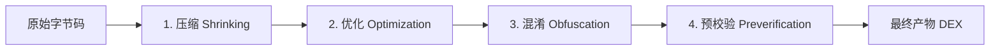

# Android 代码混淆与 R8 高级实战全解

## 使用入口：先解决问题，再做验证

缩小 release 产物并正确处理反射、序列化和 JNI。

**先做基本操作**：先开启项目 release 的 minify、归档 mapping、安装 release 验证关键链路，再根据证据写 keep 规则。初次学习可先完成[本模块基础实践](/doc/Android/Android应用基本开发与验证)。

**再逐步深入**：基本 API 与输入输出 → 常见失败和使用边界 → 场景排查与优化 → 本文机制分析与源码。面试先讲用途和自己的操作过程，再回答场景与原理追问。

## 🎯 核心技术原理与架构心智模型

代码混淆与字节码优化不仅是 Android 应用打包上线的最后一道“防线”，更是 APK/AAB 瘦身（Shrink）与运行时性能优化的关键环节。

深入掌握混淆技术需要回答四个核心命题：
1. **“从 ProGuard 到 D8/R8，现代 Android 编译管线发生了什么本质变革？”**
2. **“Tree-Shaking（死代码消除）的底层依据是什么？为什么配置不当会导致线上反射、JSON 解析、JNI 大面积崩溃？”**
3. **“`-keep`、`-keepclassmembers`、`-keepclasseswithmembers` 与带 `-names` 的系列指令，作用边界究竟有何区别？”**
4. **“线上收到一串 `a.b.c(Unknown Source)` 的混淆崩溃堆栈，如何通过 `retrace` 与 `mapping.txt` 精确还原至源码行号？”**

---

## 一、 编译管线演进：ProGuard vs D8/R8

### 1. 传统打包流水线（ProGuard + dx）
在 Android Gradle Plugin 3.0 之前，打包流程长且繁琐：
```text
Java 源码 ──► javac ──► .class 文件 ──► ProGuard ──► 优化后 .class ──► dx 编译器 ──► .dex 文件
```
* **缺陷**：代码需要先被解析为 Java 字节码，经过 ProGuard 处理后再被 `dx` 重新解析转换为 Dalvik/ART 字节码。两道工序存在大量重复的 Class 解析与 I/O 开销，编译耗时极长。

### 2. 现代 R8 全合一流水线（Next-Gen Desugaring & Dexing）
Google 引入了 **D8**（下一代 Dex 编译器）和 **R8**（集成了 ProGuard 功能的 Dex 编译器）：

```text
Java / Kotlin 源码
       │
       ▼ (javac / kotlinc)
   .class 字节码
       │
       ▼ (R8 编译器 一步到位)
┌─────────────────────────────────────────────────────────────┐
│                            R8                               │
│  - 压缩 (Shrinking): 基于静态分析消除无用代码 (Tree-Shaking) │
│  - 优化 (Optimization): 方法内联、死分支移除、逃逸分析       │
│  - 混淆 (Obfuscation): 符号重命名 (短名称 a, b, c)          │
│  - 字节码脱糖 (Desugaring): 自动降级 Java 8+ Lambda / Stream │
│  - DEX 生成 (Dexing): 直接生成优化后的 classes.dex          │
└─────────────────────────────────────────────────────────────┘
       │
       ▼
  classes.dex
```

#### R8 相较于 ProGuard 的核心优势：
1. **单步直出 DEX**：跳过了中间生成优化 `.class` 的环节，编译构建速度提升 30%~50%。
2. **更高程度的激进优化**：由于 R8 直接感知最终的 DEX 格式限制（如 64K 方法数、寄存器分配），能做更深入的方法内联（Inlining）、类合并（Class Merging）和无用实参剔除（Unused Argument Removal）。
3. **完全兼容 ProGuard 语法**：项目中的 `proguard-rules.pro` 规则文件无需迁移，R8 原生解析执行。

---

## 二、 混淆的四大核心阶段



1. **压缩（Shrinking / Tree-Shaking）**：
   * **原理**：从一组“入口点”（Entry Points，即 Seeds，如 `AndroidManifest.xml` 中声明的四大组件）出发，遍历整棵依赖调用图。任何未被引用的类、字段、方法被直接剔除。
2. **优化（Optimization）**：
   * 对字节码指令进行深度重写。例如：将非 private 的方法私有化、小方法直接内联展开、合并等价的 switch 分支、剔除未读取的局部变量。
3. **混淆（Obfuscation）**：
   * 将类名（`UserManager`）、方法名（`fetchUserProfile`）、变量名（`userToken`）替换为无意义的短名称（`a.a.a`、`b()`）。
   * 显著增大逆向分析工具（JADX、IDA Pro、JEB）的理解成本。
4. **预校验（Preverification）**：
   * Java 6+ 用于在类加载前校验字节码安全。但在 Android 移动端（ART 运行时会自行 AOT/JIT 校验），该步骤完全冗余，因此通常在配置中加上 `-dontpreverify` 提高编译速度。

---

## 三、 Keep 规则指令全景解析

混淆规则中，开发者最容易混淆的是带有不同后缀的 `-keep` 指令：

| 指令 | 保留类？ | 保留类中成员？ | 触发条件 / 特性 |
| :--- | :--- | :--- | :--- |
| **`-keep`** | ✅ 是 | ✅ 是 | **最全面**。类和指定成员既不被剔除，也不被混淆改名。 |
| **`-keepclassmembers`** | ❌ 否（类名可被混淆/剔除） | ✅ 是 | **仅保护成员**。只有在该类被其他代码引用而保留下来时，指定成员才被保留。 |
| **`-keepclasseswithmembers`** | ✅ 是 | ✅ 是 | **带筛选条件的 `-keep`**。只有类同时拥有指定的全部成员时，才保留该类及其成员（常用于 JNI native 匹配）。 |
| **`-keepnames`** | 仅不改名 | 仅不改名 | 若该类/成员无人调用，**仍会被 Tree-Shaking 删掉**；只有在被使用时才保留原名。 |
| **`-keepclassmembernames`** | 允许类改名 | 仅成员不改名 | 成员若被引用，保持原名。 |

### 1. 通配符模式匹配表

```properties
# 匹配任意类名（单层包，不跨子包）
-keep class com.example.service.*

# 匹配类名及其子包下的所有类（跨多层包）
-keep class com.example.model.**

# 匹配任意类（包括所有包）
-keep class *

# 匹配所有实现或继承该接口/基类的子类
-keep class * extends com.example.base.BaseActivity
-keep class * implements java.io.Serializable

# 成员通配符
<fields>    # 匹配类中的所有变量字段
<methods>   # 匹配类中的所有方法
<init>      # 匹配所有构造函数
*           # 匹配所有字段和方法
```

### 2. 修饰符约束（取反运算）
```properties
# 保留非 private、非 static、非 transient 的变量（常用于 Serializable 序列化保护）
-keepclassmembers class * implements java.io.Serializable {
    !static !transient <fields>;
    !private <methods>;
}
```

---

## 四、 生产环境常见混淆踩坑与避坑法则

代码混淆后最常发生的不是编译报错，而是**运行时闪退（NoSuchMethodError / NullPointerException）或业务异常**。

### 避坑 1：反射（Reflection）调用被混淆
* **崩溃现象**：`java.lang.NoSuchMethodException: com.example.util.Helper.calculate()`
* **原因剖析**：代码中使用字符串反射 `Class.forName("...").getMethod("calculate")`，而 R8 在静态分析时只看到字符串字面量，不知道它关联了该方法，直接把方法改名为 `a()` 甚至 Tree-Shaking 抹除了。
* **规则防线**：
  ```properties
  # 明确保护被反射调用的类与方法
  -keep class com.example.util.Helper {
      public void calculate();
  }
  ```

### 避坑 2：JSON 实体反序列化全为 null（Gson / FastJson / Moshi）
* **崩溃现象**：接口返回了 JSON，解析出的 Java/Kotlin 实体类对象字段全是 `null` 或默认值。
* **原因剖析**：JSON 库通常依赖反射将 JSON 键名映射到字段名（如 `user_id` 映射到 `userId`）。混淆后字段被重命名为 `a`、`b`，反射找不到对应字段。
* **规则防线**：
  ```properties
  # 方案 A：在混淆规则中保留整个实体包
  -keep class com.example.app.data.model.** { *; }

  # 方案 B：使用注解保护（代码更清晰规范）
  -keepattributes *Annotation*
  # 使用 androidx.annotation.Keep 注解的类和方法全保留
  -keep @androidx.annotation.Keep class * { *; }
  -keepclassmembers class * {
      @androidx.annotation.Keep *;
  }
  ```

### 避坑 3：JNI / NDK 动态回调崩溃
* **崩溃现象**：Native C/C++ 代码调用 `env->GetMethodID(clazz, "onNativeCallback", "()V")` 时触发底层 SIGSEGV 致命中断。
* **原因剖析**：C/C++ 代码硬编码了 Java 类全路径与方法签名，无法被 R8 关联更新。
* **规则防线**：
  ```properties
  # 必须保护所有带有 native 声明的方法，以及被 C/C++ 反向调用的 Java 类
  -keepclasseswithmembernames class * {
      native <methods>;
  }
  ```

### 避坑 4：WebView 与 JS 交互（JavascriptInterface 失效）
* **崩溃现象**：H5 页面调用 `window.AndroidBridge.getUserToken()` 毫无响应或报 `TypeError: not a function`。
* **原因剖析**：注入给 WebView 的 Bridge 类中，暴露给 JS 的方法被混淆改名。
* **规则防线**：
  ```properties
  -keepattributes JavascriptInterface
  -keepclassmembers class * {
      @android.webkit.JavascriptInterface <methods>;
  }
  ```

### 避坑 5：泛型擦除导致复杂类型反序列化失败（Signature 丢失）
* **崩溃现象**：使用 Gson `new TypeToken<List<Order>>() {}.getType()` 解析数据时，抛出 `ClassCastException: LinkedTreeMap cannot be cast to Order`。
* **原因剖析**：Java 编译后泛型会被擦除，但默认可以通过类的 `Signature` 属性保留泛型签名。如果混淆把 `Signature` 属性去掉了，Gson 就无法推断出集合内的具体类型。
* **规则防线**：
  ```properties
  # 必须保留泛型签名、注解、内部类关联信息
  -keepattributes Signature,InnerClasses,EnclosingMethod,*Annotation*
  ```

### 避坑 6：自定义 View 出现 `InflateException`
* **崩溃现象**：页面启动时 XML 加载失败，报 `android.view.InflateException: Binary XML file line #10: Error inflating class com.example.ui.MyCustomView`。
* **原因剖析**：`LayoutInflater` 在解析 XML 时，是通过反射调用带 `(Context, AttributeSet)` 参数的构造函数。如果该构造函数被优化剔除，直接导致视图膨胀失败。
* **规则防线**：
  ```properties
  -keepclasseswithmembers class * extends android.view.View {
      public <init>(android.content.Context);
      public <init>(android.content.Context, android.util.AttributeSet);
      public <init>(android.content.Context, android.util.AttributeSet, int);
  }
  ```

---

## 五、 混淆四大产物与符号表映射还原（Retrace 实战）

当 Gradle 执行构建（如 `./gradlew assembleRelease`）后，R8 会在 `build/outputs/mapping/{flavor}/release/` 目录下生成四个核心文件：

```text
build/outputs/mapping/release/
├── mapping.txt        # 核心映射表：记录原始类名/方法名与混淆后名称的对应关系 (极其重要，发版必归档)
├── seeds.txt          # 命中 Keep 规则保留下来的类和成员列表 (用于验证规则是否生效)
├── usage.txt          # 被 Tree-Shaking 判定为无用并成功剔除的类/成员列表 (包体积优化参考)
└── configuration.txt  # 所有 module 混淆文件合并后的最终生效规则全集
```

### 1. 使用官方 `retrace` 工具还原混淆堆栈

线上用户崩溃时，收集到的堆栈可能长这样（`crash.txt`）：
```text
java.lang.NullPointerException: Attempt to invoke virtual method 'java.lang.String a.b.c.a()' on a null object reference
    at com.example.app.ui.MainActivity.b(MainActivity.java:42)
    at com.example.app.ui.MainActivity$1.onClick(MainActivity.java:78)
```

#### 命令行还原指令：
在 Android SDK 目录下（`$ANDROID_HOME/cmdline-tools/latest/bin/` 或老版本 `platform-tools/`）：
```bash
# 执行堆栈反解
./retrace mapping.txt crash.txt
```
#### 还原后的清晰堆栈：
```text
java.lang.NullPointerException: Attempt to invoke virtual method 'java.lang.String com.example.app.model.User.getAccessToken()' on a null object reference
    at com.example.app.ui.MainActivity.initUserProfile(MainActivity.java:42)
    at com.example.app.ui.MainActivity$1.onClick(MainActivity.java:78)
```

::: warning 生产规范警示
**每次发包上线前，必须将当前版本的 `mapping.txt` 归档到公司内部的 CI/CD 或版本归档服务器！**  
如果发版时没有保存 `mapping.txt`，一旦线上爆发未知崩溃，由于类名行号完全错乱，你将面对无法破译的“天书”堆栈！
:::

---

## 六、 进阶防护：自定义混淆字典与资源混淆

默认情况下，R8 使用 `a, b, c` 单字符重命名。黑客逆向时仍能借助控制流很容易理清逻辑。通过引入高级字典混淆，可让反编译代码呈现极高认知负荷。

### 1. 配置难以区分的符号混淆字典
创建文件 `obfuscation-dictionary.txt`：
```text
o0O0o
o0O00
oo00o
I1lIl
I11ll
```
在 `proguard-rules.pro` 中启用：
```properties
# 混淆字典（类成员名、方法名）
-obfuscationdictionary obfuscation-dictionary.txt
# 类名混淆字典
-classobfuscationdictionary obfuscation-dictionary.txt
# 包名混淆字典
-packageobfuscationdictionary obfuscation-dictionary.txt
```

### 2. 代码混淆 vs 资源混淆（AndResGuard）
* **代码混淆（R8）**：仅处理 Java/Kotlin 的字节码（Dex），**对于 `res/layout/activity_main.xml`、`res/drawable/icon.png` 等文件完全不做重命名**。
* **资源混淆（如 WeChat 团队开源的 AndResGuard / AAB 资源缩减）**：
  * 将 `res/layout/activity_home_page_view.xml` 缩短重命名为 `r/l/a.xml`。
  * 将字符串资源、资源 ID 在 `resources.arsc` 中做索引压缩。
  * 二者配合可进一步降低 APK 体积 10%~20%，并全方位封死逆向突破口。

---

## 七、 生产级 `proguard-rules.pro` 开箱即用全集模板

以下为工业级 Android 生产环境即贴即用的混淆母版：

```properties
# ==============================================================================
# 1. 基础运行环境与优化策略
# ==============================================================================
-dontusemixedcaseclassnames               # 混淆后不使用大小写混合类名（避免 Windows 平台解压覆盖）
-dontskipnonpubliclibraryclasses          # 不跳过非公共库类，确保类依赖完整分析
-verbose                                  # 打印混淆过程中的详细日志
-dontpreverify                            # 关闭预校验（Android ART 运行时不需要，提升构建性能）
-optimizationpasses 5                     # 优化执行迭代轮数（默认 5）

# 保留调试行号与核心元信息（崩溃分析必须）
-keepattributes SourceFile,LineNumberTable
-renamesourcefileattribute SourceFile

# 保留注解、泛型签名、内部类关联
-keepattributes *Annotation*,Signature,InnerClasses,EnclosingMethod

# ==============================================================================
# 2. Android 平台原生组件防护
# ==============================================================================
# 保护四大组件、Application 与权限受保护组件
-keep public class * extends android.app.Activity
-keep public class * extends android.app.Application
-keep public class * extends android.app.Service
-keep public class * extends android.content.BroadcastReceiver
-keep public class * extends android.content.ContentProvider
-keep public class * extends android.app.backup.BackupAgentHelper
-keep public class * extends android.preference.Preference

# 保护自定义 View 的全参构造函数（防止 XML 反射加载失败）
-keepclasseswithmembers class * extends android.view.View {
    public <init>(android.content.Context);
    public <init>(android.content.Context, android.util.AttributeSet);
    public <init>(android.content.Context, android.util.AttributeSet, int);
}

# 保护带有 native 关键字的 JNI 方法与类
-keepclasseswithmembernames class * {
    native <methods>;
}

# 保护 WebView 与 JS 互调方法
-keepattributes JavascriptInterface
-keepclassmembers class * {
    @android.webkit.JavascriptInterface <methods>;
}

# 保护枚举类的 values 与 valueOf 方法
-keepclassmembers enum * {
    public static **[] values();
    public static ** valueOf(java.lang.String);
}

# 保护 Parcelable 自动生成凭据
-keepclassmembers class * implements android.os.Parcelable {
    public static final ** CREATOR;
}

# 保护 Serializable 序列化 ID 与变量
-keepclassmembers class * implements java.io.Serializable {
    static final long serialVersionUID;
    private static final java.io.ObjectStreamField[] serialPersistentFields;
    !static !transient <fields>;
    !private <fields>;
    !private <methods>;
}

# ==============================================================================
# 3. 通用第三方主流开源库防护规约
# ==============================================================================

# ----------------- OkHttp3 & Retrofit2 -----------------
-dontwarn okhttp3.**
-dontwarn okio.**
-keep class okhttp3.** { *; }
-keep interface okhttp3.** { *; }
-dontwarn retrofit2.**
-keep class retrofit2.** { *; }
-keepclasseswithmembers interface * {
    @retrofit2.http.* <methods>;
}

# ----------------- Gson -----------------
-keepattributes *Annotation*
-keep class sun.misc.Unsafe { *; }
-keep class com.google.gson.stream.** { *; }
-keep class com.google.gson.examples.android.model.** { <fields>; }
# 保护业务数据模型 (按你实际的项目路径替换)
-keep class com.example.app.model.** { *; }
-keep class com.example.app.data.entity.** { *; }

# ----------------- Glide -----------------
-keep public class * implements com.bumptech.glide.module.GlideModule
-keep class * extends com.bumptech.glide.module.AppGlideModule { <init>(...); }
-keep public enum com.bumptech.glide.load.resource.bitmap.ImageHeaderParser$** {
  **[] $VALUES;
  public *;
}

# ----------------- Kotlin 协程 -----------------
-keepclassmembers class kotlinx.coroutines.internal.MainDispatcherFactory {
    java.lang.String getLoadPriority();
}
-keepclassmembers class kotlinx.coroutines.CoroutineExceptionHandler {
    void handleException(kotlin.coroutines.CoroutineContext, java.lang.Throwable);
}
```
