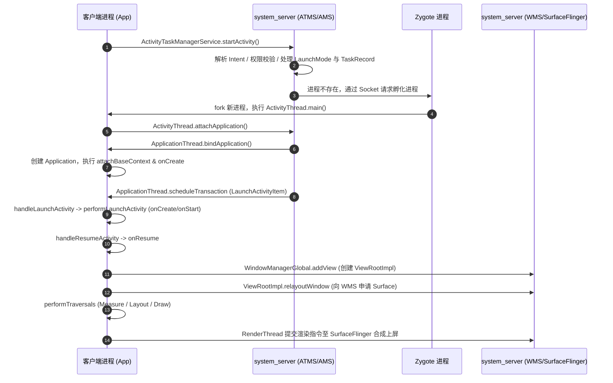

# Android社招高频硬核50道连环炮全景通关

本篇作为 Android 资深/专家级社招面试通关宝典，深度收敛一线大厂（字节、阿里、腾讯、美团、快手）高频技术考核要点。题目设计摈弃表层概念背诵，直击 Linux 内核、Binder IPC、Framework 调度、UI 硬件渲染管线、ART 虚拟机底层、NDK/C++ 交互、Kotlin 协程状态机、Jetpack Compose 运行时、网络及 APM 深度性能攻防，为 3~5 年及以上社招候选人构筑坚不可摧的底层技术护城河。

---

## 模块一：Linux 内核基石与 Binder IPC 深度剖析（第 1~5 题）

### 01. 为什么 Android 跨进程通信（IPC）不选用 Linux 传统管道、FIFO 或 Socket，而是首选 Binder？从物理内存拷贝次数和架构安全性展开推导。

传统 Linux IPC 机制中：
1. **内存拷贝次数与性能**：
   - **管道（Pipe）、FIFO、消息队列、Socket**：都需要经历 **两次物理内存拷贝**。发送方进程先将用户态数据拷贝至内核空间缓冲区（`copy_from_user`），接收方进程再从内核空间缓冲区拷贝至自身用户态空间（`copy_to_user`）。在高吞吐量的 UI 交互、跨进程 View 传递场景下，性能损耗严重且引起频繁的 CPU Cache 颠簸。
   - **共享内存（Shared Memory）**：虽然可以实现 **0 次拷贝**，但内核不提供天然的同步互斥访问与权限控制体系，需要上层通过信号量等复杂机制自行实现并发管理，极易引发死锁或内存踩踏。
   - **Binder**：仅需 **一次物理内存拷贝**。Binder 驱动通过 `mmap` 系统调用，将接收方进程的用户空间虚拟内存地址与 Binder 内核空间的物理页帧直接映射到同一块连续物理内存中。发送方通过 `copy_from_user` 将数据写入内核缓冲区后，接收方无需再次拷贝，即可直接读取该物理内存，兼顾了极致性能与工程实现复杂度。
2. **架构安全性（Security）**：
   - 传统 IPC 的通信实体无法在内核层保证身份标识的不可篡改性（例如 Socket 的 IP/端口或文件路径容易被注入或伪造，只能在数据包应用层携带 UID/PID）。
   - Binder 通信通道完全受控于内核态驱动。驱动在通信发生时，会自动从内核进程控制块（`task_struct`）中直接提取发送方真实的 `UID`（用户 ID）和 `PID`（进程 ID），并封装在 `binder_transaction_data` 结构体中下发给接收方。接收方（如 AMS、PMS）可基于 UID/PID 进行强校验和权限鉴权，杜绝身份伪造。
3. **面向对象的 RPC 抽象模型**：
   - Binder 将通信过程抽象为面向对象的 `Client-Proxy-Stub-Server` 模式，结合 `ServiceManager` 统一路由命名空间，完美契合 Java/C++ 等上层面向对象编程范式。

---

### 02. Binder 驱动中的 `mmap` 与普通文件的 `mmap` 有什么物理本质区别？默认映射的内存大小是多少？

1. **物理映射本质区别**：
   - **普通文件 mmap**：将一个物理磁盘文件的扇区映射到调用进程的虚拟地址空间（VMA）。发生缺页中断时，Linux 缺页异常处理程序触发磁盘 I/O，将文件页缓存（Page Cache）调入物理内存；
   - **Binder mmap**：映射的不是物理磁盘文件，而是一个字符设备文件 `/dev/binder`。在内核驱动的 `binder_mmap` 函数中，系统并不分配物理磁盘空间，而是分配两组虚拟地址空间：一组是**接收方进程的用户空间虚拟地址**，另一组是**内核空间的虚拟地址**。Binder 随后分配一块物理页（Page Frame），将该物理页同时挂载在这两组虚拟地址的页表项（PTE）上，从而实现了内核空间与用户空间对同一块物理内存的直接共享。
2. **映射大小限制**：
   - 普通应用进程在调用 `ProcessState::open_driver()` 映射 Binder 内存时，默认分配大小为 `(1 * 1024 * 1024) - (4096 * 2)`，即 **1MB - 8KB**（预留 2 个 Page 作为保护页，防止越界访问）。
   - 如果是系统服务进程（如 `system_server`），在 C++ 层初始化时设置的 Binder 内存上限通常为 **1MB**。
   - 驱动初始化时并不会直接物理分配 1MB 的连续内存，而是按需以 Page（4KB）为粒度逐步分配物理页帧，但虚拟地址空间已经被锁定为 1MB - 8KB。这也是跨进程传输超大数据时发生 `TransactionTooLargeException` 的物理根因。

---

### 03. 描述 AIDL 编译后生成的 `.java` 内部结构，`Stub` 与 `Proxy` 分别运行在哪个进程？跨进程调用的真正入口与出口是哪两个方法？

1. **AIDL 生成的类层次结构**：
   - 顶层接口继承 `android.os.IInterface`；
   - 内部抽象类 `Stub` 继承 `android.os.Binder` 并实现该 AIDL 接口，运行在 **服务端进程**；
   - `Stub` 的静态内部类 `Proxy` 实现该 AIDL 接口并持有 `IBinder mRemote` 引用，运行在 **客户端进程**。
2. **调用入口与底层穿透**：
   - **客户端入口**：客户端调用 `Proxy.someMethod()`。`Proxy` 将方法参数打包写入 `Parcel _data`，然后调用底层的 `mRemote.transact(Stub.TRANSACTION_someMethod, _data, _reply, flags)`，触发 CPU 从用户态切入内核态，向 Binder 驱动发送 `BC_TRANSACTION` 指令。
3. **服务端出口与回调**：
   - **服务端出口**：Binder 线程池中的空闲线程被内核唤醒，从驱动接收 `BR_TRANSACTION` 命令，调用 `Stub.onTransact(code, data, reply, flags)` 方法。`onTransact` 根据传入的 `code` 进行 switch-case 分发，从 `data` 中反序列化解包出参数，调用真正的本地业务实现函数 `this.someMethod()`；执行完毕后将结果序列化写入 `reply`，最终通过 Binder 驱动原路返回。

---

### 04. 跨进程传输百兆（100MB+）位图或文件，Binder 会直接崩溃，工业级架构应如何突破这一限制？

当传输数据超过 Binder 缓冲区阈值时，驱动直接返回 `BR_FAILED_REPLY`，Java 层抛出 `TransactionTooLargeException`。工业级破局方案为：
1. **Ashmem（Anonymous Shared Memory, 匿名共享内存）/ MemoryFile / SharedMemory**：
   - 物理原理：通过 Linux `ashmem` 内核驱动在内核中开辟一块连续内存，支持动态 pin/unpin 操作。在 Android 8.0 及以上推荐使用 `android.os.SharedMemory`。
   - 跨进程协同：发送方将 100MB 数据直接写入 `SharedMemory`；随后获取该内存区域的文件描述符（File Descriptor, `fd`）。
   - FD 跨进程传递：通过 Binder 的 `Parcel.writeFileDescriptor(fd)` 将文件描述符传给接收方。Binder 驱动会在内核层拦截该 FD，并在接收方进程的打开文件表（`files_struct`）中克隆并插入一条记录，返回接收方专属的有效 FD。接收方拿到 FD 后直接调用 `mmap` 将其映射到自身虚拟空间读取，实现 **0 拷贝传输**。
2. **FileProvider 配合 Binder 管道**：
   - 将超大文件存放在磁盘私有缓存目录，通过 `FileProvider` 生成授权 `Uri`，通过 Intent/Binder 传递该 Uri；
   - 接收方通过 `ContentResolver.openFileDescriptor(uri, "r")` 获取 `ParcelFileDescriptor`，通过 Linux 底层 `sendfile` 系统调用或管道零拷贝读入内存。

---

### 05. Zygote 孵化应用进程为什么选择 `fork` 机制而不是创建空进程后从头加载 JVM？为什么 `fork` 之后不能直接沿用父进程的多线程？

1. **选用 `fork` + Copy-On-Write（COW）的物理优势**：
   - Zygote 在开机启动时，已经预加载了整个系统的核心资源（`preload-classes` 和 `preload-resources`），并初始化了 Android 运行时的核心类库（如 `libcore`、`framework.jar`）。
   - 调用 Linux `fork()` 创建子进程时，操作系统并不会立即为子进程分配全新的物理内存，而是**直接复制父进程的页表（Page Table）**，子进程与 Zygote 共享绝大部分只读代码段和常量数据段。只有当应用尝试写入某块内存时，硬件 MMU 才会触发缺页中断并复制该 4KB 物理页（COW）。这使得应用冷启动仅需耗时数十毫秒，且极大减少了整机内存消耗。
2. **Fork 不能沿用多线程的死锁机理**：
   - Linux POSIX 标准中，`fork()` 在一个多线程进程中调用时，**只会复制调用 fork 的那一条当前线程**，父进程中的其他线程在子进程中将全部凭空消失；
   - 若父进程的其他子线程正在持有某把互斥锁（Mutex/Lock），而在持有期间父进程执行了 fork，子进程中该互斥锁的状态依然被标记为“已锁定”，但持有该锁的线程在子进程中压根不存在，导致子进程中任何尝试获取该锁的代码将永远陷入**死锁**。
   - 因此，Zygote 在执行 fork 之前，必须确保自身处于完全单线程状态（若有预加载的后台线程必须全部 `join` 等待终止），在 fork 产生新应用进程后，才重新初始化 Binder 线程池和垃圾回收等工作线程。

---

## 模块二：Framework 核心子系统与生命周期调度（第 6~10 题）

### 06. 详述 `startActivity` 到第一帧呈现给用户，跨越了哪些核心系统服务？



1. **阶段 1：请求发起与系统解析**：`ContextImpl.startActivity` 跨进程调用 `ATMS.startActivity()`，ATMS 进行权限校验、检查目标 Activity 是否存在，解析 `Intent` 标记与 `LaunchMode`，确定所属的 `TaskRecord` 与 `ActivityRecord`。
2. **阶段 2：进程决策与孵化**：若目标进程未启动，ATMS 通过本地 Socket（`/dev/socket/zygote`）向 Zygote 进程发送创建进程参数。Zygote `fork` 出应用子进程并进入 `ActivityThread.main()`。
3. **阶段 3：进程绑定与生命周期推进**：新进程通过 `attachApplication` 将自身的 `ApplicationThread` Binder 实体注册到 ATMS。ATMS 调度事务向应用发送 `bindApplication`，触发 `Application` 初始化；紧接着发送 `LaunchActivityItem` 事务。
4. **阶段 4：UI 挂载与上屏**：`ActivityThread` 调用 `performLaunchActivity` 触发目标 Activity 的 `onCreate`、`onStart`；紧随其后进入 `handleResumeActivity` 执行 `onResume`，并通过 `WindowManagerImpl.addView` 实例化 `ViewRootImpl`。`ViewRootImpl` 通过 Binder 跨进程向 WMS 申请一块硬件 `Surface`，随后触发 Choreographer 编舞者管线，执行 `measure`、`layout`、`draw`，最终将 DisplayList 交由 RenderThread 发送给 SurfaceFlinger 合成并显示。

---

### 07. `Activity` 的四种启动模式在底层是如何被 TaskRecord 管理的？`singleTask` 跨应用调用时其任务栈会发生什么变化？

1. **四种 LaunchMode 的 TaskRecord 底层映射**：
   - **standard**：默认行为，系统每次调用均在启动者所在的当前 `TaskRecord` 栈顶推入一个全新的 `ActivityRecord` 实例。
   - **singleTop**：检查当前目标 `TaskRecord` 的栈顶节点是否正是该 Activity。如果是，直接复用栈顶的 `ActivityRecord` 并回调 `onNewIntent`；若不是，在栈顶压入新实例。
   - **singleTask**：具备栈内唯一性。系统遍历所有 `TaskRecord` 寻找与其 `taskAffinity` 匹配的栈：
     - 若栈不存在，新建 TaskRecord 并压入栈底；
     - 若栈已存在，且栈内包含该 `ActivityRecord`，系统将触发 **Clear-Top 机制**，把该节点之上的所有 Activity 全部弹出栈并销毁（依次触发 `onPause->onStop->onDestroy`），将其推至栈顶并回调 `onNewIntent`。
   - **singleInstance**：具有极端的独立任务栈属性。该 Activity 必须独占一个全局唯一的 `TaskRecord`，该栈内不允许任何其他 Activity 存在。
2. **`singleTask` 跨应用调用时任务栈的物理变迁**：
   - 假设 App A 启动了 App B 中声明为 `singleTask` 且 `taskAffinity="com.b"` 的 Activity B1。
   - 若 App B 当前未在后台运行：系统将新建一个属于 App B 的 `TaskRecord`，并将 B1 放入其中，此时屏幕前台展示 App B 的任务栈。
   - 若 App B 已在后台运行，且其任务栈包含 `[B_Root, B1, B2]`：系统会将 App B 的整个任务栈迁移切换到前台，同时将 B1 之上的 B2 弹出销毁，使 B1 成为前台栈顶并触发 `onNewIntent`。当用户按 Back 键时，退出的不是调用者 App A，而是依次回退 App B 栈底的 `B_Root`，直到 App B 栈空，才会切回 App A。

---

### 08. 什么是 `BadTokenException`？WMS 在校验 Window Token 时的底层机制是什么？为什么在 `onDestroy` 之后显示 Dialog 必定报错？

1. **Window Token 底层机理**：
   - 在 WMS（WindowManagerService）中，每一个 Window 必须归属于一个合法的标识凭证，即 `IBinder mAppToken`。
   - 当 ATMS 启动一个 Activity 时，会在系统服务层创建一个 `AppWindowToken`，并将这个 Binder 句柄通过 `attach()` 传递给应用层 Activity 的 `PhoneWindow`。
   - 所有的应用级子窗口（如 `AlertDialog`）在调用 `show()` 时，底层通过 `WindowManagerGlobal.addView` 向 WMS 发起跨进程添加窗口请求，参数中必须携带宿主 Activity 的这个 `token`。
2. **WMS 严格校验机制**：
   - WMS 的 `addWindow` 接口内部会检索自身的全局映射表 `mTokenMap`。若未找到该 Token，或者该 Token 所对应的 Activity 已经处于退出或销毁流程，WMS 直接拦截并返回错误码 `WindowManagerGlobal.ADD_BAD_APP_TOKEN`。
   - 应用端收到该错误码后，立即抛出 `WindowManager.BadTokenException: Unable to add window -- token android.os.BinderProxy is not valid; is your activity running?`。
3. **`onDestroy` 后显示 Dialog 必挂成因**：
   - 当宿主 Activity 执行 `onDestroy` 时，ATMS 已经通知 WMS 销毁并注销了该 Activity 对应的 `AppWindowToken`。如果此时异步网络回调或延时 Handler 尝试在该 Context 上调用 `dialog.show()`，携带的 Token 已在 WMS 端被抹除，WMS 校验未通过，引发致命崩溃。

---

### 09. Android 8.0+ 的后台执行限制（Background Execution Limits）物理原理是什么？后台 Service 为什么被强推为 Foreground Service 或 WorkManager？

1. **物理限制背景与电池续航治理**：
   - 早期 Android 系统中，任何应用均可在后台无限制调用 `startService()`，常驻后台监听广播、死循环运行，导致系统 CPU 无法进入深睡眠状态（Deep Sleep），整机电量与内存雪崩。
2. **Android 8.0+ 内核级拦截**：
   - 当应用处于后台（没有可见 Activity，且未处于前台白名单）时，系统禁止其通过 `startService()` 启动后台服务。若强行调用，系统将直接抛出 `IllegalStateException: Not allowed to start service Intent ...: app is in background`。
3. **合规架构转型**：
   - **Foreground Service（前台服务）**：应用必须通过 `startForegroundService()` 启动服务，并在 **5 秒内** 显式调用 `startForeground(id, notification)` 在通知栏展示常驻系统通知。通知赋予了用户知情权和强杀权，防止应用静默偷跑；
   - **WorkManager**：对于非即时性的后台离线任务，系统推荐采用 WorkManager。WorkManager 底层基于系统级 `JobScheduler` 实现，操作系统会在设备接入电源、连入 Wi-Fi 或处于空闲状态时批量合并唤醒执行，避免各个应用频繁触发 CPU 唤醒锁（WakeLock）。

---

### 10. `ContentProvider` 是在 `Application.onCreate()` 之前还是之后执行的？多个三方库通过 Provider 偷跑初始化会带来什么危害？

1. **执行时序**：
   - `ContentProvider.onCreate()` 严格在 **`Application.attachBaseContext()` 之后、`Application.onCreate()` 之前** 执行。
   - 源码证明（`ActivityThread.java`）：
     ```java
     private void handleBindApplication(AppBindData data) {
         Application app = data.info.makeApplication(data.restrictedBackupMode, null);
         // 1. 先安装并执行所有在 Manifest 中静态注册的 ContentProvider
         installContentProviders(app, data.providers);
         // 2. 之后才回调 Application.onCreate
         mInstrumentation.callApplicationOnCreate(app);
     }
     ```
2. **偷跑初始化的生产危害**：
   - **冷启动时延严重恶化**：每个三方 SDK（如各类推送、分析、Crash 工具）为了接入无侵入性，在自身 AAR 中埋入自定义 Provider。`installContentProviders` 是在**主线程串行反射初始化**每个 Provider 的，若工程中累积了 10 个以上此类 SDK，主线程在进入业务 `Application.onCreate` 之前就会产生 200ms~500ms 的纯阻塞白屏时间。
   - **生命周期断层与崩溃风险**：此时业务自定义的 `Application` 尚未完全初始化，如果三方 SDK 在其 Provider 中尝试读取全局业务配置或依赖未就绪的注入组件，可能引发不可预期的空指针异常。

---

## 模块三：UI 渲染引擎、屏幕刷新与事件分发（第 11~15 题）

### 11. 深入剖析 Choreographer 编舞者机制：VSYNC 信号是如何从底层硬件经 SurfaceFlinger 流转到 View 树重绘的？

1. **硬件脉冲与 EventThread 分发**：
   - 屏幕显示控制器（Display Controller）以固定周期（如 60Hz 为 16.6ms，120Hz 为 8.33ms）发出硬件垂直同步脉冲信号（Hardware VSYNC）。
   - 该信号被硬件抽象层（HWC）捕获并传递给 `SurfaceFlinger` 的 `EventThread`。`EventThread` 维护两个独立的连接端点：`VSYNC-app`（专供应用进程驱动绘制）和 `VSYNC-sf`（专供 SurfaceFlinger 合成上屏），两者存在一个人工微秒级相差（Phase Offset），防止争抢 CPU/GPU。
2. **Choreographer 请求与 epoll 唤醒**：
   - 当业务调用 `view.invalidate()` 时，最终调用到 `ViewRootImpl.scheduleTraversals()`。
   - ViewRootImpl 向 `Choreographer` 注册一个 `TraversalRunnable` 回调；
   - Choreographer 通过 JNI 在底层调用 `DisplayEventReceiver.scheduleVsync()`，底层的 Unix Domain Socket 注册进入 `Looper` 的 epoll 监听体系；
3. **四级执行流水线（Callbacks Pipeline）**：
   - 当 `VSYNC-app` 信号到达应用进程，Looper 被 epoll 机制唤醒，回调 `Choreographer.onVsync()`；
   - Choreographer 严格按序串行执行其内部维护的四类回调队列：
     1. `CALLBACK_INPUT`：处理触摸事件与输入设备事件；
     2. `CALLBACK_ANIMATION`：执行属性动画（`ValueAnimator`）的插值器与数值更新；
     3. `CALLBACK_INSETS_ANIMATION`：处理窗口沉浸式过渡与软键盘弹出动画；
     4. `CALLBACK_TRAVERSAL`：最终执行 `ViewRootImpl.performTraversals()`，驱动 View 树的 `measure`、`layout` 和 `draw`。

---

### 12. 为什么有了双缓冲（Double Buffering）还会发生掉帧（Jank）？三缓冲（Triple Buffering）的物理工作机制是怎样的？

1. **双缓冲的掉帧本质**：
   - 双缓冲包含屏幕正在读取的 **Front Buffer（前台缓冲）** 和 GPU 正在写入的 **Back Buffer（后台缓冲）**。
   - 假设某一帧主线程 + GPU 耗时超过了 16.6ms（发生了卡顿超时）：在下一次 VSYNC 信号到来时，Back Buffer 中的新帧尚未渲染完毕，Display Controller 无法交换缓冲区，只能强行继续展示旧的 Front Buffer，导致屏幕产生一次**掉帧（Jank）**。
   - 此时致命的问题出现：CPU 和 GPU 必须等待下一个 VSYNC 信号到来且 Buffer 交换后才能获取新的空闲 Back Buffer 开始下一帧的绘制！这意味着 CPU 被无谓地闲置阻塞了半个周期，将卡顿链式传导到后续帧。
2. **三缓冲（Triple Buffering）破局**：
   - 系统引入第三个缓冲区（Back Buffer 2）。
   - 当发生超时导致 Buffer A（Front）与 Buffer B（Back）均被占用时，CPU 和 GPU 无需挂起等待，可以直接向第三个空闲缓冲区 Buffer C 写入下一帧的渲染数据。
   - 三缓冲通过**用空间换取时间弹性**，吸收偶发性的 CPU/GPU 运算抖动，极大降低了链式持续丢帧的概率；但缺点是渲染管线延迟增加了一帧，内存消耗同步上涨。

---

### 13. `ViewRootImpl.performTraversals()` 内部执行流程是什么？`MeasureSpec` 的 32 位二进制设计有何数学与工程考量？

1. **`performTraversals` 核心流程**：
   - `performMeasure(childWidthMeasureSpec, childHeightMeasureSpec)`：自顶向下递归计算 View 树每个节点的测量尺寸，最终确立 `mMeasuredWidth` 和 `mMeasuredHeight`；
   - `performLayout(lp.width, lp.height, ...)`：自顶向下递归确立所有子 View 在父容器坐标系中的绝对物理位置（`left, top, right, bottom`）；
   - `performDraw()`：自顶向下生成渲染命令流。硬件加速开启时构建 `DisplayList`，未开启时分配 CPU 绘图内存并递归调用 `view.draw(canvas)`。
2. **`MeasureSpec` 的 32 位二进制架构**：
   - `MeasureSpec` 将两个完全不同的数据压缩在一个 32 位的整型 `int` 变量中，避免高频遍历时频繁创建对象引发 GC：
     - **高 2 位（Mode, 模式）**：
       - `UNSPECIFIED` (`00 << 30`)：父容器对子 View 没有任何约束；
       - `EXACTLY` (`01 << 30`)：父容器检测到子 View 为固定数值（如 `100dp`）或 `match_parent`；
       - `AT_MOST` (`10 << 30`)：父容器为子 View 划定最大尺寸边界（对应 `wrap_content`）。
     - **低 30 位（Size, 尺寸）**：容纳最大约 10 亿像素的尺寸空间（$2^{30} - 1$），彻底杜绝溢出风险。
   - 通过高效的位运算提取：
     - `int mode = measureSpec & ~(0x3 << 30)` 即 `MeasureSpec.getMode(spec)`；
     - `int size = measureSpec & (0x3 << 30 - 1)` 即 `MeasureSpec.getSize(spec)`。

---

### 14. 开启硬件加速（Hardware Acceleration）后，Android 的渲染架构发生了什么本质翻转？为什么它能大幅提升流畅度？

1. **软件渲染（Software Rendering）模式**：
   - 全部在主线程的 CPU 中完成。View 的 `draw(Canvas)` 操作直接调用底层的 `Skia` 图形库，由 CPU 一笔一划地将矢量图形与位图像素计算并写入一块匿名共享内存的 Bitmap 中；
   - 当某个 View 发生变化时，可能导致整个 Window 的局部甚至全局区域全部由 CPU 重新计算光栅化，CPU 负载极重且极易阻塞主线程。
2. **硬件加速（Hardware Accelerated Rendering）模式**：
   - **职责分离（主线程与 RenderThread）**：主线程 CPU 不再直接光栅化像素，而是遍历 View 树，将绘制操作记录为一系列极轻量的元操作指令，封装在 **DisplayList（显示列表）** 和 **RenderNode** 中；
   - **GPU 高并发光栅化**：主线程将构建好的 DisplayList 同步给原生的 **RenderThread（渲染线程）**。RenderThread 负责与 GPU 驱动（Vulkan 或 OpenGL ES）通信，将图形纹理与指令流水线并行提交给拥有成百上千个 ALU 算力核心的 GPU 进行硬件光栅化；
   - **局部更新性能质变**：当仅发生 Alpha 渐变、平移（Translation）、旋转（Rotation）时，主线程无需重走 Measure/Layout/Draw，RenderThread 仅需直接修改 RenderNode 的变换矩阵参数通知 GPU 重新合成，主线程开销几乎为 0。

---

### 15. View 事件分发机制中，`onTouchEvent` 返回 `false` 会发生什么？嵌套滑动（NestedScrolling）机制如何解决传统事件拦截造成的“一刀切”弊端？

1. **`onTouchEvent` 返回 `false` 的事件物理回退**：
   - 当 `ACTION_DOWN` 到达某个 View 的 `onTouchEvent` 并返回 `false` 时，该 View 会被父容器的 `mFirstTouchTarget` 链表直接剔除；
   - 该 View 将**永久失去后续该手势序列中所有后续事件（ACTION_MOVE、ACTION_UP）的接收权**；
   - 本次 `ACTION_DOWN` 将沿事件分发链一路向上逆向回退，传递给其直接父容器的 `onTouchEvent` 处理，若所有层级父容器均返回 `false`，最终交由 `Activity.onTouchEvent` 兜底丢弃。
2. **传统事件拦截的“一刀切”缺陷**：
   - 传统事件拦截基于 `onInterceptTouchEvent`。父容器一旦拦截了某个 `ACTION_MOVE`，事件流就会被强行截断，子 View 收到 `ACTION_CANCEL`，后续事件全部独占归属于父容器。这导致父容器与子 View 无法在单次平滑手势中协同滚动（例如子 RecyclerView 滚到顶部后无缝联动父 CoordinatorLayout 折叠）。
3. **NestedScrolling 协同架构**：
   - 引入双向契约接口：子 View 实现 `NestedScrollingChild`，父容器实现 `NestedScrollingParent`；
   - **滑动前协商（Pre-Scroll）**：子 View 收到 `ACTION_MOVE` 后，不直接消费，先调用 `dispatchNestedPreScroll` 询问父容器：“我将要滑动 $\Delta y$，你是否需要先消费部分距离？”；父容器在 `onNestedPreScroll` 中优先消费需要的滚动距离并返回；
   - **剩余消费与回传（Post-Scroll）**：子 View 自行消费父容器剩余的位移；若子 View 已经滑到边界仍有剩余位移，再调用 `dispatchNestedScroll` 将未消费的距离返还给父容器继续消费。双方在一次手势中实现微秒级平滑联动。

---

## 模块四：消息循环、异步机制与高级组件（第 16~19 题）

### 16. `Looper.loop()` 是死循环，为什么不会导致主线程 CPU 占用 100%？底层 Linux `epoll` 是如何实现休眠与唤醒的？

1. **Linux `epoll` 阻塞等待机制**：
   - `Looper.loop()` 底层调用 `MessageQueue.next()`。当消息队列中没有待处理消息，或者下一条延时消息的触发时间尚未到达时，调用会下沉至 C++ 层的 `NativeMessageQueue::pollOnce`，最终执行 Linux 内核系统调用 **`epoll_wait()`**。
   - `epoll_wait` 会将主线程从 Linux CPU 的运行队列（Runqueue）中摘除，将线程状态置为 **休眠态（Interruptible Sleep, S-State）**，并主动让出 CPU 执行时间片。在没有事件触发时，主线程完全不消耗任何 CPU 周期。
2. **底层唤醒机制（`eventfd` / 管道）**：
   - 当有子线程通过 `Handler.sendMessage()` 向主线程消息队列插入一条新消息时，调用 `MessageQueue.enqueueMessage()`；
   - 若发现主线程正在 `epoll_wait` 中休眠，且新消息位于队列头部（需要立即执行），底层调用 C++ 层的 `Looper::wake()`，向一个被监控的文件描述符 `mWakeEventFd` 写入一个 8 字节整型数值；
   - Linux 内核捕获到该 FD 产生的 `EPOLLIN` 可读事件，硬件中断将主线程从等待队列移回 CPU 运行队列，`epoll_wait` 返回，主线程重新在用户空间恢复执行，消费处理消息。

---

### 17. 什么是消息同步屏障（Sync Barrier）？它在系统中有哪些工业级应用场景？如果屏障未被正确移除会造成什么后果？

1. **同步屏障底层机制**：
   - 同步屏障是一种特殊的消息，其标志是：**`target == null`**（即没有关联任何具体的 Handler）；
   - 通过隐藏 API `MessageQueue.postSyncBarrier()` 插入队列；
   - 当 `MessageQueue.next()` 检索到一条 `target == null` 的消息时，开启**优先级插队过滤模式**：主线程将直接忽略后面所有普通的同步消息，沿着链表向后检索，直到找到第一条被标记为异步的消息（`msg.isAsynchronous() == true`）优先执行。
2. **核心工业级应用**：
   - **UI 刷新保障**：在 `ViewRootImpl.scheduleTraversals()` 请求 VSYNC 信号时，为了防止消息队列中堆积的大量普通业务消息（如网络回调、数据解析）延误首帧渲染，ViewRootImpl 会立即向队列插入一个同步屏障，并将绘制任务包装为异步消息；在 VSYNC 到来时，确保绘制指令能够无视排队立即得到 CPU 响应；渲染执行完毕后立即调用 `removeSyncBarrier` 释放屏障。
3. **未被移除的灾难后果**：
   - 若发生异常导致 `removeSyncBarrier` 未被成对调用，屏障将永久驻留队列头部；
   - 后续所有普通的同步 Handler 消息（包括绝大部分点击事件分发、生命周期调度）将被**永久拦截挂起**，主线程只消费异步消息；由于正常消息无法流动，最终引发应用界面无响应（ANR）。

---

### 18. 深度拆解 RecyclerView 的五级缓存机制：各级缓存的作用、生命周期及复用条件是什么？

RecyclerView 之所以能在处理海量数据流时保持 60/120 帧极致流畅，核心在于其精心设计的复用缓存架构：

| 缓存层级 | 存储结构 | 默认容量 | 核心作用与生命周期 | 是否需重新绑定数据（bindViewHolder） |
| :--- | :--- | :--- | :--- | :--- |
| **一级：Changed Scrap** | `ArrayList<ViewHolder>` | 无限制 | 存储在动画过程中属性发生改变（如执行特定 ItemAnimator）的 ViewHolder | 否（直接复用当前渲染数据） |
| **二级：Attached Scrap** | `ArrayList<ViewHolder>` | 无限制 | 临时存储当前屏幕上可见、尚未与 RecyclerView 脱离依附关系的 ViewHolder。在每次 `layoutChildren` 时使用 | 否（直接复用） |
| **三级：CachedViews** | `ArrayList<ViewHolder>` | 默认 2 | 存储刚滑出屏幕边界的 ViewHolder。具有**物理位置和 ID 强亲和性**，直接按 Position 复用 | **否（无需重新 onBindViewHolder，直接上屏）** |
| **四级：ViewCacheExtension** | 自定义扩展接口 | 开发者控制 | 供开发者自定义特殊场景的缓存逻辑（极少使用） | 视开发者实现而定 |
| **五级：RecycledViewPool** | `SparseArray<ScrapData>` | 每种 ViewType 默认 5 | 跨屏幕、跨 Adapter 甚至跨多 RecyclerView 共享的废弃池。仅保留 View 骨架，内部数据全部被标记为 Dirty | **是（必须重新执行 onBindViewHolder）** |

---

### 19. 自定义 View 中 `Xfermode` 的 `SRC_IN` 与 `DST_OUT` 的物理数学运算公式是什么？使用离屏缓冲（`saveLayer`）的本质原因是什么？

1. **Xfermode 物理合成代数公式**：
   - 图形像素颜色由四个分量定义：$[A, R, G, B]$，设源图为 $S$（Source），目标图为 $D$（Destination）：
   - **`SRC_IN`**：保留源图在目标图非透明区域重叠的部分，公式为：
     $$\alpha_{out} = \alpha_s \cdot \alpha_d, \quad C_{out} = C_s \cdot \alpha_d$$
     （广泛用于给矢量图标着色、实现圆形头像等场景）；
   - **`DST_OUT`**：保留目标图未与源图重叠的部分，公式为：
     $$\alpha_{out} = \alpha_d \cdot (1 - \alpha_s), \quad C_{out} = C_d \cdot (1 - \alpha_s)$$
     （常用于橡皮擦、刮刮乐、蒙版挖孔遮罩效果）。
2. **必须使用 `saveLayer` 的底层物理成因**：
   - 默认情况下，View 的 Canvas 绘制是直接绘制在当前 Window 的 FrameBuffer 上的，FrameBuffer 中已经存在了父容器背景、窗口壁纸等底色像素；
   - 若不调用 `canvas.saveLayer()`，在执行 Xfermode 混合时，当前绘制的图形会直接与**底层已经存在的全局屏幕背景像素**进行代数运算，导致预期透明的区域直接显露出奇怪的底色或纯黑背景；
   - `saveLayer` 强制系统在 GPU 显存中开辟一块全新的纯透明独立纹理（Offscreen Buffer），所有的混合计算均局限在这块干净的离屏纹理内完成，计算完毕后再一并合成回父 Canvas。

---

## 模块五：ART 虚拟机、Class加载与热修复/插件化（第 20~24 题）

### 20. 从 Dalvik 到 ART 架构演进中，AOT、JIT 以及 Profile-Guided Compilation（配置文件引导混合编译）的物理运作流程是什么？

1. **Dalvik 时代（Android 4.4 之前）**：
   - 采用纯 JIT（Just-In-Time）解释与即时编译。每次应用启动时，虚拟机通过解释器执行 DEX 字节码；对高频执行的热点代码（Hot Code）通过 JIT 编译为本地机器码缓存在内存中。缺点是应用每次重启都要重新编译热点代码，运行时 CPU 消耗大、耗电且卡顿。
2. **ART 初代（Android 5.0 ~ 6.0）**：
   - 引入纯 AOT（Ahead-Of-Time）预编译。应用在安装（APK Install）阶段，系统调用 `dex2oat` 工具，直接将全部 DEX 字节码一次性编译生成针对该 CPU 架构的本地 ELF 二进制机器码（`.oat` 文件）。
   - 优点：运行期拥有极致的原生机器码执行速度；
   - 致命缺陷：应用安装耗时极度漫长（几分钟），且生成的 oat 文件体积达到 DEX 的 3~5 倍，极度消耗磁盘存储。
3. **ART 现代混合编译（Android 7.0+ 引入 Profile-Guided）**：
   - **初次运行**：采用轻量级解释器 + JIT 运行，应用安装极速；
   - **数据画像记录（Profiling）**：在 JIT 运行过程中，虚拟机后台守护进程将用户日常使用的高频热点代码、类以及调用路径记录在一个小巧的 profile 文件中（`/data/misc/profiles/cur/0/...`）；
   - **闲时优化（Dexopt in Background）**：当设备处于接入电源、息屏充电且处于闲置状态时，系统级服务 `JobScheduler` 唤醒 `dex2oat`，精准读取 profile 文件，仅将这 20% 的热点代码编译为高优本地机器码。兼顾了极速安装、小体积存储与巅峰运行性能。

---

### 21. DEX 文件格式中为何存在 65535 方法数上限？分包 MultiDex 底层是如何解决该限制的？

1. **65535 的二进制物理成因**：
   - 在 DEX 文件规范中，方法引用存储在 `method_ids` 列表中；
   - 在 Dalvik 指令集设计中，诸如 `invoke-kind`（`invoke-virtual`、`invoke-direct` 等）的字节码指令，用于寻址目标方法的索引寄存器是一个 **16 位无符号短整型（unsigned 16-bit integer）**；
   - 16 位二进制能表示的最大寻址空间范围为：$2^{16} - 1 = 65535$。一旦工程及其所有依赖库的方法总数超过 65535，DEX 索引越界，编译器直接抛出经典异常：`Cannot fit requested classes in a single dex file (# methods: ... > 65536)`。
2. **MultiDex 底层破局原理**：
   - **打包期切分**：构建工具链通过主 DEX 保持规则（Main Dex Keep List），确保应用冷启动必需的核心类（Application、启动 Activity 及其直接依赖）打包到 `classes.dex` 中，剩余类切分到 `classes2.dex`、`classes3.dex`；
   - **运行时加载（Android 5.0 以下）**：系统 ClassLoader 默认只加载主 DEX。应用必须在 `attachBaseContext` 中调用 `MultiDex.install(context)`：
     - 反射获取 `PathClassLoader` 的 `pathList`（类型为 `DexPathList`）；
     - 读取内部维护的 `Element[] dexElements` 数组；
     - 将从 APK 提取出的次级 DEX 解压并转化为新的 `Element[]` 数组；
     - 通过反射将新生成的数组与原系统数组拼接合并为一个大数组，并写回 `pathList`。类加载时按序检索数组，从而使次级 DEX 中的类顺利加载。

---

### 22. Android 的 `PathClassLoader` 与 `DexClassLoader` 在 Android 8.0+ 的演变区别是什么？双亲委派机制（Parent Delegation）为什么不能被插件化完全照搬？

1. **类加载器演变**：
   - 在 Android 8.0 之前：`PathClassLoader` 只能加载系统已经安装的 APK 内部的 DEX 文件（因为其限制了优化目录 `optimizedDirectory` 必须为空）；而 `DexClassLoader` 允许传入自定义的解压优化路径，用于加载未安装的外部 SD 卡/私有目录 DEX 或 APK。
   - 在 Android 8.0 及以后：Google 底层统一了两者实现，`DexClassLoader` 的自定义目录参数已被废弃，两者底层均直接委托给 `BaseDexClassLoader`，在功能特性上已无本质差异。
2. **双亲委派机制与插件化冲突**：
   - 双亲委派模型规定：类加载器收到加载请求时，必须优先委派给父类加载器处理，父类无法加载时才由自己加载。
   - **冲突机理**：插件 APK 中往往会包含与宿主 App 相同全限定名的基础库（例如宿主依赖了 Gson 2.8，插件依赖了定制版 Gson 2.9，或者包含同名的热修复补丁类）。如果完全遵循双亲委派，插件加载类时永远会优先加载宿主中的老版本类，导致插件版本隔离完全失效。因此插件化框架通常打破双亲委派，采用自定义的委托优先顺序（优先加载插件自身 DEX，找不到时再委托宿主）。

---

### 23. 热修复主流两大派系：以 Tinker 为代表的 DEX 替换方案与以 AndFix 为代表的底层方法替换（Native Method Hook）方案，各自优缺点与适用场景是什么？

1. **AndFix 体系（底层 Native 指针直接替换）**：
   - **物理原理**：不改动 DEX 文件。在 C++ 层直接获取修复前方法与修复后方法的 `art::mirror::ArtMethod` 结构体物理指针，将旧方法的函数入口指针（`entry_point_from_quick_compiled_code_`）直接暴力覆写为新方法的入口地址；
   - **优势**：**即时生效（Real-time）**，无需重启进程或重启 Activity；
   - **致命缺陷**：极度依赖各手机厂商对 Android 底层 C++ 结构体的魔改，兼容性极差；且无法实现新增类、新增方法或修改成员字段，容易引发系统级 Crash。
2. **Tinker 体系（DEX 差异差分与全量合成）**：
   - **物理原理**：在后台通过自研的 DexDiff 算法计算基准包与新包的二进制差异，生成轻量补丁包下发。在客户端通过自研 DEX 算法将补丁与原始 DEX 融合成一个全新的 `classes.dex`，在下次冷启动时通过插入 ClassLoader 数组头部生效；
   - **优势**：**100% 稳定性与兼容性**，支持类替换、资源替换、新增类与字段；
   - **缺点**：无法即时生效，必须杀死进程冷启动后方能加载生效。

---

### 24. 插件化架构中，未在宿主 `AndroidManifest.xml` 中注册的插件 `Activity`，是如何绕过 AMS 校验并成功启动的？

工业级插件化（如 RePlugin、Shadow）通过核心的 **动态代理 Hook + 占坑 Activity（Stub Activity）** 突破校验：
1. **阶段 1：欺骗 AMS（启动前拦截）**：
   - 宿主工程预先在 Manifest 中静态注册一个无业务逻辑的占坑声明：`<activity android:name=".StubActivity" />`；
   - 客户端在调用 `startActivity` 时，通过反射或动态代理 Hook 住 `ActivityTaskManager.getService()` 返回的 `IActivityTaskManager` Binder 代理对象；
   - 拦截 `startActivity` 调用，将 Intent 中真实指向的 `PluginActivity` 包装暂存为额外参数，把目标 Intent 的 Component 偷梁换柱替换为合法的 `.StubActivity`；
   - AMS 接收到调用后，在自身系统进程中校验 `.StubActivity`，校验通过，允许创建并启动目标组件。
2. **阶段 2：瞒天过海（还原真实组件）**：
   - AMS 回调回应用进程的 `ActivityThread`，向其 `mH`（Handler）发送 `LAUNCH_ACTIVITY`（或新版事务）消息；
   - 插件框架在宿主启动时，通过反射向 `ActivityThread.mH` 注入自定义的 `Handler.Callback`；
   - 在 `Callback.handleMessage` 优先截获启动消息，从暂存参数中解包取出真正的 `PluginActivity` 类名，将其重写还原回待启动的 Intent 中；
   - 随后 `ActivityThread` 按正常流程通过反射实例化出真正的 `PluginActivity`，顺利绕过系统安全校验。

---

## 模块六：NDK、C++ 底层与 Native 稳定性监控（第 25~28 题）

### 25. JNI 静态注册与动态注册的底层原理是什么？为什么工业级大项目均极力推崇动态注册？

1. **静态注册机制**：
   - 基于函数命名规则规范（Name Mangling）：如 `Java_com_example_app_MainActivity_nativeInit`；
   - **底层寻址**：当 Java 层初次调用该 native 方法时，虚拟机发现尚未绑定指针，便会触发 `dlopen` 与 `dlsym` 遍历整个 SO 库的导出符号表（Export Symbol Table），按照字符串规则进行模式匹配；
   - **缺点**：由于包含长命名字符串，SO 体积增大，逆向破解门槛极低；且运行时字符串查找消耗 CPU 算力，无法对符号进行 strip 保护。
2. **动态注册机制**：
   - 基于 `JNINativeMethod` 结构体数组建立内存映射：
     ```c
     typedef struct {
         const char* name;      // Java 方法名
         const char* signature; // 方法签名 (如 "([BI)V")
         void* fnPtr;           // C++ 对应函数的内存物理指针
     } JNINativeMethod;
     ```
   - **底层注册**：在 SO 库被 `System.loadLibrary` 加载时，虚拟机会立即回调其入口函数 `JNI_OnLoad(JavaVM* vm, void* reserved)`；
   - 开发者在 `JNI_OnLoad` 中调用 `env->RegisterNatives(clz, gMethods, numMethods)`，直接将 Java 方法与 C++ 内存指针在虚拟机内部的数据结构中强制绑定。
3. **推崇动态注册的核心考量**：
   - **极致执行性能**：初次调用零字符串检索与 dlsym 消耗，纳秒级直接跳转指令；
   - **核心代码混淆与防逆向**：C++ 函数无需暴露长字符串符号，编译时开启 `-fvisibility=hidden` 隐藏符号表，逆向工具反编译后完全无法关联逻辑；
   - **重构与架构解耦**：Java 层的包名和类名变更，仅需在 C++ 对应字符串做简单调整，无需重写所有底层函数名称。

---

### 26. JNI 中的 `LocalReference`、`GlobalReference` 与 `WeakGlobalReference` 的物理生命周期是什么？如何防范 Native 引用表溢出（JNI Global Reference Table Overflow）？

1. **三种引用生命周期与存储空间**：
   - **LocalReference（局部引用）**：在 JNI 原生函数内部创建的绝大部分 Java 对象（如 `FindClass`、`NewObject`）。生命周期局限于当前 Native 方法调用栈。当 Native 方法返回 Java 层时，虚拟机自动回收释放。**限制**：局部引用存储在一个固定大小的局部引用表（Local Reference Table，通常仅有 512 个槽位），在 Native 层大循环（如处理视频帧数据）中若未手动调用 `DeleteLocalRef`，极易导致表瞬间溢出崩溃。
   - **GlobalReference（全局引用）**：通过 `env->NewGlobalRef(obj)` 创建。跨方法、跨线程均有效，生命周期完全受控于开发者，直到显式调用 `env->DeleteGlobalRef(obj)` 时才会被垃圾回收，是产生 Native 内存泄漏与跨层内存泄漏的高发区。
   - **WeakGlobalReference（弱全局引用）**：通过 `env->NewWeakGlobalRef(obj)` 创建。不阻止 GC 回收目标对象；每次在 Native 层使用前必须通过 `env->IsSameObject(weakRef, NULL)` 判空保护。
2. **引用表溢出防御体系**：
   - 在涉及 `for` 循环批量处理数组或数据流的原生代码中，使用完毕立即调用 `env->DeleteLocalRef(localObj)` 显式释放；
   - 使用 `env->EnsureLocalCapacity(capacity)` 或在循环外层包裹 `env->PushLocalFrame` / `env->PopLocalFrame` 成对接口，由系统统一成批清理局部引用；
   - 针对全局引用，建立带有生命周期的 RAII 智能指针或统一的对象托管注册器，杜绝空悬指针。

---

### 27. Linux SO 动态链接中 PLT 与 GOT 的调用跳转过程是怎样的？PLT-Hook 与 Inline-Hook 的核心原理与攻防博弈是什么？

1. **PLT（过程链接表）与 GOT（全局偏移表）动态寻址原理**：
   - 共享库（SO）被编译为位置无关代码（PIC），代码段是只读共享的，而数据段（GOT）是各个进程私有的；
   - 当 SO 调用一个外部库函数（如 `malloc`）时：
     - 代码跳转到对应的 PLT 桩代码（`malloc@plt`）；
     - PLT 桩代码读取对应的 GOT 项（`malloc@got`）；
     - **延迟绑定（Lazy Binding）**：首次调用时，GOT 项存储的不是最终物理地址，而是回到动态链接器（Linker）的解析逻辑；Linker 解析出真实物理内存地址后，回写覆写到 GOT 项中；
     - 后续再次调用时，PLT 即可直接通过 GOT 寻址到目标函数真实入口，实现快速跳转。
2. **PLT-Hook 核心原理**：
   - 利用 GOT 表的可写特性，通过 `mprotect` 将目标 SO 的 GOT 数据段赋予写权限，将目标函数在 GOT 表中记录的物理指针直接篡改为 Hook 挂钩函数的指针；
   - **优缺点**：极其稳定、极少产生汇编指令冲突；缺点是**只能 Hook 外部动态导出函数**，对 SO 内部通过静态链接或内部私有函数调用完全无效。
3. **Inline-Hook 核心原理**：
   - 直接修改目标函数**起始位置的前几个字节机器码指令**（如 ARM64 下的 4 字节/16 字节指令）；
   - 将这几个字节改写为一条无条件跳转指令（`B` 或 `LDR PC, ...`），跳转到自定义的 Hook 函数；
   - 将被覆盖的原指令保存至一块可执行的 Trampoline（跳板）内存中，用于原函数的补偿调用；
   - **优缺点**：威力无穷，可以 Hook SO 内任何一条汇编代码指令；缺点是需要处理极其复杂的 CPU 架构指令对齐、Cache 同步刷新（`__clear_cache`）以及指令重定位，极易引发 SIGILL 或非法寻址 Crash。

---

### 28. Native Crash 捕获的核心技术链路是什么？Linux 信号处理函数为何必须使用“异步信号安全函数（Async-Signal-Safe Functions）”？

1. **Native Crash 捕获全链路**：
   - **信号注册**：在 C++ 层初始化时，调用 `sigaction` 系统调用，监听进程崩溃相关的 Linux 信号：`SIGSEGV`（无效内存访问）、`SIGABRT`（主动异常终止）、`SIGBUS`（总线错误）、`SIGFPE`（算术异常）、`SIGILL`（非法指令）；
   - **专用信号栈保障**：发生栈溢出崩溃时，原线程栈空间已枯竭，信号处理器如果仍运行在原栈上将直接导致二次崩溃无法捕获。因此必须提前通过 `sigaltstack` 在堆上分配一块独立的替代执行栈（Alternate Stack，通常 16KB~32KB）；
   - **崩溃捕获与现场转储**：信号触发时进入回调，保存当前 CPU 寄存器上下文（`ucontext_t`），利用 unwind 机制（如 `libunwind`）回溯抓取 Native 调用栈与 PC 寄存器地址；
   - **Minidump 写入**：基于 Google Breakpad 将现场内存与线程信息格式化转储为离线 `.dmp` 文件；
   - **原信号恢复**：处理完毕后重置为系统的默认信号处理器并重新触发，将控制权还给系统崩溃机制。
2. **必须使用“异步信号安全函数”的物理成因**：
   - 信号中断是完全异步发生的，它可以在线程执行的任何一条汇编指令处切入（包括正处于系统全局锁保护的代码临界区内）；
   - 若在信号处理函数中调用了非异步安全函数（例如 `malloc`、`free`、`printf`）：
     - 如果线程在发生崩溃的瞬间正好在执行 `malloc` 并持有着内核堆内存互斥锁，信号处理函数内部再次调用 `malloc` 尝试争抢同一把锁，将瞬间产生**不可解的死锁（Deadlock）**，导致整个监控逻辑永远卡死，无法完成日志转储。
   - 因此，信号处理函数内**严禁动态分配堆内存**，只能使用 Linux 系统调用级 API（如 `read`、`write`、`open`），或提前预分配好的环形静态内存缓冲区。

---

## 模块七：Kotlin 协程并发与现代响应式架构（第 29~32 题）

### 29. 深入剖析 Kotlin 协程底层原理：编译器是如何将 `suspend` 挂起函数转换为基于 Continuation 接口的状态机（State Machine）的？

1. **CPS 变换（Continuation-Passing-Style）**：
   - Kotlin 编译器在编译期对所有声明了 `suspend` 的函数进行 CPS 语法降级；
   - 变换规则：在参数列表末尾隐式插入一个 `Continuation<? super T>` 参数；同时将函数的返回值改为 `Object`（用于在需要挂起时返回一个特殊的标记单例 `COROUTINE_SUSPENDED`）。
2. **状态机（State Machine）物理生成**：
   - 每个挂起函数会被编译生成一个继承自 `ContinuationImpl` 的内部匿名类；
   - 该类内部维护一个名为 **`label`** 的整型状态指针，用于记录当前执行到了第几个挂起挂钩点；
   - 函数体内的业务逻辑被切割并映射为一个巨大的 `switch-case(label)` 状态转移代码块。
3. **状态流转与执行时序**：
   - **首次调用（label == 0）**：执行第 1 段业务代码，推进到第一个挂起函数（如 `apiCall()`），将 `label` 置为 1，将当前对象作为 `completion` 回调传入并执行；
   - **挂起响应**：若 `apiCall()` 尚未完成，它直接向外层返回 `COROUTINE_SUSPENDED`。当前线程不会阻塞，立即退出释放，协程被挂起；
   - **恢复执行（Resume）**：底层异步任务完成时，调用 `continuation.resumeWith(result)`。`resumeWith` 重新调用该函数，此时读取 `label == 1`，直接通过 switch-case 恢复跳转到第 2 段业务代码处继续执行，完美抹平了回调地狱。

---

### 30. Kotlin 协程的 `Dispatchers.Main`、`Dispatchers.IO` 与 `Dispatchers.Default` 的底层线程池模型是什么？工作窃取（Work-Stealing）算法是如何提升吞吐量的？

1. **底层线程池模型差异**：
   - **`Dispatchers.Main`**：单线程驱动模型。底层直接绑定到 Android 的 `Looper.getMainLooper()`。协程的派发本质上是通过 `Handler.post(Runnable)` 将任务压入主线程的 `MessageQueue` 中由主线程消费；
   - **`Dispatchers.Default`**：计算密集型调度器。底层共享 `CoroutineScheduler` 核心线程池。其最大工作线程数严格等于 **`CPU 核心数（最小值为 2）`**，专门用于图像处理、JSON 解析等 CPU 满载任务，杜绝过多线程导致的频繁上下文切换；
   - **`Dispatchers.IO`**：I/O 密集型阻塞调度器。与 `Dispatchers.Default` 共享同一个底层物理线程池实例，但拥有独立的虚拟并发配额。其最大并发上限默认为 **`max(64, CPU 核心数)`**。当线程因为文件读写或网络 Socket 阻塞时，调度器会动态弹性补充新线程维持高并发。
2. **工作窃取（Work-Stealing）算法物理机制**：
   - `CoroutineScheduler` 中的每个工作线程（Worker）都拥有一个独立的**本地双端无锁任务队列（Local Queue）**，同时维护一个全局任务队列（Global Queue）；
   - Worker 优先以 LIFO/FIFO 模式消费自身本地队列的任务，最大化 CPU L1/L2 缓存局部性；
   - 当某个 Worker 处理完毕自身本地队列变为空闲时，它不会立即休眠，而是采用伪随机算法扫描其他繁忙 Worker 的本地队列尾部，**主动窃取（Steal）一半的任务**转移到自己本地执行；
   - 算法消除了单全局队列多线程高频争抢互斥锁的瓶颈，使多核 CPU 算力始终维持在均衡高水位。

---

### 31. `Flow`、`StateFlow` 与 `SharedFlow` 的核心设计差异是什么？如何治理高频数据流下的背压（Backpressure）问题？

1. **三者核心差异全景**：
   - **冷流 `Flow`**：属于纯冷数据流（Cold Stream）。在没有调用终端操作符（如 `collect()`）之前，生产者代码绝对不执行；每次新的订阅者收集，生产者都会从头开始发射一遍数据。
   - **`SharedFlow`**：热数据流（Hot Stream）。无论是否存在观察者，数据均可独立发射。支持配置重放缓存（`replay` 属性）以及容量缓冲区，可一对多广播广播给多个收集者。
   - **`StateFlow`**：特殊的 `SharedFlow` 实现。**强类型状态容器**，永远持有且必须提供一个最新的初始值（`value`）；内部基于 `Any.equals` 自动进行**防抖过滤（Distinct Until Changed）**，仅当新旧数值不一致时才会通知下游收集者。
2. **背压治理（Backpressure Handling）策略**：
   - 当生产者发射速度远快于下游消费处理速度时，必须采取背压控制：
     - **`buffer(capacity, onBufferOverflow)`**：建立定长缓冲区，并指定溢出策略：`BufferOverflow.SUSPEND`（挂起生产者）、`DROP_OLDEST`（丢弃最老数据）、`DROP_LATEST`（丢弃最新数据）；
     - **`conflate()`**：合并流策略。下游处理慢时直接跳过中间发射的过渡值，消费者只取最新发射的那一条数据；
     - **`debounce(timeout)`**：时间窗口防抖。在指定时间间隔内只保留最后一条发射值，专用于输入搜索推荐场景。

---

### 32. `ViewModel` 为什么在配置变更（如屏幕旋转）后能够存活并恢复数据？`SavedStateHandle` 是如何解决进程被系统杀死的场景的？

1. **配置变更存活的底层机制**：
   - 当发生屏幕旋转等配置变更时，Activity 会被销毁并重建，但整个宿主应用进程并没有死亡；
   - 在销毁前，Activity 内部触发 `onRetainNonConfigurationInstance()` 方法，将包含当前所有 ViewModel 实例的 **`ViewModelStore`** 结构体，缓存保存在系统层级管理的 `NonConfigurationInstances` 容器中；
   - 在新 Activity 重新创建并执行 `onCreate()` 时，调用 `getLastNonConfigurationInstance()` 直接将之前的 `ViewModelStore` 原封不动恢复取出；
   - `ViewModelProvider` 读取到已存在的实例直接返回，避免了重建与重复网络请求。只有当用户主动按 Back 键或调用 `finish()` 正常退出时，Activity 才会调用 `ViewModelStore.clear()`，进而触发 `ViewModel.onCleared()` 释放内存。
2. **`SavedStateHandle` 应对系统 Low Memory Killer 进程强杀**：
   - 当 Activity 退入后台时，系统若发生严重内存不足，会将整个应用进程物理杀死（KILL）。此时内存中的 `ViewModelStore` 随进程灰飞烟灭；
   - `SavedStateHandle` 基于 `SavedStateRegistry` 体系工作。在进程即将被杀前，触发系统的 `onSaveInstanceState(Bundle)` 机制；
   - `SavedStateHandle` 中的数据被自动打包并序列化为 `Bundle`，通过 Binder 跨进程传递保存在系统的 `system_server` 进程中；
   - 用户重新切回应用时，系统重新孵化进程并传入之前的 Bundle，`SavedStateHandle` 内部通过反序列化精准还原数据，实现进程级无缝状态恢复。

---

## 模块八：Jetpack Compose 声明式 UI 革命（第 33~35 题）

### 33. Jetpack Compose 编译器插件在底层对 `@Composable` 函数施加了哪些字节码黑魔法？`Composer` 调用树的作用是什么？

1. **编译器底层字节码变换（IR Transform）**：
   - Compose 并不是运行时的语法糖，而是深度依赖 **Kotlin 编译器插件（Compose Compiler Plugin）** 在编译期对代码 AST 进行拦截与转换；
   - **插入 `$composer` 参数**：编译器重写每一个被 `@Composable` 标注的函数签名，在参数列表末端强行注入一个 `androidx.compose.runtime.Composer` 隐式参数；
   - **插入 `$changed` 稳定性位掩码（Bitmask）**：注入整型参数 `$changed`，用于记录当前入参是否在上次执行后发生了变更；
   - **插入 Pivot 跟踪与调用锚点**：在函数体首尾插入 `composer.startReplaceableGroup(key)` 和 `composer.endReplaceableGroup()`，为该组件在调用树上分配唯一的整数 Key 标识。
2. **`Composer` 调用树的核心职责**：
   - `Composer` 是整个 Compose 运行时的中枢控制器；
   - 它在内存中建立了一棵代表 UI 组件树层次的虚拟节点图谱；
   - 负责感知外界的状态读取，在重组发生时作为纽带驱动 SlotTable 的游标移动，执行差异计算与最终渲染命令的下发。

---

### 34. 深度解密 Compose 运行时的核心存储数据结构：`SlotTable` 与 `Gap Buffer` 是如何实现微秒级状态存储与变更定位的？

1. **`SlotTable` 扁平连续存储结构**：
   - Compose 没有采用传统 View 那样深层嵌套的对象指针树，而是将整棵 UI 状态树扁平化存储在一个**一维的连续数组**中，这个结构被称为 `SlotTable`；
   - 数组分为两部分：`groups` 数组（存储 UI 节点层次与结构标记）和 `slots` 数组（存储状态数值、`remember` 缓存对象、Lambda 闭包引用）。
2. **`Gap Buffer`（间隙缓冲区）物理原理**：
   - `SlotTable` 内部采用了文本编辑器（如 Emacs）经典的 **Gap Buffer（间隙缓冲区）** 物理算法；
   - 在数组的当前操作游标位置，预留一块连续未被占用的“空隙区间”（Gap）；
   - **读取与局部修改**：当我们在某个局部 Composable 节点中插入或更新一个状态时，系统仅需移动 Gap 到该位置，在常数时间复杂度 $O(1)$ 内直接完成写入，不需要搬移整个数组的大量元素；
   - **空间换时间与重塑**：只有在 Gap 空间耗尽或者需要跨大步跳跃时，才进行单次大块内存搬移。这种紧凑内存结构具有极佳的 CPU 缓存命中率（Cache Locality）。

---

### 35. 什么是 Compose 智能重组（Smart Recomposition）？何谓“稳定性（Stability）”？为什么包含 `List` 集合的参数会导致重组优化失效？

1. **智能重组物理机制**：
   - Compose 在初次执行 Composable 函数时，会通过快照系统（Snapshot）自动建立依赖追踪：记录该函数读取了哪些 `State` 对象；
   - 当某个 `State.value` 发生变更时，Compose 不会重组整屏界面，而是**仅仅精确定位并重新执行读取了该 State 的那几个具体 Composable 函数**；
   - 并且，在重新执行前，函数会先对比当前传入的实参与上一次执行时的实参：**若参数完全未变，则直接跳过（Skip）该函数的执行**，实现极高的渲染效率。
2. **稳定性推导（Stability System）**：
   - 编译器在编译期推断类型的稳定性，只有被标记为 `@Stable` 或 `@Immutable` 的类型，Compose 才能确保跳过优化安全生效；
   - 稳定类型的铁律是：对象的公共属性变更必须能被 Compose 感知，且两个实例如果 `equals` 相同就永远相同。
3. **`List` 破坏跳过优化的底层机理**：
   - Kotlin 的 `List<T>` 是只读接口，**并不是不可变（Immutable）集合**！其底层运行时实例极可能是一个可变的 `ArrayList`；
   - 编译器在编译期无法证明运行时传进来的 List 内部元素会不会被外部异步线程暗中 `add()` 或 `clear()` 修改；
   - 因此，Compose 编译器将所有标准集合接口（`List`、`Set`、`Map`）一律推导为**不稳定（Unstable）类型**；
   - 只要 Composable 的入参包含 `List<T>`，即便内容完全没变，Compose 在每次重组时也**坚决不执行跳过**，导致无意义的频繁全量重组。
4. **生产级解法**：
   - 使用 Kotlin 官方 kotlinx 不可变集合库：`ImmutableList<T>`；
   - 或者使用自定义包装类，显式打上 `@Immutable` 注解。

---

## 模块九：网络通信与高并发持久化核心框架（第 36~38 题）

### 36. 详述 OkHttp 五大拦截器的责任链架构与各自职责，连接池（ConnectionPool）是如何实现 Socket 复用与空闲清理的？

1. **五大拦截器责任链与执行流**：
   - **`RetryAndFollowUpInterceptor`**：负责网络故障自动重试，以及处理 3xx 重定向追踪；
   - **`BridgeInterceptor`**：桥接转换器。将应用的高层请求转化为标准的 HTTP 协议报文头（补充 `Host`、`User-Agent`、`Keep-Alive`，自动处理 Gzip 压缩解压，维护 Cookie）；
   - **`CacheInterceptor`**：HTTP 缓存拦截器。读取本地 Cache，利用 `Cache-Control`、`ETag`、`If-None-Match` 执行标准的 HTTP 协商缓存；命中缓存时直接拦截返回，无需穿透到网络层；
   - **`ConnectInterceptor`**：核心连接器。通过内部持有的 `RealConnectionPool` 建立与服务端的底层 TCP Socket 连接（包括 TLS 握手握握），获取目标连接流；
   - **`CallServerInterceptor`**：末端执行器。向底层网络链路真正发送 HTTP 请求行与请求体，并读取服务端的响应报文封装为 `Response`。
2. **连接池复用与标记清除算法**：
   - **Socket 复用物理原理**：HTTP/1.1 支持 `Keep-Alive`，HTTP/2 支持单连接多路复用。OkHttp 维护一个由 `Deque<RealConnection>` 组成的双端队列。发起新请求时，优先匹配队列中目标路由相同且处于可用状态的连接，避免了三次握手与 TLS 密钥协商的巨大开销；
   - **后台自动清理机制**：连接池默认参数为最大空闲连接数 5 个，最长保活时间 5 分钟。内部启动一个后台守护清理任务，通过类似 GC 的**引用计数标记算法**运行：
     - 遍历所有连接内部的 `transmitters` 虚引用列表；
     - 找到最长未被使用且空闲的连接；
     - 计算其剩余超时时间并让清理线程休眠；一旦超时或空闲连接数超标，调用 `connection.socket().close()` 物理关闭并移出连接池。

---

### 37. 为什么腾讯 MMKV 的读写性能能达到 SharedPreferences 的数十倍？`mmap` 内存映射结合 Protocol Buffers 的底层优势是什么？

1. **传统 SharedPreferences 的性能致命伤**：
   - **全量写入与解析**：底层存储为一个单一的 XML 文件。无论修改一个还是全部键值，都必须在内存中全量重组整个 DOM 树，全量覆盖重写磁盘；
   - **主线程阻塞风险**：`apply()` 虽然是异步写入磁盘，但其在内部将任务加入了等待队列；在 Activity 的 `onStop` / `onPause` 中，系统会强制调用 `QueuedWork.waitToFinish()` 阻塞等待磁盘 I/O 结束，是引发线上 ANR 的极高频隐形杀手。
2. **MMKV 物理架构突破**：
   - **`mmap` 系统调用零拷贝**：MMKV 在初始化时，通过 Linux `mmap` 将私有数据文件直接映射至进程虚拟空间。应用向 MMKV 写入数据时，直接修改该内存指针，**由操作系统内核的 Page Cache 机制负责在闲时自动刷盘回写磁盘**，即便应用发生崩溃异常退出，内核依然保障数据完整落盘，彻底消除了应用层的阻塞式同步磁盘 I/O；
   - **Protocol Buffers 增量序列化**：MMKV 采用二进制 PB 格式存储。当修改一个键值时，**不全量重写**，而是直接将最新键值的 PB 二进制片段以追加模式（Append）写入文件末尾；
   - **内存空间重整理（De-duplication）**：只有当追加写导致物理文件空间耗尽时，才在内存中触发单次去重整理，将其最小化压缩重建。

---

### 38. Room 数据库底层原理是什么？SQLite 开启 WAL（Write-Ahead Logging）模式为什么能成倍提升并发吞吐量？

1. **Room 底层编译架构**：
   - Room 不是运行时的动态 ORM 框架，而是基于 **KSP / APT（注解处理器）** 在编译期生成代码；
   - 在编译阶段，Room 插件会调用本地已安装的真实 SQLite 语法解析器，静态检查开发者在 `@Query` 注解中书写的每一个 SQL 语句合法性（包括表名、列名、数据类型映射），杜绝了运行时才能发现的 SQL 语法错误；
   - 编译期自动生成继承自 `RoomOpenHelper` 和对应 DAO 的实现类（如 `UserDao_Impl`），内部依然包装原生的 `SupportSQLiteOpenHelper` 和 `Cursor`。
2. **WAL（预写式日志）高并发物理原理**：
   - **传统回滚日志模式（Rollback Journal）**：在修改数据库时，先将旧数据拷贝至 Journal 文件，再修改主数据库。此模式下数据库锁粒度为**整库独占排他锁**：读写互相阻塞排斥，一个读事务进行时完全禁止任何写入，高并发性能极其低下；
   - **WAL 模式（Write-Ahead Logging）**：
     - 修改操作不再直接修改主数据库文件（`.db`），而是将改动以追加方式按序写入一个独立的 WAL 日志文件（`.db-wal`）；
     - 读取操作执行时，通过读取 WAL 索引文件（`.db-shm`，基于共享内存），能够同时读取主文件和 WAL 中的最新数据；
     - **读写完全并发**：**读者绝对不阻塞写者，写者也绝对不阻塞读者**。读与写各走各的通道，数据库吞吐量提升一个数量级；
     - 当 WAL 文件累积到一定阈值时，后台异步触发检查点机制（Checkpoint），将 WAL 中的脏页批量同步刷回主 DB 文件。

---

## 模块十：大厂 APM 性能治理与线上疑难攻防（第 39~45 题）

### 39. LeakCanary 2.0+ 的 Shark 分析引擎相比旧版发生了什么质的飞跃？它在生产环境为何坚决不能开启？

1. **Shark 引擎相比旧版 HAHA 的革命性重构**：
   - **内存占用削减 80%**：旧版基于第三方 HAHA 库，分析时需要将整个 Hprof 文件（往往 100MB~500MB）全量反序列化加载并构建为庞大的 Java 对象树，极易在分析泄漏时自身先引发 OOM 崩溃；
   - **直接索引与零完整反序列化**：Shark 用纯 Kotlin 重写。它不把 Hprof 全部解析为内存对象，而是采用**两遍扫描机制**：
     1. 第一遍扫描：快速提取所有类的元信息、对象在文件中的物理文件偏移量（Byte Offset），构建轻量级的虚拟索引表；
     2. 第二遍检索：从 GC Roots 出发，仅针对可疑的泄漏对象利用该文件偏移索引，按需微量读取局部字节，使用改进的 Dijkstra 最短路径算法检索 GC 可达引用链，内存消耗降为几兆至几十兆。
2. **坚决不能在生产环境开启的核心机理**：
   - **`Debug.dumpHprofData()` 会冻结进程**：生成 Hprof 堆转储文件的唯一底层 API 是 Android 虚拟机的 `dumpHprofData()`。调用该函数时，**ART 虚拟机会强制执行一次深度垃圾回收，并使用 `SuspendAll` 挂起进程内所有的 Java 线程**！根据堆内存大小不同，应用会完全卡死停滞 3 秒至 15 秒不等，直接诱发用户强退或系统 ANR；
   - **隐私合规灾难**：Hprof 是当前进程内存空间的完整镜像，包含内存中暂存的用户密码、Token、手机号等高敏感隐私数据，明文写入本地甚至上传属于严重违法违规行为。

---

### 40. Bitmap 物理内存分配在各 Android 版本中经历了怎样的历史变迁？`BitmapFactory.Options` 中 `inBitmap` 的复用物理限制是什么？

1. **Bitmap 内存分配演变史**：
   - **Android 2.3 之前**：像素数据（Pixel Data）直接分配在 **Native 堆** 内存中，Java 层的 Bitmap 仅持有一个指针；由于 Native 内存回收依赖不可预测的 Java 终结器（Finalizer），极易引发内存耗尽崩溃；
   - **Android 3.0 ~ 7.1**：Google 将像素数据直接迁回 **Java 堆（Dalvik/ART Heap）** 中。像素大小直接计入应用 Java 堆上限，虽然能由 GC 及时回收，但由于当时 Java 堆上限往往仅有 192MB/256MB，多加载几张高清大图瞬间引发 `OutOfMemoryError`；
   - **Android 8.0 及以后**：Google 引入 **NativeAllocationRegistry** 机制，将像素数据彻底重新迁回 **Native 堆（C++ 物理内存）**。同时在 Java 层的 Cleaner 中绑定生命周期，当 Java 层的 Bitmap 对象被 GC 判定不可达时，能够毫秒级自动触发 Native 内存释放。
2. **`inBitmap` 物理复用约束**：
   - **Android 4.4 之前**：要求被复用的旧 Bitmap 尺寸必须与新图**完全一模一样（宽高相等且 inSampleSize == 1）**；
   - **Android 4.4+**：放宽约束，只要**被复用的旧 Bitmap 的物理字节大小（`getAllocationByteCount()`）大于或等于新解码图所需字节大小**，即可复用该显存物理块，杜绝重复创建带来的高频内存抖动与 GC 卡顿。

---

### 41. 线上卡顿监控中，基于 Looper Printer 插桩方案与基于 Choreographer FrameCallback 方案各自存在什么缺陷？字节跳动/微信 Matrix 为何采用字节码插桩（ASM）？

1. **两套传统方案的缺陷**：
   - **Looper Printer 方案（如早期 BlockCanary）**：
     - 原理：通过 `Looper.getMainLooper().setMessageLogging(printer)` 监听每条消息开始与结束时打印的字符串 `>>>>> Dispatching` 和 `<<<<< Finished`；
     - **缺陷 1（字符串拼接开销）**：频繁的 `println` 会在主线程高频生成海量字符串对象，加剧主线程内存抖动；
     - **缺陷 2（颗粒度过粗）**：只能知道“某一条消息执行超时了”，但在该消息长达 500ms 的耗时中，内部究竟是哪个具体的方法、哪一行代码卡住了，完全两眼一抹黑，只能在子线程靠定时轮询抓取堆栈（Dump Stack），极易抓偏或抓不到真实耗时现场。
   - **Choreographer FrameCallback 方案**：
     - 原理：每帧注册 `postFrameCallback`，通过计算两帧时间差统计掉帧；
     - **缺陷**：只能知道“UI 掉帧了”，无法抓取非渲染消息（如纯后台运算消息）的阻塞现场，且回调本身也属于异步消息，严重卡顿时自身根本无法被及时调度。
2. **字节码插桩（ASM 方法插桩）的降维打击优势**：
   - 微信 Matrix 等顶级 APM 在编译期利用 Gradle Transform / ASM 框架，对工程中所有方法在指令入口注入 `MethodTrace.i(methodId)`，在出口注入 `MethodTrace.o(methodId)`；
   - 底层使用一个环形连续长整型数组（`long[]`）记录每一个方法的执行时间戳；
   - **纳秒级追踪**：纯位运算与数组记录，几乎零内存分配开销；
   - **聚合调用树（Call Tree）还原**：当检测到卡顿发生时，能够精确还原出卡顿区间内执行的**完整函数调用堆栈、每个方法的绝对耗时占比及调用次数**，精准定位到具体方法名。

---

### 42. ANR 发生的底层四大触发场景与各自的超时阈值是什么？排查 ANR 时如何从 `traces.txt` 中精准区分主线程阻塞、系统服务死锁与 CPU 饥饿（CPU Starvation）？

1. **ANR 四大核心场景与超时阈值**：
   - **InputDispatching Timeout**：触摸手势或按键事件发送后，**5 秒** 内主线程未能消费处理完毕；
   - **BroadcastReceiver Timeout**：广播接收者 `onReceive()` 执行超时，**前台广播 10 秒，后台广播 60 秒**；
   - **Service Timeout**：Service 生命周期方法（如 `onCreate`、`onStartCommand`）超时，**前台服务 20 秒，后台服务 200 秒**；
   - **ContentProvider Timeout**：Provider 发布（Publish）超时，通常为 **10 秒**。
2. **`traces.txt` 排障三大特征分析**：
   - **场景 1：主线程自身代码严重阻塞/死锁**：
     - 查看 `main` 线程堆栈，状态为 `SUSPENDED`、`BLOCKED` 或 `WAITING`；
     - 堆栈清晰显示 `waiting to lock <0x...>`，并明确指出锁的持有者是哪个具体的子线程（如 `held by thread 12`），直接追踪该子线程堆栈即可破局；
   - **场景 2：系统死锁或 Binder 耗尽**：
     - 主线程堆栈处于 `NATIVE` 状态，停留在 `IPCThreadState::talkWithDriver` 或 `BinderProxy.transact`；
     - 说明主线程发起了跨进程 IPC 同步调用，而接收方（如 `system_server` 中的 AMS/WMS）自身发生了死锁或系统负载爆满未及时回复，应用主线程惨遭连带挂起超时；
   - **场景 3：CPU 饥饿（CPU Starvation）**：
     - 查看 trace 头部记录的整机 CPU 状态：
       `CPU usage from 0ms to 5000ms later: 99% TOTAL: 40% user + 55% kernel + 4% iowait`；
     - 若发现大量后台进程或子线程抢占 CPU 导致主线程分配不到时间片，主线程堆栈往往停留在一些看起来极其简单（甚至只有一行赋值语句）的代码处，此时绝非该代码有问题，而是全系统 CPU 资源枯竭所致。

---

### 43. 极速冷启动优化中，DAG（有向无环图）异步任务调度器的核心原理是什么？主线程如何优雅地等待必须完成的核心异步任务？

1. **DAG 调度器核心原理**：
   - 将应用启动时的数十个初始化任务抽象为图的节点，每个任务显式声明其前置依赖的父任务；
   - 调度器基于 **Kahn 拓扑排序算法**，统计所有节点的初始入度（In-Degree）；
   - 将初始入度为 0 的无依赖任务推入并发线程池执行；
   - 任何一个任务执行完毕时，通过原子操作（`AtomicInteger`）将其所有后继依赖子任务的入度递减 1；
   - 当某个子任务入度降为 0 时，自动触发入队，进入线程池并发消费。彻底消除了传统串行等待造成的线程空转。
2. **主线程优雅等待核心任务**：
   - 某些基础库（如网络库、用户登录状态）是首屏 Activity 渲染前必须完成的，而埋点、上报等可以异步慢慢跑；
   - 调度器设计**阶段闭锁（CountDownLatch）**：在 Application 结束前，计算当前尚未完成的“必须依赖任务”数量；
   - 主线程调用 `latch.await(timeout, TimeUnit.MILLISECONDS)` 进行有限度挂起；
   - 一旦所有核心任务完毕，原子计数器归零，主线程被瞬间唤醒继续走生命周期；同时配置 2 秒超时兜底，杜绝子线程异常引发主线程永久死锁。

---

### 44. 生产级包体积瘦身中，R8 的代码摇树（Tree Shaking）、AndResGuard 的资源混淆与 SO 库治理各自的比特级优化原理是什么？

1. **R8 代码摇树（Tree Shaking）**：
   - 从 Manifest 中声明的四大组件和 ProGuard 保持规则为入口根节点，构建全工程的方法与类引用的**全量可达性图（Reachability Graph）**；
   - 静态不可达的代码直接从 DEX 文件物理剔除；
   - 进行**激进的方法内联（Method Inlining）**与**类合并（Class Merging）**：将单一实现类直接合并进接口，把短方法指令直接压平到调用处，消除方法表结构开销。
2. **AndResGuard 资源混淆**：
   - 传统的 `res/layout/activity_main.xml` 路径字符串会完整存放在 `resources.arsc` 文件的字符串常量池中；
   - AndResGuard 重写 ARSC 二进制格式，将长路径映射压缩替换为 `r/l/a.xml` 类似超短字符串；
   - 剔除未被代码引用的 `dimen`、`string`、`color` 条目，并使用 7-Zip 高压缩比算法重新组装 APK，可大幅削减数兆空间。
3. **SO 库治理**：
   - **ABI 归一化**：工程配置仅保留 `arm64-v8a`，剥离过时的 `armeabi-v7a`，直接腰斩 50% 的 SO 物理体积；
   - **编译选项优化**：在 CMake 中开启 `-flto`（链接时优化）、`-fvisibility=hidden`（隐藏非导出符号）并执行 `strip` 剔除所有调试符号表；
   - **动态下发机制**：将体积庞大的音视频引擎（如 OpenCV、FFmpeg）剥离出安装包，应用首次启动后由后台静默下载至内部私有目录动态加载。

---

### 45. Android 14+ 针对广播安全、前台服务类型（Foreground Service Types）以及精确闹钟（Exact Alarms）做了哪些极为严苛的限制？

1. **上下文注册广播导出性强制显式声明**：
   - Android 14 强制要求应用在调用 `registerReceiver()` 动态注册广播时，必须显式指定标志位：`RECEIVER_EXPORTED`（允许其他应用向其发送广播）或 `RECEIVER_NOT_EXPORTED`（仅限本应用内部发送）；
   - 若未声明标志位，系统将直接抛出 `SecurityException` 崩溃，以堵死跨应用广播仿冒与数据窃听漏洞。
2. **前台服务类型（Foreground Service Types）细粒度约束**：
   - 严禁再使用泛化的通用前台服务。应用在 Manifest 中声明 `<service>` 时，必须显式指定具体的 `android:foregroundServiceType`（如 `camera`、`location`、`microphone`、`dataSync`、`mediaPlayback`）；
   - 系统会在运行时核验：例如指定了 `camera` 的前台服务，若此时应用并未获得相机硬件权限，调用 `startForeground()` 将直接崩溃，防止后台滥用前台服务保活。
3. **精确闹钟（`SCHEDULE_EXACT_ALARM`）权限收归**：
   - 针对使用 `AlarmManager.setExact()` 的应用，系统不再默认授予精确定时权限；
   - 应用必须引导用户跳转系统设置页面手动开启权限开关；
   - 除非是时钟或日历类强需求应用，Google 建议全面迁移至 `WorkManager` 进行宽泛窗口调度，避免设备频繁脱离低电耗模式（Doze Mode）。

---

## 模块十一：跨端架构协同与前沿技术思考（第 46~50 题）

### 46. Flutter 与 React Native / Uni-App 在渲染引擎底层架构上有何物理区别？为什么 Flutter 能彻底告别“双端表现不一致”的梦魇？

1. **三者底层渲染引擎物理分型**：
   - **React Native / Uni-App（原生映射派）**：
     - 业务代码运行在 JavaScriptCore / V8 引擎中；
     - 渲染时通过 C++ 桥接（Bridge）或 JSI（JavaScript Interface）调用 Android 系统的原生控件（如 `android.widget.TextView`）；
     - **痛点**：各个 Android 系统版本（Android 8 到 Android 14）以及各大手机厂商定制 ROM 对原生控件的默认样式、内边距、字体渲染实现均存在差异，导致双端“像素级表现不一致”极其严重。
   - **Flutter（自绘引擎派）**：
     - 彻底抛弃了操作系统的原生 UI 控件体系；
     - 直接自带底层的 **Impeller / Skia** 高性能 2D 图形渲染引擎；
     - 架构层面通过 C++ 调用 Android 的 NDK 原生层，直接向系统申请一块原生的 `ANativeWindow` 或 `Surface`，直接通过 GPU 指令在上面一笔一画绘制自己所有的 Widget；
2. **彻底解决一致性难题的机理**：
   - 在 Flutter 看来，Android 原生系统仅仅提供了一块用来贴图的画布（Canvas）；
   - 所有的排版、文本测量、矢量图绘制全部由 Flutter 引擎自身控制，因此无论在 Android 4.4 还是 Android 14，无论在小米、华为还是三星手机上，界面的每一像素渲染逻辑完全一致。

---

### 47. 现代混合开发中，Android 与 Web/跨端进行通信的 JSBridge 底层设计原理是什么？有哪些安全漏洞必须严防？

1. **JSBridge 底层通信三大通道**：
   - **Native 调 JS**：
     - Android 4.4 之前：`webView.loadUrl("javascript:methodName(args)")`，缺点是无法获取 JavaScript 方法的执行返回值；
     - Android 4.4+：`webView.evaluateJavascript("script", ValueCallback)`，异步执行且支持直接接收 JS 返回的 JSON 字符串。
   - **JS 调 Native（工业级核心）**：
     - **接口注入（`@JavascriptInterface`）**：通过 `webView.addJavascriptInterface(object, "name")` 直接将 Java 对象暴露注入到 JS 的 `window` 对象上。
     - **URL 拦截机制（Prompt / Console / Custom Scheme）**：JS 端通过创建隐藏 iframe 发送自定义协议头（如 `myapp://bridge?param=...`），Native 端在 `WebViewClient.shouldOverrideUrlLoading` 中拦截解析；或者利用 `WebChromeClient.onJsPrompt` 拦截，通过该同步调用获取返回值。
2. **高危安全漏洞防护 SOP**：
   - **Android 4.2 及以下远程代码执行漏洞（RCE）**：早期未做权限隔离，攻击者可通过反射获取 Java `Runtime` 对象执行任意 shell 命令。**防范**：必须为暴露的方法全部打上 `@JavascriptInterface` 注解，禁止 Android 4.2 以下启用注入；
   - **白名单域名防劫持**：所有暴露给 JS 的 Native 敏感接口（如拍照、转账、读取通讯录），必须在调用前对当前 URL 的域名和证书进行严格的安全白名单校验，杜绝注入恶意三方网页调用原生核心能力。

---

### 48. Kotlin 协程与 RxJava 在并发理念、内存开销以及线程切换上有何全方位差异？为什么大厂新项目均全面向协程迁移？

1. **架构全方位横向对比**：

| 对比维度 | RxJava 2/3 | Kotlin Coroutines |
| :--- | :--- | :--- |
| **编程范式** | 链式响应式编程（函数式反应流） | 结构化顺序编程（直接写出同步风格代码） |
| **执行模型** | 基于操作符（map/flatMap）构建深层观察者链表 | 基于 CPS 状态机变换，无嵌套类调用链 |
| **内存开销** | 每次链路构建都会实例化数十个 Observable/Observer 对象，极易引发内存抖动 | 挂起函数仅编译为一个极简状态机类，开销比创建对象小一个数量级 |
| **取消机制** | 通过 `Disposable.dispose()` 手动管理，易遗漏引发泄漏 | 原生**结构化并发（Structured Concurrency）**，父协程取消自动递归取消所有子协程 |
| **生命周期融合** | 必须配合 `AutoDispose` 或手动在 `onDestroy` 清理 | 官方通过 `lifecycleScope` / `viewModelScope` 原生与组件生命周期强绑定 |

2. **全面向协程迁移的物理决定因素**：
   - **心智负担极大降低**：开发者不再需要记忆 RxJava 上百个复杂的变换与合并操作符，利用 `async`、`await` 和常规 `try-catch` 就能以极具直觉的同步代码书写复杂的并发逻辑；
   - **协程的无缝取消支持**：结构化并发从语言根基上杜绝了后台孤儿任务泄露的可能。

---

### 49. Android 动态权限申请（Runtime Permissions）在多进程架构下有哪些深水坑？如何设计一个零生命周期侵入的权限请求框架？

1. **多进程架构下的权限深水坑**：
   - **权限状态缓存不一致**：权限授权是操作系统级别的行为（由系统 PMS 管理）。当主进程通过弹窗获取了某项权限后，已经在运行的子进程（如常驻的推送进程或独立渲染进程）内存中的权限状态缓存可能并不会立即刷新，若在子进程直接读取可能依然判定为没有权限；
   - **跨进程上下文缺失**：权限申请的核心 API `ActivityCompat.requestPermissions` 必须依托于一个处于活动状态的前台 `Activity`。若在纯后台运行的独立 Service 进程中触发了需要权限的业务，由于没有可见 Activity，直接调用会引发崩溃或无响应。
2. **零生命周期侵入的框架设计核心**：
   - **无界面 Fragment 注入模式**（类似 RxPermissions 原理）：
     - 框架内部封装一个不可见的 `Fragment`（`GhostFragment`）；
     - 当业务需要申请权限时，框架获取当前前台 Activity 的 `FragmentManager`，动态提交该 Fragment；
     - 在该 Fragment 内部调用 `requestPermissions`，并重写 `onRequestPermissionsResult`；
     - 收到回调后通过挂起函数（`suspendCancellableCoroutine`）将结果转换为 Kotlin 协程单次返回值派发给调用方，随后从 Activity 中自动注销移除该 Fragment，彻底抹平生命周期的侵入。

---

### 50. 面对极其刁钻的线上 Native“野指针踩内存（Memory Corruption）”偶发崩溃，没有完整堆栈，你如何定位并解决？

在工业级生产环境中，踩内存（如堆越界写入、Use-After-Free 释放后使用）往往不会在发生破坏的瞬间崩溃，而是在很久之后另一块合法代码访问被污染的内存时才在无辜的堆栈处抛出 `SIGSEGV (SEGV_MAPERR / SEGV_ACCERR)`。

#### 体系化排障攻防方案
1. **线下复现与编译期地址消毒器（ASan / HWASan）**：
   - 在测试构建或针对灰度核心用户包中，在 `CMakeLists.txt` 中开启 **AddressSanitizer (ASan)** 或新一代 **Hardware-assisted ASan (HWASan)**：
     ```cmake
     set(CMAKE_C_FLAGS "${CMAKE_C_FLAGS} -fsanitize=hwaddress -fno-omit-frame-pointer")
     set(CMAKE_CXX_FLAGS "${CMAKE_CXX_FLAGS} -fsanitize=hwaddress -fno-omit-frame-pointer")
     ```
   - **底层物理原理**：HWASan 利用 ARM64 的 Top-Byte-Ignore（TBI）硬件特性，在每个分配的内存指针的高 8 位填充一个特定的 Tag 标签，同时在影子内存（Shadow Memory）中记录该内存块的合法 Tag。一旦发生越界寻址或使用已释放指针，硬件立刻触发比对失败异常，并在被踩的**第一现场**直接中断并打印出精确到具体代码行数的 allocation 栈与 free 栈。
2. **线上内存分页守护与内存越界拦截（Guard Pages）**：
   - 针对高频疑似崩溃的关键数据结构，在 C++ 自定义内存分配器中，通过 `mprotect` 在目标堆内存块的头部和尾部强制插入一个属性为 `PROT_NONE` 的**物理内存守护页（Guard Page）**；
   - 任何越界写入只要触碰这块守护页，MMU 硬件立刻触发缺页异常并精准捕捉，瞬间锁定凶手线程。
3. **结合 GWP-ASan 线上极低损耗灰度抽样**：
   - Android 11+ 原生集成了 **GWP-ASan**。它不需要重新编译代码，通过对极小比例（如 1%）的分配进行随机采样拦截保护；
   - CPU 性能损耗小于 1%，内存开销极小，专门用于在数十万级的真实生产用户中自动捕获偶发的 UAF 和越界写入，并将包含分配栈与释放栈的详细 Tombstone 崩溃报告回传 APM 平台，实现盲盒级踩内存的确定性攻克。
