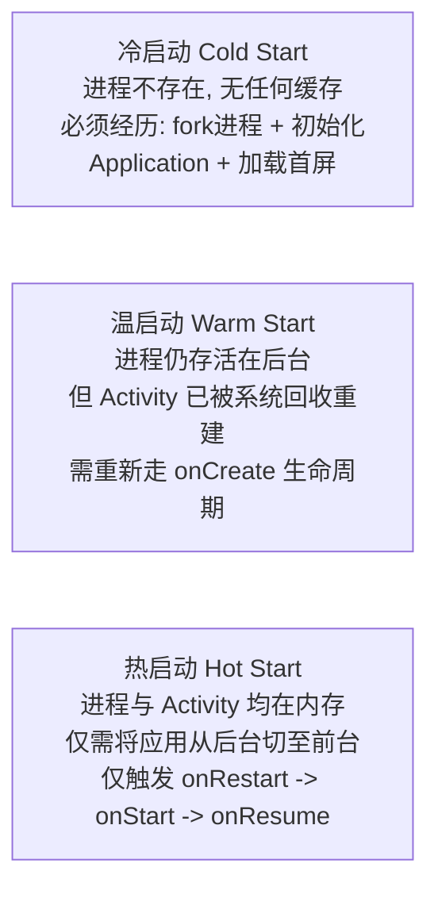
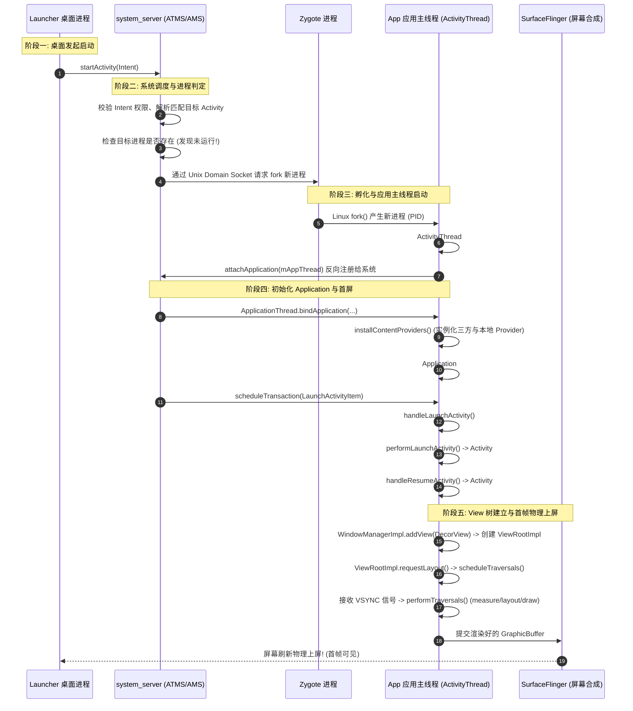

# App冷启动全时序深挖从startActivity到首帧上屏

“应用启动速度（App Startup Time）”是移动端性能工程中最核心的北极星指标之一。冷启动过程跨越了 **Launcher 桌面进程、系统级服务进程（`system_server` 中的 ATMS/AMS/WMS）、Zygote 孵化进程**，最终进入新建的 **App 应用进程**，涉及多次 Linux 进程切换与 IPC 交互。本文将深入拆解从点击图标到物理屏幕点亮第一帧画面的完整底层时序。

---

## 核心底层机制与全景架构

### 1. 启动类型三态物理对比

根据操作系统内存中是否存留进程及 Activity 状态，启动分为三种物理状态：



---

## 源码级架构物理拆解

### 1. 冷启动跨越 4 大进程的完整执行时序图



---

### 2. 关键时序节点深度推导

#### 节点 A：ContentProvider 的启动早于 `Application#onCreate`
从时序可见，`installContentProviders()` 是在 `Application#onCreate` 之前被调用的。
- **面试陷阱**：如果在 ContentProvider 的 `onCreate` 中直接引用了某些在 `Application#onCreate` 中才初始化的全局单例组件（如网络库、DB单例），将直接抛出空指针异常（NPE）崩溃。

#### 节点 B：`onResume` 执行完毕 $\neq$ 界面已对用户可见
- 在 `Activity#onResume()` 阶段，DecorView 甚至还没有挂载到 `ViewRootImpl` 上！
- 真实的物理上屏必须等待 `WindowManagerGlobal.addView()` 实例化 `ViewRootImpl`，并通过 Choreographer 等待下一次硬件 VSYNC 垂直同步信号到来，执行完整的 `performTraversals`（`measure` $\rightarrow$ `layout` $\rightarrow$ `draw`）生成显存帧，再由 SurfaceFlinger 刷到显示器面板。
- 因此，在 `onResume` 中打印的时间**不是用户真正看到界面的时间**。

---

## 启动耗时测量标准与权威工具

### 1. 系统日志与 ADB 命令测量
```bash
adb shell am start -W com.example.app/com.example.app.MainActivity
```
输出指标物理含义：
- **`ThisTime`**：最后一个 Activity 启动耗时；
- **`TotalTime`**：包含目标进程启动到该 Activity 启动的总时间（最具有业务参考价值）；
- **`WaitTime`**：包含前一个 Activity 暂停与新进程启动的总和耗时。

### 2. 业务端权威打点：`reportFullyDrawn()`
当应用包含异步网络请求或骨架屏时，第一帧渲染完成并不等于业务可用。在核心业务数据真正填充上屏的那一刻，显式调用：
```java
activity.reportFullyDrawn();
```
Logcat 会输出真实的系统级统计 `Displayed com.example.app/.MainActivity: +1s250ms`，这也是 Google Play 核心 Vital 指标。

---

## 社招高频硬核连环追问

### Q1: 冷启动时白屏或黑屏（StartingWindow / Preview Window）的底层成因是什么？如何优雅解决？
- **考点**：Window 预览机制与主题适配。
- **解析**：
  - **成因**：App 进程 fork 以及 Application/Activity 实例化的几百毫秒内，App 尚未绘制出任何 View。为了让用户感知即时响应，WMS 会根据该 Activity 在 `AndroidManifest.xml` 中配置的 `theme`，直接创建一个虚拟的临时起始窗口（`StartingWindow` / `SplashScreen`）。如果主题没有指定背景，默认会显示纯白或纯黑底色。
  - **解决方案**：
    1. 为启动页 Activity 配置专属 Theme，设置 `windowBackground` 为与启动插画对齐的 LayerDrawable；
    2. Android 12+ 推荐集成官方 **SplashScreen API**，由系统直接托管平滑过渡动效，进入真正的 `onCreate` 时无缝切出。

### Q2: 为什么 `View.post(Runnable)` 能够精准拿到 View 的宽高？它和 `Handler.post` 有什么本质区别？
- **考点**：`View.post` 内部队列暂存机制与 VSYNC 帧时序。
- **解析**：
  - 如果在 `onCreate` 中直接调用 `new Handler().post(runnable)`，该 Runnable 被压入普通消息队列末端。此时下一帧的 VSYNC 绘制可能还没开始调度，执行时极大概率仍然拿到宽高为 0；
  - **`View.post()` 的底层机制**：
    - 若 View 尚未挂载到 `ViewRootImpl`（`mAttachInfo == null`），`View.post()` 不会立即发消息，而是将 Runnable 暂存在 View 内部的一个 `HandlerActionQueue` 数组中；
    - 当 ViewRootImpl 在 `performTraversals` 执行完测量与布局后，在 `dispatchAttachedToWindow()` 阶段将暂存的 Runnable 批量全部刷出并投递到主线程。因此在 `View.post` 的回调中，**必定能准确拿到 `getWidth()` 和 `getHeight()`**。

---

## 生产级冷启动极速调优 SOP

### 1. 启动任务有向无环图（DAG）异步编排
将所有在 `Application#onCreate` 中初始化的数十个 SDK 抽离，分析相互之间的依赖关系，构建 DAG 拓扑排序任务树：
- **无依赖的任务**：立即投入 `ThreadPoolExecutor` 并行加载（如日志组件、网络埋点）；
- **必须在主线程执行的任务**：严格保留在主线程最小化执行；
- **次要任务**：利用 `IdleHandler` 延后到首帧渲染完毕、CPU 空闲时再行加载。
