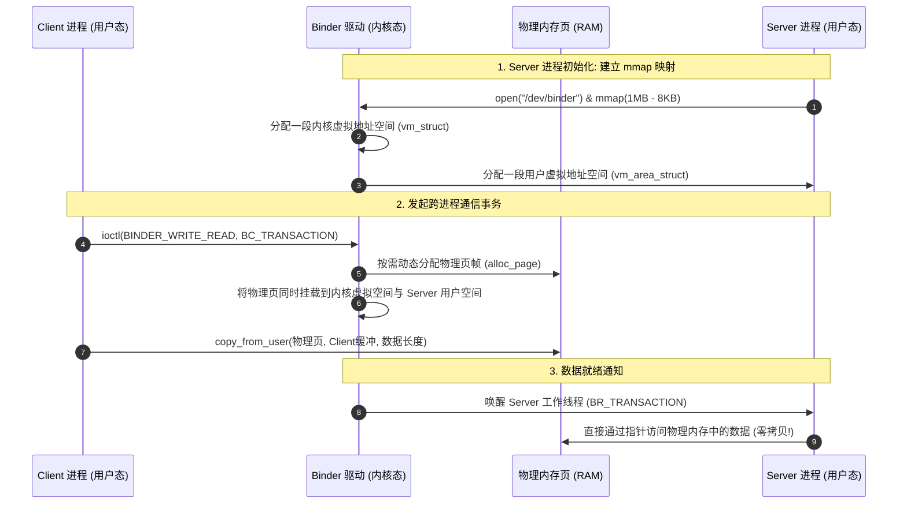

# Binder核心物理机制与一次拷贝mmap原理

在 Android 系统中，绝大多数跨进程通信（IPC，Inter-Process Communication）——无论是四大组件生命周期调度、系统级服务（AMS、WMS、PMS）调用，还是应用层 AIDL，底层无一例外构建在 **Binder 驱动** 之上。理解 Binder 为什么能在移动端兼顾**极低内存拷贝开销、严苛的安全性与优雅的面向对象 RPC 模型**，是每个资深 Android 工程师的立身之本。

---

## 核心底层机制与全景架构

### 1. 主流 Linux IPC 与 Binder 拷贝代价物理对比

操作系统中，用户空间（User Space）与内核空间（Kernel Space）在硬件 MMU（内存管理单元）层面是严格隔离的。两个不同进程之间无法直接访问对方的虚拟内存地址：

```mermaid
flowchart TD
    subgraph 传统 Linux IPC: Socket / 管道 / 消息队列 (2 次拷贝)
        C_User1[进程 A 用户空间] -->|1. copy_from_user| C_Kernel[内核缓冲区]
        C_Kernel -->|2. copy_to_user| C_User2[进程 B 用户空间]
    end

    subgraph 共享内存 Shared Memory (0 次拷贝)
        S_User1[进程 A 虚拟地址] --> PhysMem[同一块物理内存页]
        S_User2[进程 B 虚拟地址] --> PhysMem
        Note_S[零拷贝，但无访问控制机制，缺乏安全性与同步开销]
    end

    subgraph Android Binder IPC (1 次拷贝)
        B_User1[Client 进程用户空间] -->|唯一一次 copy_from_user| B_Phys[共享物理内存页]
        B_Kernel[Binder 内核缓冲区] -.->|mmap 映射| B_Phys
        B_User2[Server 进程用户空间] -.->|mmap 映射| B_Phys
        Note_B[Server 端无需 copy_to_user，直接通过指针寻址读取数据！]
    end
```

| IPC 机制 | 内存拷贝次数 | 物理内存传输路径 | 优缺点与 Android 取舍 |
| :--- | :--- | :--- | :--- |
| **管道 / 消息队列 / Socket** | **2 次** | 进程A $\xrightarrow{\text{copy}}$ 内核缓冲 $\xrightarrow{\text{copy}}$ 进程B | 拷贝开销大，高频 IPC 严重占用移动设备 CPU 与内存带宽 |
| **共享内存（Shared Memory）** | **0 次** | 双方直接通过虚拟地址映射同一物理页 | 性能最高，但**缺乏身份鉴权控制**，各进程易发生恶意读写与死锁 |
| **Android Binder** | **1 次** | 进程A $\xrightarrow{\text{copy\_from\_user}}$ 物理页（Server端已直接映射） | **兼具极致性能（仅 1 次拷贝）与严苛安全性（内核注入 UID/PID 鉴权）** |

---

## 源码级架构物理拆解

### 1. `binder_mmap` 物理内存映射机制

Binder 实现“一次拷贝”的杀手锏是 Linux 内核的 `mmap()`（Memory Map，内存映射）系统调用。

在 Server 端进程启动时，通过 `ProcessState::open_driver()` 打开 `/dev/binder` 驱动，并调用 `mmap()` 向驱动申请一段虚拟内存空间：



#### 关键源码细节：
- 当 Client 发起 `BC_TRANSACTION` 时，Binder 驱动根据传输大小，在 Server 预留的缓冲区中寻找空闲块；
- 驱动调用 `copy_from_user()`，将 Client 用户空间的数据**直接拷贝到该物理内存页中**；
- 因为 Server 进程的虚拟内存空间通过 `mmap` 与这块物理内存建立了页表映射（Page Table Mapping），Server 进程的线程被唤醒后，直接拿到这块内存的虚拟地址指针即可读取数据，**省去了传统 IPC 中从内核向 Server 用户空间的第二次拷贝！**

---

### 2. ServiceManager 的特殊地位：为什么 Handle 固定为 0？

在面向对象的 Binder 模型中，Client 必须通过引用句柄（Handle）来定位远程服务。

- **先有鸡还是先有蛋的悖论**：如果获取服务必须通过 Binder 通信，那谁来提供“查找服务”的初始服务？
- **破局：DNS 根节点设计**：
  - `ServiceManager` 是 Linux 用户空间的一个独立守护进程；
  - 启动后调用 `binder_become_context_manager()`，向 Binder 驱动将自己注册为“全局上下文管理者（Context Manager）”；
  - Binder 驱动内部将 `Handle = 0` 硬编码绑定给 ServiceManager。
  - 任何应用进程拿到 `Handle 0`，就能直接向 ServiceManager 发送 `getService("activity")` 等请求，获取其他业务 Service 的代理 Handle。

---

### 3. Binder 缓冲区上限与 `TransactionTooLargeException`

每个进程在使用 Binder 时，驱动分配的虚拟内存缓冲区有严格的物理上限：
- **普通应用进程**：
  ```cpp
  // frameworks/native/libs/binder/ProcessState.cpp
  #define BINDER_VM_SIZE ((1 * 1024 * 1024) - sysconf(_SC_PAGE_SIZE) * 2)
  ```
  物理大小为：$1\text{ MB} - 8\text{ KB} = 1016\text{ KB}$。
- **异步单向事务（`oneway`）**：
  为了防止单向异步事务（无需等待返回）无节制挤占缓冲区打崩服务端，异步事务被强制限制为只能使用**该缓冲区的一半（约 508 KB）**。
- **注意点**：该 $1016\text{ KB}$ 缓冲区是**该进程内所有正在并发流转的 Binder 事务共享的**！如果多个线程同时传输数十 KB 的数据，瞬间累加超过空闲缓冲区阈值，就会直接抛出 `android.os.TransactionTooLargeException`。

---

## 社招高频硬核连环追问

### Q1: 既然共享内存（Shared Memory）是 0 次拷贝，为什么 Android 不选共享内存作为主流 IPC？
- **考点**：安全性、架构优雅性与移动端取舍。
- **解析**：
  1. **安全性（Security）不可妥协**：共享内存要求通信双方必须信任对方。在开放的 Android 生态中，恶意 App 可以在共享内存中随意修改覆盖系统服务的状态，引发系统提权甚至死机；而 Binder 驱动运行在 Linux 内核空间，**由内核强行注入调用方的 UID 和 PID**，接收方可安全进行权限校验（`checkCallingPermission`），绝对防伪造。
  2. **面向对象与易用性**：共享内存需要开发者自行处理复杂的内存对齐、死锁互斥、进程死亡资源回收；而 Binder 构建了优雅的 `Stub-Proxy` 模型，跨进程调用表现如同本地方法调用。

### Q2: 为什么 Client 向内核拷贝不能省？为什么 Binder 不能做到像 Server 端一样的 0 拷贝？
- **考点**：MMU 虚拟内存隔离与动态写入保护。
- **解析**：
  - Client 进程调用 `write()` 时，数据原本存放在 Client 自己的私有栈/堆内存中。这段内存随时可能被 Client 线程释放或覆写。
  - 要想让 Server 看到这段数据，驱动必须将其固定到一段受保护且与 Server 映射的物理页上。
  - 如果 Client 也要做到 0 拷贝，必须要求 Client 在写数据前就事先向 Binder 申请特定格式的共享物理页，这极大地破坏了 Java/C++ 应用层普通对象实例化的编程通用性。因此保留一次 `copy_from_user` 是工程实现与易用性权衡下的最优解。

### Q3: Binder 是如何实现跨进程对象传递与引用计数的？
- **考点**：Binder 节点（`binder_node`）与 Binder 引用（`binder_ref`）。
- **解析**：
  - 当 Server 将一个 Java Binder 对象（`BBinder`）传给 Client 时，驱动在内核为其创建 `binder_node` 实体节点；
  - 传到 Client 进程时，驱动在 Client 进程中建立一个 `binder_ref` 引用结构，并分配一个整型 `handle` 编号；
  - 驱动通过 `BC_ACQUIRE` / `BC_RELEASE` 自动维护内核节点的强弱引用计数。当所有 Client 进程都释放了该 handle，驱动通知 Server 端回收物理对象，实现了跨进程的分布式垃圾回收。

---

## 生产级避坑指南与故障排查 SOP

### 1. `TransactionTooLargeException` 生产排查与破解 SOP

**事故场景**：Activity 跳转时通过 `Intent.putExtra()` 传递超大商品列表或高分辨率 Bitmap，或者异步回调跨进程传递大数据，App 突发 Crash。

#### 治理方案：
1. **严禁使用 Intent/Bundle 传输大数组与图片**：
   - 数据大于 100KB 时必须禁止直接塞入 Binder！
2. **破局方案 1：基于本地文件或 FileProvider**：
   - 将大对象序列化到应用私有 Cache 目录，Binder 仅透传 `Uri` 或轻量文件路径。
3. **破局方案 2：基于匿名共享内存（Ashmem / MemoryFile）**：
   - 大数据写入 `MemoryFile`，Binder 仅传输其底层的 `ParcelFileDescriptor`（本质仅占 4 字节的文件描述符），彻底突破 1MB 物理上限，实现百兆级数据的高速共享。
