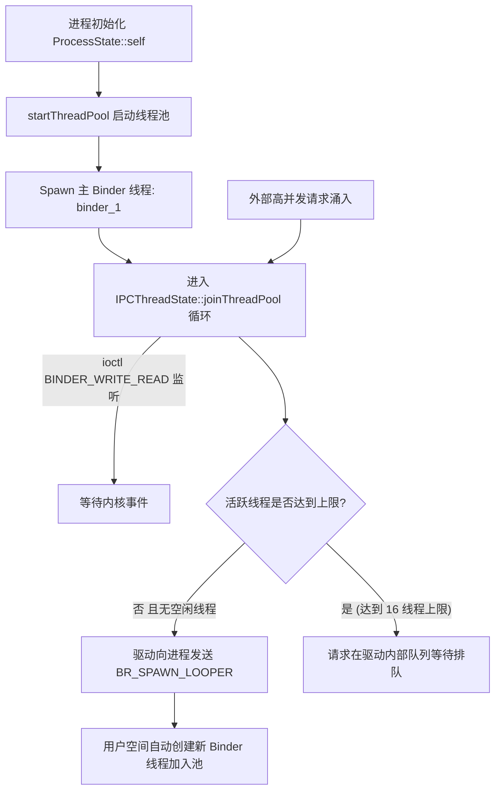

# Binder线程池管理死亡代理与驱动协议码

在大型 Android 架构设计中，跨进程通信绝非单线程的一对一交互，而是多进程、多并发线程交织的网状调用系统。深入理解 **Binder 驱动的线程池动态伸缩机制、底层协议码流转控制，以及跨进程高可用基石“死亡代理（DeathRecipient）”**，是衡量 Android 资深工程师架构与底层功底的关键标尺。

---

## 核心底层机制与全景架构

### 1. Binder 线程池生命周期全景

每个支持 Binder 服务的进程（包括系统服务进程 `system_server` 与普通应用进程），在初始化时都会启动 Binder 线程池以并发响应外部请求：



#### 关键常量与上限：
```cpp
// frameworks/native/libs/binder/ProcessState.cpp
#define DEFAULT_MAX_BINDER_THREADS 16
```
- Binder 线程池的默认最大线程数为 **16 个**；
- 线程名通常以 `Binder:pid_x` 命名（如 `Binder:1234_1`、`Binder:1234_2`）。

---

## 源码级架构物理拆解

### 1. 驱动命令动态创建线程：`BR_SPAWN_LOOPER` 机制

Binder 线程池并不是一开始就无脑创建 16 个线程，而是**按需弹性伸缩**的：
1. 进程启动时先拉起 1 个主 Binder 线程进入 `joinThreadPool()`，通过 `ioctl(BINDER_WRITE_READ)` 阻塞等待请求；
2. 当有并发请求到来，且当前空闲线程数为 0、同时总线程数未达到 `max_threads`（16）时，驱动在处理请求的同时向进程返回协议码 **`BR_SPAWN_LOOPER`**；
3. 用户空间的 `IPCThreadState` 接收到 `BR_SPAWN_LOOPER` 后，立即调用 `pthread_create()` 创建一个新的工作线程，该线程向驱动发送 `BC_REGISTER_LOOPER` 完成注册，并一同参与排队接客。

---

### 2. 死亡代理（`DeathRecipient`）：高可用容灾核心

由于 Client 和 Server 运行在不同的物理进程中，Server 端随时可能因为 **OOM、底层断电、Native Crash、或被系统 LowMemoryKiller（LMK）杀死**。如果 Server 进程阵亡，Client 却毫不知情继续调用，将直接引发崩溃（`DeadObjectException`）。

```mermaid
sequenceDiagram
    autonumber
    participant Client as Client 客户端
    participant Proxy as IBinder / BinderProxy
    participant Driver as Binder 驱动 (内核态)
    participant Server as Server 服务端 (意外崩溃)

    Client ->> Proxy: proxy.linkToDeath(deathRecipient, 0)
    Proxy ->> Driver: ioctl(BC_REQUEST_DEATH_NOTIFICATION)
    Note over Driver: 在内核将 binder_ref 关联死亡通知结构体
    
    ... 业务正常流转一段时间后 ...
    Note over Server: Server 进程突发 Crash 被操作系统杀死!
    Server ->> Driver: 内核触发 release(/dev/binder) 释放进程资源
    Note over Driver: 驱动遍历该进程所有 binder_node，发现挂载了死亡通知
    Driver ->> Proxy: 驱动主动下发返回码 BR_DEAD_BINDER
    Proxy ->> Client: 触发 deathRecipient.binderDied() 回调!
    Note over Client: 客户端感知对端死亡，清空旧缓存引用并启动自动重连机制
```

---

### 3. Binder 核心双向协议码全景体系

用户空间与内核驱动之间通过 `ioctl(fd, BINDER_WRITE_READ, &bwr)` 交互，数据流被严格划分为两组命令：
- **BC 协议码（Binder Command）**：用户空间向内核驱动发送的指令；
- **BR 协议码（Binder Return）**：内核驱动向用户空间回复的事件。

| 协议码类别 | 常见协议码 | 物理含义与底层行为 |
| :--- | :--- | :--- |
| **BC 指令** | `BC_TRANSACTION` | 客户端发起远程事务请求，驱动负责将数据投递给目标进程 |
| | `BC_REPLY` | 服务端完成方法计算，将返回结果回写给客户端 |
| | `BC_ENTER_LOOPER` | 告知驱动：主 Binder 线程已就绪进入事件循环 |
| | `BC_REGISTER_LOOPER` | 告知驱动：动态新建的从属 Binder 线程已就绪 |
| | `BC_REQUEST_DEATH_NOTIFICATION` | 向驱动注册 Binder 死亡监听 |
| **BR 回复** | `BR_TRANSACTION` | 驱动通知服务端：有新的客户端请求需要你处理 |
| | `BR_REPLY` | 驱动通知客户端：服务端的执行结果已经送达物理共享页 |
| | `BR_DEAD_BINDER` | 驱动通知客户端：所引用的远程 Service 已经物理死亡 |
| | `BR_SPAWN_LOOPER` | 驱动命令服务端：当前并发过高，请立即创建一个新线程加入池 |

---

## 社招高频硬核连环追问

### Q1: Binder 线程池如果 16 个线程全部被占满了，后续请求会发生什么？会立即报错吗？
- **考点**：Binder 线程池耗尽（Thread Exhaustion）与系统级卡顿。
- **解析**：
  - **不会立即抛出异常**。
  - 当 16 个线程都在忙碌（例如执行耗时网络请求或数据库死锁），Binder 驱动会将后续新到的请求挂载到该服务端进程的**等待队列（`todo` 链表）**中；
  - 客户端的调用线程会继续在内核的 `wait_event_interruptible` 中**无限期阻塞挂起（Sleep）**；
  - 如果调用方是主线程，将直接触发 **ANR**；若服务端是系统的 `system_server` 发生线程池耗尽，则会引发**整台手机界面冻结、无响应、进而触发系统级 Watchdog 软重启**！

### Q2: `linkToDeath` 的接收回调 `binderDied()` 是在哪个线程执行的？
- **考点**：线程上下文与安全切换。
- **解析**：
  - `binderDied()` **绝不是在客户端的主线程（UI 线程）执行的**！
  - 驱动向客户端进程下发 `BR_DEAD_BINDER` 时，是由客户端自身的某个 **空闲 Binder 线程（如 `Binder:1234_x`）** 负责接收并调度的；
  - **避坑提示**：若在 `binderDied()` 内部需要操作 UI（如弹窗提示、更新界面状态），必须使用 `Handler.post()` 或 `runOnUiThread()` 切换回主线程，否则将抛出 `CalledFromWrongThreadException`。

---

## 生产级高可用断线重连实战 SOP

```java
public class RemoteServiceManager {
    private static final String TAG = "RemoteServiceManager";
    private IRemoteApi remoteService;
    private final IBinder.DeathRecipient deathRecipient = new IBinder.DeathRecipient() {
        @Override
        public void binderDied() {
            Log.e(TAG, "检测到远程服务异常终止，执行容灾重置与重连！");
            if (remoteService != null) {
                // 1. 移除已阵亡对象的死亡监听
                remoteService.asBinder().unlinkToDeath(this, 0);
                remoteService = null;
            }
            // 2. 指数退避重新发起 bindService 绑定
            scheduleReconnect();
        }
    };

    public void setService(IBinder binder) {
        try {
            // 注册死亡代理监听
            binder.linkToDeath(deathRecipient, 0);
            this.remoteService = IRemoteApi.Stub.asInterface(binder);
        } catch (RemoteException e) {
            Log.e(TAG, "绑定死亡代理失败，说明服务端此时已经阵亡", e);
        }
    }

    private void scheduleReconnect() {
        // 延时重连逻辑...
    }
}
```
