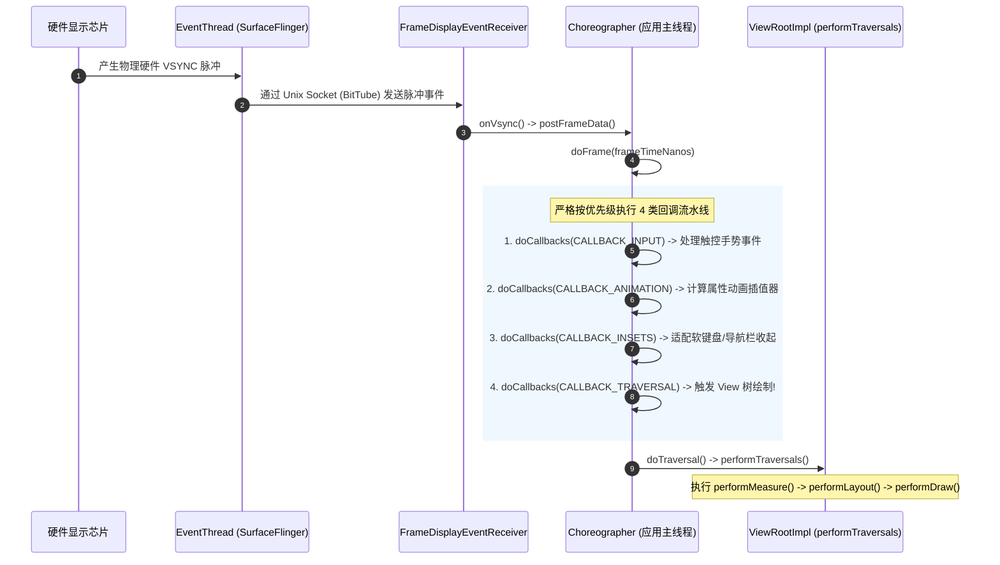
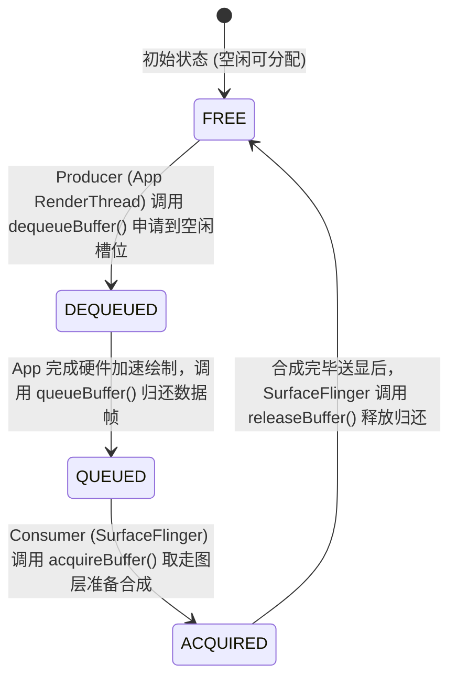

# Choreographer编舞者VSYNC与SurfaceFlinger渲染管线

在 Android 系统中，用户之所以能感受到“丝滑顺畅”或者“卡顿掉帧”，核心取决于底层图形渲染管线的运转效率。**Choreographer（编舞者）** 充当了应用层 View 树更新的指挥官，而 **SurfaceFlinger** 则是负责将各个图层混合合成并刷入显示屏幕的总调度师。理解硬件 **VSYNC 垂直同步信号** 是如何协调应用层与系统合成层的，是突破 Android 性能调优天花板的核心必修课。

---

## 核心底层机制与全景架构

### 1. Android 图形全链路生产-消费拓扑

从应用层触发 `view.invalidate()` 到最终像素点在屏幕上发光，经历了一条严密的物理管线：

```mermaid
flowchart TD
    App[应用进程 App (Producer 生产者)<br/>ViewRootImpl / RenderThread] -->|绘制生成画面并填充 GraphicBuffer| BQ[BufferQueue 环形缓冲区<br/>管理 Buffer 的 dequeue / queue 状态]
    
    BQ -->|传递渲染就绪的 Buffer| SF[SurfaceFlinger 进程 (Consumer 消费者)<br/>统一收集全系统所有窗口图层]
    
    VSYNC[硬件 VSYNC 垂直同步信号发生器<br/>60Hz: 每 16.6ms / 120Hz: 每 8.3ms 发送脉冲]
    VSYNC -.->|唤醒应用开始布局与绘制| App
    VSYNC -.->|唤醒合成器开始混合图层| SF
    
    SF --> HWC[HWC: Hardware Composer 芯片硬件图层合成器]
    HWC --> Display[物理显示屏面板 Display Controller]
```

---

## 源码级架构物理拆解

### 1. Choreographer 接收 VSYNC 后的 4 阶段执行链

当调用 `view.requestLayout()` 或 `view.invalidate()` 时，最终会调用 `ViewRootImpl#scheduleTraversals()`，向 `Choreographer` 注册一个下一次 VSYNC 信号的回调：



#### 为什么 4 类回调必须严格按此顺序执行？
- **INPUT 优先**：必须先处理用户的最新触控（如按住列表拖动），更新位移参数；
- **ANIMATION 紧随其后**：根据最新的动画进度（`ValueAnimator`）重新计算当前帧的属性变化；
- **INSETS 次之**：软键盘如果在此刻弹出，更新窗口的裁剪和偏移；
- **TRAVERSAL 最后执行**：将上述手势、动画与窗口偏移的所有最终状态，**在唯一的一次 `performTraversals` 中合并计算完成**，杜绝重复无效重绘！

---

### 2. BufferQueue 生产者-消费者流转状态机

`BufferQueue` 是 Android 图形系统的血液循环中枢，它在物理上管理着一组指向显存的 `GraphicBuffer`：



- **阻塞机制**：如果 App 绘制太慢，或者 SurfaceFlinger 消耗不及时，当所有的 Buffer（通常为 3 个）都被占用时，下一次 `dequeueBuffer()` 将直接阻塞 App 的 `RenderThread`，表现为应用帧率断崖式下跌。

---

## 社招高频硬核连环追问

### Q1: 为什么在 60Hz 屏幕下，掉帧以 16.6ms 的整数倍（33ms, 50ms）发生？
- **考点**：垂直同步信号强制周期性对其。
- **解析**：
  - 屏幕电子枪的物理扫描是周期的。对于 60Hz 显示屏，每隔精确的 $16.66\text{ ms}$（$\frac{1000}{60}$）产生一次 VSYNC 信号；
  - 假设 App 在第 1 个 VSYNC 到来时开始计算，耗时了 $18\text{ ms}$（哪怕只超出了 $1.3\text{ ms}$）；
  - 当第 2 个 VSYNC 脉冲到达时，**App 的 GraphicBuffer 还没准备好，SurfaceFlinger 只能被迫再次显示上一帧的旧画面**；
  - 因此这一帧画面在屏幕上被迫停留了两次 VSYNC 周期，即 $16.6 \times 2 = 33.3\text{ ms}$，用户肉眼直观感知到“卡顿（Jank）”一下！

### Q2: 既然有了 Choreographer，为什么在主线程连续调用 10 次 `view.invalidate()` 并不会执行 10 次绘制？
- **考点**：`TraversalRunnable` 的屏障保护与去重。
- **解析**：
  - `ViewRootImpl` 内部维护了一个布尔状态变量：`mTraversalScheduled`；
  - 第一次调用 `invalidate()` 时，`scheduleTraversals()` 将 `mTraversalScheduled` 置为 `true`，并向 Choreographer 注册 `mTraversalRunnable`；
  - 后续 9 次 `invalidate()` 调用时，检查发现 `if (mTraversalScheduled) return;`，直接静默退出；
  - 只有当下一个 VSYNC 信号到来，真正的 `doTraversal()` 开始执行时，才会将 `mTraversalScheduled` 重置为 `false`。
  - **收益**：该机制实现了瞬时多次重绘请求在时间轴上的**合并去重**，保证一个刷新周期最多只触发一次昂贵的 View 树遍历。

---

## 生产级避坑指南与排障 SOP

### 1. 利用 Systrace / Perfetto 精确定位 Choreographer 异常掉帧

**排障步骤**：
1. **抓取 Perfetto / Systrace 追踪文件**：
   ```bash
   python systrace.py -a com.example.app -o trace.html sched gfx view app
   ```
2. **在 Chrome 打开 `chrome://tracing` 加载文件**：
   - 观测主线程泳道中的 `Choreographer#doFrame` 切片；
   - 检查切片耗时是否突破了 $16.6\text{ ms}$（绿色通常代表合格，黄色/红色代表严重超标）；
3. **定位罪魁祸首**：
   - 若 `traversal` 耗时过长：排查是否存在过深的 View 层级与嵌套 `RelativeLayout` 引发的多重测量；
   - 若 `input` 耗时过长：检查是否在 `onTouchEvent` 中执行了耗时的复杂计算或数据库操作。
