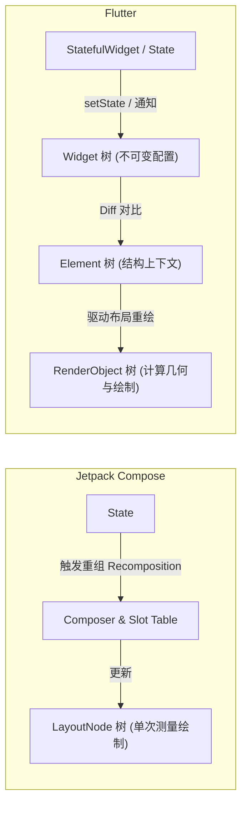
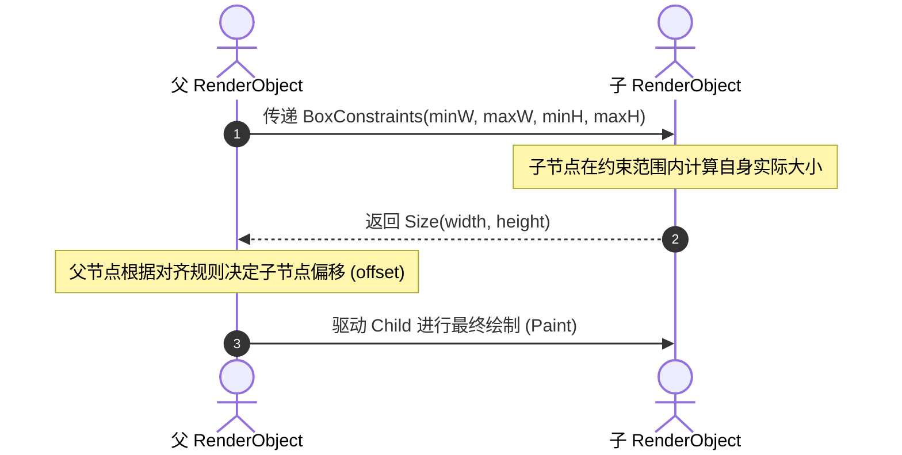

# Compose 与 Flutter 现代化声明式 UI 控件布局与优化全景指南

> 本文系统性归纳整理 **Jetpack Compose (Android 原生声明式)** 与 **Flutter (跨平台声明式)** 的布局哲学、核心控件一一对照表、经典业务布局 MVP 模板、布局测量机制深度剖析及**工业级布局性能优化五大铁律**。无论是 Android 原生转型还是 Flutter 跨端进阶，读完本文均可建立系统性心智模型。

---

## 一、 声明式 UI 核心心智模型对比

现代 UI 开发彻底摒弃了传统命令式（findViewById / 动态 addView / 手动 setVisibility）的思路，全面转向 **状态驱动 UI（State-driven UI）**：

$$\text{UI} = f(\text{State})$$

界面只是当前业务状态（State）的一个轻量级投影。当状态改变时，框架自动负责重新计算并渲染需要更新的区域。



### 核心机制对比总览

| 架构维度 | Jetpack Compose | Flutter |
| :--- | :--- | :--- |
| **编程语言** | Kotlin | Dart |
| **底层渲染引擎** | Android 原生 Canvas / Skia（Android 12+ 适配 RenderThread / Vulkan） | 自研 Impeller（新） / Skia（旧）通过 NDK 绕过系统 View |
| **视图构建形态** | 纯 Kotlin 函数（带 `@Composable` 编译期注解） | 类继承（`StatelessWidget` / `StatefulWidget`） |
| **树结构设计** | 单一的 `LayoutNode` 语义树，配合编译期注入的 `Slot Table` 记录执行状态 | 经典三棵树：`Widget`（配置） $\to$ `Element`（关系） $\to$ `RenderObject`（渲染） |
| **更新机制** | **重组（Recomposition）**：根据位掩码与 Slot Table 智能跳过无变化函数 | **重建（Rebuild）**：重新调用 `build()` 方法，Element 树对比更新 RenderObject |
| **样式与行为修饰** | **链式 Modifier**（单向装饰流，顺序敏感） | **Widget 嵌套包裹**（如 `Padding`、`Container`、`DecoratedBox`） |

---

## 二、 各版块控件与布局全景对照速查表

在日常开发中，95% 的页面布局均可由以下 8 大板块组合而成：

### 1. 文本与输入组件

| 布局/控件场景 | Jetpack Compose | Flutter | 核心参数/关键属性说明 |
| :--- | :--- | :--- | :--- |
| **基础文本** | `Text("Hello")` | `Text("Hello")` | 字体大小（`fontSize`/`style`）、颜色（`color`）、行数（`maxLines`）、溢出截断（`overflow`） |
| **富文本混排** | `Text(buildAnnotatedString { ... })` | `Text.rich(TextSpan(children: [...]))` | 支持同一段文字内不同的颜色、加粗与点击事件（`Clickable` / `GestureRecognizer`） |
| **基础单行/多行输入** | `TextField` / `BasicTextField` | `TextField` / `TextFormField` | 控制器（`TextFieldValue` vs `TextEditingController`）、软键盘动作（`ImeOptions` vs `TextInputAction`） |

### 2. 图像与矢量图标

| 布局/控件场景 | Jetpack Compose | Flutter | 核心参数/关键属性说明 |
| :--- | :--- | :--- | :--- |
| **本地图片** | `Image(painterResource(R.drawable.pic), ...)` | `Image.asset("assets/pic.png")` | 缩放填充模式（`contentScale = ContentScale.Crop` vs `fit: BoxFit.cover`） |
| **网络异步图片** | Coil 库：`AsyncImage(model = url, ...)` | `Image.network(url)` / `CachedNetworkImage` | 占位图（placeholder）、加载失败图（error）、内存/磁盘双重缓存 |
| **矢量系统图标** | `Icon(Icons.Default.Favorite, contentDescription)`| `Icon(Icons.favorite)` | 着色（`tint` vs `color`）、无障碍描述 |

### 3. 线性弹性布局（水平与垂直）

| 布局/控件场景 | Jetpack Compose | Flutter | 核心参数/关键属性说明 |
| :--- | :--- | :--- | :--- |
| **水平排布** | `Row { ... }` | `Row(children: [...])` | 主轴对齐（`horizontalArrangement` vs `mainAxisAlignment`）、交叉轴对齐（`verticalAlignment` vs `crossAxisAlignment`） |
| **垂直排布** | `Column { ... }` | `Column(children: [...])` | 主轴空间均分（`Arrangement.SpaceBetween` vs `MainAxisAlignment.spaceBetween`） |
| **剩余空间弹性填充** | `Modifier.weight(1f)` | `Expanded(child: ...)` / `Flexible` | `Expanded` 必须吃满剩余空间；`Flexible` 可根据子项自身需求按比例分配 |
| **弹性占位留白** | `Spacer(modifier = Modifier.weight(1f))` | `Spacer()` | 用于推挤两侧控件到屏幕边界 |

### 4. 层叠重合与绝对定位

| 布局/控件场景 | Jetpack Compose | Flutter | 核心参数/关键属性说明 |
| :--- | :--- | :--- | :--- |
| **层叠布局** | `Box { ... }` | `Stack(children: [...])` | 默认层叠顺序：后声明的组件覆盖在先声明的组件上方 |
| **内部对齐** | `Modifier.align(Alignment.BottomEnd)` | `Align(alignment: Alignment.bottomRight)` | 锚定到父容器的特定方位（九宫格方位点） |
| **绝对边距定位** | `Modifier.padding(...)` / `offset(...)` | `Positioned(top: 10, right: 10, child: ...)` | 距离父边缘的绝对像素偏移 |
| **铺满父容器大小** | `Modifier.matchParentSize()` | `Positioned.fill(child: ...)` | 尺寸与父容器严格等大，且**不参与父容器自身大小的测量计算**，避免死循环 |

### 5. 流式折行布局（标签云/动态筛选器）

| 布局/控件场景 | Jetpack Compose | Flutter | 核心参数/关键属性说明 |
| :--- | :--- | :--- | :--- |
| **水平自动换行** | `FlowRow(horizontalArrangement = ...)` | `Wrap(spacing: 8.0, runSpacing: 4.0)` | 空间不足时自动换行，多用于商品 Tag 标签、搜索历史云 |
| **垂直自动折列** | `FlowColumn` | `Wrap(direction: Axis.vertical)` | 垂直方向不足时自动折到下一列 |

### 6. 长列表与网格（高性能动态复用）

| 布局/控件场景 | Jetpack Compose | Flutter | 核心参数/关键属性说明 |
| :--- | :--- | :--- | :--- |
| **纵向高效列表** | `LazyColumn { items(list, key = {...}) }` | `ListView.builder(itemBuilder: ...)` | 只创建可见区域组件；**必须声明稳定 key** 防止增删时错误刷新 |
| **横向高效列表** | `LazyRow { ... }` | `ListView.builder(scrollDirection: Axis.horizontal)` | 常见于轮播图、横向分类 Tab 栏 |
| **网格布局** | `LazyVerticalGrid(columns = GridCells.Fixed(2))` | `GridView.builder(gridDelegate: ...)` | 等宽网格、自适应列宽（`GridCells.Adaptive(120.dp)`） |
| **复杂异构滚动视图** | `LazyColumn` 嵌套不同项 / 吸顶 `stickyHeader` | `CustomScrollView(slivers: [SliverAppBar, SliverList])` | 统一滚动轴，解决多列表嵌套滑动冲突的终极方案 |

### 7. 页面骨架与导航脚手架

| 布局/控件场景 | Jetpack Compose | Flutter | 核心参数/关键属性说明 |
| :--- | :--- | :--- | :--- |
| **标准页面骨架** | `Scaffold` | `Scaffold` | 集成标题栏（`topBar` vs `appBar`）、底部栏（`bottomBar` vs `bottomNavigationBar`）、悬浮按钮（`floatingActionButton`） |
| **底部抽屉弹窗** | `ModalBottomSheet` | `showModalBottomSheet(...)` | 手势下拉收起、全屏沉浸拖拽手势 |

---

## 三、 典型业务布局 MVP 实战代码直观对照

### 场景：电商标准“自适应商品卡片”（图片 + 标签 + 标题 + 价格与加购按钮）

#### 1. Compose 实现代码
```kotlin
@Composable
fun ProductCard(
    imageUrl: String,
    title: String,
    tags: List<String>,
    price: String,
    onAddClick: () -> Unit,
    modifier: Modifier = Modifier
) {
    Card(
        modifier = modifier.fillMaxWidth().padding(8.dp),
        shape = RoundedCornerShape(12.dp),
        elevation = CardDefaults.cardElevation(defaultElevation = 4.dp)
    ) {
        Column(modifier = Modifier.padding(12.dp)) {
            // 1. 商品图片（自适应比例）
            AsyncImage(
                model = imageUrl,
                contentDescription = null,
                contentScale = ContentScale.Crop,
                modifier = Modifier.fillMaxWidth().height(160.dp).clip(RoundedCornerShape(8.dp))
            )
            Spacer(modifier = Modifier.height(8.dp))

            // 2. 标签流
            FlowRow(
                horizontalArrangement = Arrangement.spacedBy(6.dp),
                verticalArrangement = Arrangement.spacedBy(4.dp)
            ) {
                tags.forEach { tag ->
                    Text(
                        text = tag,
                        fontSize = 10.sp,
                        color = MaterialTheme.colorScheme.primary,
                        modifier = Modifier
                            .background(MaterialTheme.colorScheme.primaryContainer, RoundedCornerShape(4.dp))
                            .padding(horizontal = 6.dp, vertical = 2.dp)
                    )
                }
            }
            Spacer(modifier = Modifier.height(6.dp))

            // 3. 商品标题（最多2行）
            Text(
                text = title,
                maxLines = 2,
                overflow = TextOverflow.Ellipsis,
                style = MaterialTheme.typography.titleMedium
            )
            Spacer(modifier = Modifier.height(12.dp))

            // 4. 底部栏：价格 + 加购按钮
            Row(
                modifier = Modifier.fillMaxWidth(),
                horizontalArrangement = Arrangement.SpaceBetween,
                verticalAlignment = Alignment.CenterVertically
            ) {
                Text(
                    text = "¥$price",
                    color = Color.Red,
                    style = MaterialTheme.typography.titleLarge
                )
                Button(onClick = onAddClick, shape = CircleShape) {
                    Text("+ 选购")
                }
            }
        }
    }
}
```

#### 2. Flutter 实现代码
```dart
class ProductCard extends StatelessWidget {
  final String imageUrl;
  final String title;
  final List<String> tags;
  final String price;
  final VoidCallback onAddClick;

  const ProductCard({
    super.key,
    required this.imageUrl,
    required this.title,
    required this.tags,
    required this.price,
    required this.onAddClick,
  });

  @override
  Widget build(BuildContext context) {
    return Card(
      margin: const EdgeInsets.all(8.0),
      shape: RoundedRectangleBorder(borderRadius: BorderRadius.circular(12.0)),
      elevation: 4.0,
      child: Padding(
        padding: const EdgeInsets.all(12.0),
        child: Column(
          crossAxisAlignment: CrossAxisAlignment.start,
          mainAxisSize: MainAxisSize.min,
          children: [
            // 1. 商品图片
            ClipRRect(
              borderRadius: BorderRadius.circular(8.0),
              child: Image.network(
                imageUrl,
                height: 160.0,
                width: double.infinity,
                fit: BoxFit.cover,
              ),
            ),
            const SizedBox(height: 8.0),

            // 2. 标签流
            Wrap(
              spacing: 6.0,
              runSpacing: 4.0,
              children: tags.map((tag) => Container(
                padding: const EdgeInsets.symmetric(horizontal: 6.0, vertical: 2.0),
                decoration: BoxDecoration(
                  color: Colors.blue.shade50,
                  borderRadius: BorderRadius.circular(4.0),
                ),
                child: Text(
                  tag,
                  style: const TextStyle(fontSize: 10.0, color: Colors.blue),
                ),
              )).toList(),
            ),
            const SizedBox(height: 6.0),

            // 3. 商品标题（最多2行）
            Text(
              title,
              maxLines: 2,
              overflow: TextOverflow.ellipsis,
              style: const TextStyle(fontSize: 16.0, fontWeight: FontWeight.bold),
            ),
            const SizedBox(height: 12.0),

            // 4. 底部栏：价格 + 加购按钮
            Row(
              mainAxisAlignment: MainAxisAlignment.spaceBetween,
              children: [
                Text(
                  "¥$price",
                  style: const TextStyle(fontSize: 20.0, color: Colors.red, fontWeight: FontWeight.bold),
                ),
                ElevatedButton(
                  onPressed: onAddClick,
                  style: ElevatedButton.styleFrom(shape: const StadiumBorder()),
                  child: const Text("+ 选购"),
                ),
              ],
            ),
          ],
        ),
      ),
    );
  }
}
```

---

## 四、 布局测量机制深度剖析（为什么会溢出与崩溃？）

### 1. Flutter 的“约束传递黄金法则”

Flutter 官方有一句最著名的设计准则：
> **Constraints go down. Sizes go up. Parent sets position.**  
> （约束向下传递，尺寸向上传递，父节点决定最终摆放位置。）



#### 常见报错与根本成因：
* **`RenderFlex overflowed by xxx pixels`（黄黑相间斑马线溢出）**：
  - **原因**：`Row` 或 `Column` 默认给子组件的是**无边界宽度/高度约束（Unbounded）**，子组件总尺寸超出了父容器允许的物理屏幕空间。
  - **解法**：在文本或可变项外包裹 `Expanded` 或 `Flexible`，强制其接受紧约束，限制在剩余可用空间内。
* **`Vertical viewport was given unbounded height`（无限高度致命崩溃）**：
  - **原因**：在 `Column`（垂直无限高）里直接放 `ListView`（需要根据父容器高度决定视口），两者互相等待对方给出高度限制，陷入死循环。
  - **解法**：为内层 `ListView` 包裹一层 `Expanded`，或者设置 `shrinkWrap: true` 配合 `physics: NeverScrollableScrollPhysics()`。

---

### 2. Compose 的“单次测量原则”（Single-Pass Measurement）

在传统 Android View 体系中，`RelativeLayout` 或包含权重的 `LinearLayout` 会触发多次测量（Multi-measure），导致树深度增加时出现 $O(2^n)$ 级测量性能灾难。

Compose 在底层架构中**严禁子项多次测量**：
- 每个 `LayoutNode` 在一轮布局中**只允许被 `measure()` 一次**。
- 如果需要父组件根据所有子项的最宽/最高尺寸来对齐（例如两个按钮宽度强制相同），Compose 提供了 **固有特性测量（Intrinsics Measurement）**：在正式测量前先查询子项的最小/最大内在宽高（`IntrinsicSize.Min`），优雅避免重复递归测量。

> [!WARNING] Modifier 链式调用的“顺序陷阱”
> Compose 的 Modifier 是由外向内包裹的链条，**调用顺序不同，最终效果天差地别**：
> ```kotlin
> // 案例 1：先加内边距，再上背景色 -> 背景色会把 padding 区域一同填满
> Modifier.padding(16.dp).background(Color.Red)
> 
> // 案例 2：先上背景色，再加上外边距 -> 背景色只染内部核心，外围保留空白
> Modifier.background(Color.Red).padding(16.dp)
> 
> // 案例 3：点击涟漪范围
> Modifier.padding(16.dp).clickable { } // 只有扣除 16dp 后的内层才能被点击并有涟漪
> Modifier.clickable { }.padding(16.dp) // 点击热区覆盖包含 16dp 整体
> ```

---

## 五、 工业级布局性能优化五大铁律

### 💎 Jetpack Compose 布局优化 5 大铁律

#### 1. 状态读取极致下沉（跳过 Composition 重组阶段）
Compose 的执行分为三大阶段：**组合（Composition） $\to$ 布局（Layout） $\to$ 绘制（Draw）**。
- **反例（严重卡顿）**：在 `@Composable` 函数顶层直接读取高频变化的滑动偏移 `scrollState.value`，导致整个组件每秒重组上百次：
  ```kotlin
  // 错误：触发全组件高频 Recomposition
  val offset = scrollState.value
  Box(modifier = Modifier.offset(y = offset.dp))
  ```
- **正例（120 帧丝滑）**：使用 Lambda 延迟读取，将状态读取下沉至 **布局或绘制阶段**，彻底绕过组合重组：
  ```kotlin
  // 正确：跳过 Composition，直接在 Layout/Draw 阶段完成位移，零重组消耗！
  Box(modifier = Modifier.offset { IntOffset(x = 0, y = scrollState.value) })
  // 或者使用 graphicsLayer 在绘制层硬件加速
  Box(modifier = Modifier.graphicsLayer { translationY = scrollState.value.toFloat() })
  ```

#### 2. 长列表必须指定唯一且稳定的 `key` 与 `contentType`
- 如果未指定 `key`，`LazyColumn` 默认使用 `index` 索引。一旦在头部插入一项，后续所有 Item 的 index 全部移位，触发整列全量重建。
- 通过 `contentType` 区分异构视图类型，让相同布局的组件在内部高效复用渲染结构：
  ```kotlin
  LazyColumn {
      items(
          items = feedList,
          key = { item -> item.uniqueId }, // 1. 唯一且不可变的主键
          contentType = { item -> item.viewType } // 2. 相似布局复用池
      ) { item ->
          FeedItemView(item)
      }
  }
  ```

#### 3. 规避 Unstable 参数，激活“智能跳过”（Smart Skip）
- 官方编译器对 Kotlin 原生 `List<T>` 默认判定为 `Unstable`（因为实现可能是可变的 ArrayList），导致父组件重组时子组件必定跟着重组。
- **解法**：使用 `kotlinx.collections.immutable.ImmutableList`，或在数据实体类上标注 `@Immutable` / `@Stable` 注解。

#### 4. 善用 `derivedStateOf` 削峰过滤微小波动
- 监听滑动距离决定是否展示“回到顶部按钮”时，每滑 1px 状态都在变。使用 `derivedStateOf` 将连续高频数值转换为二元布尔值：
  ```kotlin
  val showScrollToTop by remember {
      derivedStateOf { listState.firstVisibleItemIndex > 5 }
  }
  // 只有当大于 5 的布尔结果由 false 变 true（或反之）时，才会触发重组
  ```

#### 5. 绝对不要在组合作用域执行耗时计算
- 在 `@Composable` 函数体内直接进行日期格式化、列表复杂排序、高斯模糊参数计算等，每次重组都会重复执行。
- 必须使用 `remember(calcKey) { ... }` 缓存耗时计算结果，或移入 ViewModel 异步处理。

---

### 🚀 Flutter 布局优化 5 大铁律

#### 1. 善用 `const` 构造函数，榨干 Element 树复用红利
- 在 Flutter 中，标记为 `const` 的 Widget 在编译期即生成常驻常量。
- 当父级调用 `setState()` 触发重绘时，Element 树执行 Diff 时发现该 `const` 子组件引用完全一致，**直接整棵跳过其 `build()`，实现 0 CPU 开销的绝对优化**。
  ```dart
  // 正确：只要不依赖动态变量的静态修饰组件，全部加上 const
  const Padding(
    padding: EdgeInsets.all(16.0),
    child: Text("固定文案", style: TextStyle(color: Colors.grey)),
  );
  ```

#### 2. 精准下沉状态更新范围，杜绝全屏大 `setState`
- `setState` 的刷新范围是**当前 State 类的整个 `build()` 子树**。在最外层 Page 级别 `setState` 会导致整屏上百个组件重新 `build()`。
- **解法**：
  - 将频繁变化的微小局部抽离为独立的 `StatefulWidget`。
  - 使用 `ValueListenableBuilder`、`Selector` (Provider) 或 `BlocBuilder` 做精细化局部响应。

#### 3. 复杂动态组件使用 `RepaintBoundary` 隔绝重绘蔓延
- 当一个复杂的子组件（如持续旋转的加载动画、手势跟随的高频拖拽元素）重绘时，默认可能会向上传播，引起整个视口 RenderObject 全部重新绘制。
- **解法**：用 `RepaintBoundary` 将高频重绘模块包裹起来，框架会为其分配独立的渲染图层（Render Layer），将重绘限制在自己的局域图层内：
  ```dart
  RepaintBoundary(
    child: CustomSpinnerAnimation(),
  )
  ```

#### 4. 警惕离屏渲染（SaveLayer）吞噬 GPU 性能
以下组件会触发 GPU 离屏缓冲（Offscreen Buffer）与图层合成（Blend），在低端机上是掉帧元凶：
- `Opacity`（透明度）：如果只是想改变颜色透明度，直接用 `Color(0x80FFFFFF)` 代替在外面套 `Opacity`。
- `ClipRRect` / `ClipPath`：裁剪非矩形路径非常昂贵；尽量让 UI 设计师切好圆角背景图，或使用 `Container(decoration: BoxDecoration(borderRadius: ...))`。
- `BackdropFilter`：高斯模糊毛玻璃，滑动列表内严禁大面积使用。

#### 5. 长列表绝对禁止直接使用 `ListView(children: [...])`
- `ListView(children: [...])` 会在初始化瞬间把里面所有子组件**一次性全部实例化加载**，列表条目超过几十条直接引发卡顿或内存 OOM。
- 必须使用 `ListView.builder` 或 `CustomScrollView + SliverList`，实现只构建当前屏幕可见区域（Visible Area + `cacheExtent` 预加载区）的动态按需构建回收机制。

---

## 六、 总结与自学指南

| 场景需求 | 推荐选用方案 | 核心技术点与自测问题 |
| :--- | :--- | :--- |
| **Android 原生现代化重构** | **Jetpack Compose** | 能否分清组合、布局、绘制三阶段？是否掌握了 Modifier offset 延迟读取与 `@Immutable` 智能跳过？ |
| **多端一致性与出海双端交付** | **Flutter** | 能否透彻解释 BoxConstraints 传递链路？能否在不发生 `RenderFlex overflow` 的前提下熟练使用 Sliver 与 RepaintBoundary？ |

::: tip 相关深度延伸学习
- 想要了解原生 Android 布局历史与演变？请参阅：[Android 布局方式与层级深挖](/doc/Android/布局方式)
- 想要深入 Compose 编译器底层机制？请参阅：[Compose 底层原理与高频面试实战](/doc/Android/Compose底层原理与高频面试实战)
- 想要深入 Flutter 渲染机制三棵树？请参阅：[Flutter 渲染机制与 Widget 体系](/doc/flutter/渲染机制与Widget体系面试题)
:::
