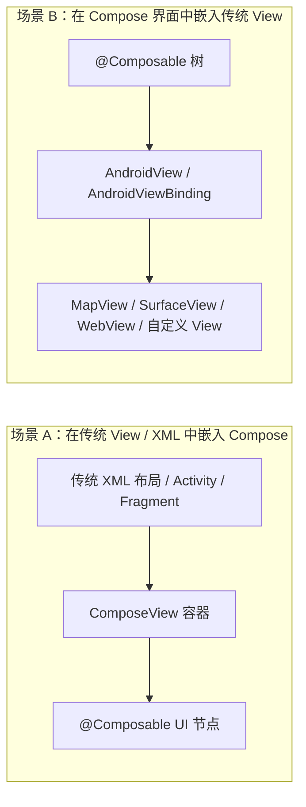

# Compose 与传统 View 混合开发互操作：ComposeView 与 AndroidView 全解

在实际企业级工程演进中，几乎没有任何大型商业 App 能够在一夜之间将百万行基于 XML 和传统 View 的代码全量重构成 Compose。因此，掌握 **Compose 与传统 View 的双向无缝互操作技术**，是实现平滑渐进式迁移的核心技能。

---

## 1. 混合开发双向互操作架构



---

## 2. 场景一：在传统 View 体系中引入 Compose（ComposeView）

### 2.1 在 XML 布局中声明 ComposeView
```xml
<!-- res/layout/activity_hybrid.xml -->
<LinearLayout xmlns:android="http://schemas.android.com/apk/res/android"
    android:layout_width="match_parent"
    android:layout_height="match_parent"
    android:orientation="vertical">

    <TextView
        android:layout_width="match_parent"
        android:layout_height="wrap_content"
        android:text="传统 XML 顶部标题" />

    <!-- 承载现代 Compose 组件的容器 -->
    <androidx.compose.ui.platform.ComposeView
        android:id="@+id/compose_container"
        android:layout_width="match_parent"
        android:layout_height="match_parent" />
</LinearLayout>
```

### 2.2 在 Activity / Fragment 中绑定与生命周期策略配置
```kotlin
class HybridActivity : AppCompatActivity() {
    override fun onCreate(savedInstanceState: Bundle?) {
        super.onCreate(savedInstanceState)
        setContentView(R.layout.activity_hybrid)

        val composeView = findViewById<ComposeView>(R.id.compose_container)
        composeView.apply {
            // 核心调优：设置组合释放策略，与 View 的生命周期保持同步
            setViewCompositionStrategy(
                ViewCompositionStrategy.DisposeOnViewTreeLifecycleDestroyed
            )
            setContent {
                MaterialTheme {
                    Text("这里是纯 Compose 编写的高性能列表或卡片！")
                }
            }
        }
    }
}
```

> [!IMPORTANT] ViewCompositionStrategy 策略选型
> - **DisposeOnDetachedFromWindowOrReleasedFromPool**（默认）：当 View 脱离窗口或在 RecyclerView 中回收时即释放组合；
> - **DisposeOnViewTreeLifecycleDestroyed**（Fragment 推荐）：当 Fragment 的 `viewLifecycleOwner` 销毁时才释放组合，防止重用时反复重建。

---

## 3. 场景二：在 Compose 中嵌入传统 View（AndroidView）

对于尚未提供官方 Compose 实现的高德地图（MapView）、ExoPlayer 视频渲染（SurfaceView）或 WebView，必须使用 `AndroidView` 进行承载包装。

```kotlin
@Composable
fun HybridWebView(url: String, modifier: Modifier = Modifier) {
    AndroidView(
        factory = { context ->
            // factory 仅在初次附加到组合树时执行一次，用于构造原生 View
            WebView(context).apply {
                settings.javaScriptEnabled = true
                webViewClient = WebViewClient()
            }
        },
        update = { webView ->
            // update 会在 Composable 重组且入参 url 改变时被调用
            webView.loadUrl(url)
        },
        modifier = modifier.fillMaxSize()
    )
}
```

---

## 4. 面试核心要点总结

1. **混合开发会带来性能损耗吗？**
   在渲染层面，Compose 底层最终也是通过 `AndroidComposeView` 挂载到系统的 `DecorView` 之上，其本质也是一个 `ViewGroup`。因此，适度的混合并不会引起显著帧率下降。但应避免在 `LazyColumn` 中频繁交替嵌套 `AndroidView`，否则会打断 Compose 节点测量缓存。
2. **主题样式如何共享？**
   可以使用官方适配库 `com.google.android.material:compose-theme-adapter` 将传统的 `styles.xml` / MDC 主题自动桥接生成 Compose 的 `MaterialTheme`。
