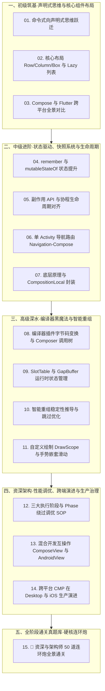

# Jetpack Compose 现代化声明式 UI 革命全景指南

欢迎来到 **Jetpack Compose 现代化声明式 UI 进阶专栏**。

作为 Google 官方推行的 Android 新一代现代化原生 UI 工具包，Jetpack Compose 彻底摒弃了传统 Android 基于 XML 布局、View/ViewGroup 继承树以及命令式 DOM 刷新的复杂旧架构，带来了类似 Flutter 与 React 的**纯响应式、声明式编程体验**。

然而，深入掌握 Compose 绝不仅仅是调用几个 `@Composable` 基础组件，更需要深刻洞察其**编译器插件（Compiler Plugin）字节码转换**、**运行时状态管理（SlotTable / GapBuffer 与快照 Snapshot 机制）**、**智能重组（Smart Recomposition）跳过推导**以及 **Layout/Draw 阶段优化与手势拦截**。

---

## 🗺️ Jetpack Compose 全阶段技术图谱与学习路线

---

## 📚 专栏章节索引

### 一、初级筑基·声明式思维与核心组件布局
1. [01. Compose 基础与核心要点：从命令式到声明式思维转变](/doc/Android/Compose基础与核心要点)
2. [02. Compose 核心布局容器 Row、Column、Box 与 Lazy 列表实战](/doc/Android/Compose核心布局容器Row-Column-Box与Lazy列表实战)
3. [03. Compose 与 Flutter 声明式 UI 布局与性能优化全景指南](/doc/Android/Compose与Flutter声明式UI布局与性能优化全景指南)

### 二、中级进阶·状态驱动、快照系统与生命周期
4. [04. Compose 状态管理：remember、mutableStateOf 与状态提升实战](/doc/Android/Compose状态管理remember与mutableStateOf及状态提升)
5. [05. Compose 副作用 API：LaunchedEffect、DisposableEffect 与生命周期实战](/doc/Android/Compose副作用APILaunchedEffect与生命周期实战)
6. [06. Compose 单 Activity 导航路由 Navigation-Compose 实战](/doc/Android/Compose单Activity导航路由Navigation-Compose实战)
7. [07. Compose 底层原理与深度实战：CompositionLocal 与组件封装](/doc/Android/Compose底层原理与深度实战)

### 三、高级深水·编译器黑魔法、运行时原理与智能重组
8. [08. Compose 编译器插件底层：Composable 字节码变换与 Composer 调用树](/doc/Android/Compose编译器插件底层Composable字节码变换与Composer调用树)
9. [09. Compose 运行时状态管理：SlotTable、GapBuffer 与快照系统](/doc/Android/Compose运行时状态管理SlotTable-GapBuffer与快照系统)
10. [10. 智能重组 Smart-Recomposition 机制：稳定性推导与布局绘制](/doc/Android/智能重组Smart-Recomposition机制稳定性推导与布局绘制)
11. [11. Compose 自定义绘制与手势交互嵌套滚动全解](/doc/Android/Compose自定义绘制与手势交互嵌套滚动全解)

### 四、资深架构·性能调优、跨端演进与生产治理
12. [12. Compose 性能调优实战：Layout 优化、Phase 绕过与重组检测](/doc/Android/Compose性能调优实战Layout优化Phase绕过与重组检测)
13. [13. Compose 与传统 View 混合开发互操作：ComposeView 与 AndroidView 全解](/doc/Android/Compose与传统View混合开发互操作ComposeView与AndroidView)
14. [14. Compose 跨平台 CMP 在 Desktop 与 iOS 生产演进](/doc/Android/Compose跨平台CMP在Desktop与iOS生产演进)

### 五、全阶段通关真题库·大厂高频面试硬核连环炮
15. [15. 🎯 Jetpack Compose 资深与架构师社招高频硬核 50 道连环炮全景通关](/doc/Android/Jetpack-Compose资深与架构师社招高频硬核50道连环炮全景通关)
