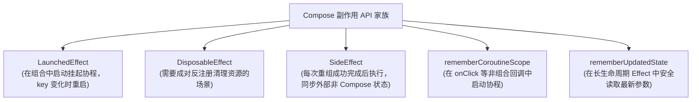

# Compose 副作用 API：LaunchedEffect、DisposableEffect 与生命周期实战

Composable 函数原则上应当是**无副作用（Side-Effect Free）的纯函数**，即输入相同的参数必须产生相同的 UI 结构，且函数的执行不应对外部环境产生不可控的影响（如发起网络请求、修改全局变量、注册系统监听）。

但在实际工程中，弹 Toast、导航跳转、首次进入页面加载数据或注册传感器监听等操作都是必不可少的。Compose 专门提供了一组**受控的副作用 API（Effect APIs）**，确保副作用与 Composable 的生命周期精确对齐。

---

## 1. 副作用 API 全景速查



---

## 2. 核心 API 工业级实战

### 2.1 LaunchedEffect：页面初次加载与参数监听

```kotlin
@Composable
fun UserDetailScreen(userId: String, viewModel: UserViewModel = viewModel()) {
    // 当 userId 改变时，旧协程自动取消，并使用新 userId 重新请求数据
    // 若传入 Unit 作为 key，则仅在当前 Composable 首次进入组合时执行一次
    LaunchedEffect(userId) {
        viewModel.fetchUserInfo(userId)
    }

    val user by viewModel.userState.collectAsState()
    // 渲染 UI...
}
```

### 2.2 DisposableEffect：成对注册与资源释放

当需要订阅系统广播、Lifecycle 变化或第三方 SDK 监听器时，必须使用 `DisposableEffect` 确保在组件脱离组合树（onDispose）时执行反注册，严防内存泄漏：

```kotlin
@Composable
fun SystemBroadcastReceiver(
    systemAction: String,
    onReceive: (Intent?) -> Unit
) {
    val context = LocalContext.current
    // 确保 onReceive 回调变化时不需要重启整个 Effect
    val currentOnReceive by rememberUpdatedState(onReceive)

    DisposableEffect(context, systemAction) {
        val receiver = object : BroadcastReceiver() {
            override fun onReceive(context: Context?, intent: Intent?) {
                currentOnReceive(intent)
            }
        }
        val filter = IntentFilter(systemAction)
        context.registerReceiver(receiver, filter)

        // 核心：组件离开界面时执行清理
        onDispose {
            context.unregisterReceiver(receiver)
        }
    }
}
```

### 2.3 rememberCoroutineScope：在用户交互事件中启动协程

`LaunchedEffect` 只能在 `@Composable` 函数体顶层调用，不能在普通的事件回调（如 `onClick`）中直接调用。此时使用 `rememberCoroutineScope` 获取绑定到当前组合生命周期的协程作用域：

```kotlin
@Composable
fun SnackBarButton() {
    val scope = rememberCoroutineScope()
    val snackbarHostState = remember { SnackbarHostState() }

    Button(onClick = {
        scope.launch {
            snackbarHostState.showSnackbar("操作成功！")
        }
    }) {
        Text("弹出提示")
    }
}
```

---

## 3. 面试避坑要点

1. **绝对不要在 Composable 函数体内直接开启未经管理的协程（如 `GlobalScope.launch`）**：这会导致重组时反复启动新协程，且组件销毁后协程依然在后台空转消耗 CPU 与内存。
2. **正确选择 Key 的时机**：如果传了错误的 Key，会导致 `LaunchedEffect` 在不该重启时频繁重启（如把高频变化的动画值当做 key）；反之如果应该响应更新却传了 `Unit`，则会导致参数变化时界面逻辑不执行。
