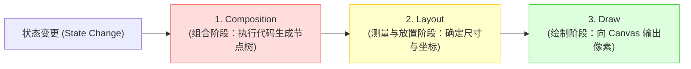
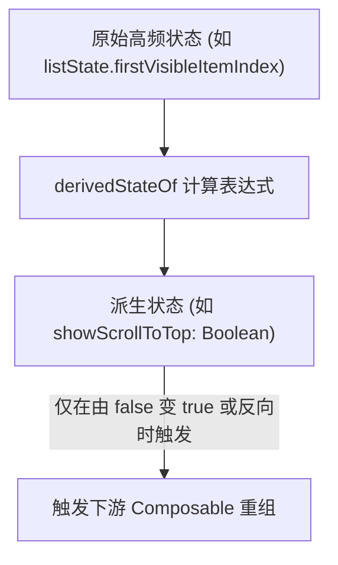

# Compose 性能调优实战：Layout 优化、Phase 绕过与重组检测

在现代 Android 声明式 UI 开发中，Jetpack Compose 极大地简化了 UI 构建流程。然而，由于开发者对 Compose 的**三大渲染阶段（Composition $\to$ Layout $\to$ Draw）**以及**快照状态读取（Snapshot State Read）**机制缺乏深入理解，极易引发“全屏无谓重组”、“每帧触发重组导致掉帧卡顿”等工业级性能灾难。

本篇将深入剖析 Compose 内部三大执行阶段的物理边界，详细讲解如何通过 Lambda 延迟状态读取绕过 Composition 阶段、正确使用 DerivedStateOf 降低状态震荡，并掌握 Layout Inspector 与自定义重组追踪器的生产实战技巧。

---

## 1. Compose 三大执行阶段与 Phase 绕过机制

Compose 将状态映射为屏幕像素的过程严格划分为三个阶段：



### 核心调优原则：状态读取点决定阶段开销
- **如果在组合阶段（Composition）读取 State**：当 State 发生变更时，**整个 Composable 函数将被标记为失效并重新执行**，产生最大的 CPU 计算开销。
- **如果在测量/布局阶段（Layout）读取 State**：Compose **完全跳过组合阶段**，直接重新执行 Measure / Place 逻辑。
- **如果在绘制阶段（Draw）读取 State**：Compose **完全跳过组合和布局阶段**，仅仅触发轻量级的 Canvas 重绘。

### 经典反例与优化对比：滚动联动透明度/位移

#### ❌ 错误示范：在 Composition 阶段读取高频变化的滚动偏移量
```kotlin
@Composable
fun ScrollHeaderBad(scrollState: ScrollState) {
    // ⚠️ 致命陷阱：每滑动 1 像素，scrollState.value 都会变化
    // 导致 ScrollHeaderBad 每一帧都触发 Recomposition！
    val offset = scrollState.value
    Box(
        modifier = Modifier
            .offset(y = offset.dp) // 接收静态值，强制在 Composition 读取
            .alpha(1f - offset / 500f)
            .fillMaxWidth()
            .height(60.dp)
            .background(Color.Blue)
    )
}
```

#### ✅ 工业级优化：使用 Lambda 将状态读取推迟至 Layout 或 Draw 阶段
```kotlin
@Composable
fun ScrollHeaderOptimized(scrollState: ScrollState) {
    // ✅ 优化：传入 lambda，组合阶段不读取状态！
    // 状态读取推迟至 Layout 阶段的 Placeable.PlacementScope
    Box(
        modifier = Modifier
            .offset { IntOffset(0, scrollState.value) } // Layout 阶段读取
            .graphicsLayer {
                // Draw 阶段读取：透明度与旋转仅触发 GPU 图层变换，零重组、零重新测量！
                alpha = (1f - scrollState.value / 500f).coerceIn(0f, 1f)
            }
            .fillMaxWidth()
            .height(60.dp)
            .background(Color.Blue)
    )
}
```

---

## 2. derivedStateOf 正确使用场景与物理原理

`derivedStateOf` 是 Compose 中最容易被滥用或误用的 API 之一。

### 适用场景：状态高频变化，但派生结果低频变化



```kotlin
@Composable
fun ScrollToTopButton(listState: LazyListState) {
    // 仅在 index > 5 的布尔值翻转时才通知下游重组
    val showButton by remember {
        derivedStateOf {
            listState.firstVisibleItemIndex > 5
        }
    }

    if (showButton) {
        FloatingActionButton(onClick = { /* 滚动到顶部 */ }) {
            Icon(Icons.Default.KeyboardArrowUp, contentDescription = null)
        }
    }
}
```

> [!WARNING] derivedStateOf 的滥用陷阱
> 如果你的派生状态发生变化的频率与原始状态完全一致（例如 `derivedStateOf { stateA.value + stateB.value }`，且两个值每次变动都会生成新的数值），使用 `derivedStateOf` **只会凭空增加对象创建与快照订阅开销**，而不会带来任何重组削减效果！

---

## 3. LazyColumn 列表性能优化与 Key 物理防刷

在处理超长列表时，缺乏稳健的 `key` 与 `contentType` 声明是列表丢帧、滑动卡顿的第一元凶。

```kotlin
@Composable
fun OptimizedFeedList(items: List<FeedItem>) {
    LazyColumn(
        modifier = Modifier.fillMaxSize()
    ) {
        items(
            items = items,
            // 1. 必填：提供唯一且稳定的业务主键，避免插入/删除元素时导致整列表重组
            key = { item -> item.id },
            // 2. 核心：声明组件类型，供底层复用机制识别，避免不同样式的 Item 发生错误的测量与重走节点
            contentType = { item -> item.itemType }
        ) { item ->
            FeedItemRow(item = item)
        }
    }
}
```

---

## 4. 生产级重组追踪器（Recomposition Tracker）

在没有开启完整 Layout Inspector 的调试期，可以通过以下轻量级 Modifier 快速检测界面任意区域的重组频次：

```kotlin
@Composable
fun Modifier.recompositionVisualizer(): Modifier {
    val count = remember { intArrayOf(0) }
    SideEffect {
        count[0]++
    }
    return this.drawWithContent {
        drawContent()
        // 重组次数越多，颜色越红
        val color = when {
            count[0] > 10 -> Color.Red.copy(alpha = 0.5f)
            count[0] > 5 -> Color.Yellow.copy(alpha = 0.4f)
            else -> Color.Green.copy(alpha = 0.2f)
        }
        drawRect(color)
    }
}
```

---

## 5. 面试高频考核总结

| 考点问题 | 核心答题要点 |
| :--- | :--- |
| **Compose 的三个阶段分别是什么？** | Composition（组合）、Layout（测量与排版）、Draw（绘制）。状态读取点决定触发的最早阶段。 |
| **如何优化频繁变化的动画状态（如平移与透明度）？** | 避免在 Modifier.offset(x, y) 传普通数值；改用 `Modifier.offset { ... }` 或 `Modifier.graphicsLayer { ... }` 绕过 Composition。 |
| **derivedStateOf 解决了什么问题？** | 当输入状态变化极为频繁，但下游关心的过滤/判断结果变化相对低频时，起到“节流降频”的作用，避免无谓重组。 |
| **为什么 LazyList 必须指定 key 和 contentType？** | `key` 保证数据项增删移动时仅定位重组而不导致列表整体重算；`contentType` 保证同类型节点结构复用。 |
