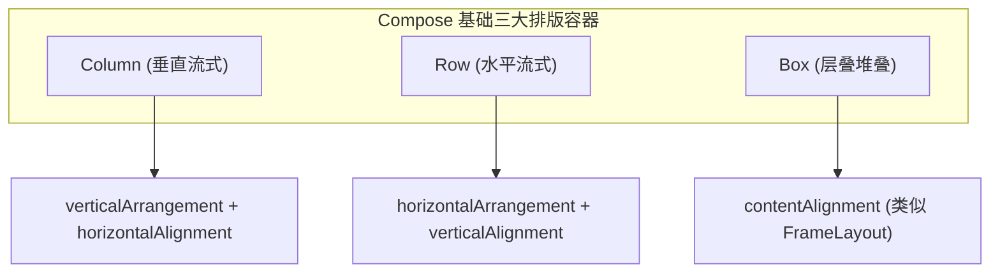

# Compose 核心布局容器 Row、Column、Box 与 Lazy 列表实战

在 Jetpack Compose 中，布局体系摒弃了传统 XML 中的 `LinearLayout`、`RelativeLayout` 与 `FrameLayout`，转而采用纯 Kotlin 函数式的声明式排版容器。理解基础容器的排列算法、权重分配、视口懒加载与复用机制，是构建高性能界面的基石。

---

## 1. 基础布局三剑客：Column、Row 与 Box



### 1.1 Column 与 Row：对齐（Alignment）与排列（Arrangement）
- **Arrangement（排列）**：决定子组件在**主轴方向**上的分布间距（如 `SpaceBetween`、`SpaceAround`、`SpaceEvenly`、`Center`）。
- **Alignment（对齐）**：决定子组件在**交叉轴方向**上的位置（如 `Start`、`CenterHorizontally`、`End`）。

```kotlin
@Composable
fun ColumnRowDemo() {
    Column(
        modifier = Modifier
            .fillMaxSize()
            .padding(16.dp),
        verticalArrangement = Arrangement.SpaceBetween, // 主轴间距均分
        horizontalAlignment = Alignment.CenterHorizontally // 交叉轴居中
    ) {
        Text("顶部标题", style = MaterialTheme.typography.titleLarge)

        Row(
            modifier = Modifier.fillMaxWidth(),
            horizontalArrangement = Arrangement.spacedBy(12.dp), // 子项固定间距
            verticalAlignment = Alignment.CenterVertically
        ) {
            Icon(Icons.Default.Star, contentDescription = null, tint = Color.Yellow)
            Text("自适应子文本", modifier = Modifier.weight(1f)) // 占据剩余空间
            Button(onClick = { /* 操作 */ }) {
                Text("操作")
            }
        }

        Text("底部版权信息", style = MaterialTheme.typography.bodySmall)
    }
}
```

### 1.2 Box 层叠布局与 contentAlignment
`Box` 类似传统的 `FrameLayout`，按声明顺序由底至顶层叠绘制子项，并支持局部 `Modifier.align(...)` 覆盖父级 `contentAlignment`。

---

## 2. LazyColumn 与 LazyRow：工业级懒加载视口

面对长列表，切忌在普通 `Column` 中使用 `forEach`，这会导致所有 Item 一次性全部创建并测量，引发严重卡顿与 OOM。`LazyColumn` 与 `LazyRow` 仅渲染可视区域内的 Item。

```kotlin
@Composable
fun OrderFeedList(orders: List<OrderVo>, onLoadMore: () -> Unit) {
    val listState = rememberLazyListState()

    // 监听滑动到底部触发分页加载
    LaunchedEffect(listState) {
        snapshotFlow { listState.layoutInfo.visibleItemsInfo.lastOrNull()?.index }
            .collect { lastIndex ->
                if (lastIndex != null && lastIndex >= orders.size - 3) {
                    onLoadMore()
                }
            }
    }

    LazyColumn(
        state = listState,
        contentPadding = PaddingValues(16.dp),
        verticalArrangement = Arrangement.spacedBy(8.dp)
    ) {
        // 1. 列表头部
        item(key = "header") {
            Text("我的订单", style = MaterialTheme.typography.headlineMedium)
        }

        // 2. 动态长列表项 (提供唯一稳定 Key 与 contentType)
        items(
            items = orders,
            key = { order -> order.orderId },
            contentType = { order -> order.status } // 相同状态类型共享节点复用
        ) { order ->
            OrderItemRow(order = order)
        }

        // 3. 底部 Loading 占位
        item(key = "footer_loading") {
            Box(modifier = Modifier.fillMaxWidth().padding(16.dp), contentAlignment = Alignment.Center) {
                CircularProgressIndicator()
            }
        }
    }
}
```

---

## 3. 核心避坑指南

1. **LazyColumn 嵌套 LazyColumn 会直接 Crash**：Compose 不允许在同方向无限约束的视口容器内再嵌套同向无限视口，推荐通过多类型 `items()` 拼接在同一个 `LazyColumn` 内。
2. **务必为 items 指定稳定的 key**：未指定 key 时，默认以列表 index 为 key，当列表在头部插入数据时，会导致全量 Item 重新执行测量与重组。
