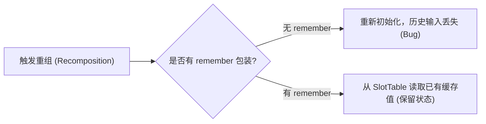
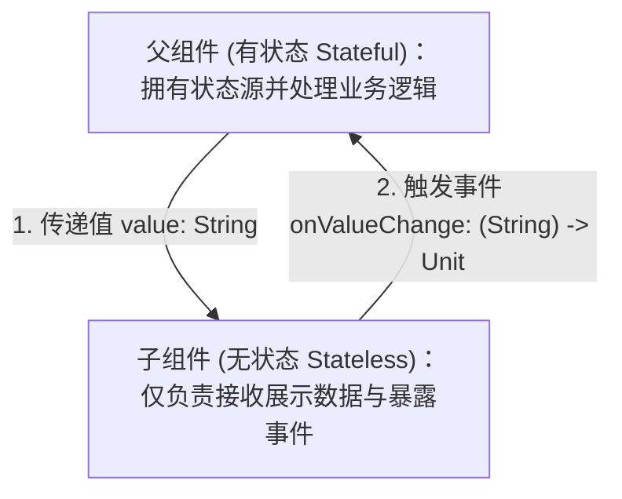

# Compose 状态管理：remember、mutableStateOf 与状态提升实战

在 Jetpack Compose 的响应式架构中，**界面是状态的直接映射（UI = f(State)）**。深入理解状态在组件重组间的保留机制、快照系统的通知机制以及单向数据流中的“状态提升（State Hoisting）”是编写高质量 Compose 应用的核心要求。

---

## 1. 状态基本原语：mutableStateOf 与 remember



### 1.1 mutableStateOf 的本质
`mutableStateOf` 创建一个包含泛型值的 `MutableState<T>` 观察对象。
当该值在某个 Composable 函数中被**读取（Read）**时，Compose 的快照系统（Snapshot System）会自动将该 Composable 注册为订阅者；当值被**修改（Write）**时，Compose 会精准将订阅了该属性的重组作用域标记为失效，在下一帧刷新时触发重组。

### 1.2 remember 的作用
若直接写 `val count = mutableStateOf(0)`，每次函数被重组执行时，都会新建一个初始值为 0 的状态对象，导致数值归零。
`remember { mutableStateOf(0) }` 将该状态对象存储在底层的 **SlotTable** 中，只要当前 Composable 未脱离组合树（Composition Tree），后续重组均直接复用之前的值。

---

## 2. 状态提升（State Hoisting）架构模式

状态提升是指将组件内部的状态“向上移动”至其调用方，使组件本身变为**无状态（Stateless）组件**。



### 生产级案例对比

```kotlin
// ❌ 错误示范：有状态组件，难以复用、无法在多组件间共享、不利于单元测试
@Composable
fun CounterBad() {
    var count by remember { mutableStateOf(0) }
    Button(onClick = { count++ }) {
        Text("点击次数: $count")
    }
}

// ✅ 工业级规范：状态提升为无状态组件
@Composable
fun CounterStateless(
    count: Int,
    onIncrement: () -> Unit,
    modifier: Modifier = Modifier
) {
    Button(onClick = onIncrement, modifier = modifier) {
        Text("点击次数: $count")
    }
}

// 统一由父级或 ViewModel 调度管理
@Composable
fun CounterScreen(viewModel: CounterViewModel = viewModel()) {
    val count by viewModel.countState.collectAsState()
    CounterStateless(
        count = count,
        onIncrement = { viewModel.increment() }
    )
}
```

---

## 3. rememberSaveable：对抗 Activity 销毁重建与进程被杀

`remember` 仅能保证在重组期间保留状态，当用户旋转屏幕（Configuration Change）或系统因内存不足回收后台进程时，`remember` 中的状态将全部丢失。

```kotlin
// 使用 rememberSaveable 自动序列化存入 SavedInstanceState Bundle
var userInput by rememberSaveable { mutableStateOf("") }

// 自定义复杂对象跨配置保存需提供 Saver
@Parcelize
data class UserFilter(val keyword: String, val sortOrder: Int) : Parcelable

var filter by rememberSaveable { mutableStateOf(UserFilter("", 0)) }
```

---

## 4. 总结与最佳实践

1. **单一可信源（SSOT）**：业务核心状态统一由 ViewModel 持有并暴露为只读的 `StateFlow` 或 `State`，UI 组件只消费不直接拥有业务核心状态。
2. **事件向上冒泡，数据向下流动**：严格遵守 UDF（单向数据流）模式，子组件通过高阶函数回调向外通知用户意图。
