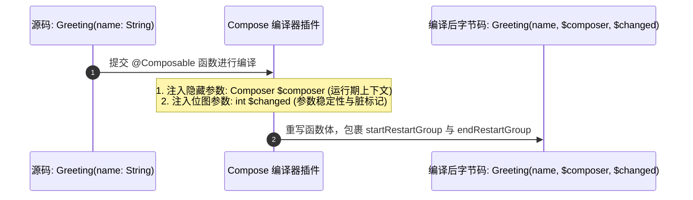

# Compose编译器插件底层Composable字节码变换与Composer调用树

在 Android 传统开发中，以 XML + View 为代表的“命令式 UI（Imperative UI）”统治了十余年。开发者必须频繁通过 `findViewById` 拿到控件引用，并在数据变动时手动调用 `setText()`、`setVisibility()`。一旦业务逻辑复杂，极易产生“内存状态与屏幕呈现脱节”的幽灵 Bug。**Jetpack Compose** 彻底掀起了声明式 UI（Declarative UI）革命，实现 **$UI = f(State)$** 的函数式映射。深入理解 **Compose 编译器插件（Compiler Plugin）底层的字节码变形、隐式参数注入，以及 Composer 调用树**，是掌握现代 Android UI 架构的终极分水岭。

---

## 核心底层机制与全景架构

### 1. 命令式 UI vs 声明式 Compose 架构本质对比

```mermaid
flowchart TD
    subgraph 传统命令式 UI (View 体系)
        V_State[状态改变: count = 5] -->|开发者手动维护| V_Code[textView.setText("5")]
        V_Code --> V_Tree[遍历 View 控件树并刷新]
        Note_V[痛点: 控件状态由控件自身内部持有, 状态源不唯一, 易引发数据不同步与空指针]
    end

    subgraph 现代声明式 UI (Jetpack Compose)
        C_State[唯一可信真实状态源 State: count = 5] --> C_Func[函数式映射: UI = f(State)]
        C_Func --> C_Compiler[Compose 编译器解析 Composer 上下文]
        C_Compiler --> C_Recompose[智能重组: 仅精准重新执行依赖了 count 的 Composable 函数代码块!]
        Note_C[优势: UI 控件没有内部隐藏状态, 纯函数式单向数据流 (Unidirectional Data Flow)]
    end
```

---

## 源码级架构物理拆解

### 1. 编译期核心黑魔法：IR（中间表示）字节码变换

在 Kotlin 语法中，`@Composable` 表面上看起来像一个普通的注解，但 **Compose 编译器插件（Compose Kotlin Compiler Plugin）实际上将其视作一个类型修饰符（Type Modifier）**，其地位与 Kotlin 的 `suspend` 关键字完全等价！

假设开发者编写了一段极其简洁的代码：
```kotlin
@Composable
fun Greeting(name: String) {
    Text(text = "Hello $name")
}
```

Kotlin 编译器在将代码降级为 IR（中间表示）并生成 JVM 字节码时，会对其进行彻底的**物理形态重塑**：



#### 逆向反编译后的真实 Java 代码还原：
```java
// 编译后的真实物理方法签名
public static final void Greeting(
    final String name, 
    Composer $composer,     // 隐式注入的组合控制器
    final int $changed      // 32 位位图，记录 name 是否发生了变更
) {
    // 1. 开启一个可重启重组的作用域，生成唯一的整数哈希 Key
    $composer = $composer.startRestartGroup(-123456789);
    
    // 2. 脏标记检查（跳过重组算法的核心依据）
    int $dirty = $changed;
    if (($changed & 14) == 0) {
        // 通过位运算判定入参 name 是否与上一次重组相同
        $dirty |= $composer.changed(name) ? 4 : 2;
    }

    // 3. 如果入参没有发生任何变动，且当前不是强制刷新，直接跳过整个函数体！
    if (($dirty & 11) != 2 || !$composer.getSkipping()) {
        // 执行真实绘制，递归透传 $composer 上下文
        TextKt.Text("Hello " + name, $composer, 0);
    } else {
        // 极致性能：直接跳过执行（Smart Skip）！
        $composer.skipToGroupEnd();
    }

    // 4. 结束当前作用域，并注册重组监听回调
    ScopeUpdateScope $scope = $composer.endRestartGroup();
    if ($scope != null) {
        $scope.updateScope(new Function2() {
            public final void invoke(Composer nc, int nr) {
                // 当状态变动需要重组时，重新调用自身
                Greeting(name, nc, $changed | 1);
            }
        });
    }
}
```

---

### 2. Composer 调用树（Composition Tree）的职责

为什么**普通没有被 `@Composable` 修饰的 Kotlin 函数无法直接调用 Composable 函数**？
- **物理原因**：普通函数在编译期不会被注入 `Composer $composer` 参数；
- 当调用 `Text()` 时，编译器发现根本无法向下透传这个隐式的 `$composer` 上下文，因此在语法分析阶段就直接阻断报错。

`Composer` 是整套声明式 UI 运行期的核心中枢大脑：
1. **构建与维护 UI 节点树**：负责创建、移动、更新底层的 LayoutNode 节点；
2. **记录状态读写依赖**：当某个 Composable 函数在执行期间读取了某个 `State`，Composer 会在内部将当前函数的作用域（`RecomposeScope`）自动注册为该 State 的订阅者；
3. **调度智能重组（Recomposition）**：当 State 发生变更时，Composer 能根据注册表，**精确定位到依赖该 State 的具体最小代码块**，而无需刷新整屏页面。

---

## 社招高频硬核连环追问

### Q1: 为什么在 `@Composable` 函数内部不能直接使用普通变量缓存数据，必须使用 `remember { mutableStateOf(...) }`？
- **考点**：重组过程中的临时变量重置。
- **解析**：
  - **普通局部变量的宿命**：Composable 本质是一个普通的函数。当发生重组时，该函数会被**反复重新执行调用**。如果写成 `var count = 0`，每次函数重新执行，`count` 都会被重新赋值为 `0`，历史累加数据彻底丢失；
  - **`remember` 的物理底层机制**：
    - `remember` 内部持有了当前 Composer 的**插槽表（SlotTable）**；
    - 第一次执行时，计算计算初始值并将其持久化在 SlotTable 的物理槽位中；
    - 在后续的每一次重组中，`remember` 直接从槽位中把旧值读出来返回，避开了重新初始化；
  - **`mutableStateOf` 的作用**：将其包装为一个可被快照系统（Snapshot System）监听的观察对象，当其 `.value` 被修改时，自动通知 Composer 触发该作用域的重组。

### Q2: 既然 Composable 最终也是在屏幕上绘制，它底层底层还存在 `View` 吗？
- **考点**：Compose 渲染管道与原生 View 体系的解耦。
- **解析**：
  - **底层完全废除了传统的 `android.view.View` 树结构！**
  - 在 Compose 界面中，整棵树上**只有一个顶层的 `ComposeView`（继承自 ViewGroup）作为宿主**；
  - 在 `ComposeView` 内部，所有的组件（`Column`、`Row`、`Text`、`Button`）全部抽象为轻量级的 **`LayoutNode`** 节点；
  - `LayoutNode` 拥有极其轻量的测量与布局能力，最终通过 RenderNode 直接调用底层的 Canvas 绘制指令刷入屏幕，彻底消除了传统 View 体系中每个控件都包含数百个属性变量（如各种 padding、背景、动画标记）带来的沉重内存开销。

---

## 生产级避坑指南与排障 SOP

### 1. 规避在重组函数体内直接执行副作用（Side-Effects）

**事故代码**：
```kotlin
// 致命错误：在重组函数体内直接发起异步网络请求
@Composable
fun UserProfile(userId: String) {
    // 致命！由于重组可能在滑动或动画期间每秒触发数十次，
    // 这行网络请求会被疯狂并发触发数十次，导致接口被刷爆！
    viewModel.fetchUser(userId) 

    Text(text = "Profile")
}
```

#### 官方标准解法：使用生命周期副作用 API（`LaunchedEffect`）
```kotlin
@Composable
fun UserProfile(userId: String) {
    // 仅在 userId 发生变动（或首次进入组合）时执行一次协程
    // 当该 Composable 离开屏幕时，协程会被自动安全取消！
    LaunchedEffect(userId) {
        viewModel.fetchUser(userId)
    }

    Text(text = "Profile")
}
```
通过该方案，彻底将 UI 纯函数与外部副作用（I/O、网络、打点）安全隔离。
