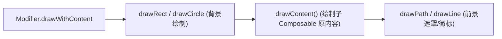
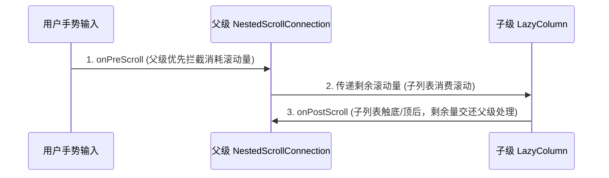

# Compose 自定义绘制与手势交互嵌套滚动全解

在声明式 UI 中，除了使用基础组件拼装界面，面对复杂的可视化图表、水波纹动效以及多层级手势滑动冲突时，必须深度掌握 Compose 的**底层自定义绘制机制（DrawScope / Canvas）**与**现代手势事件系统（PointerInput / NestedScrollConnection）**。

本篇将从底层物理机制出发，系统拆解 Compose 画笔渲染模型、手势消费状态机与多层级嵌套滚动的工业级解决方案。

---

## 1. Compose 自定义绘制：DrawScope 与 Canvas 机制

Compose 提供了 `Canvas` 组件与 `Modifier.drawBehind` / `Modifier.drawWithContent` 修饰符，其底层基于 `DrawScope` 封装，免去了传统 View 频繁创建 `Paint` 对象的 GC 压力。



### 生产级案例：平滑贝塞尔曲线波浪动效

```kotlin
@Composable
fun WaveLoadingIndicator(
    modifier: Modifier = Modifier,
    progress: Float = 0.5f,
    waveColor: Color = Color(0xFF2196F3)
) {
    val infiniteTransition = rememberInfiniteTransition(label = "WaveAnimation")
    val waveOffset by infiniteTransition.animateFloat(
        initialValue = 0f,
        targetValue = 1f,
        animationSpec = infiniteRepeatable(
            animation = tween(1500, easing = LinearEasing),
            repeatMode = RepeatMode.Restart
        ),
        label = "WaveOffset"
    )

    Canvas(modifier = modifier.fillMaxWidth().height(120.dp)) {
        val width = size.width
        val height = size.height
        val waveLength = width / 2
        val waveHeight = 20.dp.toPx()
        val baseWaterHeight = height * (1f - progress)

        val path = Path().apply {
            moveTo(0f, height)
            lineTo(0f, baseWaterHeight)

            var x = 0f
            while (x < width + waveLength) {
                // 使用三阶贝塞尔曲线构建正弦波峰波谷
                val startX = x - (waveOffset * waveLength)
                relativeQuadraticBezierTo(
                    waveLength / 4, -waveHeight,
                    waveLength / 2, 0f
                )
                relativeQuadraticBezierTo(
                    waveLength / 4, waveHeight,
                    waveLength / 2, 0f
                )
                x += waveLength
            }

            lineTo(width, height)
            close()
        }

        drawPath(
            path = path,
            color = waveColor
        )
    }
}
```

---

## 2. PointerInput 手势响应与事件消费模型

Compose 中的手势通过 `Modifier.pointerInput` 协程作用域实现。每个手势检测器均能安全地运行在协程内，并在组件从界面脱钩时自动取消，杜绝内存泄漏。

### 手势冲突与事件消费（consume）原理

在 Compose 的手势管线中，多个父子节点共享触摸流。如果子组件调用了 `change.consume()`，则该事件将被标记为已处理，防止父组件误触滑动：

```kotlin
@Composable
fun DraggableCard(onSwipeDismiss: () -> Unit) {
    var offsetX by remember { mutableStateOf(0f) }

    Box(
        modifier = Modifier
            .offset { IntOffset(offsetX.roundToInt(), 0) }
            .pointerInput(Unit) {
                detectHorizontalDragGestures(
                    onDragEnd = {
                        if (abs(offsetX) > 300f) {
                            onSwipeDismiss()
                        } else {
                            offsetX = 0f // 弹性复位
                        }
                    },
                    onHorizontalDrag = { change, dragAmount ->
                        // 1. 消费触摸位移事件，阻止事件向外冒泡
                        change.consume()
                        offsetX += dragAmount
                    }
                )
            }
            .fillMaxWidth()
            .height(80.dp)
            .background(Color.White, RoundedCornerShape(8.dp))
    )
}
```

---

## 3. 嵌套滚动（NestedScrollConnection）双向拦截实战

在处理类似“折叠顶部标题栏（Collapsible Toolbar）”与底层“长列表（LazyColumn）”的滚动联动时，传统的事件分发模型极为繁琐。Compose 提供了优雅的 `NestedScrollConnection` 机制：



### 核心实现：可折叠悬浮 Header 联动

```kotlin
@Composable
fun CollapsibleToolbarScaffold(
    headerHeight: Dp = 200.dp,
    minHeaderHeight: Dp = 56.dp
) {
    val maxPx = with(LocalDensity.current) { headerHeight.toPx() }
    val minPx = with(LocalDensity.current) { minHeaderHeight.toPx() }

    var headerOffset by remember { mutableStateOf(0f) }

    // 构造嵌套滚动连接器
    val nestedScrollConnection = remember {
        object : NestedScrollConnection {
            override fun onPreScroll(available: Offset, source: NestedScrollSource): Offset {
                // 向上滑动时，父级 Header 优先消耗，收缩自身高度
                val delta = available.y
                val newOffset = (headerOffset + delta).coerceIn(-(maxPx - minPx), 0f)
                val consumedY = newOffset - headerOffset
                headerOffset = newOffset
                // 返回父级消费的像素偏移，剩余 delta 传递给下游 LazyColumn
                return Offset(0f, consumedY)
            }

            override fun onPostScroll(
                consumed: Offset,
                available: Offset,
                source: NestedScrollSource
            ): Offset {
                // 向下滑动且列表已经滚到顶部时，拉伸展开 Header
                val delta = available.y
                if (delta > 0) {
                    val newOffset = (headerOffset + delta).coerceIn(-(maxPx - minPx), 0f)
                    val consumedY = newOffset - headerOffset
                    headerOffset = newOffset
                    return Offset(0f, consumedY)
                }
                return Offset.Zero
            }
        }
    }

    Box(
        modifier = Modifier
            .fillMaxSize()
            .nestedScroll(nestedScrollConnection)
    ) {
        // 1. 内容长列表
        LazyColumn(
            contentPadding = PaddingValues(top = headerHeight)
        ) {
            items(100) { index ->
                Text("Item #$index", modifier = Modifier.fillMaxWidth().padding(16.dp))
            }
        }

        // 2. 顶部折叠 Header
        Box(
            modifier = Modifier
                .fillMaxWidth()
                .height(headerHeight)
                .offset { IntOffset(0, headerOffset.roundToInt()) }
                .background(Color.DarkGray)
        ) {
            Text("折叠标题栏", color = Color.White, modifier = Modifier.align(Alignment.Center))
        }
    }
}
```

---

## 4. 面试高频深度答疑

| 考点问题 | 核心答题要点 |
| :--- | :--- |
| **Compose 的 Canvas 和传统 View 的 onDraw 相比有什么优势？** | `DrawScope` 具备无状态特性，不需要在每次重绘时反复创建 `Paint`；并且通过作用域封装避免了频繁的 JNI 画笔参数切换开销。 |
| **Modifier.pointerInput 是如何管理生命周期的？** | 运行在 Composable 的协程作用域内，当 Composable 离开组合树时，协程自动 Cancel，杜绝了传统 View 监听器的悬挂与内存泄漏。 |
| **NestedScrollConnection 中的 onPreScroll 与 onPostScroll 顺序与区别？** | `onPreScroll` 在子组件滑动之前由父组件优先拦截消费；`onPostScroll` 在子组件滑动耗尽（到达边界）后，处理剩余的滑动量。 |
