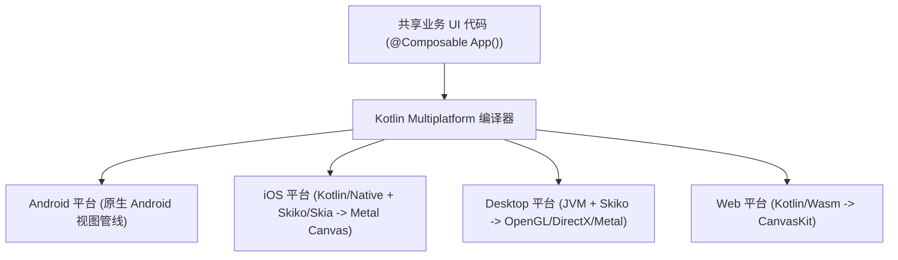

# Compose 跨平台 CMP 在 Desktop 与 iOS 生产演进

**Compose Multiplatform（简称 CMP）** 是由 JetBrains 与 Google 联合主导、基于 Kotlin Multiplatform（KMP）技术栈的新一代全平台声明式 UI 框架。它允许开发者使用一套统一的 Compose 代码库，同时产出 Android、iOS、Desktop（macOS、Windows、Linux）以及 Web（Wasm）的原生客户端。

---

## 1. CMP 跨平台渲染引擎与架构原理



### 核心差异：与 Flutter 对比
- **Flutter**：使用 Dart 语言，通过 C++ 编写的 Skia/Impeller 引擎全自绘像素，与原生平台通信依赖异步 `MethodChannel` 序列化。
- **Compose Multiplatform**：使用 Kotlin 语言，逻辑层直接编译为目标平台原生二进制机器码（如 iOS 上的 Objective-C/Swift 桥接），UI 渲染在桌面和 iOS 上借助 Skiko 调用系统 GPU（Metal），**且能直接无缝调用 iOS 原生 Objective-C/Swift API，零序列化开销**。

---

## 2. 生产级 iOS 架构集成实战

在 CMP 工程中，iOS 界面被包装为一个标准的 `UIViewController`，供 Swift 工程直接调用：

```kotlin
// commonMain (跨平台共享代码)
@Composable
fun App() {
    MaterialTheme {
        Column(modifier = Modifier.fillMaxSize().padding(16.dp)) {
            Text("欢迎使用 Compose Multiplatform!")
        }
    }
}

// iosMain (导出给 iOS 的接口)
fun MainViewController(): UIViewController = ComposeUIViewController {
    App()
}
```

在 Xcode 的 Swift 界面中直接接入：

```swift
import UIKit
import SharedComposeApp

@main
class AppDelegate: UIResponder, UIApplicationDelegate {
    var window: UIWindow?

    func application(_ application: UIApplication, didFinishLaunchingWithOptions launchOptions: [UIApplication.LaunchOptionsKey: Any]?) -> Bool {
        window = UIWindow(frame: UIScreen.main.bounds)
        // 直接挂载 Kotlin 导出的 Compose 控制器
        window?.rootViewController = MainViewControllerKt.MainViewController()
        window?.makeKeyAndVisible()
        return true
    }
}
```

---

## 3. 面向 Desktop 的桌面特有能力支持

针对 PC 桌面端场景，CMP 提供了原生的桌面窗口、托盘图标、菜单栏与键盘快捷键控制：

```kotlin
// desktopMain
fun main() = application {
    Window(
        onCloseRequest = ::exitApplication,
        title = "企业级数据分析大屏",
        state = rememberWindowState(width = 1280.dp, height = 800.dp)
    ) {
        App()
    }
}
```

---

## 4. 生产演进评估与技术选型

| 评估维度 | Jetpack Compose (CMP) | Flutter | React Native |
| :--- | :--- | :--- | :--- |
| **开发语言** | Kotlin (现代化强类型) | Dart (单平台绑定) | TypeScript (动态弱类型) |
| **原生生态兼容** | ⭐⭐⭐⭐⭐ (直接调用原生 API) | ⭐⭐⭐ (需编写 Channel 桥接) | ⭐⭐⭐ (依赖原生桥与 JSI) |
| **Android 产物契合度** | ⭐⭐⭐⭐⭐ (官方推荐一等公民) | ⭐⭐⭐ (增加 5~10MB 引擎体积) | ⭐⭐⭐ (增加 JS 引擎体积) |
| **iOS 成熟度** | 稳定商用（持续逼近原生体验） | 极其成熟 | 极其成熟 |
