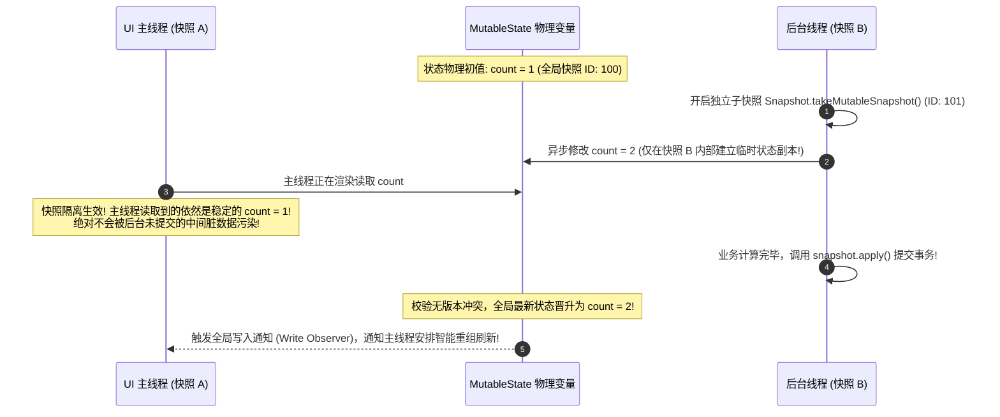

# Compose运行时状态管理SlotTable-GapBuffer与快照系统

在上一篇中，我们剖析了 Compose 编译器如何将 `@Composable` 函数变形为带有 `Composer` 参数的调用树。而在运行期，这些海量的状态、对象引用（`remember` 缓存）以及 UI 树的拓扑关系，在物理内存中究竟是以何种数据结构存放的？答案是 Compose 内部最核心、最硬核的两大底层基础设施：**基于间隙缓冲区（GapBuffer）思想的 `SlotTable`（插槽表）**，以及借鉴了数据库 MVCC 思想的 **快照系统（Snapshot System）**。

---

## 核心底层机制与全景架构

### 1. 扁平化数据结构：树状 UI 映射为线性一维数组

传统 View 体系采用树状节点指针图（每个 View 持有 `mParent` 和 `mChildren` 数组），指针跳转会导致 CPU 缓存行（Cache Line）命中率极低。

Compose 采用了革新性的设计：**将一整棵深度优先遍历（DFS）的 UI 树，完全拍平成两个连续的扁平线性数组**：

```mermaid
flowchart TD
    subgraph UI 逻辑树
        Root[App Root] --> Col[Column 容器]
        Col --> Text1[Text 控件: name]
        Col --> Text2[Text 控件: age]
    end

    subgraph SlotTable 物理底层结构 (扁平连续内存)
        SlotTable[SlotTable 结构体] --> Groups[groups 数组: int[]<br/>记录每个 Group 的类型、长度、在 slots 数组中的起始偏移与子节点数]
        SlotTable --> Slots[slots 数组: Object[]<br/>存放真实的业务对象: remember 缓存值, LayoutNode 引用, 状态参数]
    end

    UI 逻辑树 -.->|DFS 序列化映射| SlotTable
```

---

## 源码级架构物理拆解

### 1. 深度推导：GapBuffer（间隙缓冲区）的移动算法

在文本编辑器（如 Emacs、Sublime Text）中，用户在光标处频繁打字和删除文字，如果使用普通连续数组，每次插入一个字符都需要将其后的全部字符向后 `System.arraycopy` 移动，开销是 $O(N)$。

为此，计算机科学诞生了经典的数据结构——**GapBuffer（间隙缓冲区）**。Compose 将其深度应用在 `SlotTable` 中：

```
初始状态（间隙 Gap 位于中间）：
+---------+---------+---------+-------------------+---------+---------+
| Slot 0  | Slot 1  | Slot 2  |    GAP (空闲间隙)   | Slot 3  | Slot 4  |
+---------+---------+---------+-------------------+---------+---------+
                              ^ gapStart          ^ gapEnd
```

#### 当需要向当前光标处插入新组件时：
- 直接在 `gapStart` 处填充新对象，`gapStart++`；
- **时间复杂度为惊人的 $O(1)$！零内存拷贝！**

#### 当用户滑动列表，焦点跳转到另一处分支时：
- 触发 **`moveGapTo()`**：将间隙物理滑动平移到新的操作位置；
- 由于 UI 界面的重组具有极强的“局部性（Locality）”（即重组通常集中在某个子分支内部频繁发生），GapBuffer 在绝大多数情况下都不需要物理扩容，在纳秒级完成状态的更新与替换。

---

### 2. 状态并发隔离：快照系统（Snapshot System）与 MVCC

Android 界面交互是高度多线程并发的（如后台子线程异步下载数据修改 `State`，主线程同时在做手势动画）。如果多个线程直接读写同一个内存变量，必然导致线程竞争、界面闪烁或脏读。

Compose 引入了 **快照系统（Snapshot）**，其设计哲学直接师承自关系型数据库（MySQL / PostgreSQL）的 **MVCC（多版本并发控制）**：



#### 快照系统的核心数据结构：
1. **全局快照 ID**：一个单调递增的原子整数，每开启一个新快照，ID 自增 1；
2. **状态记录链表（`StateRecord`）**：每个 `mutableStateOf` 变量内部并不只存一个值，而是维护一个单向链表 `head: StateRecord`；
3. **可见性判定（Visibility Rule）**：当当前线程读取变量时，快照系统遍历该链表，**寻找记录中快照 ID 小于等于当前快照 ID、且未在当前活跃快照黑名单中的最新版本**，实现了近乎零锁竞争的极致并发读取。

---

## 社招高频硬核连环追问

### Q1: 如果两个并发线程同时修改了同一个 `mutableStateOf` 变量并调用 `apply()`，会发生什么？
- **考点**：快照系统的并发写入冲突与合并策略（Snapshot Mutation Policy）。
- **解析**：
  - **冲突检测**：快照系统在执行 `snapshot.apply()` 时，会检查当前提交的状态是否基于最新全局快照；若发现两个快照交叉修改了同一个变量，系统判定发生**写冲突（Conflict）**；
  - **默认行为**：若未配置冲突解决器，系统直接抛出 **`SnapshotApplyConflictException`** 异常；
  - **解决方案（StructuralEqualityPolicy）**：
    在创建状态时指定结构化合并策略：
    ```kotlin
    val state = mutableStateOf(user, structuralEqualityPolicy())
    ```
    或者实现 `SnapshotMutationPolicy.merge()` 接口，自定义两者的合并逻辑（例如将两个并发累加操作进行数值求和），自动完成无损合并。

### Q2: 为什么官方文档强调 `mutableStateListOf` 内部元素的属性改动无法自动触发重组？
- **考点**：快照系统对引用的浅监听机制。
- **解析**：
  - `mutableStateListOf()` 包装的是一个支持快照隔离的列表集合；
  - **快照系统仅监听集合本身的物理结构变更**（如 `add()`、`remove()`、`clear()`）；
  - 如果执行 `list[0].name = "NewName"`，由于 `list` 集合本身持有的元素对象内存引用地址**没有发生任何改变**，快照系统底层的写入观察者（Write Observer）根本不会被激活；
  - **正确做法**：
    1. 集合内的实体对象（Item）属性本身也声明为 `mutableStateOf`；
    2. 或者每次修改时创建新的副本对象替换原位置元素：`list[0] = list[0].copy(name = "NewName")`。

---

## 生产级避坑指南与排障 SOP

### 1. 规避重组期间引发无限递归死循环（Recomposition Loop）

**事故代码**：
```kotlin
// 致命错误：在 Composable 函数体内直接修改正在读取的 State!
@Composable
fun BadCounter() {
    val count = remember { mutableStateOf(0) }

    // 致命！读取了 count，同时在此处直接写入 count.value++
    // 这会导致当前 Composable 执行完毕后，写入监听立即通知系统再次触发重组，
    // 进而再次写入，界面陷入 100% CPU 的无限死循环，数秒后引发 OOM 崩溃！
    count.value++ 

    Text(text = "Count: ${count.value}")
}
```

#### 规范治理：
状态的修改只能发生在**用户交互事件回调（如 `onClick`）**或受控的副作用 API（如 `LaunchedEffect`）中，**严禁在 Composable 纯渲染主函数体中直接产生修改状态的副作用**。
