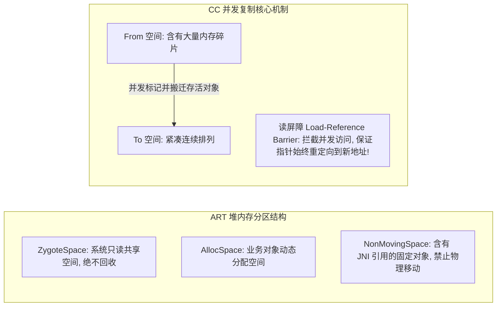

# Dalvik与ART架构演进AOT-JIT与Profile引导混合编译

Android 虚拟机的演进史，本质是一部**在运行性能、应用安装速度与移动设备有限存储空间之间进行极致物理权衡的工程架构史**。从早期的 **Dalvik 解释执行 + JIT**，到 Android 5.0 激进的 **全量 AOT（Ahead-Of-Time）预编译**，再到 Android 7.0 至今大获成功的 **AOT + JIT + Profile 引导的混合编译模型**，深入理解虚拟机的底层物理编译与 GC 收集机制，是突破 Android 底层技术天花板的核心分水岭。

---

## 核心底层机制与全景架构

### 1. 三大虚拟机编译架构演进矩阵

```mermaid
flowchart TD
    subgraph 1. Dalvik 时代 (Android 4.4 之前)
        D1[APK 内 DEX 字节码] -->|每次运行| D2[解释器 Interpreter 逐行解释执行]
        D2 -->|热点代码统计达到阈值| D3[JIT 即时编译为内存机器码]
        NoteD[缺点: 每次应用重启, 内存机器码丢失, 再次退化为解释执行, CPU 持续发烫]
    end

    subgraph 2. 初代 ART 全量 AOT (Android 5.0 ~ 6.0)
        A1[安装 APK 阶段] -->|dex2oat 耗时数分钟| A2[全量预编译为物理机器码 OAT 文件]
        A2 -->|运行时| A3[直接被物理 CPU 执行, 速度极快!]
        NoteA[缺点: 安装与系统升级奇慢无比 (几十分钟), 磁盘存储空间暴增 2~3 倍!]
    end

    subgraph 3. 现代 ART 混合编译 (Android 7.0+ 至今)
        M1[安装阶段: 零预编译, 秒装!] --> M2[首次运行: 解释执行 + JIT 动态编译]
        M2 --> M3[JIT 运行时将真正热点方法记录进 Profile 文件 .prof]
        M3 -->|夜间充电且设备空闲时| M4[后台编译服务读取 .prof, 仅对热点方法执行 AOT 编译成机器码!]
        NoteM[完美平衡: 秒速安装 + 节约磁盘 + 常用路径极速流畅!]
    end
```

---

## 源码级架构物理拆解

### 1. Android 7.0+ Profile 引导混合编译物理闭环

Google 认识到：**一个 App 中 80% 的代码（如边缘设置页、生僻功能）在用户日常使用中几乎永远不会被执行**，全量 AOT 预编译这些冷代码是巨大的算力与存储浪费。

```mermaid
sequenceDiagram
    autonumber
    participant App as 应用运行期
    participant JIT as JIT 编译器 (内存)
    participant Prof as Profile 记录器 (.prof)
    participant Daemon as 后台守护服务 (BackgroundDexOptService)
    participant Disk as 物理存储 (.odex / .vdex)

    App ->> JIT: 运行业务，统计方法调用频次
    Note over JIT: 当方法计数器超过阈值，编译为机器码塞入 JIT Code Cache
    JIT ->> Prof: 将该热点方法的签名与 Class 写入 /data/misc/profiles/cur/0/<pkg>/primary.prof
    
    ... 夜深人静，用户插上充电器，手机灭屏闲置 ...
    Daemon ->> Daemon: 触发条件满足 (Battery Charging && Device Idle)
    Daemon ->> Prof: 读取收集到的真实热点 Profile 文件
    Daemon ->> Disk: 驱动 dex2oat，仅将这 20% 的热点方法编译为机器码写入 .odex
    
    ... 第二天用户再次打开 App ...
    App ->> Disk: 核心启动与滑动路径直接以机器码全速飙车!
```

#### 产物文件物理拆解：
- **`.vdex`（Verified DEX）**：包含校验过的原 DEX 代码，当系统 OTA 升级时无需重新验证，大幅提速；
- **`.odex`（Optimized DEX）**：包含针对该机型物理 CPU 架构编译出的真正热点机器指令；
- **`.art`**：包含预加载的常用类对象镜像（Image），启动时直接映射进内存，零类加载开销。

---

### 2. ART 现代垃圾收集器演进：从 CMS 到 CC（并发复制）

Dalvik 时代的 GC 会频繁触发全系统 **Stop-The-World（STW）**，导致界面剧烈卡顿。现代 ART 虚拟机采用了革命性的 **并发复制收集器（CC，Concurrent Copying）**：



- **无 STW 碎片整理**：传统收集器为了消除内存碎片，在移动对象内存地址时必须全量挂起所有线程；
- **读屏障（Read Barrier）**：ART CC 收集器利用 CPU 读屏障，允许 Java 线程在**对象正在被后台搬迁的同时并发读写**，将 GC 挂起停顿彻底压缩到 **几毫秒以内**！

---

## 社招高频硬核连环追问

### Q1: Dalvik 为什么基于寄存器（Register-based），而标准 Java JVM 基于操作数栈（Stack-based）？
- **考点**：虚拟机指令集架构物理取舍。
- **解析**：
  1. **指令条数与执行效率**：JVM 基于操作数栈，一个简单的加法 `a + b` 需要经历 `iload_1`、`iload_2`、`iadd`、`istore_3` 四条指令，涉及大量的栈帧压栈出栈操作；Dalvik 基于虚拟寄存器，可以直接用一条物理指令 `add-int v0, v1, v2` 在寄存器之间完成计算，**指令数量减少约 30%**；
  2. **移动端 CPU 架构对齐**：移动端 ARM 架构 CPU 本身拥有大量的硬件物理寄存器，基于寄存器的虚拟机更容易在 JIT/AOT 时将虚拟寄存器直接一对一映射到 ARM 物理硬件寄存器上，执行效率高出数倍。

### Q2: 什么是云端 Profile（Cloud Profiles / Baseline Profiles）？
- **考点**：Google 现代性能工程基础设施。
- **解析**：
  - **痛点**：混合编译虽然好，但在用户刚安装 App 的头几天，Profile 还没生成，用户依然会经历短暂的解释执行期；
  - **破局（基线配置文件 Baseline Profiles）**：
    - 开发者在发布 App 前，利用自动化测试跑一遍核心流程，生成一份标准的 `baseline-prof.txt` 打包进 APK；
    - Google Play 在分发 APK 时，直接将全局云端聚合的最优 Profile 连同 APK 一并下发；
    - **App 在用户手机上安装完成的瞬间，核心冷启动路径就已经被预编译为最佳机器码**，实现了“秒装 + 首发即极速”。

---

## 生产级避坑指南与排障 SOP

### 1. 强制手动触发 Profile 编译验证命令

在性能优化与基线配置验证过程中，无需等待夜间充电，可通过 ADB 强制触发编译：

```bash
# 1. 强制生成当前应用的 Profile 文件并转储
adb shell cmd package dump-profiles com.example.app

# 2. 强制利用 Profile 执行 dex2oat 优化编译
adb shell cmd package compile -m speed-profile -f com.example.app

# 3. 查看当前应用的编译状态 (确认是否达到 speed-profile 或 speed)
adb shell dumpsys package com.example.app | grep -E "status=|filter="
```
通过该 SOP，开发团队可在 CI/CD 自动化性能测试中量化验证 AOT 编译带来的启动耗时提升。
