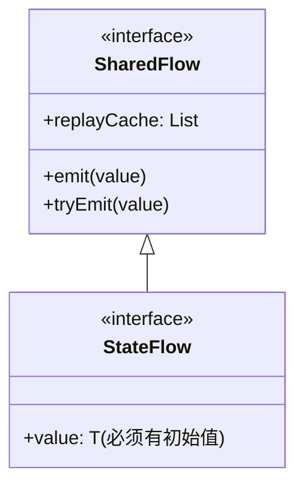
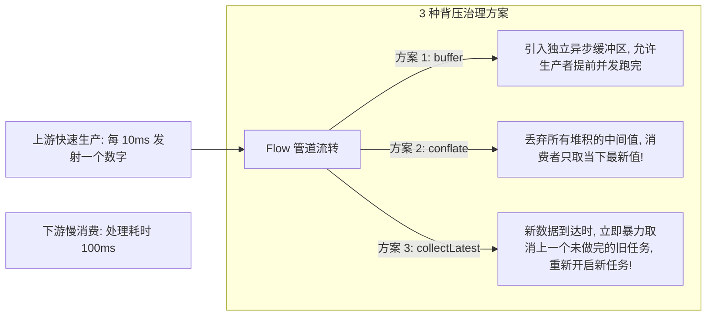

# Flow响应式冷流与热流StateFlow-SharedFlow背压治理

在现代 Android 架构设计中，**Kotlin Flow** 已经全面取代传统的 RxJava 与古老的 LiveData，成为 Google 官方推荐的**响应式数据流（Reactive Streams）事实标准**。Flow 深度融合了 Kotlin 协程的非阻塞式挂起特性，无需复杂的线程调度操作符，天然支持协作式取消与结构化并发。深入理解 **冷流（Cold Flow）的惰性生产机制**、**热流（Hot Flow：StateFlow vs SharedFlow）的物理缓冲设计**，以及**背压（Backpressure）与生命周期安全治理**，是构建现代大中型 App 架构的核心必修课。

---

## 核心底层机制与全景架构

### 1. 冷流（Cold Stream）vs 热流（Hot Stream）物理对比

```mermaid
flowchart TD
    subgraph 冷流 Cold Flow (普通 flow / channelFlow)
        C_Producer[生产者: flow 闭包]
        C_Consumer1[观察者 A: 调用 collect] -->|触发生产| C_Producer
        C_Consumer2[观察者 B: 调用 collect] -->|触发全新的一轮独立生产| C_Producer
        NoteC[物理特性: 惰性求值 (Lazy), 无消费者时不运行, 每个消费者拥有一份独立的生产流水线]
    end

    subgraph 热流 Hot Flow (StateFlow / SharedFlow)
        H_Producer[生产者: emit / tryEmit 持续生产广播]
        H_Hub[物理内存缓冲区 Buffer<br/>持续广播数据给所有订阅者]
        H_Producer --> H_Hub
        H_Consumer1[观察者 A] -.->|监听共享数据| H_Hub
        H_Consumer2[观察者 B] -.->|监听共享数据| H_Hub
        NoteH[物理特性: 类似广播电台, 不管有没有听众都在持续发射, 多个订阅者共享同一份数据]
    end
```

---

## 源码级架构物理拆解

### 1. 深度对比：`StateFlow` vs `SharedFlow` 物理设计

在 MVVM / MVI 架构中，两者承担着截然不同的领域职能：



| 核心特性 | **`StateFlow`（状态持有者）** | **`SharedFlow`（事件分发总线）** |
| :--- | :--- | :--- |
| **物理定位** | **表示 UI 状态（State）**，如页面加载中、商品列表数据 | **表示一次性瞬时事件（Event）**，如弹窗提示、页面跳转 |
| **初始值要求** | **必须赋予初始值**（`MutableStateFlow(initialValue)`） | 无需初始值 |
| **防抖与去重** | **天然防抖！内部通过 `Any.equals()` 校验，若新值等于旧值则直接丢弃不发射** | 无论值是否相同，**一律按流发射，不做去重** |
| **重放缓存（Replay）** | 固定强行锁定为 **`replay = 1`**（新观察者订阅立即收到当前最新状态） | **可自由灵活配置**（`replay = 0, 1, 2...`） |

#### `SharedFlow` 核心参数物理推导：
```kotlin
public fun <T> MutableSharedFlow(
    replay: Int = 0,                     // 新订阅者接入时，重放历史数据的条数
    extraBufferCapacity: Int = 0,        // 额外的环形缓冲区容量
    onBufferOverflow: BufferOverflow = BufferOverflow.SUSPEND // 背压溢出策略
): MutableSharedFlow<T>
```
- **`BufferOverflow.SUSPEND`**：默认策略。当缓冲区满了且慢观察者来不及消费时，`emit()` 挂起等待；
- **`BufferOverflow.DROP_OLDEST`**：丢弃队列中最旧的一条数据，挤入新数据；
- **`BufferOverflow.DROP_LATEST`**：丢弃刚刚到来的最新数据，保护队列稳定。

---

### 2. 响应式背压（Backpressure）三大治理利器

当上游数据产生极快（如传感器每秒产生 1000 个位置点），而下游处理极慢（每次入库耗时 50ms）时，会产生严重的内存堆积与线程卡顿：



- **`conflate()`**：合并操作符。在股票行情、即时比分刷新中，用户只关心最新行情，中间错过的波动直接无损合并丢弃；
- **`collectLatest()`**：搜索框联想提示必用。当用户快速输入关键词时，前一个字符触发的网络请求立即被取消，仅全力响应最后一次输入的搜索结果。

---

### 3. 与 Android 生命周期深度契约：`repeatOnLifecycle`

#### 传统在生命周期中收集 Flow 的致命灾难：
```kotlin
// 错误示范：极其危险的收集方式！
lifecycleScope.launch {
    viewModel.uiState.collect { data ->
        // 当用户按 Home 键将 App 切到后台不可见时，由于 lifecycleScope
        // 依然处于存活状态，此处的协程在后台持续疯狂收集网络与定位数据!
        // 导致严重耗电、浪费流量，甚至后台操作 View 造成不可控异常!
    }
}
```

#### 官方标准解法：`repeatOnLifecycle`
```kotlin
// 规范：安全响应生命周期
lifecycleScope.launch {
    // 仅当 Activity 处于 STARTED（前台可见）及以上状态时，协程才开始收集
    // 一旦 Activity 进入 STOPPED（退入后台不可见），内部的协程被立即物理取消并释放！
    // 重新回到前台时，自动重新启动协程并拉取最新状态！
    repeatOnLifecycle(Lifecycle.State.STARTED) {
        viewModel.uiState.collect { state ->
            renderUI(state)
        }
    }
}
```

---

## 社招高频硬核连环追问

### Q1: `LiveData` 曾存在著名的“数据倒灌（粘性事件）”Bug，`SharedFlow` 是如何彻底解决的？
- **考点**：事件与状态的语义混淆。
- **解析**：
  - **LiveData 数据倒灌成因**：LiveData 内部基于版本号机制（`mVersion`），新观察者注册时，若其初始版本号（`-1`）小于 LiveData 当前版本号，系统强制将最后一次保存的旧数据重放推送给它，导致从二级页面返回时弹窗或 Toast 被重复弹出；
  - **SharedFlow 破局**：将用于事件分发的 `SharedFlow` 的 **`replay` 参数显式设置为 `0`**（`MutableSharedFlow<Event>(replay = 0)`）；
  - 此时它是一个纯粹的一次性事件广播，新订阅者接入时不会收到任何历史数据，只有在订阅之后发生的全新事件才会被接收，彻底在物理设计上根除了数据倒灌。

### Q2: `Flow` 的冷流内部可以调用 `withContext` 切换线程吗？
- **考点**：Flow 的流不变性原则（Flow Invariance）。
- **解析**：
  - **严禁直接在 `flow { ... }` 闭包内部使用 `withContext(Dispatchers.IO)`！**
  - 如果尝试在 `flow` 构造器中写 `withContext`，在运行时会直接抛出：
    `IllegalStateException: Flow invariant is violated: Flow was collected in [Main], but emission happened in [IO]`；
  - **原因**：Flow 遵循“上下文保护（Context Preservation）”规则，发射数据的上下文必须与下游调用 `collect` 的上下文一致；
  - **正确切线程姿势**：必须且只能使用官方的 **`flowOn(Dispatchers.IO)`** 操作符，它在底层自动引入了 Channel 缓冲区将上下游安全解耦。

---

## 生产级避坑指南与排障 SOP

### 1. 规范构建 MVI 架构下的 UIState 与 UIEvent

```kotlin
// 规范：StateFlow 负责单向数据流持久状态，SharedFlow 负责一次性瞬时事件
class GoodsDetailViewModel : ViewModel() {

    // 1. UI 状态持有 (StateFlow: 必须有初始值，自动去重防抖)
    private val _uiState = MutableStateFlow<GoodsUiState>(GoodsUiState.Loading)
    val uiState: StateFlow<GoodsUiState> = _uiState.asStateFlow()

    // 2. 一次性事件总线 (SharedFlow: replay=0，杜绝数据倒灌)
    private val _uiEvent = MutableSharedFlow<GoodsUiEvent>(
        replay = 0,
        extraBufferCapacity = 1,
        onBufferOverflow = BufferOverflow.DROP_OLDEST
    )
    val uiEvent: SharedFlow<GoodsUiEvent> = _uiEvent.asSharedFlow()

    fun addToCart() {
        viewModelScope.launch {
            val result = repository.add()
            if (result.isSuccess) {
                // 发射一次性成功弹窗事件
                _uiEvent.emit(GoodsUiEvent.ShowToast("加购成功"))
            }
        }
    }
}
```
