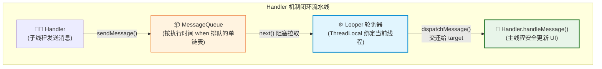

# Handler消息机制底层原理与进阶实战

## 使用入口：先解决问题，再做验证

把任务投递到指定 Looper 线程，常用于界面更新和延时工作。

**先做基本操作**：用 Handler(Looper.getMainLooper()).post 更新 UI，页面退出清理回调；验证延时执行不等于精确时刻。初次学习可先完成[本模块基础实践](/doc/Android/Android应用基本开发与验证)。

**再逐步深入**：基本 API 与输入输出 → 常见失败和使用边界 → 场景排查与优化 → 本文机制分析与源码。面试先讲用途和自己的操作过程，再回答场景与原理追问。

### 基本代码：指定目标线程

```kotlin
private val uiHandler = Handler(Looper.getMainLooper())
private val refresh = Runnable { renderLatestState() }
// 从工作线程提交短小的 UI 更新
uiHandler.post(refresh)
// 页面退出时移除这个回调，避免更新已销毁视图
uiHandler.removeCallbacks(refresh)
```

Handler 把 Runnable 投递到对应 Looper，不会自动把 Runnable 变成后台任务。`postDelayed` 是最早可执行时间，线程忙时会更晚。

## 🎯 核心技术原理与实战归纳
- **核心设问与思考**：“请简述 Handler、Looper、MessageQueue 与 Message 之间的协作流程？一个线程可以有几个 Handler 和几个 Looper？”
- **深水区追问**：“为什么主线程中的 **`Looper.loop()` 是一个死循环（`for(;;)`），却不会导致应用卡死产生 ANR，也不会把 CPU 占满？** 底层的 Linux **`epoll` 机制** 是如何起作用的？什么是**同步屏障（Sync Barrier）**与**异步消息**，View 的渲染刷新为什么必须依赖同步屏障？**`IdleHandler`** 在启动优化中如何落地？”

---

## 一、 Handler 四大核心角色协作链路

::: tip 📦 通俗心智模型：快递流水线与智能休眠传送带
* **`Message`（包裹）**：里面装着具体的数据货物（`what, arg1, obj`），包裹上面贴着专属收件人条码（`target` 就是发送它的 Handler）。
* **`Handler`（寄件人 & 拆件工）**：
  * 在子线程可以把包裹扔上传送带（`sendMessage()`）；
  * 在主线程里又是负责最后拆开包裹并干活的人（`handleMessage()`）。
* **`MessageQueue`（单向传送带）**：
  * 所有包裹严格按照**预约送达时间戳（`msg.when`）**从先到后排队。
* **`Looper`（传送带电机与分拣员）**：
  * 守在传送带末端不断拉取到期包裹（`next()`），看一眼包裹上的 `target` 是谁，直接把包裹递给对应的 Handler 拆包。
* **为什么死循环不耗 CPU 也不卡死？**
  * 传送带上没包裹时，底层通过 Linux `epoll` 机制让电机**自动关机休眠**，主线程让出 CPU，耗电几乎为 0！
  * 一旦有新包裹放上传送带，管道写入信号**瞬间唤醒电机**继续派件。
:::



- **对应关系**：
  - 一个线程 **只能有 1 个 `Looper`**（通过 `ThreadLocal` 强隔离保证）。
  - 一个 `Looper` **只能有 1 个 `MessageQueue`**。
  - 一个线程可以创建 **无数个 `Handler`**，所有的 Handler 共享同一个 MessageQueue。

---

## 二、 破除世纪疑问：为什么 `Looper.loop()` 死循环不导致 ANR？

### 1. 为什么 Android 应用必须依赖死循环？
- 对于一个基于事件驱动的操作系统，主线程需要持续处理框架事件；退出主 Looper 会破坏正常调度，不能仅凭主线程返回推断所有 Java 线程立即退出。
- 主线程的所有生命周期回调（Activity 的 `onCreate/onResume`）、屏幕触摸点击（`MotionEvent`）、UI 界面绘制（`Choreographer`），进入主线程调度，但来源不同：生命周期可来自 Binder 调度，输入来自 input channel，VSync 来自显示事件连接；不是全部经 Binder 线程转发。

### 2. 为什么不会把 CPU 占满？（Linux `epoll` 阻塞与唤醒机制）
- **核心在 `MessageQueue.next()` 方法**：
  当消息队列中没有任何消息（或者下一条消息触发的时间还没到）时，主线程**绝不会空转消耗 CPU**！
- 底层通过 JNI 调用了 Linux 原生的 **`epoll_wait()`** 系统调用：
  - 线程主动在 native 层的管道（Pipe / eventfd）上**挂起并进入休眠状态**，直接让出 CPU 执行权给其他进程。
  - 当新消息需要改变当前等待状态时，队列调用 nativeWake（现代实现常用 eventfd）唤醒等待；不是每次入队都必须唤醒。
- **ANR 的真正根因**：ANR 不是因为死循环，而是因为主线程在处理某个 `Message` 的 `handleMessage()` 逻辑时，**执行了耗时的网络/磁盘 IO，或者发生了锁竞争等待**，导致后续的消息在队列中堆积超时无法被及时处理！

---

## 三、 同步屏障（Sync Barrier）与 View 渲染刷新

### 1. 什么是同步屏障？
- 在默认情况下，MessageQueue 中的消息按照 `when`（执行时间戳）排队，所有消息都是普通同步消息。
- **同步屏障**：是一种特殊的 `Message`，它的 **`target == null`**。
- 当 `Looper` 在消息队列中遇到同步屏障时，会**立即停滞处理后续所有的普通同步消息，而是向后遍历寻找所有的“异步消息（Asynchronous Message）”优先执行！** 直到同步屏障被主动移除。

### 2. 为什么 View 绘制必须使用同步屏障？
- VSync 提供帧调度时机，60Hz 时约 16.7ms 一次，高刷新率有不同周期；不是每次都必须完整重绘。
- 如果你的消息队列里排了 50 个普通业务消息（比如下载进度日志），必须让 UI 绘制指令“插队”优先执行！
- **`ViewRootImpl.scheduleTraversals()` 源码逻辑**：
  1. 调用 `MessageQueue.postSyncBarrier()` 按相应时间插入**同步屏障**，不是一律放在链表头部。
  2. 向 `Choreographer` 注册一个**异步消息**（执行 `doTraversal` -> `measure` -> `layout` -> `draw`）。
  3. `doTraversal()` 在执行 `performTraversals()` 前移除屏障；屏障让异步帧消息有机会越过同步消息，但不能抢占已经执行的长任务。

---

## 四、 性能优化杀手锏：`IdleHandler`（空闲时执行）

### 1. 核心机制
`IdleHandler` 是 `MessageQueue` 暴露的一个接口：**当队列为空或下一条消息尚未到期、将进入等待时**，会自动回调 `IdleHandler.queueIdle()`。

### 2. 启动优化实战（首屏秒开）
在 `Application` 或 `MainActivity.onCreate()` 中，很多三方 SDK（如推送打点、埋点统计、离线缓存预热）不需要在启动主线程死拼。

```kotlin
// 最小 MVP：利用 IdleHandler 进行非关键初始化延后执行
Looper.myQueue().addIdleHandler {
    println("[IdleHandler] 主线程完全空闲，启动非核心 SDK 与后台日志任务")
    scheduleNonCriticalCacheWarmup() // 仅做短调度，真正耗时工作放到受控后台任务
    scheduleOptionalAnalyticsInit()
    
    false // 返回 false 表示执行完毕后自动从队列中移除，不重复执行
}
```

---

## 五、 防内存泄漏标准 Handler 模板代码

- **内存泄漏根因**：非静态内部类 Handler 默认持有外部 Activity 的强引用。如果发送了延时消息（`sendMessageDelayed`），Message 会持有 Handler，Handler 持有 Activity，导致页面关闭后无法被 GC 回收！

```kotlin
// 正确写法：静态内部类 + 弱引用 (WeakReference)
class SafeActivity : AppCompatActivity() {

    private val safeHandler = SafeHandler(this)

    private class SafeHandler(activity: SafeActivity) : Handler(Looper.getMainLooper()) {
        private val activityRef = WeakReference(activity)

        override fun handleMessage(msg: Message) {
            val activity = activityRef.get() ?: return
            // 安全操作 activity 视图，仍需检查生命周期与回调捕获
            if (msg.what == 1001) {
                activity.updateUiText("数据加载完毕")
            }
        }
    }

    override fun onDestroy() {
        super.onDestroy()
        // 退出页面时清空所有未执行的延时回调
        safeHandler.removeCallbacksAndMessages(null)
    }
}
```


## 使用边界补充

IdleHandler 在所属 Looper 线程执行，没有自动后台执行或可靠截止时间；持续繁忙时可能迟迟不执行。崩溃采集应按隐私和初始化要求尽早接入，不能为了启动成绩一律延后到空闲。弱引用也不能自动保证所有回调安全，页面退出清理消息并检查状态仍然必要。
