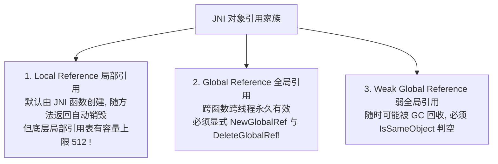

# JNI核心原理动态注册静态注册与引用泄漏防范

在音视频处理（FFmpeg/WebRTC）、游戏渲染引擎（Unity/Unreal）、自研跨平台框架以及人脸识别深度学习推理等高性能场景中，纯 Java 层的执行效率与内存控制往往无法满足要求。**JNI（Java Native Interface，Java 原生接口）** 充当了 Java 世界与 C/C++ Native 世界双向通信的高速公路。深入掌握 **`JavaVM` 与 `JNIEnv` 线程模型、动态注册机制，以及致命的 JNI 引用泄漏防范**，是进阶资深 Android 底层架构师的核心必备硬功。

---

## 核心底层机制与全景架构

### 1. `JavaVM` 与 `JNIEnv` 物理双核架构

在 JNI 运行时中，有两个至关重要的核心指针：

```mermaid
flowchart TD
    subgraph 进程全局唯一
        JVM[JavaVM 结构体指针<br/>代表整个 ART 虚拟机实例<br/>跨进程全局唯一，跨线程共享可用]
    end

    subgraph 线程私有隔离 (Thread-Local)
        Thread1[Java 主线程 / Native 线程 1] --> JNIEnv1[JNIEnv 1 指针<br/>内部是指向庞大 JNI 函数表的二级指针]
        Thread2[后台子线程 / Native 线程 2] --> JNIEnv2[JNIEnv 2 指针<br/>独立函数表副本]
    end

    JVM -->|AttachCurrentThread| Thread2
    Note[铁律: JNIEnv 是线程绑定的! 绝对严禁跨线程传递 JNIEnv 指针!]
```

- **`JavaVM`**：全局虚拟机实例指针。如果后台的 C++ 独立子线程（通过 `pthread_create` 启动）想要回调 Java 方法，必须通过全局持有的 `JavaVM->AttachCurrentThread(&env, NULL)` 为该线程动态分配并绑定专属的 `JNIEnv`。
- **`JNIEnv`**：**严格的线程私有指针**。它本质上是一个二级指针（指向函数指针数组），提供了如 `FindClass`、`GetMethodID`、`CallObjectMethod`、`NewByteArray` 等数百个与 JVM 交互的桥梁函数。

---

## 源码级架构物理拆解

### 1. 静态注册 vs 动态注册终极对比

| 注册方式 | 绑定原理与实现机制 | 优点 | 致命缺陷与安全性 |
| :--- | :--- | :--- | :--- |
| **静态注册** | 遵循特定命名规范：<br>`Java_包名_类名_方法名`<br>（例如 `Java_com_example_Native_calc`） | 编写直观简单，适合小型算法调用 | 初次调用必须依赖 `dlsym` 反射扫描 SO 符号表，**初次执行慢**；**符号名完全暴露在 SO 导出表中，极易被 IDA Pro 逆向破解** |
| **动态注册（大厂标配）** | 在 SO 加载时触发的 **`JNI_OnLoad`** 中，调用 `env->RegisterNatives()` 将函数指针表一次性硬编码绑定 | **加载即绑定，调用性能极致；SO 符号可随意隐藏，安全性与混淆防御极佳** | 需手写方法签名（JNI Type Signature）映射表，编写略微繁琐 |

#### 动态注册生产标准代码实战：
```cpp
#include <jni.h>

// 1. 真实的 C++ 业务执行函数
jstring native_getSecretToken(JNIEnv *env, jobject thiz, jint userId) {
    return env->NewStringUTF("Encrypted_Token_12345");
}

// 2. 映射关系方法表 (JNINativeMethod 数组)
static const JNINativeMethod gMethods[] = {
    // Java方法名, 签名规则 (入参Int返回String), C++函数指针
    {"getSecretToken", "(I)Ljava/lang/String;", (void*)native_getSecretToken}
};

// 3. System.loadLibrary 加载时由虚拟机自动触发的入口函数
JNIEXPORT jint JNI_OnLoad(JavaVM *vm, void *reserved) {
    JNIEnv *env = NULL;
    if (vm->GetEnv((void**)&env, JNI_VERSION_1_6) != JNI_OK) {
        return JNI_ERR;
    }
    
    // 找到对应的 Java 类
    jclass clazz = env->FindClass("com/example/security/NativeSecurityManager");
    if (clazz == NULL) return JNI_ERR;
    
    // 核心一步：动态注册方法映射
    if (env->RegisterNatives(clazz, gMethods, sizeof(gMethods)/sizeof(gMethods[0])) < 0) {
        return JNI_ERR;
    }
    return JNI_VERSION_1_6;
}
```

---

### 2. JNI 三类引用的内存陷阱与溢出崩溃

在 JNI 中，C++ 操作 Java 对象时，虚拟机会为该对象建立引用映射：



#### 致命事故：`local reference table overflow (max=512)`
许多工程师在 C++ 循环中读取大列表或音频帧：
```cpp
// 致命错误示范：循环创建局部引用未释放!
for (int i = 0; i < 2000; i++) {
    jstring str = env->GetObjectArrayElement(array, i); // 创建了一个局部引用
    // ... 做业务计算 ...
    // 忘记调用 env->DeleteLocalRef(str)!
}
```
- **物理报错**：每个 JNI 线程持有的局部引用表底层空间默认非常微小（Dalvik/ART 通常限制在 **512 个**）。当循环超过 512 次，虚拟机直接引爆底层崩溃：
  `JNI ERROR (app bug): local reference table overflow (max=512)`。
- **治理**：在循环体内部使用完后，必须**强制手动调用 `env->DeleteLocalRef(str)`** 显式销毁。

---

## 社招高频硬核连环追问

### Q1: 在 C++ 独立子线程中，为什么不能直接使用主线程的 `JNIEnv` 调用 Java 方法？
- **考点**：`JNIEnv` 的线程栈帧隔离。
- **解析**：
  - `JNIEnv` 内部包含了当前线程的异常堆栈、局部变量表指针以及虚拟机的专用执行上下文；
  - 如果跨线程使用，不同线程的 CPU 寄存器与栈结构完全混乱，虚拟机会在第一时间触发内部断言校验崩溃（`JNI ERROR: non-thread-safe environment access`）；
  - **跨线程正确姿势**：全局缓存 `JavaVM` 指针，子线程通过 `vm->AttachCurrentThread(&env, NULL)` 动态接入，并在线程结束退出前调用 `vm->DetachCurrentThread()` 安全解绑。

### Q2: 为什么从 JNI 传输超大的 `byte[]`（如 $20\text{ MB}$ 图片），`GetByteArrayElements` 可能会导致 Java 堆严重卡顿？
- **考点**：内存拷贝与内存固定（Pinning）。
- **解析**：
  - `GetByteArrayElements(env, array, &isCopy)` 接收一个布尔输出参数 `isCopy`；
  - 如果虚拟机不支持指针直接寻址，它会在 Native 堆重新申请 $20\text{ MB}$ 内存，并将 Java 堆的数据**完整执行一次物理拷贝**（此时 `isCopy = JNI_TRUE`），耗费巨大的 CPU 时间；
  - **极致优化方案**：
    1. 改用 **`GetPrimitiveArrayCritical`**（申请临界区直接访问，但期间严禁发生任何阻塞操作）；
    2. 使用 **`Direct ByteBuffer`（直接内存）**：通过 `env->GetDirectBufferAddress(buffer)` 拿到堆外共享物理指针，实现 **0 拷贝瞬时读写**！

---

## 生产级避坑指南与排障 SOP

### 1. 内存泄漏治理：全局引用必须显式手动释放

**事故场景**：在 C++ 中缓存了某个回调 Listener 对象，但当用户退出 Activity 页面后，该 Activity 却发生永久内存泄漏。

#### 修复代码规范：
```cpp
// 1. 初始化时提升为全局引用
jobject g_listener = env->NewGlobalRef(localListener);

// 2. 页面销毁或释放时，必须强制对应调用销毁，彻底斩断强引用
void releaseNative() {
    if (g_listener != NULL) {
        env->DeleteGlobalRef(g_listener);
        g_listener = NULL;
    }
}
```
