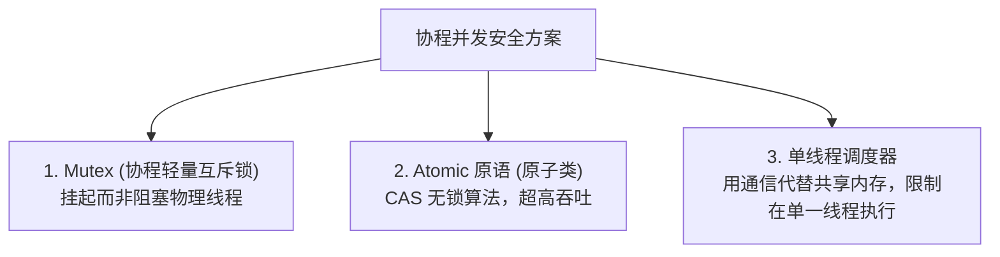

# Kotlin Channel 通道模型与高并发安全实战

在并发编程中，经典的 Go 语言有一句名言：“**不要通过共享内存来通信，而要通过通信来共享内存（Do not communicate by sharing memory; instead, share memory by communicating）**”。

Kotlin 协程不仅提供了传统的锁与原子变量，更原生支持了基于 CSP（Communicating Sequential Processes）并发模型的 **Channel（通道）**。本篇将系统剖析 Channel 的缓冲策略、背压与关闭语义，以及在高并发场景下保障状态安全的工业级方案。

---

## 1. Channel 核心模型与工作原理

Channel 类似于一个并发安全的挂起队列（BlockingQueue），由生产者协程负责发送（`send`），由消费者协程负责接收（`receive`）。当队列满时发送端挂起，当队列空时接收端挂起。

```mermaid
flowchart LR
    P["Producer (生产者协程)"] -->|send(data)| Ch["Channel 管道\n[ 缓冲区 Capacity ]"]
    Ch -->|receive()| C["Consumer (消费者协程)"]
```

### 1.1 Channel 四大缓冲容量（Capacity）策略

| 容量类型 | 常量标识 | 缓冲区大小 | 满载时发送行为 |
| :--- | :--- | :--- | :--- |
| **无缓冲 rendezvous** | `Channel.RENDEZVOUS` (默认) | 0 | 发送者直接挂起，直到消费者调用 `receive` 汇合 |
| **有缓冲 buffered** | `Channel.BUFFERED` (默认 64) | 固定容量 | 缓冲区填满前立即返回；填满后发送者挂起 |
| **覆盖最新 conflated** | `Channel.CONFLATED` | 1 | 永远不挂起发送者，新数据直接冲掉未消费的旧数据 |
| **无限缓冲 unlimited** | `Channel.UNLIMITED` | 内存无上限 | 永远不挂起发送者，若生产过快可能耗尽内存引发 OOM |

```kotlin
// 生产级管道创建案例
val channel = Channel<OrderEvent>(capacity = Channel.BUFFERED)

// 生产者
coroutineScope.launch {
    for (i in 1..10) {
        channel.send(OrderEvent(orderId = i))
    }
    // 生产完毕务必关闭通道，通知消费者退出循环
    channel.close()
}

// 消费者 (优雅迭代消费)
coroutineScope.launch {
    for (event in channel) {
        println("处理订单: ${event.orderId}")
    }
    println("通道已关闭，消费循环结束！")
}
```

---

## 2. 协程高并发安全解决方案三剑客

当多个并发协程需要修改同一共享状态时，由于协程是在线程间动态调度的，依旧存在线程安全与竞态条件（Race Condition）风险。



### 2.1 方案一：Mutex 互斥锁（严禁使用 Java synchronized！）
传统的 Java `synchronized` 或 `ReentrantLock` 会**物理阻塞当前执行线程**。若当前运行在有限的线程池（如 `Dispatchers.Default`）中，线程阻塞极易引发全局线程饥饿死锁。
`Mutex` 则是非阻塞的挂起锁：

```kotlin
val mutex = Mutex()
var counter = 0

suspend fun safeIncrement() {
    // lock() 会挂起当前协程释放底层线程，直到锁被释放才恢复执行
    mutex.withLock {
        counter++
    }
}
```

### 2.2 方案二：Atomic 原子变量
对于简单的计数、开关与状态位切换，直接采用 Java 原生原子类，性能最高：

```kotlin
val activeConnections = AtomicInteger(0)

fun onNewClient() {
    activeConnections.incrementAndGet()
}
```

### 2.3 方案三：单线程调度器（Actor 模式）
通过专用单线程调度器将所有写操作收拢，天然杜绝并发竞争：

```kotlin
val stateWorkerDispatcher = Executors.newSingleThreadExecutor().asCoroutineDispatcher()

suspend fun updateGameState() = withContext(stateWorkerDispatcher) {
    // 在该单线程内，无需任何锁，完全线程安全
    gameState.score += 10
}
```

---

## 3. 面试核心答疑

1. **Channel 与 Flow 的本质区别是什么？**
   - **Channel 是热的（Hot）**：即使没有任何接收者，生产者只要调用 `send` 就会将数据推入通道；且通道数据是一对一消费的（单播/抢占式消费）。
   - **Flow 是冷的（Cold）**：只有下游调用 `collect` 时，上游生产逻辑才会开始执行；多个订阅者各自独立执行一份数据流。
2. **Channel 关闭后调用 send 与 receive 会发生什么？**
   - 关闭后调用 `send()` 会抛出 `ClosedSendChannelException`；
   - 关闭后调用 `receive()` 仍能正常读取缓冲区中剩余的数据，全部读空后再次调用才会抛出 `ClosedReceiveChannelException`。
