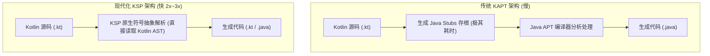

# Kotlin 元编程：KSP 符号处理器与编译器插件实战

在 Android 和 Kotlin 工程中，注解处理器（APT / KAPT）长期承担着 Room、Dagger、Retrofit、Moshi 等主流开源库的代码自动生成工作。

然而，KAPT 必须先将 Kotlin 代码完整转译为 Java Stubs（存根文件），再调用 Java APT 工具处理，导致全量编译时间剧烈膨胀（最高占构建耗时 30% 以上）。为此，Google 官方推出了新一代专为 Kotlin 打造的原生元编程工具 —— **KSP（Kotlin Symbol Processing）**。

---

## 1. KAPT vs KSP 物理架构与构建速度对比



### 核心优势对比
1. **构建速度提升 2~3 倍**：完全省去了将 Kotlin AST 转换为 Java Stubs 的沉重磁盘 I/O 与语法降级步骤；
2. **完整保留 Kotlin 专属语言特性**：KAPT 在生成 Java Stubs 后会丢失 Kotlin 的**可空性标记（Nullable/Non-nullable）**、**类型别名（typealias）**与**内联类（inline class）**；KSP 能够原生、精准地读取并操作这些符号。

---

## 2. 生产级 KSP 处理器开发三步走

### 2.1 第一步：声明注解
```kotlin
// module: annotation
@Target(AnnotationTarget.CLASS)
@Retention(AnnotationRetention.SOURCE)
annotation class AutoBuilder
```

### 2.2 第二步：实现 SymbolProcessor
```kotlin
// module: processor
class BuilderProcessor(
    private val codeGenerator: CodeGenerator,
    private val logger: KSPLogger
) : SymbolProcessor {

    override fun process(resolver: Resolver): List<KSAnnotated> {
        // 1. 查找所有带有 @AutoBuilder 的符号节点
        val symbols = resolver.getSymbolsWithAnnotation(AutoBuilder::class.qualifiedName!!)
        val unableToProcess = symbols.filterNot { it.validate() }.toList()

        symbols.filter { it is KSClassDeclaration && it.validate() }
            .forEach { it.accept(BuilderVisitor(), Unit) }

        return unableToProcess // 返回当前轮次无法解析的符号供下一轮处理
    }

    inner class BuilderVisitor : KSDefaultVisitor<Unit, Unit>() {
        override fun visitClassDeclaration(classDeclaration: KSClassDeclaration, data: Unit) {
            val packageName = classDeclaration.packageName.asString()
            val className = classDeclaration.simpleName.asString()
            val builderName = "${className}Builder"

            // 2. 利用 codeGenerator 写入新文件
            val file = codeGenerator.createNewFile(
                dependencies = Dependencies(aggregating = false, classDeclaration.containingFile!!),
                packageName = packageName,
                fileName = builderName
            )

            file.bufferedWriter().use { writer ->
                writer.write("// 自动生成代码，请勿手动编辑\n")
                writer.write("package $packageName\n\n")
                writer.write("class $builderName {\n")
                writer.write("    // 自动构建生成类字段与方法...\n")
                writer.write("}\n")
            }
        }
    }
}
```

### 2.3 第三步：注册 Provider
```kotlin
class BuilderProcessorProvider : SymbolProcessorProvider {
    override fun create(environment: SymbolProcessorEnvironment): SymbolProcessor {
        return BuilderProcessor(
            codeGenerator = environment.codeGenerator,
            logger = environment.logger
        )
    }
}
```

并在 `resources/META-INF/services/com.google.devtools.ksp.processing.SymbolProcessorProvider` 文件中配置全限定类名。

---

## 3. 架构选型与迁移策略

在现代大型工程中，应全面将 Room、Moshi、Hilt 等主流框架的 Gradle 配置从 `kapt` 替换为 `ksp`：

```kotlin
plugins {
    id("com.google.devtools.ksp") version "2.0.0-1.0.21"
}

dependencies {
    // 替换前：kapt("androidx.room:room-compiler:2.6.1")
    ksp("androidx.room:room-compiler:2.6.1")
}
```
经过企业级实测，在多模块千级类的工程中，移除全部 KAPT 并切到 KSP 后，增量构建平均加速可达 **40% 以上**。
