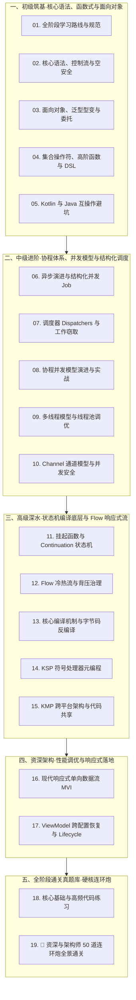

# Kotlin 现代编程语言与并发响应式全景指南

欢迎来到 **Kotlin 现代语言与高并发响应式进阶专栏**。

随着 Google 将 Kotlin 确立为 Android 官方首选开发语言（Kotlin-First）并在后端（Ktor/Spring Boot）、跨平台（Kotlin Multiplatform - KMP）以及现代响应式架构中的全面落地，熟练掌握 Kotlin 已不仅是“语法糖的运用”，而是深入掌握**函数式编程模型**、**结构化并发（Structured Concurrency）**、**协程 Continuation 状态机编译底层**与 **Flow 现代流式响应式架构**的必经之路。

---

## 🗺️ Kotlin 全阶段技术图谱与学习路线

---

## 📚 专栏章节索引

### 一、初级筑基·核心语法、函数式与面向对象实战
1. [01. Kotlin 语言使用与全阶段学习路线](/doc/Android/Kotlin语言使用与面试学习路线)
2. [02. Kotlin 基础核心语法、控制流与空安全深度剖析](/doc/Android/Kotlin语言基础与日常开发)
3. [03. Kotlin 面向对象、泛型型变(out/in)与委托详解](/doc/Android/Kotlin面向对象泛型与委托详解)
4. [04. Kotlin 集合操作符、高阶函数与 DSL 实战](/doc/Android/Kotlin集合函数式与DSL实战)
5. [05. Kotlin 与 Java 互操作实战与平台类型空安全避坑](/doc/Android/Kotlin与Java互操作实战)

### 二、中级进阶·协程体系、并发模型与结构化调度
6. [06. 异步演进历程与结构化并发 Job 与作用域体系深度解密](/doc/Android/Kotlin异步演进与结构化并发Job与作用域体系)
7. [07. 协程调度器 Dispatchers 与底核工作窃取线程池机制](/doc/Android/协程调度器Dispatchers与工作窃取线程池机制)
8. [08. 协程与 Flow 实战：并发模型演进与结构化并发](/doc/Android/协程与Flow实战)
9. [09. 多线程并发编程模型与生产级线程池调优实战](/doc/Android/多线程)
10. [10. Channel 通道模型与 CSP 跨协程高并发安全实战](/doc/Android/KotlinChannel通道模型与并发安全实战)

### 三、高级深水·状态机编译底层、Flow 响应式流与源码剖析
11. [11. 协程底层编译黑魔法：挂起函数与 Continuation 状态机源码推导](/doc/Android/Kotlin协程底层原理挂起函数与Continuation状态机)
12. [12. Flow 响应式冷流与热流 StateFlow-SharedFlow 背压治理全解](/doc/Android/Flow响应式冷流与热流StateFlow-SharedFlow背压治理)
13. [13. Kotlin 核心编译机制与高频实战解析](/doc/Android/Kotlin核心机制与高频实战解析)
14. [14. Kotlin 元编程：KSP 符号处理器与编译器插件实战](/doc/Android/Kotlin元编程KSP符号处理器与编译器插件实战)
15. [15. Kotlin 跨平台 KMP 架构设计与双端代码共享实战](/doc/Android/Kotlin跨平台KMP架构设计与代码共享实战)

### 四、资深架构·性能调优、工程治理与响应式落地
16. [16. Kotlin 现代化响应式单向数据流 MVI 架构实战](/doc/Android/Kotlin现代化响应式单向数据流MVI架构实战)
17. [17. ViewModel 跨配置恢复与 Lifecycle 协程生命周期绑定](/doc/Android/ViewModel跨配置恢复与Lifecycle状态机深度解密)

### 五、全阶段通关真题库·大厂高频面试硬核连环炮
18. [18. Kotlin 核心基础与高频代码练习全景通关](/doc/Android/Kotlin高频面试题与代码练习)
19. [19. 🎯 Kotlin 资深与架构师社招高频硬核 50 道连环炮全景通关](/doc/Android/Kotlin资深与架构师社招高频硬核50道连环炮全景通关)
