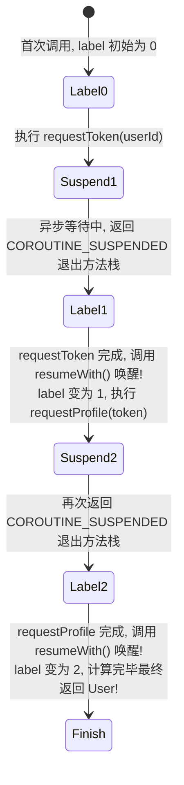

# Kotlin协程底层原理挂起函数与Continuation状态机

Kotlin 协程（Coroutines）彻底革新了 Android 异步并发编程范式，使得“**用看似同步的代码结构编写复杂的异步非阻塞逻辑**”成为现实。然而，协程绝非由操作系统支持的原生线程，它是一套完全由 **Kotlin 编译器（kotlinc）在编译期进行的黑魔法改造**，配合轻量级用户态调度器实现的。深入理解 **CPS 变换（Continuation-Passing-Style）**、**有限状态机（Finite State Machine）字节码推导**，以及 **结构化并发的异常传播模型**，是社招面试中区分普通开发者与资深开发者的关键考点。

---

## 核心底层机制与全景架构

### 1. 协程并发与线程模型物理对比

```mermaid
flowchart TD
    subgraph 传统操作系统线程 (Thread)
        T1[内核级实体: 由 OS 内核直接调度]
        T2[栈内存开销大: 默认每个线程分配 1MB 栈内存]
        T3[阻塞代价高: Thread.sleep 导致操作系统级上下文切换 (Context Switch)]
    end

    subgraph Kotlin 协程 (Coroutine)
        C1[用户态轻量协作原语: 完全由编译器与代码调度]
        C2[极低内存: 一个协程仅占用几十字节的堆内存对象]
        C3[非阻塞挂起: delay 仅仅是注册定时器并注销当前状态机, 线程立即释放去执行其他任务!]
    end
```

- **“挂起（Suspend）”的物理本质**：不是阻塞操作系统线程，而是**函数执行到挂起点时，保存当前所有局部变量并主动从当前线程“返回（Return）”**，把宝贵的线程资源让出来；当异步操作完成，由恢复机制将保存的上下文重新投递到指定线程继续向下执行。

---

## 源码级架构物理拆解

### 1. 编译期第一重蜕变：CPS 变换（Continuation-Passing-Style）

假设我们编写了一段看似普通的挂起代码：
```kotlin
suspend fun fetchUserData(userId: String): User {
    val token = requestToken(userId)    // 挂起点 1
    val user = requestProfile(token)    // 挂起点 2
    return user
}
```

Kotlin 编译器在编译为 JVM 字节码时，会对其进行 **CPS 变换（续体传递风格）**：
1. **函数签名大改造**：
   - 原本无额外参数的函数，签名末尾被强制插入一个隐藏参数：**`Continuation<? super User> completion`**；
   - 函数的返回值从 `User` 变成了 **`Object`**（因为该函数要么立即返回 `User`，要么返回特殊的挂起标志对象 `COROUTINE_SUSPENDED`）。
   - 变换后的实际 Java 签名：
     ```java
     public static Object fetchUserData(String userId, Continuation<? super User> completion);
     ```
2. **什么是 `Continuation`（续体）？**
   - 它在物理上就是一个包含了回调与上下文的轻量接口：
     ```java
     public interface Continuation<in T> {
         public val context: CoroutineContext
         public fun resumeWith(result: Result<T>) // 恢复执行入口
     }
     ```

---

### 2. 编译期第二重蜕变：有限状态机（State Machine）逆向反编译

编译器会为该函数动态生成一个实现了 `ContinuationImpl` 的内部类状态机：



#### 逆向反编译出的伪代码逻辑还原：
```java
public static Object fetchUserData(String userId, Continuation completion) {
    // 1. 判断传入的是否是自身的状态机，若不是则新建一个状态机
    FetchUserDataContinuation sm;
    if (completion instanceof FetchUserDataContinuation) {
        sm = (FetchUserDataContinuation) completion;
    } else {
        sm = new FetchUserDataContinuation(completion);
    }

    // 2. 状态机分发中枢 (核心是 label 标签计数器)
    switch (sm.label) {
        case 0:
            sm.label = 1;
            sm.L$0 = userId; // 保存局部变量到状态机堆内存中!
            Object tokenResult = requestToken(userId, sm);
            if (tokenResult == IntrinsicsKt.getCOROUTINE_SUSPENDED()) {
                return tokenResult; // 挂起! 直接退出方法栈，线程释放!
            }
            // 若没有挂起（如命中了内存缓存直接返回），则无缝贯穿进入 case 1
        case 1:
            // 恢复现场：从状态机中取出之前保存的局部变量
            String token = (String) sm.result;
            sm.label = 2;
            Object profileResult = requestProfile(token, sm);
            if (profileResult == IntrinsicsKt.getCOROUTINE_SUSPENDED()) {
                return profileResult; // 再次挂起!
            }
        case 2:
            // 最终就绪阶段
            User user = (User) sm.result;
            return user;
    }
}
```
通过一个普通的 `switch(label)`，Kotlin 编译器巧妙地把异步多段回调扁平化为了同一个方法在不同时间片断的“断点续传”。

---

### 3. 结构化并发（Structured Concurrency）与异常扩散模型

协程遵循树形生命周期层级：

```mermaid
flowchart TD
    Parent[Parent Scope: Job / SupervisorJob] --> Child1[Child Job 1 (网络请求 A)]
    Parent --> Child2[Child Job 2 (数据库读写 B)]
    Parent --> Child3[Child Job 3 (动画渲染 C)]
    
    Child1 -->|突发抛出未捕获异常 SocketTimeoutException!| Boom[异常向上抛给父协程]
    Boom --> Diff{父协程是 Job 还是 SupervisorJob?}
    
    Diff -- 普通 Job --> CancelAll[级联取消: 父协程被取消, 导致 Child 2 和 Child 3 全部被强行取消中断!]
    Diff -- SupervisorJob (主管作业) --> CatchSingle[隔离保护: 仅取消 Child 1, 其余兄弟协程 Child 2 和 3 继续安全执行!]
```

- **生产军规**：在 Android UI 界面或 ViewModel 中启动并发多个并行网络请求时，**必须使用 `SupervisorJob` 或 `supervisorScope`**，防止其中一个非关键接口报错导致整个页面的其他数据请求全部被连带取消！

---

## 社招高频硬核连环追问

### Q1: `suspendCancellableCoroutine` 与 `suspendCoroutine` 的区别是什么？生产上为什么严禁使用后者？
- **考点**：协程取消响应与内存/资源泄漏。
- **解析**：
  - **`suspendCoroutine`**：仅支持挂起和恢复，**不支持感知协程的取消**；
  - **`suspendCancellableCoroutine`**：提供了一个 `CancellableContinuation`，支持通过 `invokeOnCancellation { ... }` 注册取消监听；
  - **生产事故**：当用户退出 Activity 时，外部 `viewModelScope` 自动取消了父协程。
    - 如果使用 `suspendCoroutine` 包装第三方异步 SDK（如 OkHttp Call），底层的网络请求依然在后台傻傻运行并持续占用线程与内存，发生物理泄漏；
    - 使用 `suspendCancellableCoroutine` 可以在协程被取消时，**立即调用 `call.cancel()` 掐断物理网络连接**，释放 Native 资源。

### Q2: 协程中的 `withContext(Dispatchers.IO)` 是如何保证线程切换安全的？
- **考点**：调度器拦截器机制（`ContinuationInterceptor`）。
- **解析**：
  - `withContext` 会为当前代码块创建一个新的子协程；
  - 其传入的 `Dispatchers.IO` 实现了 `ContinuationInterceptor` 拦截器接口；
  - 当状态机触发 `resumeWith` 恢复时，拦截器会介入，调用 `dispatcher.dispatch(context, runnable)` 将当前状态机作为一个任务提交给目标线程池执行，实现无锁化跨线程调度。

---

## 生产级避坑指南与排障 SOP

### 1. 避免使用 `GlobalScope` 导致严重内存与任务泄漏

**反模式**：
```kotlin
// 致命错误：脱离组件生命周期的孤儿协程
GlobalScope.launch {
    delay(10000)
    userDao.update(...)
}
```
- **治理规范**：在 Android 中必须且只能绑定具体组件的生命周期作用域：
  - 在 ViewModel 中使用 **`viewModelScope`**（在 `onCleared` 时自动全量取消）；
  - 在 Activity/Fragment 中使用 **`lifecycleScope`**；
  - 严禁在业务层滥用 `GlobalScope`。
