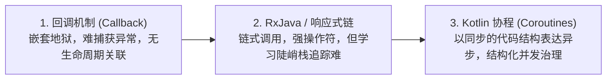
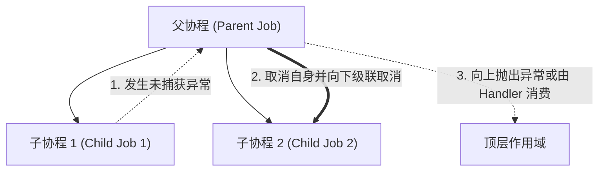
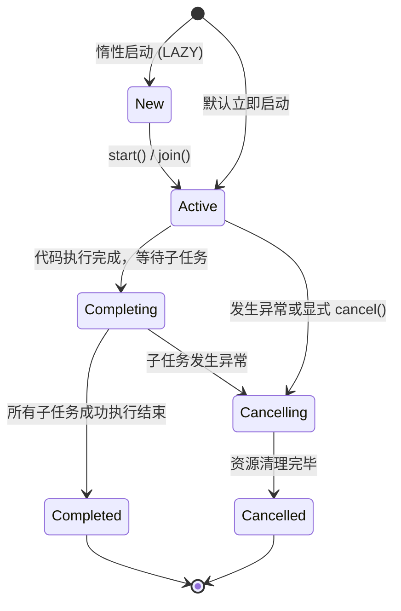

# Kotlin 异步演进与结构化并发：Job 与作用域体系深度解密

在现代软件工程中，异步编程经历了从多线程回调地狱（Callback Hell）到响应式流（RxJava），再到**轻量级协程与结构化并发（Structured Concurrency）**的巨大范式变革。

本篇将系统梳理异步编程的技术演进脉络，深入解密 Kotlin 协程中 `Job` 状态机生命周期、父子任务关联、异常传递隔离以及 `CoroutineScope` 的底层运作机理。

---

## 1. 异步编程范式演进之路



---

## 2. 结构化并发（Structured Concurrency）物理真相

结构化并发的核心法则是：**并发任务不得脱离明确的生命周期范围独立存活，父级任务必须等待其所有子任务全部完成，且子任务的异常能够按照预定义规则安全传播。**



### 2.1 任务树状层级绑定
当在协程内通过 `launch` 或 `async` 启动新协程时，新协程会自动继承父协程的 `CoroutineContext`，并将自身的 `Job` 作为 Child 挂载到父级 `Job` 的子任务列表中。

### 2.2 核心机制：Job 与 SupervisorJob 的本质差异

```kotlin
// 场景 1：标准 Job (普通树状级联崩溃)
val standardScope = CoroutineScope(Dispatchers.Default + Job())
standardScope.launch {
    launch {
        throw RuntimeException("子任务 1 崩溃！")
    }
    launch {
        delay(1000)
        println("子任务 2: 永远无法被执行，因为父级已被子任务 1 连带取消！")
    }
}

// 场景 2：SupervisorJob (监督者模式：子任务间互不影响)
val supervisorScope = CoroutineScope(Dispatchers.Default + SupervisorJob())
supervisorScope.launch {
    // 独立子协程 1 崩溃，不会连带导致子协程 2 取消
    launch(CoroutineExceptionHandler { _, e -> println("捕获子任务 1 异常: $e") }) {
        throw RuntimeException("子任务 1 崩溃！")
    }
    launch {
        delay(500)
        println("子任务 2: 正常执行完成！")
    }
}
```

> [!WARNING] SupervisorJob 常见误区
> `SupervisorJob()` 仅对其**直接子协程**生效。如果在 `supervisorScope.launch { ... }` 内部再直接通过普通 `launch` 启动多层嵌套子任务，由于嵌套子任务的直接父级是该 `launch`（普通 Job），孙任务崩溃依然会导致其父协程及其兄弟任务全军覆没！

---

## 3. Job 状态机全生命周期推导

每个 `Job` 内部维护着严格的状态机转移：



### 关键细节：Completing 状态
一个协程的代码块执行完最后一行时，它并不会立即变为 `Completed`，而是处于 `Completing` 状态。它必须等待其派生出的所有异步并发子任务全部退出后，父级才会真正进入 `Completed`。

---

## 4. 生产级异常拦截：CoroutineExceptionHandler

`CoroutineExceptionHandler`（简称 CEH）是协程处理未捕获异常的最后一道防线：

```kotlin
val customCeH = CoroutineExceptionHandler { coroutineContext, throwable ->
    Log.e("CoroutineGuard", "全局兜底捕获异常: $throwable", throwable)
}

val scope = CoroutineScope(Dispatchers.Main + SupervisorJob() + customCeH)

// 必须加在 root 根协程上才生效！
scope.launch {
    fetchNetworkData()
}
```

> [!IMPORTANT] CEH 加载位置限制
> `CoroutineExceptionHandler` **仅对根协程（Root Coroutine）有效**。如果将 CEH 放在子协程 `launch(ceh)` 上，子协程发生异常时依然会向上委派给父协程，导致局部设置的 CEH 被完全忽略！
