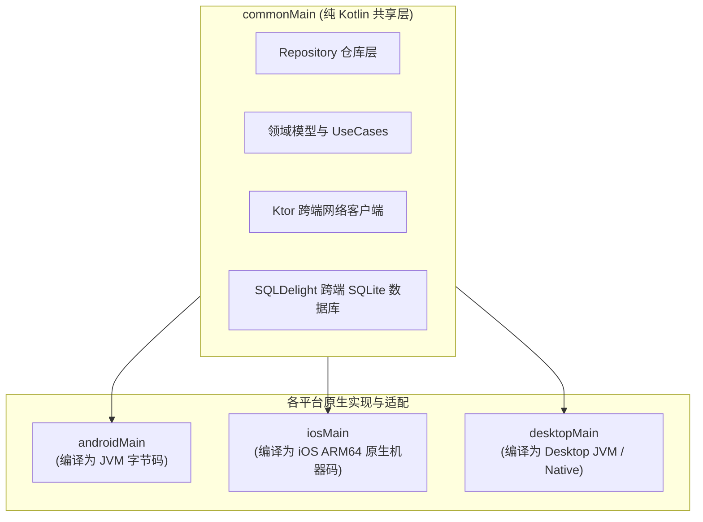

# Kotlin 跨平台 KMP 架构设计与代码共享实战

**Kotlin Multiplatform（简称 KMP）** 是 JetBrains 推出的新一代跨平台技术解决方案。与传统的跨端方案（如 Flutter、React Native 强行将 UI 和业务全量统一）不同，KMP 的核心哲学是：**“共享最值得共享的商业逻辑与数据层，将纯粹的原生 UI 体验留给各平台”**。

---

## 1. KMP 现代分层架构与预期/实际（expect/actual）机制



### expect / actual 机制：打通平台特有能力

当共享层需要调用特定平台的系统功能（如获取设备型号、存储目录或加密芯片）时，可以使用 `expect` 声明契约，各平台使用 `actual` 具体实现：

```kotlin
// commonMain (声明平台契约)
expect class PlatformInfo() {
    val platformName: String
    fun getHardwareId(): String
}

// androidMain (Android 原生实现)
actual class PlatformInfo actual constructor() {
    actual val platformName: String = "Android ${android.os.Build.VERSION.SDK_INT}"
    actual fun getHardwareId(): String = android.os.Build.FINGERPRINT
}

// iosMain (iOS 原生实现，直接调用 Apple 原生 API)
import platform.UIKit.UIDevice

actual class PlatformInfo actual constructor() {
    actual val platformName: String = "iOS ${UIDevice.currentDevice.systemVersion}"
    actual fun getHardwareId(): String = UIDevice.currentDevice.identifierForVendor?.UUIDString ?: ""
}
```

---

## 2. 生产级 KMP 技术选型全景

| 功能模块 | 官方/业界首选跨端库 | 适用平台 |
| :--- | :--- | :--- |
| **网络层** | **Ktor Client** | Android, iOS, Desktop, Web |
| **本地持久化** | **SQLDelight / Room KMP** | Android, iOS, Desktop |
| **异步流** | **kotlinx.coroutines & Flow** | 全平台原生支持 |
| **JSON 序列化**| **kotlinx.serialization** | 零反射，极速纯编译器生成 |
| **依赖注入** | **Koin (纯 Kotlin 实现)** | 全平台兼容 |

---

## 3. 企业级落地策略：逻辑共享与渐进式接入

1. **零风险切入点：数据模型与算法共享**：
   在现有的 Android 与 iOS 工程之间，优先将双方通用且极易产生双端逻辑差异的模块（如加解密算法、风控规则运算、数据字典校验）抽离为 KMP 基础库。
2. **第二阶段：网络与仓储层沉淀**：
   将 API 请求封装、Token 无感刷新拦截器、离线数据同步引擎下沉至 `commonMain`。
3. **第三阶段：UI 选型自由**：
   团队既可继续在 Android 上使用 Compose、iOS 上使用 SwiftUI，亦可使用 Compose Multiplatform 统一 UI。架构高度弹性解耦。
