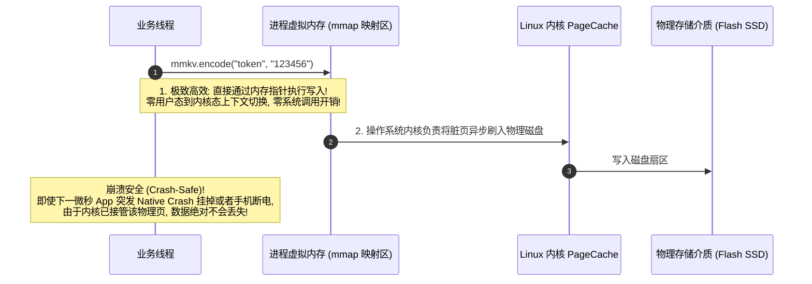
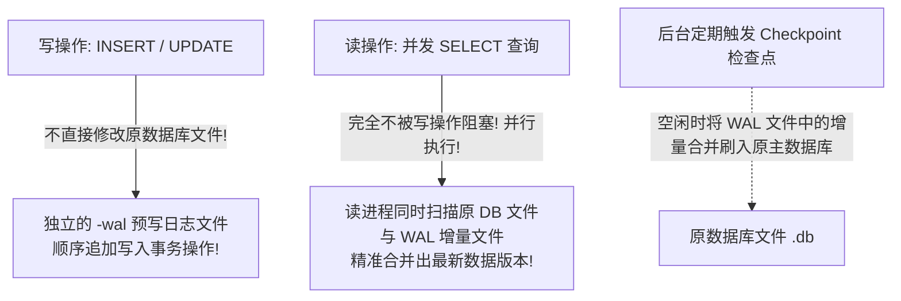

# MMKV极速持久化原理mmap与Room数据库WAL并发模式

在 Android 客户端持久化存储中，小数据量配置项（如登录态 Token、用户设置、标记位）与结构化大业务数据（如聊天记录、离线商品库）有着截然不同的架构诉求。早期的 **SharedPreferences（SP）** 存在严重的“全量 XML 解析卡死主线程、引发线上大面积 ANR”等致命物理缺陷。微信开源的 **MMKV** 与 Google 推荐的 **Room（基于 SQLite WAL 模式）** 构成了现代 Android 本地存储的双子星。本文深度解构 **`mmap` 增量写入机制** 与 **SQLite WAL 读写并发事务物理原理**。

---

## 核心底层机制与全景架构

### 1. 本地存储架构全景对比

```mermaid
flowchart TD
    Store[Android 本地持久化体系] --> Small[1. 轻量 KV 键值存储: MMKV (全面替代 SP)<br/>基于 mmap 内存映射 + Protocol Buffers 增量写入<br/>读写速度快 100+ 倍, 彻底绝迹 ANR!]
    
    Store --> Large[2. 结构化大型数据库: Room (基于 SQLite)<br/>基于 WAL 预写日志模式<br/>读写完全并发, 彻底解决数据库读写排他互斥锁!]
```

---

## 源码级架构物理拆解

### 1. 为什么大厂必须强制禁用 SharedPreferences？

在许多一线互联网公司，代码静态扫描（Lint）会将 `SharedPreferences` 的使用直接标为严重警告甚至编译阻断：

```mermaid
flowchart LR
    subgraph SharedPreferences 三大致命物理缺陷
        D1[1. 全量 XML 阻塞读取<br/>初次 getSharedPreferences 必须在主线程将几百KB的 XML 文件全部读入内存并解析为 Map<br/>严重拖垮冷启动!]
        D2[2. 极度严重的 IO 写入放大<br/>哪怕仅仅修改一个 boolean 值从 false 改为 true<br/>SP 也必须将整个 XML 字符串重新全量覆写到磁盘!]
        D3[3. apply() 依然引发致命 ANR!<br/>虽然看似在后台线程写盘, 但系统在 Activity.onPause/onStop 时强制清空 QueuedWork 队列<br/>主线程被迫死等磁盘写入完成, 诱发海量 ANR!]
    end
```

---

### 2. MMKV 底层黑魔法：`mmap` 内存映射与 PB 增量追加

为了彻底颠覆 SP 的缺陷，微信团队打造了 **MMKV**：



#### 关键物理优势：
1. **`mmap` 零系统调用**：将文件通过系统调用 `mmap()` 直接映射到进程的虚拟内存空间中，对文件的读写退化为**直接对内存指针的读写**；
2. **Protocol Buffers 增量追加写入（Append-only）**：
   - 当修改一个 Key-Value 时，MMKV **绝不重写整个文件**，而是将修改后的键值编码为轻量的 PB 二进制块，**直接追加在文件末尾**；
   - 顺序追加写入的耗时仅需微秒级；
   - 只有当文件空间不足时，MMKV 才会自动触发一次“全局去重重写（Compaction）”，消除历史冗余数据。

---

### 3. SQLite / Room 的 WAL（Write-Ahead Logging）读写并发模式

传统关系型数据库在执行写入时采用 **Rollback Journal（回滚日志）** 模式，存在严重的**读写互斥锁**：当有一个线程在执行 `INSERT` 时，整个数据库被加上排他排它锁，所有的 `SELECT` 查询线程必须全量挂起等待。

现代 Room / SQLite 默认开启了 **WAL（预写日志）模式**：



- **物理收益**：**读操作永远不阻塞写操作，写操作也永远不阻塞读操作！** 极大地释放了多线程高并发下的数据库并发吞吐上限。

---

## 社招高频硬核连环追问

### Q1: MMKV 是如何实现“跨进程并发安全”的？
- **考点**：跨进程文件锁与内存校验。
- **解析**：
  - 传统 SP 在跨进程模式下（`MODE_MULTI_PROCESS`）极易发生数据覆盖错乱；
  - **MMKV 内部实现了基于 Linux 原生文件锁（`flock`）的多进程协同机制**：
    - 读取时加读锁（共享锁，允许多进程同时读）；
    - 写入时加写锁（互斥锁，排他写入）；
  - 配合文件头部记录的 `CRC32` 校验码与序列号，当进程 A 完成修改后，进程 B 在下一次读取时能瞬间感知到序列号变化，**仅将增量部分同步映射进内存**，达成了极致的跨进程数据一致性。

### Q2: 为什么 Room 严禁在主线程执行普通的查询操作？
- **考点**：磁盘 I/O 抖动与 UI 掉帧防范。
- **解析**：
  - 虽然 SQLite 单次查询在测试机上耗时可能只有 1~2ms；
  - 但在真实用户的低端设备、或者磁盘正在经历高频 I/O 写入（如后台下载大文件、解压更新包）时，由于 Flash 闪存的寻道延迟与系统调度，**即使是一次极简单的 `SELECT` 也可能瞬间卡顿数十毫秒甚至数秒**；
  - 如果在主线程执行，直接导致错过数个 VSYNC 垂直同步帧引发卡顿甚至 ANR；
  - **规范**：Room 强制要求通过 Kotlin 协程挂起函数（`suspend`）或返回响应式 `Flow`，将查询强制下沉至后台 IO 线程调度。

---

## 生产级避坑指南与排障 SOP

### 1. MMKV 极速初始化与全工程迁移 SOP

在 `Application#onCreate()` 启动第一行执行极速初始化（耗时低于 3ms）：

```java
// 1. 初始化 MMKV 根目录
MMKV.initialize(this);

// 2. 存量 SharedPreferences 一键平滑无损迁移
MMKV mmkv = MMKV.defaultMMKV();
SharedPreferences oldSp = getSharedPreferences("user_config", Context.MODE_PRIVATE);
// 将旧 SP 中的全部历史数据批量导入 MMKV，并自动清空旧 SP，零数据丢失！
mmkv.importFromSharedPreferences(oldSp);
oldSp.edit().clear().apply();
```
彻底移除旧代码中的 `getSharedPreferences()` 调用，断绝启动期卡顿隐患。
