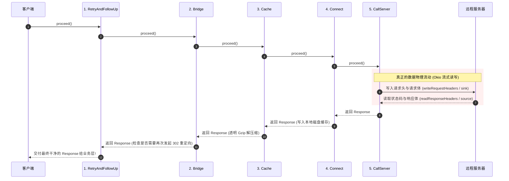

# OkHttp核心架构全景五大拦截器责任链与连接池复用机制

在 Android 乃至整个 Java 网络开发领域，**Square 开源的 OkHttp** 凭借其精湛的责任链设计模式（Chain of Responsibility）、极致的连接池复用以及对 HTTP/2 的卓越支持，成为所有网络框架（包括 Retrofit、Fresco、Volley）无可争议的底层物理基石。深入理解 **Dispatcher 分发器队列调度**、**五大核心拦截器的职责边界**，以及 **Socket 连接池自动回收的标记清除算法**，是每个资深工程师的必备硬核功底。

---

## 核心底层机制与全景架构

### 1. OkHttp 网络请求全景执行拓扑

```mermaid
flowchart TD
    Client[业务调用: okHttpClient.newCall(request)] --> Dispatcher[Dispatcher 分发器<br/>维护 readyAsyncCalls 与 runningAsyncCalls 队列<br/>控制并发上限: 全局 64, 单 Host 5]
    
    Dispatcher --> Chain[RealInterceptorChain 责任链中枢<br/>通过 proceed 递归嵌套流转]
    
    subgraph 五大核心内置拦截器 (按顺序依次穿透)
        I1[1. RetryAndFollowUpInterceptor: 失败重试与 3xx 重定向]
        I2[2. BridgeInterceptor: 补全 Header (Host, Gzip, Cookie) 与响应解压]
        I3[3. CacheInterceptor: 评估 HTTP 缓存策略 (ETag, 304, 本地磁盘缓存)]
        I4[4. ConnectInterceptor: 从连接池获取/新建 RealConnection 并完成握手]
        I5[5. CallServerInterceptor: 终点! 向 Socket 发送请求报文并读取响应]
        
        I1 --> I2 --> I3 --> I4 --> I5
    end

    Chain --> I1
    I5 --> Net[操作系统 TCP/IP 协议栈与物理网络]
```

---

## 源码级架构物理拆解

### 1. 五大拦截器责任链的深度源码剖析

`RealInterceptorChain#proceed()` 采用了优美至极的**递归责任链模式**：



#### 各拦截器核心职责明细：
1. **`RetryAndFollowUpInterceptor`**：
   - 捕捉底层网络异常（路由不可达、连接超时），判定是否需要换备用 IP 重试；
   - 解析服务端的 `301 / 302 / 307` 响应头，自动提取 `Location` 重新发起递归请求。
2. **`BridgeInterceptor`（桥接转换器）**：
   - **向外发请求前**：补全标准 HTTP 缺失的必要头部（`Host`, `Keep-Alive`, `User-Agent`, `Content-Type`），自动附带 `Accept-Encoding: gzip` 并从 CookieJar 中注入 Cookie；
   - **接收响应后**：检查如果服务端返回了 `Content-Encoding: gzip`，自动透明地使用 `GzipSource` 解压，业务层完全无需感知压缩细节。
3. **`CacheInterceptor`（缓存评估拦截器）**：
   - 根据 HTTP 1.1 协议规范，对比本地磁盘缓存的 `Date`、`Expires`、`Cache-Control`、`ETag`；
   - 若本地缓存新鲜，**直接短路返回，零网络交互！**
   - 若必须校验，向请求头附带 `If-None-Match`，服务端返回 `304 Not Modified` 时快速更新本地缓存返回。
4. **`ConnectInterceptor`（物理连接中枢）**：
   - 调用 `Transmitter.newExchange()`，向底层 **`ConnectionPool`（连接池）** 索取可复用的空闲 `RealConnection`；
   - 若无可用连接，发起物理 TCP 三次握手与 TLS 证书认证握手，并协商协议（HTTP/1.1 或 HTTP/2）。
5. **`CallServerInterceptor`（物理读写终点）**：
   - 唯一直接接触 Socket 管道的拦截器；
   - 借助 Square 的 **Okio** 框架，向网卡缓冲区写入协议报文，并读入服务器回传的字节流。

---

### 2. 连接池（`ConnectionPool`）复用与自动化标记清除算法

建立一条物理 TCP 连接与 TLS 握手需要经历多个 RTT（往返时延），在移动弱网下耗时长达数百毫秒。

```mermaid
flowchart TD
    Req[ConnectInterceptor 请求物理连接] --> Pool[ConnectionPool 连接池]
    
    Pool --> Check{是否存在指向目标 Host 且存活的空闲连接?}
    Check -- 存在 --> Reuse[物理连接复用! 0 握手时延, 立即发送数据!]
    Check -- 不存在 --> NewConn[新建 Socket 连接并执行握手]
    NewConn --> Save[请求完毕后, 将连接保存在连接池中]
    
    subgraph 自动化守护清理线程 (类似 JVM 垃圾回收)
        Cleanup[后台 cleanupRunnable 守护线程] --> Scan[定时扫描所有空闲连接]
        Scan --> Count{空闲连接数 > 5 或 空闲时间 > 5分钟?}
        Count -- 是 --> Close[调用 socket.closeQuietly 物理断开并移出池]
        Count -- 否 --> Wait[根据最久未使用的剩余寿命, 计算 sleep 精确休眠]
    end
```

#### 关键参数配置：
```java
// 默认配置：最大空闲连接数 5，最长空闲保持存活 5 分钟
public ConnectionPool() {
    this(5, 5, TimeUnit.MINUTES);
}
```

---

## 社招高频硬核连环追问

### Q1: HTTP/2 的多路复用（Multiplexing）在 OkHttp 底层是如何实现的？与 HTTP/1.1 有何本质差异？
- **考点**：应用层传输协议演进与物理连接利用率。
- **解析**：
  - **HTTP/1.1 的硬伤（线头阻塞 Head-of-line Blocking）**：在同一个物理 TCP 连接中，请求必须按顺序串行发送。前一个请求未返回，后一个请求即使准备好了也必须在排队等待；
  - **HTTP/2 的多路复用底层物理实现**：
    - 抛弃了纯文本格式，将数据划分为二进制的 **数据帧（Frame）**；
    - 每个逻辑请求被赋予一个唯一的整数编号 **`StreamId`**；
    - 多个并发请求的二进制帧可以**无序交错混杂在同一个物理 TCP 连接管道中全速并发传输**；
    - 接收端根据 `StreamId` 重新组装各自的报文。
    - **收益**：全站只需维持与服务器的**唯一一条物理连接**，就能饱和打满带宽并发收发几十个网络请求。

### Q2: 自定义应用拦截器（`addInterceptor`）与网络拦截器（`addNetworkInterceptor`）有什么区别？
- **考点**：拦截器在责任链中的物理位置。
- **解析**：
  - **应用拦截器（Application Interceptor）**：
    - 位于责任链的最外层（在 `RetryAndFollowUpInterceptor` 之前）；
    - **只会被调用一次**（无论内部发生了多少次 302 重定向或网络失败重试）；
    - 允许短路拦截（如直接伪造 Mock 数据返回），无法感知真实的重试和物理网络数据；
  - **网络拦截器（Network Interceptor）**：
    - 位于责任链的内层（在 `ConnectInterceptor` 和 `CallServerInterceptor` 之间）；
    - **直接观察真实的物理网络数据**；
    - 如果请求命中了本地磁盘缓存（`CacheInterceptor` 短路返回），**网络拦截器根本不会被执行**！
    - 如果发生了重定向或重试，网络拦截器会**真实地被多次触发**，可用于观察带有完整 Gzip 和真实 Header 的原始网络传输。

---

## 生产级避坑指南与排障 SOP

### 1. 移动端弱网与 DNS 劫持治理（自定义 HTTPDNS 注入）

**事故场景**：在部分偏远地区或公共 Wi-Fi 下，系统 LocalDNS 经常被运营商恶意劫持，插入垃圾广告或解析失败报 `UnknownHostException`。

#### 生产标准解决 SOP：
利用 OkHttp 提供的 `Dns` 接口，替换为企业级 **HTTPDNS（腾讯云/阿里云）**，绕过运营商 LocalDNS 的 UDP 53 端口：

```java
OkHttpClient client = new OkHttpClient.Builder()
    .dns(new Dns() {
        @NonNull
        @Override
        public List<InetAddress> lookup(@NonNull String hostname) throws UnknownHostException {
            // 1. 优先调用 HTTPDNS SDK 基于 HTTPS 获取高防真实 IP
            List<String> ips = HttpDnsManager.getIpsByHost(hostname);
            if (ips != null && !ips.isEmpty()) {
                List<InetAddress> result = new ArrayList<>();
                for (String ip : ips) {
                    result.addAll(Arrays.asList(InetAddress.getAllByName(ip)));
                }
                return result;
            }
            // 2. 兜底回退为系统原生解析
            return Dns.SYSTEM.lookup(hostname);
        }
    })
    .build();
```
彻底终结 DNS 污染与解析慢导致的白屏卡顿。
