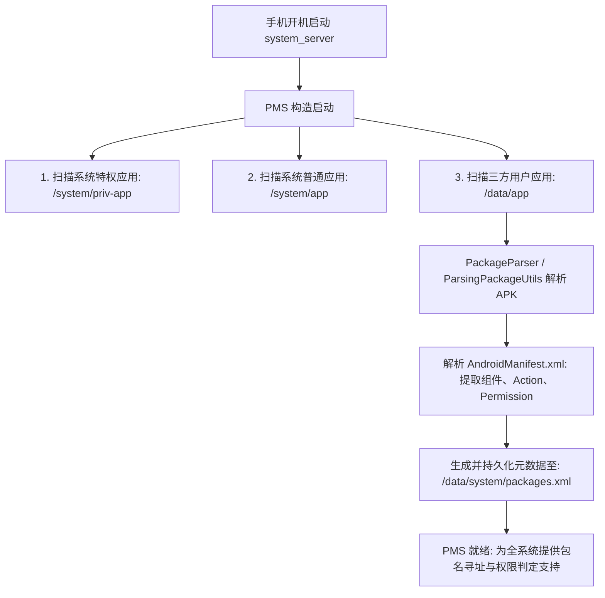
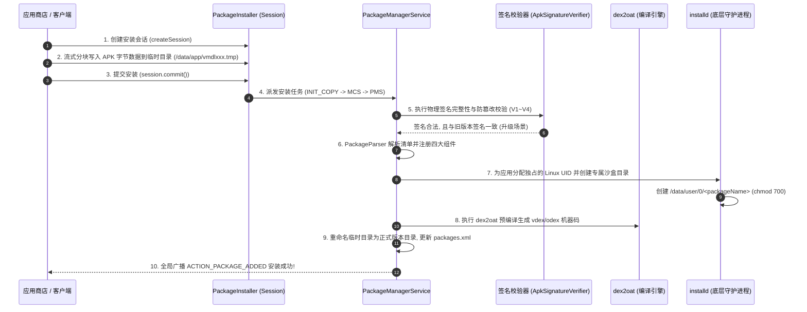

# PMS包管理服务APK解析签名校验与权限映射

在 Android 系统中，**PackageManagerService（PMS）** 是掌控全局应用程序安装、解析、权限授权与组件检索的最高权限核心服务。当我们在应用商店点击“安装”、执行 `adb install`，或者系统开机扫描预装应用时，后台均由 PMS 在严密调度。本文深入解构 PMS 的安装全时序链路、V1~V4 签名机制物理演进，以及 Linux UID 沙盒与动态权限的底层位图映射。

---

## 核心底层机制与全景架构

### 1. PMS 整体职责全景与启动扫描流程



- **`/data/system/packages.xml`**：PMS 的中央元数据数据库，记录了全设备每一个 App 的包名、代码安装路径、分配的独占 **Linux UID**、版本号、签名指纹以及被授予的全部权限。

---

## 源码级架构物理拆解

### 1. APK 安装完整生命周期物理流转

现代 Android 采用基于 Session 的安装模型（`PackageInstaller`）：



---

### 2. Android V1 到 V4 签名机制物理演进

签名是保障 APK 来源可信、防止代码被反编译二次打包篡改的终极防线：

| 签名方案 | 物理结构与校验原理 | 优势 | 致命缺陷 / 演进动机 |
| :--- | :--- | :--- | :--- |
| **V1（Jar 签名）** | 在 `META-INF/` 目录下生成 `MANIFEST.MF`、`CERT.SF`、`CERT.RSA`，**对 ZIP 包内每个文件分别计算哈希** | 兼容性最好，早至 Android 1.0 原生支持 | 校验慢（需解压并全量遍历所有条目）；**ZIP 头部的非文件区域（如注释区）未被保护**，易被篡改 |
| **V2（APK 签名分块）** | 在 ZIP 文件的“中央目录”之前**物理插入一个 `APK Signing Block` 签名块**，对整个文件按 1MB 分块计算哈希 | **安装极速提升（无需逐文件解压）**；任何字节哪怕 1 bit 的改动都会破坏哈希 | 无法在签名后更改 APK 内部任何内容（破坏了传统通过在 APK 头部加渠道注释的多渠道打包） |
| **V3（密钥轮替 Key Rotation）** | 在 V2 签名块中增加了**密钥历史证书链结构（Proof-of-rotation）** | **支持开发者在不丢失旧用户数据的前提下，平滑更换应用签名密钥** | 仅支持 Android 9.0+ 设备 |
| **V4（流式安装签名）** | 生成独立的 `.apk.idsig` 签名索引文件，配合 Linux 内核 **fs-verity** 虚拟文件系统 | 支持大型 3D 游戏（数 GB）**边下边玩（Streaming Install）**，只需下载关键代码即可立即运行 | 需要内核 fs-verity 深度支持 |

---

### 3. Linux UID 沙盒与动态权限的底层位图映射

1. **Linux UID 沙盒隔离**：
   - 在传统的 Linux 系统中，多个应用程序通常运行在同一个用户（UID）下；
   - **Android 的创举：每个 App 都是一个独立的 Linux 用户**。PMS 会为其分配一个专属的 Linux UID（例如 `u0_a123`，对应数值从 10000 开始）。
   - Linux 内核的文件权限系统（`rwx`）直接作用于该 UID，因此进程 A 绝对无法直接读取进程 B 的 `/data/data/<package_B>` 目录，达成了硬件级沙盒隔离。
2. **动态权限底层位图 Flags**：
   - Android 6.0 引入动态权限后，权限状态被保存在 PMS 的 `PermissionFlags` 中：
     - `FLAG_PERMISSION_USER_SET`：用户曾经显式点击过“允许”或“拒绝”；
     - `FLAG_PERMISSION_POLICY_FIXED`：企业 MDM 设备策略管理员强行锁死该权限；
     - `FLAG_PERMISSION_REVOKED_COMPAT`：针对未适配 Android 6.0 的老旧 App，如果用户在系统设置里关闭权限，系统底层不会直接报错，而是**静默返回空数据（如空通讯录列表）**，规避 App 崩溃。

---

## 社招高频硬核连环追问

### Q1: 两个不同的 App 之间，能否共享同一个进程和内存？如何实现？
- **考点**：`sharedUserId` 机制与签名约束。
- **解析**：
  - **可以！**
  - **实现条件**：
    1. 两个 App 必须在 `AndroidManifest.xml` 中显式配置相同的 `android:sharedUserId="com.example.shared"`；
    2. 两个 App **必须使用完全相同的证书密钥签名**！
  - **物理效果**：PMS 在安装第二个应用时，识别到相同的 `sharedUserId` 且签名校验通过，会将第一个应用的 **Linux UID 直接分配给第二个应用**。此时两者拥有相同的系统访问权限，不仅可以自由读取对方的私有沙盒目录，还可以通过配置 `android:process` 运行在同一个物理进程中共享内存！

### Q2: 为什么 Android 升级 APK 时必须保证签名绝对一致？如果签名丢失了怎么办？
- **考点**：数据安全性与密钥轮替。
- **解析**：
  - **安全性保证**：如果允许不同签名的 APK 覆盖安装，黑客可以恶意编写一个同包名伪造应用，覆盖安装后直接合法继承受害者应用的数据沙盒（包含 Token、聊天记录、数据库），引发灾难性安全事故。
  - **签名丢失的后果**：若开发者不慎丢失了签名密钥：
    - 在 Android 9.0 以下：**无解**，必须更换包名作为全新应用上架，老用户无法平滑升级且丢失历史数据；
    - 在 Android 9.0+：若之前开启了 **V3 签名密钥轮替（Key Rotation）**，可通过由旧私钥签署的证书链平滑过渡到新私钥。

---

## 生产级避坑指南与排障 SOP

### 1. `INSTALL_FAILED_UPDATE_INCOMPATIBLE` 签名冲突排查 SOP

**事故场景**：开发测试机在尝试安装最新构建包时，系统弹窗或 ADB 报错：`Failure [INSTALL_FAILED_UPDATE_INCOMPATIBLE: Package com.example.app signatures do not match previously installed version]`。

#### 快速定位步骤：
1. **查看手机上已安装版本的签名指纹**：
   ```bash
   adb shell dumpsys package com.example.app | grep -i "signatures:" -A 5
   ```
2. **查看新打出的 APK 文件的真实签名指纹**：
   ```bash
   keytool -printcert -jarfile app-release.apk
   ```
3. **定位原因**：通常是开发阶段 Debug 签名密钥与 Release 生产签名密钥混用导致。在自动化 CI/CD 流水线中，必须对发包脚本增加自动签名校验卡点。
