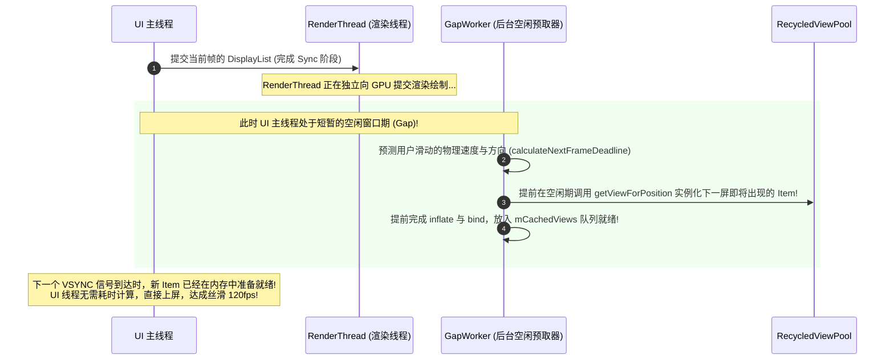

# RecyclerView五级缓存架构与预取机制Prefetch

在复杂大列表（如信息流、电商商品列表、聊天室）开发中，列表滚动的流畅度直接决定了用户对整个 App 性能的第一印象。传统的 `ListView` 仅有基础的 `RecycleBin` 二级缓存，且强制耦合了线性垂直布局。**RecyclerView** 通过高度可插拔的架构设计（`LayoutManager`、`ItemDecoration`、`ItemAnimator`），并构建了精密的一整套**多级缓存复用体系与 GapWorker 预取机制（Prefetch）**。本文深入剖析其缓存检索的物理优先级时序与性能极致压榨法则。

---

## 核心底层机制与全景架构

### 1. 多级缓存层级与物理职责全景图

当用户滑动列表时，RecyclerView 会调用 `Recycler#getViewForPosition(int position)` 尝试从多级缓存中寻找可复用的 ViewHolder：

```mermaid
flowchart TD
    Req[需要获取 Position 位置的 ViewHolder] --> C1{1. mAttachedScrap / mChangedScrap<br/>当前正在屏幕上显示的 ViewHolder 集合}
    C1 -- 命中 --> R1[直接复用: 零 create, 零 onBind!]
    
    C1 -- 未命中 --> C2{2. mHiddenViews (ChildHelper)<br/>正在执行消失动画被隐藏的 ViewHolder}
    C2 -- 命中 --> R2[恢复显示并复用]
    
    C2 -- 未命中 --> C3{3. mCachedViews (默认容量 2)<br/>刚滑出屏幕的 ViewHolder 物理队列}
    C3 -- 命中 (position 与 type 匹配) --> R3[直接复用: 零 create, 零 onBind!]
    
    C3 -- 未命中 --> C4{4. ViewCacheExtension<br/>开发者自定义扩展缓存 (极少使用)}
    C4 -- 命中 --> R4[自定义复用]
    
    C4 -- 未命中 --> C5{5. RecycledViewPool (按 viewType 分组)<br/>默认每种 type 缓存 5 个 ViewHolder}
    C5 -- 命中 (viewType 匹配) --> R5[内存复用: 仅需 onBindViewHolder, 避免 inflate!]
    
    C5 -- 全未命中 --> Create[终极兜底: 调用 adapter.onCreateViewHolder 反射解析 XML 布局<br/>+ adapter.onBindViewHolder 绑定数据]
```

---

## 源码级架构物理拆解

### 1. 缓存层级的复用代价深度对比

| 缓存层级 | 存储结构与默认容量 | 是否需要重新 `onBindViewHolder`？ | 物理复用开销 | 核心应用场景 |
| :--- | :--- | :--- | :--- | :--- |
| **`mAttachedScrap`** | `ArrayList<ViewHolder>`（无固定上限） | **不需要** | **极低（纳秒级直接复用）** | 屏幕内局部刷新、简单重新布局 |
| **`mChangedScrap`** | `ArrayList<ViewHolder>` | 需要（更新动画数据） | 较低 | Item 变更动画执行期间 |
| **`mCachedViews`** | `ArrayList<ViewHolder>`（**默认容量为 2**） | **不需要（保留原有数据与位置绑定）** | **极低（直接上屏）** | 用户轻轻往下滑动又快速往回滑的“回弹微操作” |
| **`RecycledViewPool`** | `SparseArray<ScrapData>`（**每种 viewType 默认 5 个**） | **必须重新 `onBindViewHolder`** | 中等（**省去了昂贵的 XML 解析与 `new ViewHolder()` 开销**） | 滑出屏幕较远的 Item，数据已被剥离，仅保留空壳 View 结构供同类型 Item 填充新数据 |

---

### 2. 现代预取引擎：`GapWorker` 与 Prefetch 机制

在 Android 5.0 之前，当用户快速滑动列表时，下一帧进入屏幕的新 Item 必须在 VSYNC 信号到达后的 `performTraversals` 期间**同时执行 `onCreateViewHolder` + `onBindViewHolder` + `measure` + `layout`**，高负载集中爆发极易引发单帧超时掉帧。

Google 在 Support Library 25 引入了 **`GapWorker` 预取机制**：



---

## 社招高频硬核连环追问

### Q1: `notifyDataSetChanged()` 为什么极度昂贵？与 `notifyItemChanged(position)` 的底层区别？
- **考点**：全量标记脏状态 vs 局部增量刷新。
- **解析**：
  - **`notifyDataSetChanged()`**：会将当前所有屏幕上可见的 ViewHolder 全部打上 `FLAG_INVALID` 标记，**强制丢入 `RecycledViewPool`**，迫使全屏幕的所有 Item **全部重新执行 `onBindViewHolder`，甚至触发全量重新测量与布局**，动画效果彻底丢失，开销极其巨大；
  - **`notifyItemChanged(position, payload)`**：仅将目标 Position 的单个 ViewHolder 标记为需要更新。若传入了 `payload`，还会走**局部增量绑定**（`onBindViewHolder(holder, position, payloads)`），只更新例如“点赞图标”或“点赞计数”单个控件，其余文本、头像完全不被触碰，性能提升数十倍。

### Q2: 嵌套使用纵向 RecyclerView（如大首页复杂流）时，如何优化显存与卡顿？
- **考点**：`RecycledViewPool` 的跨列表共享。
- **解析**：
  - 当外层垂直列表内部嵌套横向滚动的子 RecyclerView 时（如横滑卡片流），每个子 RecyclerView 默认都会创建自己独立的 `RecycledViewPool`；
  - **优化方案：共享对象池**：
    ```java
    // 在外层 Adapter 中创建一个单例共享池
    RecyclerView.RecycledViewPool sharedPool = new RecyclerView.RecycledViewPool();
    // 增加常用类型的池容量上限
    sharedPool.setMaxRecycledViews(TYPE_ITEM, 15);

    // 在内层子 RecyclerView 绑定时共享给它：
    innerRecyclerView.setRecycledViewPool(sharedPool);
    ```
  - 所有横滑列表共享同一组 ViewHolder 内存池，避免每个子列表反复创建和销毁，显著压降内存与卡顿。

---

## 生产级避坑指南与排障 SOP

### 1. 列表滑动卡顿治理终极清单

1. **设置 `setHasFixedSize(true)`**：
   若列表内部 Item 的宽高尺寸是固定的，设置此标记可告知 RecyclerView：内容变更时**无需重新触发外层 `requestLayout()` 测量整个父列表**，仅需重绘自身；
2. **避免在 `onBindViewHolder()` 中频繁创建监听器对象**：
   ```java
   // 错误示范：每个 Item 绑定时都 new 一个新匿名点击监听器
   holder.itemView.setOnClickListener(new View.OnClickListener() { ... });

   // 规范：监听器由 ViewHolder 自身单例持有，或在 onCreateViewHolder 时统一绑定
   ```
3. **复杂图文混排启用异步文本测量（`PrecomputedTextCompat`）**：
   长文本的折行（StaticLayout）与排版计算是主线程重大卡点，使用 `PrecomputedTextCompat` 可将繁重的文本布局计算下沉到后台子线程提前完成。
