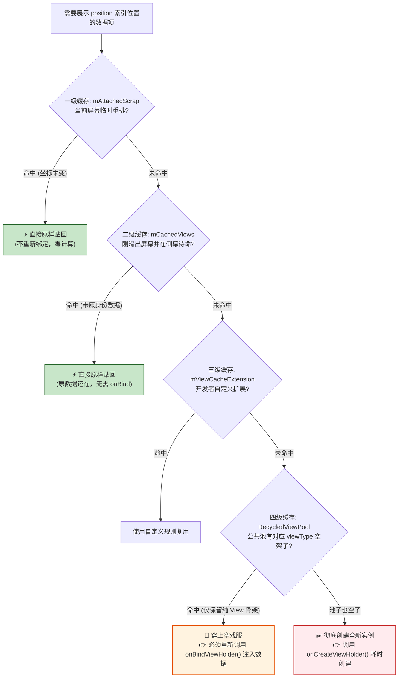

# RecyclerView源码架构与四级缓存深挖

## 🎯 招聘面试核心考点
- **面试官设问**：“RecyclerView 的**四级缓存机制**是哪四级？各个缓存的优先级和生命周期是怎样的？”
- **深水区追问**：“为什么从 **`mCachedViews`** 取出的 ViewHolder **不需要重新调用 `onBindViewHolder()`**，而从 **`RecycledViewPool`** 取出的 ViewHolder **必须重新绑定数据**？点赞时如何通过 **Payload 局部增量刷新** 彻底避免 Item 整行闪烁与图片重复加载？多个水平滚动的 RecyclerView 嵌套时，如何通过**共享缓存池**节省 80% 内存？”

---

## 一、 四级缓存机制底层流转全景图

RecyclerView 在执行测量与布局时，通过核心组件 **`Recycler`** 的 `getViewForPosition()` 方法依次向四级缓存索取可复用的 ViewHolder：

::: tip 🎭 通俗心智模型：话剧舞台的“更衣室与二手戏服库”
很多同学搞不懂为什么二级缓存不用 `onBind`，而四级缓存必须 `onBind`，用这个比喻一秒通透：
* **一级缓存 `mAttachedScrap`（舞台站位临时标记）**：
  * 演员还在舞台上（屏幕内），只是导演喊了声“大家重新站一下位置”（重新布局）。戏服没换、妆容没变，**直接就位，零开销**！
* **二级缓存 `mCachedViews`（舞台侧幕待命区，容量 2 个）**：
  * 刚刚走下舞台的演员，戏服都没脱，在侧幕候场。如果观众往回滑动（用户上下轻微回弹），该演员**连衣服都不用换，直接快步走回舞台（无需 onBindViewHolder）**，极度丝滑！
* **三级缓存 `mViewCacheExtension`（VIP 私人定制衣帽间）**：
  * 官方留给开发者自定义扩展的备用通道，几乎极少使用。
* **四级缓存 `RecycledViewPool`（公共二手戏服架，按款式 viewType 分组）**：
  * 侧幕站不下了（超过 2 个），演员脱掉戏服离开剧场。戏服被**撕掉名牌、擦除原主人数据**，挂到按款式（`viewType`）分类的架子上。
  * 当新的角色要上台时，**从架子上拿下一件空衣服（复用 View 结构，省去 new 创建开销），但必须重新化妆、重新贴上新角色的名牌（必须执行 onBindViewHolder 绑定新数据）**！
* **终极兜底（裁缝铺现裁新衣）**：
  * 如果架子上连一件空衣服都没有了，只能紧急召唤裁缝现做一件新衣服（**`onCreateViewHolder` 耗时反射膨胀 XML**）！
:::



---

## 二、 核心机制剖析：为什么二、四级复用策略不同？

### 1. 二级缓存 `mCachedViews`（精准原样复用）
- **容量**：默认最多缓存 **2 个** ViewHolder。
- **存储特性**：它保存的是**刚滑出屏幕、即将又滑回来的数据项**（例如用户上下微幅滑动回弹）。
- **为什么不需要重新走 `onBindViewHolder`？**
  因为 `mCachedViews` 记录了 ViewHolder 原本绑定的**位置索引 `position` 和数据状态**。当滑回来时，数据一模一样，直接贴回屏幕，**零数据重新绑定计算，帧率丝滑！**

---

### 2. 四级缓存 `RecycledViewPool`（跨位置甚至跨组件纯净复用）
- **存储结构**：底层是一个 `SparseArray<ScrapData>`，**按不同的 `viewType` 分组存放**，每个 `viewType` 默认最大缓存 **5 个**。
- **为什么必须重新走 `onBindViewHolder`？**
  当 `mCachedViews` 满了（超过 2 个）之后，最旧的 ViewHolder 会被踢到 `RecycledViewPool` 中。
  在进入对象池前，**其原本的 `position` 和所有业务数据被彻底重置擦除（只保留了 View 视图树层级结构）**。因此当它被再次拿出来复用给新的一行时，**必须重新注入新数据并执行 `onBindViewHolder()`**！

---

## 三、 生产级性能调优三大神技

### 1. Payload 局部刷新（终结整行 Item 闪烁）
- **场景**：点赞、修改收藏状态时，默认调用 `notifyItemChanged(position)` 会导致整个 Item 的图片重新加载、文本重新绑定，造成**视觉上的瞬间白色闪烁**。
- **优化方案**：传递一个特定的 `payload` 标识对象，只刷新点赞图标：

```kotlin
// 1. 业务调用端：只通知局部变动
adapter.notifyItemChanged(position, "PAYLOAD_LIKE_STATUS")

// 2. Adapter 内部：重写带 payloads 参数的 onBindViewHolder
override fun onBindViewHolder(holder: MyViewHolder, position: Int, payloads: MutableList<Any>) {
    if (payloads.isNotEmpty() && payloads.contains("PAYLOAD_LIKE_STATUS")) {
        // 核心：仅更新点赞图标动画，绝不重新加载大图！
        holder.updateLikeIcon(getItem(position).isLiked)
    } else {
        // 全量兜底更新
        super.onBindViewHolder(holder, position, payloads)
    }
}
```

---

### 2. 嵌套 RecyclerView 共享缓存池（大促首页内存暴跌）
- **场景**：电商大促首页通常是**外层垂直 RecyclerView 嵌套了多个水平滚动的商品列表**（每个楼层横滑 10 件商品）。
- **痛点**：每个水平 RecyclerView 默认都会为自己创建一套独立的 `RecycledViewPool`，造成内存中堆积数百个同类型的商品卡片 View。
- **方案**：全局创建一个共享的 Pool，传给所有内部子 RecyclerView：

```kotlin
// 全局只维护一个公共对象池
val sharedPool = RecyclerView.RecycledViewPool().apply {
    setMaxRecycledViews(VIEW_TYPE_PRODUCT, 20)
}

// 绑定每个楼层的横向 RecyclerView 时传入
horizontalRecyclerView.setRecycledViewPool(sharedPool)
```
> **收益**：多个横向楼层互相复用已滑出屏幕的卡片，**内存开销下降 60% 以上，彻底杜绝快速滑动时的 OOM**！
