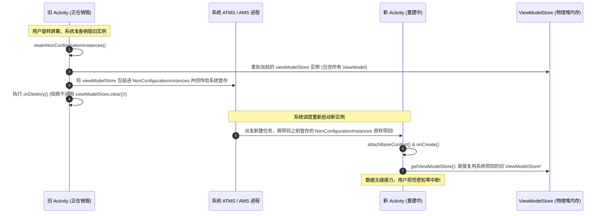
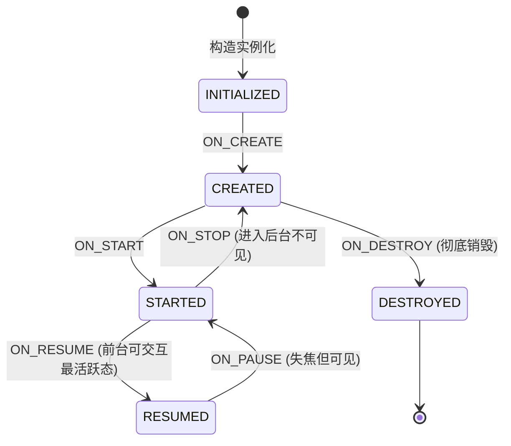

# ViewModel跨配置恢复与Lifecycle状态机深度解密

在 Android 客户端架构中，**Jetpack ViewModel** 与 **Lifecycle** 构成了现代 MVVM / MVI 架构的基石。在没有 ViewModel 的时代，手机一发生横竖屏旋转或系统语言切换（配置变更 Configuration Changes），Activity 便经历“暴力销毁并重建”，导致异步网络请求中断、用户输入表单清空，极易引发内存泄漏与空指针崩溃。本文深度解密 **`ViewModelStore` 在配置重建中无损存活的物理源码链路**，以及 **LifecycleRegistry 状态机流转法则**。

---

## 核心底层机制与全景架构

### 1. ViewModel 跨配置恢复核心物理模型

```mermaid
flowchart TD
    Rotate[用户旋转屏幕: 触发 Configuration Change] --> DestroyOld[旧 Activity 经历 onDestroy]
    
    subgraph 物理保留核心 (NonConfigurationInstances)
        DestroyOld --> Retain[ComponentActivity.retainNonConfigurationInstances]
        Retain --> Store[ViewModelStore 实例: 持有所有 ViewModel 对象的 HashMap]
        Store --> ClientRecord[暂存入系统 ActivityClientRecord]
    end
    
    ClientRecord --> RebuildNew[系统反射重新创建全新的新 Activity 实例]
    RebuildNew --> OnCreate[新 Activity.onCreate 启动]
    OnCreate --> Restore[ViewModelProvider.get 获取 ViewModel]
    Restore -->|物理原物奉还!| Store
    
    Note[新 Activity 瞬间拿到旧 Activity 已经加载好的全部数据与网络连接, 零重新请求!]
```

---

## 源码级架构物理拆解

### 1. `ViewModelStore` 物理存活的完整时序链路

在 `androidx.activity.ComponentActivity` 中，隐藏着两段决定性的源码钩子：



#### 真正的物理销毁时机：
ViewModel 到底在什么时候才会被真正执行 `onCleared()` 并销毁？
```java
// ComponentActivity.java
getLifecycle().addObserver(new LifecycleEventObserver() {
    @Override
    public void onStateChanged(@NonNull LifecycleOwner source, @NonNull Lifecycle.Event event) {
        if (event == Lifecycle.Event.ON_DESTROY) {
            // 核心判定：只有在非配置变更（即用户主动按 Back 键或代码调用 finish()）时！
            if (!isChangingConfigurations()) {
                getViewModelStore().clear(); // 此时才遍历调用所有 ViewModel#onCleared() 并销毁!
            }
        }
    }
});
```

---

### 2. `LifecycleRegistry` 状态机五大状态物理流转

Lifecycle 内部通过一个严格单调的状态机维护组件状态，将生命周期抽象为 **5 个 State** 与 **7 个 Event**：



#### 状态比对原则（State Comparison）：
- 在 `Lifecycle.State` 枚举中：
  $$\text{DESTROYED} < \text{INITIALIZED} < \text{CREATED} < \text{STARTED} < \text{RESUMED}$$
- **判定标准**：当开发者调用 `lifecycle.currentState.isAtLeast(Lifecycle.State.STARTED)` 时，系统只需判断当前状态的枚举序号是否 $\ge \text{STARTED}$。这为响应式流（如 `repeatOnLifecycle`）提供了极简高效的数学判定基石。

---

## 社招高频硬核连环追问

### Q1: 为什么不能直接在 ViewModel 内部持有 `Activity` 的引用或包含 View 控件？
- **考点**：生命周期长短不匹配导致的物理内存泄漏。
- **解析**：
  - 前面源码证实：当横竖屏旋转时，旧 Activity 必须被 JVM 正常回收，而 **ViewModel 会跨越屏幕旋转长久存活**；
  - 若 ViewModel 内部持有了旧 Activity 或其 View 控件的强引用，会导致原本该被垃圾回收的旧 Activity 无法释放，发生**严重的物理内存泄漏**；
  - **规范**：
    1. ViewModel 必须做到与具体的 View / Activity 完全解耦；
    2. 若确实需要用到 Context（如读取本地资源、访问系统服务），必须使用 **`AndroidViewModel`**，它内部仅持有生命周期与整个进程同寿的 **`getApplication()`（ApplicationContext）**，安全无泄漏风险。

### Q2: 进程在后台被系统杀死（Process Death）后，ViewModel 还能恢复数据吗？
- **考点**：配置变更（Configuration Change）与系统杀死进程（System-initiated Process Death）的区别。
- **解析**：
  - **不能！**
  - ViewModel 仅能抵御**应用进程存活前提下的 Activity 重建（即 Configuration Change）**；
  - 如果由于系统内存不足，整个应用进程（Linux Process）被 LMK 物理杀死并清出内存，**整个 JVM 堆连同 ViewModel 全部化为乌有**！
  - **进程级数据恢复方案**：必须配合 **`SavedStateHandle`**。它通过封装 `onSaveInstanceState` 机制，在进程被杀前将少量关键 ID 或查询条件交由 WMS 序列化保存，在新进程重启后无缝将参数重新注入给 ViewModel。

---

## 生产级避坑指南与排障 SOP

### 1. 跨 Activity / Fragment 共享 ViewModel 的标准范式

在底部导航栏多 Fragment 页面中，实现“Fragment A 修改数据，Fragment B 实时联动更新”的标准解法：

```kotlin
// 规范：绑定宿主 Activity 的作用域，而非 Fragment 自身作用域
class FragmentA : Fragment() {
    // 使用 activityViewModels() 拿到的是以父 Activity 为作用域的 ViewModel 单例
    private val sharedViewModel: SharedOrderViewModel by activityViewModels()

    fun updateOrder() {
        sharedViewModel.selectOrder(1001L)
    }
}

class FragmentB : Fragment() {
    // 获取同一个宿主 Activity 下的同一个 ViewModel 实例
    private val sharedViewModel: SharedOrderViewModel by activityViewModels()

    override fun onViewCreated(view: View, savedInstanceState: Bundle?) {
        viewLifecycleOwner.lifecycleScope.launch {
            viewLifecycleOwner.repeatOnLifecycle(Lifecycle.State.STARTED) {
                sharedViewModel.selectedOrder.collect { orderId ->
                    // 实时响应 Fragment A 的数据改动！
                    renderOrder(orderId)
                }
            }
        }
    }
}
```
通过该方案，彻底消除复杂的 EventBus 或繁琐的跨 Fragment 接口回调，实现纯响应式架构解耦。
