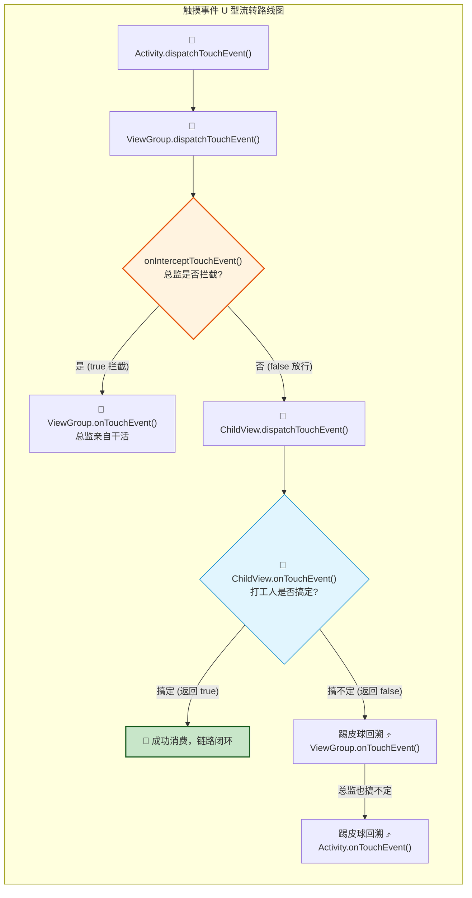

# View事件分发机制与滑动冲突终极治理

## 使用入口：先解决问题，再做验证

让点击、长按和嵌套滑动按预期响应。

**先做基本操作**：在 dispatchTouchEvent/onInterceptTouchEvent/onTouchEvent 记录 DOWN/MOVE/UP/CANCEL，再验证父子争夺事件。初次学习可先完成[本模块基础实践](/doc/Android/Android应用基本开发与验证)。

**再逐步深入**：基本 API 与输入输出 → 常见失败和使用边界 → 场景排查与优化 → 本文机制分析与源码。面试先讲用途和自己的操作过程，再回答场景与原理追问。

## 🎯 核心技术原理与实战归纳
- **核心设问与思考**：“请详细阐述 Android 事件分发的三大核心方法（`dispatchTouchEvent`、`onInterceptTouchEvent`、`onTouchEvent`）的调用时序与责任链逻辑？”
- **深水区追问**：“如果子 View 消费了 `ACTION_DOWN` 事件，但父 ViewGroup 在随后的 `ACTION_MOVE` 中决定拦截，子 View 会收到什么事件？**解决滑动冲突的‘外部拦截法’与‘内部拦截法’**的底层代码模板分别是什么？`requestDisallowInterceptTouchEvent()` 的作用阶段是什么？”

---

## 一、 经典责任链分发模型（U 型回溯全景图）

触摸事件从硬件屏幕产生后，由系统服务底层的 `InputReader` 与 `InputDispatcher` 采集，通过 Socket / Binder 传递给应用的 `DecorView`，随后进入 View 树递归分发：

::: tip 🏢 通俗心智模型：公司领导派活与打工人“U 型回溯”
* **总经理 (Activity)**：接到客户的业务需求（触摸事件），交给总监去办。
* **项目总监 (ViewGroup)**：
  * 先问自己一句 **`onInterceptTouchEvent`（这活我要不要截胡？）**：
    * 如果返回 `true`（拦截）：总监直接拿走自己干（`onTouchEvent`）。
    * 如果返回 `false`（不拦截）：总监把活派给下属**基层打工人 (Child View)**。
* **基层打工人 (Child View)**：
  * 开始干活 **`onTouchEvent`**：
    * 如果搞定了返回 `true`（**成功消费**）：任务闭环，后续的所有连续动作（MOVE/UP）都直接由他负责！
    * 如果搞不定返回 `false`（**不消费**）：打工人开始“踢皮球”，把任务逐层往上抛给总监；总监也搞不定就抛给总经理；若都没人管，事件被丢弃。
* **`ACTION_CANCEL` 到底是什么？**：
  * 打工人本来在低头干活（消费了 DOWN 事件），结果手指滑了一段，总监突然在 MOVE 阶段决定拦截截胡。总监立刻冲打工人喊一声：“**你不用干了，立刻停工！**”——打工人收到 `ACTION_CANCEL`，把按压高亮状态重置。
:::



### 1. 三大核心方法职责与返回值速记
1. **`dispatchTouchEvent(MotionEvent ev)`**：负责事件的分发。只要事件传递到当前 View，该方法必然最先被调用。
2. **`onInterceptTouchEvent(MotionEvent ev)`（ViewGroup 独有）**：负责决定是否拦截事件。
   - 返回 `true`：表示拦截事件，当前事件不再传递给子 View，而是直接转交给自己内部的 `onTouchEvent()` 处理。
   - 返回 `false`：不拦截，事件继续向下传递给子 View。
3. **`onTouchEvent(MotionEvent ev)`**：负责事件的消费处理。
   - 返回 `true`：表示已成功消费，后续的 `ACTION_MOVE` 和 `ACTION_UP` 将继续交给该 View 处理。
   - 返回 `false`：表示不消费，事件将向上回溯给父容器的 `onTouchEvent()` 兜底处理。

---

## 二、 关键执行边界特例（核心高频坑点）

1. **`ACTION_CANCEL` 机制（责任转移）**：
   - 如果子 View 已经消费了 `ACTION_DOWN` 事件，但在用户手指滑动过程中（`ACTION_MOVE`），父容器在 `onInterceptTouchEvent()` 中判定符合自身滑动条件并返回了 `true`。
   - **此时子 View 会立刻收到一个 `ACTION_CANCEL` 事件**！子 View 必须在 `ACTION_CANCEL` 中重置内部的按压和点击高亮状态。
2. **`ACTION_DOWN` 是唯一的“入场券”**：
   - 如果一个 View 在 `ACTION_DOWN` 事件中返回了 `false`（表示不消费），那么**后续的所有 `ACTION_MOVE` 和 `ACTION_UP` 都绝不会再分发给它**，直接被父容器接管！

---

## 三、 滑动冲突两大终极解决法则与通用代码模板

### 场景：水平滑动的 ViewPager 嵌套垂直滑动的 RecyclerView（或者 ScrollView 嵌套横向滑动列表）

#### 解决方案 1：外部拦截法（推荐，逻辑集中在父容器）
- **核心原则**：父容器在 `onInterceptTouchEvent` 中根据滑动的距离斜率（`|deltaX| > |deltaY|`）动态判断：如果是自己需要的方向，则返回 `true` 拦截；否则返回 `false` 放行。
- **注意**：`ACTION_DOWN` **必须返回 `false`**！如果父容器在 DOWN 阶段就拦截了，后续事件根本传不到子 View。

```java
// 外部拦截法通用模板 (写在父 ViewGroup 中)
public class CustomParentLayout extends FrameLayout {
    private int mLastX = 0;
    private int mLastY = 0;

    @Override
    public boolean onInterceptTouchEvent(MotionEvent ev) {
        boolean intercepted = false;
        int x = (int) ev.getX();
        int y = (int) ev.getY();

        switch (ev.getAction()) {
            case MotionEvent.ACTION_DOWN:
                intercepted = false; // 必须放行 DOWN，否则子View无法获取焦点
                break;
            case MotionEvent.ACTION_MOVE:
                int deltaX = x - mLastX;
                int deltaY = y - mLastY;
                // 业务判断：如果横向滑动距离大于纵向距离，父容器拦截处理横向滑动
                if (Math.abs(deltaX) > Math.abs(deltaY)) {
                    intercepted = true;
                } else {
                    intercepted = false;
                }
                break;
            case MotionEvent.ACTION_UP:
                intercepted = false;
                break;
        }
        mLastX = x;
        mLastY = y;
        return intercepted;
    }
}
```

---

#### 解决方案 2：内部拦截法（逻辑写在子 View 中）
- **核心原则**：父容器默认拦截除了 `ACTION_DOWN` 以外的所有事件；子 View 在自身 `dispatchTouchEvent` 中，调用 **`parent.requestDisallowInterceptTouchEvent(true)`** 强行禁止父容器拦截自己。当子 View 发现手势符合父容器时，再放开禁令。

```java
// 内部拦截法通用模板 (写在子 View / 子 RecyclerView 中)
@Override
public boolean dispatchTouchEvent(MotionEvent ev) {
    int x = (int) ev.getX();
    int y = (int) ev.getY();

    switch (ev.getAction()) {
        case MotionEvent.ACTION_DOWN:
            // 强行告知父容器：不准拦截我！
            getParent().requestDisallowInterceptTouchEvent(true);
            break;
        case MotionEvent.ACTION_MOVE:
            int deltaX = x - mLastX;
            int deltaY = y - mLastY;
            // 如果判断当前滑动是垂直滑动（自己不需要，属于父容器的业务）
            if (Math.abs(deltaY) > Math.abs(deltaX)) {
                // 允许父容器拦截该事件
                getParent().requestDisallowInterceptTouchEvent(false);
            }
            break;
    }
    mLastX = x;
    mLastY = y;
    return super.dispatchTouchEvent(ev);
}
```
