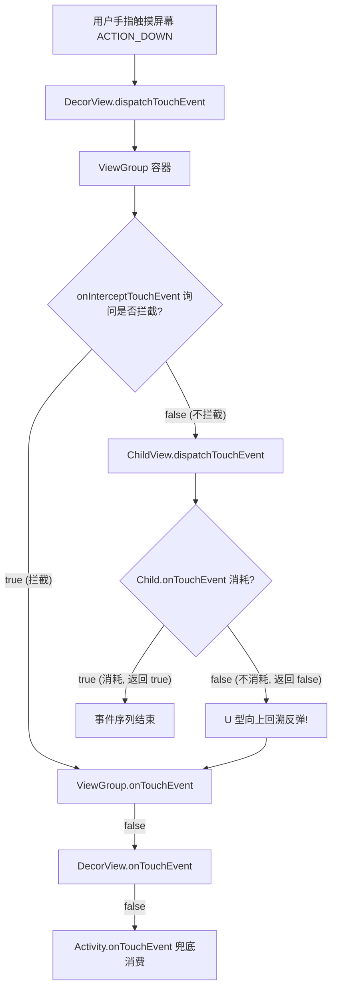
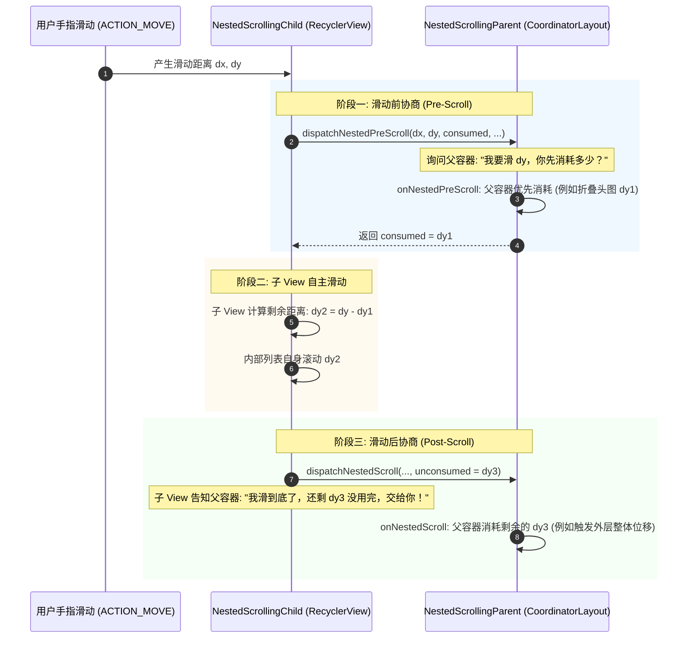

# View事件分发责任链多点触控与NestedScrolling嵌套滑动

在 Android 交互体验中，触控手势的处理直接关乎产品的跟手性。无论是经典的“外层 ViewPager + 内层 RecyclerView 左右/上下滑动冲突”，还是电商首页常见的“吸顶折叠联动”，底层都离不开 Android 经典的 **事件分发责任链（Touch Event Dispatching）** 与现代的 **嵌套滑动协同体系（NestedScrolling）**。本文深入剖析三大核心方法的源码决策树、多点触控 `mFirstTouchTarget` 链表机制，以及 NestedScrolling 是如何突破传统拦截局限实现无缝滑动的。

---

## 核心底层机制与全景架构

### 1. 经典事件分发“U型流转”责任链全景

当用户手指触摸屏幕，驱动层产生输入事件，通过 `InputReader` 与 `InputDispatcher` 注入到当前激活窗口的 `ViewRootImpl`，随后流转至 `DecorView`，沿着 View 控件树展开递归：



---

## 源码级架构物理拆解

### 1. 核心判定源码：为什么 `ACTION_DOWN` 是整个序列的生命线？

在 `ViewGroup#dispatchTouchEvent` 源码中：
```java
// 1. 当 ACTION_DOWN 到来时，重置所有旧状态
if (actionMasked == MotionEvent.ACTION_DOWN) {
    cancelAndClearTouchTargets(ev);
    resetTouchStateForAllEventListeners(); // 清除 FLAG_DISALLOW_INTERCEPT
}

// 2. 检查是否拦截
final boolean intercepted;
if (actionMasked == MotionEvent.ACTION_DOWN || mFirstTouchTarget != null) {
    final boolean disallowIntercept = (mGroupFlags & FLAG_DISALLOW_INTERCEPT) != 0;
    if (!disallowIntercept) {
        intercepted = onInterceptTouchEvent(ev);
    } else {
        intercepted = false;
    }
} else {
    // 致命点：如果没有任何子 View 消费 ACTION_DOWN (mFirstTouchTarget == null)，
    // 后续的 ACTION_MOVE 和 ACTION_UP 根本不会再调用 onInterceptTouchEvent，直接强行拦截！
    intercepted = true;
}
```

#### 关键推导结论：
- **`ACTION_DOWN` 返回值的不可逆性**：若某个子 View 在收到 `ACTION_DOWN` 时在其 `onTouchEvent` 中返回了 `false`，该子 View 对应的 `TouchTarget` 节点就不会被创建；
- **后续事件剥夺**：随后的 `ACTION_MOVE` 和 `ACTION_UP` 将**彻底绕过该子 View**，甚至连询问都不会再问它，直接交给父容器自身消费！

---

### 2. 多点触控支持：`mFirstTouchTarget` 单向链表

现代智能手机支持十指多点触控。ViewGroup 是如何记录“哪个手指按在了哪个子 View 上”的？
- 源码中引入了 `TouchTarget` 结构体，内部维护了一个单向链表 `mFirstTouchTarget`；
- 每个 `TouchTarget` 节点记录了：
  1. `child`（被触碰的子 View 实例）；
  2. `pointerIdBits`（触控点 ID 掩码位图）。
- 当第二个手指按下时，系统遍历链表：若落在同一个子 View 上，则将新手指的 `pointerId` 合并进该节点的位图中；若落在不同子 View 上，则在链表头部插入新的 `TouchTarget`，实现了**多个子 View 并发独立响应不同手指的多点触控分发**。

---

### 3. 嵌套滑动（NestedScrolling）：彻底终结传统滑动冲突

#### 传统拦截法的致命硬伤：
- 传统解决滑动冲突采用“外部拦截”或“内部拦截（`requestDisallowInterceptTouchEvent`）”；
- **缺陷**：传统拦截是**独占且不可逆的**。一旦父容器在 `ACTION_MOVE` 中决定拦截（`intercepted = true`），系统会给子 View 发送一个 `ACTION_CANCEL`。此后整个手势序列的控制权全归父容器所有，**子 View 彻底出局！**
- **导致无法实现现代折叠效果**：例如“先由子 View 内部的列表向上滑动；当列表滑到顶部边界时，手指不离开屏幕，直接平滑联动外层父容器向上收起头图”。传统机制在此处必须发生手势断裂重按！



- **NestedScrolling 的优雅**：子控件与父容器通过双向回调协商，**无需触发任何 `onInterceptTouchEvent` 拦截与事件取消**，同一个手势在子 View 与父容器之间按需拆分消费，达成了毫无阻滞感的极致跟手体验。

---

## 社招高频硬核连环追问

### Q1: `OnTouchListener`、`onTouchEvent` 和 `OnClickListener` 的执行顺序是怎样的？
- **考点**：事件消费优先级链条。
- **解析**：
  - **执行顺序**：`OnTouchListener.onTouch()` $\rightarrow$ `onTouchEvent()` $\rightarrow$ `OnClickListener.onClick()`。
  - **源码物理原因**：
    1. 在 `View#dispatchTouchEvent` 中，首先检查是否设置了 `mOnTouchListener` 且 View 处于 `ENABLED` 状态。若是且 `onTouch()` 返回 `true`，则直接返回，**`onTouchEvent()` 根本不会被执行！**
    2. 只有当未设置监听，或者 `onTouch()` 返回 `false` 时，才会下钻执行 `onTouchEvent()`；
    3. `onClick()` 并不是由底层驱动直接发出的，它是在 `onTouchEvent()` 的 `ACTION_UP` 分支中，经过时间与防抖判定后通过 `performClick()` 反射/回调触发的。

### Q2: 既然 `ACTION_DOWN` 被拦截后子 View 拿不到事件，为什么 `requestDisallowInterceptTouchEvent(true)` 能防父容器拦截？在什么时候调用会失效？
- **考点**：`FLAG_DISALLOW_INTERCEPT` 重置时机。
- **解析**：
  - 子 View 调用 `getParent().requestDisallowInterceptTouchEvent(true)`，底层会将父容器的 `mGroupFlags` 赋予 `FLAG_DISALLOW_INTERCEPT` 标记；
  - 父容器在后续的 `ACTION_MOVE` 时，看到这个标志位就会直接跳过 `onInterceptTouchEvent` 检查，不予拦截；
  - **失效场景**：如果在父容器的 `ACTION_DOWN` 期间调用该方法，**完全无效**！因为前面推导过的源码显示：每次新的 `ACTION_DOWN` 到达时，父容器第一件事就是调用 `resetTouchStateForAllEventListeners()` **强制清空该标志位**。因此内部拦截法必须且只能在 `ACTION_MOVE` 中动态介入。

---

## 生产级避坑指南与排障 SOP

### 1. 复杂滑动冲突排查与 Behavior 自定义实战

在基于 `CoordinatorLayout` 开发吸顶折叠布局时，若遇到子 View 滑动受阻：
1. **检查是否启用了嵌套滑动支持**：
   - 确认自定义子 View 是否实现了 `NestedScrollingChild3` 接口；对于普通 `ScrollView`，必须使用官方提供的 **`NestedScrollView`**，原生 `ScrollView` 不具备 NestedScrolling 通信能力，会导致父容器永远收不到嵌套滑动回调。
2. **正确实现自定义 Behavior 的两个关键钩子**：
   ```java
   public class StickyHeaderBehavior extends CoordinatorLayout.Behavior<View> {
       @Override
       public boolean onStartNestedScroll(CoordinatorLayout parent, View child, 
           View directTargetChild, View target, int axes, int type) {
           // 1. 声明关注垂直方向的滑动
           return (axes & ViewCompat.SCROLL_AXIS_VERTICAL) != 0;
       }

       @Override
       public void onNestedPreScroll(CoordinatorLayout parent, View child, 
           View target, int dx, int dy, int[] consumed, int type) {
           // 2. 在子 View 消耗前，根据当前折叠状态计算预消耗
           if (dy > 0 && child.getBottom() > minHeight) {
               // 向上滑动且尚未收缩完毕，父容器先消耗
               consumed[1] = dy;
               child.offsetTopAndBottom(-dy);
           }
       }
   }
   ```
