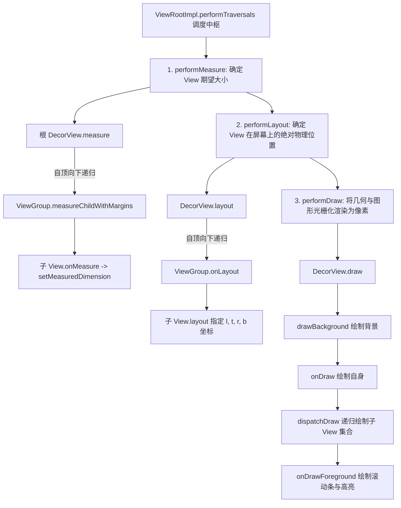
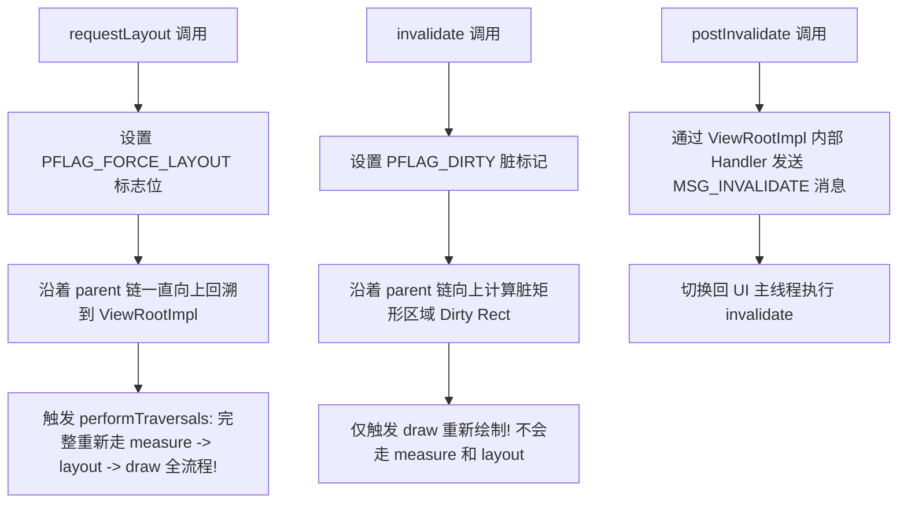

# View树绘制流程深入performTraversals与MeasureSpec计算

在 Android UI 体系中，界面的呈现本质是一棵复杂的 View 控件树（View Hierarchy）。每当界面刷新或布局变更，驱动整棵树重新计算的核心引擎正是 `ViewRootImpl#performTraversals()`。它遵循严格的“**测量（Measure）$\rightarrow$ 布局（Layout）$\rightarrow$ 绘制（Draw）**”三步曲。深入理解 **MeasureSpec 的 32 位二进制物理设计、父子规格传递矩阵，以及三大核心方法的源码边界**，是每一位资深 Android 工程师进行自定义 View 高级开发与布局性能调优的基本功。

---

## 核心底层机制与全景架构

### 1. `performTraversals` 调度流水线



---

## 源码级架构物理拆解

### 1. MeasureSpec 32位整型二进制物理结构

为了在极其频繁的递归测量中避免大量创建测量参数对象引发 GC 抖动，Android 采用一个 **32 位的整型 `int`** 紧凑打包了测量模式与尺寸大小：

```
+------------------+--------------------------------------------------+
| SpecMode (高 2位) |               SpecSize (低 30位)                 |
+------------------+--------------------------------------------------+
|     31    30     | 29                                             0 |
```

#### 三大 SpecMode 物理含义：
- **`EXACTLY`（01，精确值）**：父容器已经检测出子 View 所需要的确切大小。对应布局中的具体数值（如 `100dp`）或 `MATCH_PARENT`；
- **`AT_MOST`（10，最大值）**：子 View 的大小不能超过父容器指定的上限。对应布局中的 `WRAP_CONTENT`；
- **`UNSPECIFIED`（00，未指定）**：父容器对子 View 没有任何约束，要多大给多大。通常用于系统内部计算（如 `ScrollView`、`RecyclerView` 的可无限滑动的子 Item 测量）。

---

### 2. 核心推导：`getChildMeasureSpec()` 矩阵计算法则

子 View 的 `MeasureSpec` 绝不是由自己单独决定的，而是由 **父容器的 `parentMeasureSpec`** 与 **子 View 自身的 `LayoutParams`** 共同推导得出：

| 父容器 SpecMode | 子 View LayoutParams 为具体数值（如 `100dp`） | 子 View LayoutParams 为 `MATCH_PARENT` | 子 View LayoutParams 为 `WRAP_CONTENT` |
| :--- | :--- | :--- | :--- |
| **`EXACTLY`** | **`EXACTLY`**（大小为 childSize） | **`EXACTLY`**（大小为 parentSize） | **`AT_MOST`**（大小为 parentSize） |
| **`AT_MOST`** | **`EXACTLY`**（大小为 childSize） | **`AT_MOST`**（大小为 parentSize） | **`AT_MOST`**（大小为 parentSize） |
| **`UNSPECIFIED`** | **`EXACTLY`**（大小为 childSize） | **`UNSPECIFIED`**（大小为 0） | **`UNSPECIFIED`**（大小为 0） |

#### 为什么自定义 View 设置 `wrap_content` 时默认表现却像 `match_parent`？
- **物理源码溯源**：查看 `View#getDefaultSize()`：
  ```java
  public static int getDefaultSize(int size, int measureSpec) {
      int result = size;
      int specMode = MeasureSpec.getMode(measureSpec);
      int specSize = MeasureSpec.getSize(measureSpec);
      switch (specMode) {
          case MeasureSpec.UNSPECIFIED:
              result = size;
              break;
          case MeasureSpec.AT_MOST:
          case MeasureSpec.EXACTLY:
              result = specSize; // 致命点: AT_MOST 与 EXACTLY 均直接返回父容器全部剩余大小!
              break;
      }
      return result;
  }
  ```
- **解决方案**：在继承 `View` 开发自定义控件时，必须重写 `onMeasure()`。当判断 `specMode == MeasureSpec.AT_MOST` 时，必须显式赋予一个预设的兜底宽度与高度并调用 `setMeasuredDimension(defaultW, defaultH)`！

---

### 3. `getWidth()` 与 `getMeasuredWidth()` 的本质区别

- **`getMeasuredWidth()`**：在 `measure()` 阶段结束后立即产生，存储在 `mMeasuredWidth` 中，表示该 View **自己期望被测算出的宽度**；
- **`getWidth()`**：在 `layout()` 阶段执行完毕后产生，计算公式为：
  $$\text{Width} = \text{mRight} - \text{mLeft}$$
  表示该 View **最终在父容器屏幕上物理占据的实际几何宽度**。
- **极端场景**：在父容器的 `onLayout()` 中，父容器完全有权忽略子 View 的测量宽，强行传入 `child.layout(0, 0, 50, 50)`，此时 `getWidth() = 50`，而 `getMeasuredWidth()` 可能依然是 `200`。虽然生产中极罕见，但这揭示了两者的物理本质差异。

---

## `requestLayout()` vs `invalidate()` vs `postInvalidate()` 全景对比



---

## 社招高频硬核连环追问

### Q1: 为什么在 `Activity#onCreate()` 中调用 `view.getWidth()` 永远为 0？
- **考点**：生命周期与 ViewRootImpl 渲染时钟解耦。
- **解析**：
  - `onCreate()`、`onStart()`、`onResume()` 仅属于 Activity 的生命周期调度；
  - 真正的 View 树测量和布局必须等待 `handleResumeActivity()` 之后，`WindowManager.addView()` 异步挂载 `ViewRootImpl`，并等待下一次 VSYNC 信号触发 `performTraversals()` 才开始计算；
  - 在 `onCreate` 执行时，测量流程甚至还没有排入队列，因此此时所有的坐标属性恒为 0。

### Q2: 嵌套使用 `RelativeLayout` 为什么比 `LinearLayout` 或 `ConstraintLayout` 更容易引发掉帧？
- **考点**：多重测量（Measure Multi-Pass）与性能损耗。
- **解析**：
  - `RelativeLayout` 为了计算“相对于父容器居中”、“在某组件左侧”等相对约束，**其源码中的 `onMeasure()` 内部强制对每个子 View 遍历执行至少两次测量（Two Passes）**；
  - 如果布局中层层深层嵌套了 4~5 层 `RelativeLayout`，整棵树的测量次数呈 **$2^N$ 指数级爆炸式增长**！瞬间导致 `performMeasure` 突破 16.6ms 引起剧烈掉帧；
  - 生产推荐全面使用扁平化单层的 **`ConstraintLayout`（约束布局）**，利用基于 Cassowary 线性方程求解算法，将多层相对约束在单层内高效解析。

---

## 生产级避坑指南与排障 SOP

### 1. 避免在 `onDraw()` 中频繁分配对象引发 GC 震荡

**致命错误示范**：
```java
@Override
protected void onDraw(Canvas canvas) {
    super.onDraw(canvas);
    // 致命: 每一帧都 new 一个新画笔和矩形!
    Paint paint = new Paint();
    RectF rect = new RectF(0, 0, getWidth(), getHeight());
    canvas.drawRect(rect, paint);
}
```
- **物理危害**：`onDraw()` 在滑动或动画过程中每秒被高频调用 60~120 次。在此处频繁 `new` 对象会导致年轻代内存瞬间暴涨，触发高频 **Minor GC / ART 内存抖动（Memory Churn）**，迫使虚拟机挂起导致掉帧。
- **规范**：所有 `Paint`、`Rect`、`Path`、`Matrix` 对象必须提前在构造函数中预分配完毕，在 `onDraw` 内部只进行坐标赋值与绘制。
