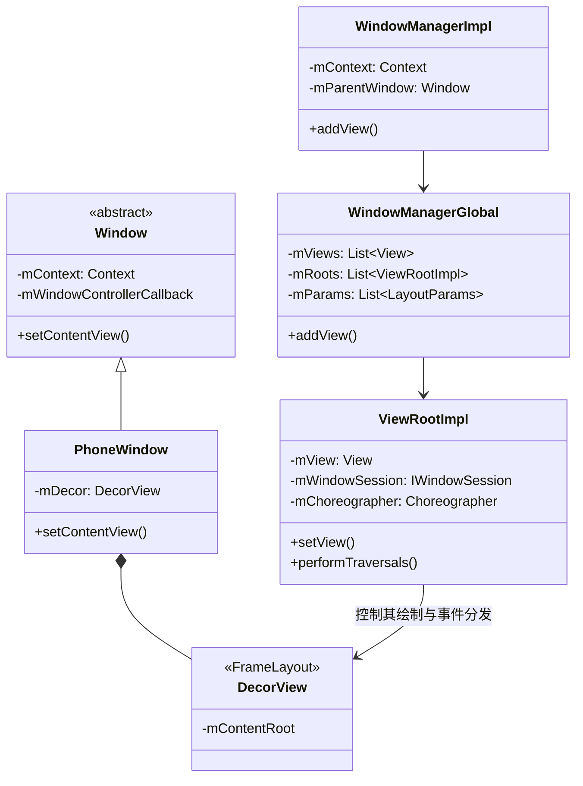

# WMS窗口管理系统Token校验与BadTokenException破局

在 Android 系统中，**WindowManagerService（WMS）** 是负责屏幕所有窗口管理、图层 Z-Order 排序、输入事件派发焦点与屏幕物理合成协调的核心系统服务。在实际业务开发中，`WindowManager$BadTokenException` 崩溃常年位列线上稳定性监控高频 Top 10。本文将深入解构 WMS 的窗口分层架构、Window-DecorView-ViewRootImpl 四角物理关系，彻底攻克 Token 校验机制与各种边界场景下的破局之道。

---

## 核心底层机制与全景架构

### 1. 窗口三大分类与 Z-Order 层级判定

WMS 依据物理优先级将屏幕上的窗口严格划分为三大类型，层级越高（`type` 值越大），窗口在屏幕 Z 轴上越靠前（覆盖在下层之上）：

```mermaid
flowchart TD
    Screen[屏幕物理 Z-Order 轴] --> SysWin[1. 系统窗口 System Window<br/>type: 2000 ~ 2999<br/>如: 状态栏, 导航栏, 锁屏, 全局 Toast, 悬浮窗<br/>需要声明系统权限 (SYSTEM_ALERT_WINDOW)]
    
    Screen --> SubWin[2. 子窗口 Sub Window<br/>type: 1000 ~ 1999<br/>如: PopupWindow, ContextMenu, 溢出菜单<br/>必须严格依赖一个已经存在的宿主父窗口!]
    
    Screen --> AppWin[3. 应用窗口 Application Window<br/>type: 1 ~ 99<br/>如: 普通 Activity 页面, Dialog 弹窗<br/>受 ATMS 任务栈管理调度]
```

---

## 源码级架构物理拆解

### 1. 四角物理关系：Window、PhoneWindow、DecorView、ViewRootImpl

很多初学者容易将 Window 与 View 混淆，我们通过调用关系还原真相：



- **`Window`**：顶层抽象概念，控制窗口外观和行为。其在 Android 中的唯一实体实现是 **`PhoneWindow`**；
- **`DecorView`**：本质是一个顶层 `FrameLayout`，是真正承载开发者 `setContentView()` 布局内容的物理 View 树根节点；
- **`ViewRootImpl`**：**它本身不是 View，而是 View 树与 WMS 之间的核心通信纽带（Bridge）**。它实现了 `ViewParent`，持有与 WMS 通信的 `IWindowSession`，负责调度 Choreographer 驱动整棵 View 树执行测量（Measure）、布局（Layout）、绘制（Draw），并将触控事件逐级向下派发。

---

### 2. Window Token 机制与 `BadTokenException` 物理根因

什么是 **Window Token**？
- 它本质上是一个跨进程传输的 **Binder 代理对象（`IBinder`）**；
- 在 WMS 内部，Token 充当了“通行准考证”：用于证明当前尝试向屏幕添加窗口的调用者，确实获得了系统的合法授权。

#### 场景 A：使用 `ApplicationContext` 弹出 Dialog 必崩的底层原理
```java
// 错误示范：必抛 BadTokenException!
Dialog dialog = new AlertDialog.Builder(getApplicationContext())
    .setTitle("警告")
    .create();
dialog.show();
```
- **物理源码剖析**：
  1. `dialog.show()` 底层调用 `WindowManager.addView(mDecor, mWindowAttributes)`；
  2. 对于应用窗口，WMS 要求参数中必须包含一个有效的宿主 `mAppToken`；
  3. 只有 `Activity` 在由 ATMS 启动时，系统才会为其生成一个 `AppWindowToken` 并绑定到该 Activity 的 `Context` 中；
  4. 而 `ApplicationContext` 是全局进程级上下文，其内部的 `mWindowToken` **恒定为 `null`**！
  5. WMS 接收到请求后，在 `WMS#addWindow()` 校验中发现 `token == null`，直接判定非法，抛出：
     `BadTokenException: Unable to add window -- token null is not for an application`。

#### 场景 B：异步延迟弹窗遭遇 Activity 死亡
```java
// 错误示范：网络回调耗时 3 秒，期间用户按 Back 键退出了页面
httpUtil.request(new Callback() {
    @Override
    public void onResponse(...) {
        // Activity 此时已经 finished 并被销毁
        dialog.show(); 
    }
});
```
- **物理源码剖析**：
  1. Activity 销毁（`onDestroy`）时，WMS 会在内核中销毁注销该 Activity 对应的 `AppWindowToken`；
  2. 当 3 秒后迟到的异步回调执行 `dialog.show()` 时，它携带的旧 Token 已经是一张被 WMS 注销的“作废发票”；
  3. WMS 检查发现 Token 在当前窗口注册表中无法匹配，抛出：
     `BadTokenException: Unable to add window -- token android.os.BinderProxy@xxx is not valid; is your activity running?`

---

## 社招高频硬核连环追问

### Q1: 子线程真的绝对不能更新 UI 吗？`ViewRootImpl` 的线程校验时机是什么？
- **考点**：`ViewRootImpl#checkThread()` 的触发时机。
- **解析**：
  - **不是绝对不能！** 校验线程的代码不是在 View 内部，而是在 `ViewRootImpl` 中：
    ```java
    void checkThread() {
        if (mThread != Thread.currentThread()) {
            throw new CalledFromWrongThreadException(
                "Only the original thread that created a view hierarchy can touch its views.");
        }
    }
    ```
  - **物理绕过场景 1**：在 `Activity#onCreate()` 阶段，直接启动子线程执行 `textView.setText("Hello")`，**不会发生崩溃**！因为此时 `ViewRootImpl` 尚未被创建（前面启动时序已证实：`ViewRootImpl` 是在 `onResume` 之后的 `handleResumeActivity` 中由 `WindowManager.addView` 才实例化的），根本还没走到 `checkThread()` 校验！
  - **物理绕过场景 2**：在独立子线程中手动调用 `Looper.prepare()`，并通过 `WindowManager.addView()` 添加一个独立的窗口，该窗口的 `ViewRootImpl` 绑定在子线程上，该子线程对其自身 View 树的更新是完全合法的。

---

## 生产级避坑指南与排障 SOP

### 1. 线上 `BadTokenException` 终极防御 SOP

**代码规范**：所有弹窗、悬浮层在调用 `show()` 与 `dismiss()` 前，必须做严格的生命周期活性判断：

```java
public static void safeShowDialog(Activity activity, Dialog dialog) {
    if (activity == null || dialog == null) {
        return;
    }
    // 1. 校验 Activity 处于物理活跃状态
    if (activity.isFinishing() || activity.isDestroyed()) {
        Log.w("DialogHelper", "Activity 已经销毁，安全阻断 Dialog 显示");
        return;
    }
    try {
        dialog.show();
    } catch (WindowManager.BadTokenException e) {
        Log.e("DialogHelper", "捕获极罕见的并发 BadToken 异常，防止 Crash", e);
    }
}
```
结合全局 ActivityLifecycleCallbacks 监听，在 `onActivityDestroyed` 自动批量销毁未关闭的 Dialog，彻底断绝泄漏与崩溃。
