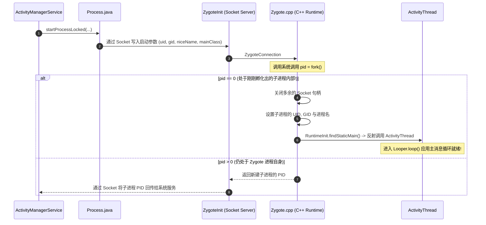

# Zygote孵化机制与应用进程创建全流程

在 Android 操作系统中，**Zygote（受精卵）进程**是所有 Java 应用程序进程以及核心系统服务（`system_server`）的共同始祖。每个 App 进程都不是从零开始冷生硬造的，而是由 Zygote “孵化”（`fork`）衍生而来。深入理解 Zygote 为什么要使用 **写时复制（COW）**、**预加载（Preload）机制**，以及**为什么必须舍弃 Binder 改用 Unix Domain Socket 通信**，是 Android 资深工程师贯通 Linux 操作系统与 Framework 运行机制的核心标尺。

---

## 核心底层机制与全景架构

### 1. Android 系统启动至应用创建全景拓扑

```mermaid
flowchart TD
    Boot[1. Boot ROM / BootLoader] --> Kernel[2. Linux Kernel 启动加载驱动]
    Kernel --> Init[3. init 进程 (PID 1)<br/>Linux 用户空间始祖, 挂载文件系统]
    Init -->|解析 init.rc 脚本启动| Zygote[4. app_process / Zygote 进程<br/>创建 ART 虚拟机, 开启 Socket 监听]
    
    Zygote -->|启动期执行 fork| SystemServer[5. system_server 进程<br/>承载 AMS, WMS, PMS, ServiceManager]
    SystemServer --> Launcher[6. Launcher 桌面 App 启动就绪]
    
    UserClick[用户点击桌面 App 图标] --> SystemServer
    SystemServer -->|通过 Unix Domain Socket 发送创建请求| Zygote
    Zygote -->|fork() 快速克隆| AppProcess[7. 目标 App 进程<br/>共享系统类与资源, 继承虚拟内存]
    AppProcess --> ActivityThread[8. ActivityThread#main 进入应用主循环]
```

---

## 源码级架构物理拆解

### 1. 为什么叫“受精卵”？写时复制（COW）与预加载机制

如果每个 App 启动时都单独加载一次 Android 核心类库（如 `android.view.View`、`android.app.Activity` 等数千个类）和公共资源，启动一个 App 需要 3~5 秒，且内存中会存在成百上千份完全重复的代码段。

```mermaid
flowchart LR
    subgraph Zygote 预加载阶段
        ZMem[Zygote 进程物理内存页<br/>preloadClasses: 预加载数千个核心系统类<br/>preloadResources: 预加载通用 Drawable/Color]
    end

    subgraph fork 衍生子进程
        App1[App 1 进程] -->|只读共享物理页 (零额外内存消耗!)| ZMem
        App2[App 2 进程] -->|只读共享物理页| ZMem
        App3[App 3 进程] -->|尝试修改某一全局变量| COW[Linux 触发写时复制 COW<br/>仅为该变量分配一个 4KB 独立新物理页]
    end
```

#### Linux COW（Copy-On-Write，写时复制）数学原理：
- 当调用 `fork()` 时，子进程直接复制父进程的页表项（Page Table Entries），**父子进程指向完全相同的物理内存页（RAM）**，此时物理内存开销几乎为 0；
- 物理内存页全部被操作系统内核标记为**只读（Read-Only）**；
- 只有当某个子进程尝试向这段共享内存**执行写操作（Write）**时，硬件 MMU 抛出缺页异常，Linux 内核介入，为该修改进程**单独拷贝一个 4KB 的物理新页**进行修改。
- **收益**：数十个 App 共享同一套 Framework 字节码，极大地节约了移动设备的宝贵物理内存。

---

### 2. 终极追问：为什么 Zygote 通信使用 Socket 而严禁使用 Binder？

在 Android 整个系统服务都全面拥抱 Binder 的背景下，**Zygote 与 AMS 之间却破例使用了传统的 Unix Domain Socket（`/dev/socket/zygote`）**。这是社招面试中最致命的系统级深水区考点：

```mermaid
flowchart TD
    subgraph 假设 Zygote 引入 Binder 后的死锁灾难
        ZThread1[Zygote 内部的主线程]
        ZThread2[Zygote 内部的 Binder 工作线程池]
        Mutex[全局互斥锁 Mutex]
        
        ZThread2 -->|正在执行业务, 占有了 Mutex 锁| Mutex
        ZThread1 -->|恰好在此瞬间执行了 fork() 系统调用!| ForkAction[Linux fork 调用]
        
        ForkAction --> Child[新诞生的 App 子进程]
        ChildNote[致命机制: Linux fork() 仅复制调用线程!<br/>父进程的其他线程在子进程中全部人间蒸发!]
        Child --> ChildNote
        ChildNote --> Deadlock[子进程主线程尝试获取 Mutex 锁<br/>但持有锁的线程在子进程根本不存在, 永远无法释放!<br/>子进程陷入永久死锁瘫痪!]
    end
```

#### 物理原因深度推导：
1. **Linux `fork()` 的物理语义限制**：在多线程程序中调用 `fork()`，**子进程只会继承调用 `fork()` 的那唯一一个线程**，父进程中的其他线程在子进程中全部被悄无声息地丢弃了！
2. **锁状态不一致死锁**：若 Zygote 使用 Binder，就必须常驻 Binder 线程池。若父进程某个 Binder 线程在持有互斥锁（如堆内存分配锁 `malloc_mutex` 或 Framework 锁）时，另一个主线程恰好执行了 `fork()`，**该锁在子进程中将处于被锁住状态，但持有锁的线程已不存在，子进程一旦再次尝试获取该锁便陷入永久死锁（Deadlock）！**
3. **保持单线程纯洁性**：因此，Zygote 在启动完成后必须保持**纯单线程模型**，仅使用 Unix Domain Socket 串行接收命令，安全完成 `fork` 后再在新进程中启动多线程和 Binder。

---

### 3. 应用进程孵化全时序链路



---

## 社招高频硬核连环追问

### Q1: Zygote 是 32 位还是 64 位的？64 位手机上怎么支持老旧的 32 位应用？
- **考点**：Zygote 架构演进与多架构兼容。
- **解析**：
  - 现代 64 位 Android 系统启动时，`init.rc` 实际会启动**两个独立的 Zygote 进程**：
    - `zygote64`（主 Zygote，监听 `/dev/socket/zygote`）
    - `zygote`（32 位辅助 Zygote，监听 `/dev/socket/zygote_secondary`）
  - 当 AMS 准备拉起一个新 App 时，会根据该应用 APK 内包含的 `lib/arm64-v8a` 或 `lib/armeabi-v7a` 的 native SO 库架构，智能决定将 Socket 创建请求发往 `zygote64` 还是 32 位的从属 Zygote，从而完美兼容 32 位与 64 位混合应用。

### Q2: 为什么 Application 中的静态变量在不同进程中不是同一个值？
- **考点**：进程虚拟内存空间独立与 COW 边界。
- **解析**：
  - 虽然子进程是从 Zygote fork 出来的，但经过 `forkAndSpecialize()` 后，子进程拥有**完全独立的 Linux 进程虚拟内存地址空间**；
  - 即使两个进程都在各自的内存中声明了 `public static int COUNT = 0`，对变量的写操作会立即触发内核的 COW（写时复制），使两个进程指向不同的物理内存页，数据在物理上完全隔离，绝不可通过静态变量跨进程传参。

---

## 生产级避坑指南与排障 SOP

### 1. 避免在 ContentProvider 初始化期执行耗时逻辑导致冷启动变慢

**隐蔽缺陷**：Android 系统的进程创建顺序极其严苛：
```
ActivityThread#main() 
  -> attachApplication() 
  -> handleBindApplication() 
  -> installContentProviders() (在此处优先实例化所有三方 SDK 的 ContentProvider!)
  -> Application#onCreate() 
```
许多第三方 SDK（如统计埋点、推送等）利用 ContentProvider 的“自动初始化”特性在 `onCreate` 中打桩。如果开发者自己的 ContentProvider 或三方库在此处执行耗时 I/O，**它甚至发生在 `Application#onCreate` 之前**，会直接将 App 的冷启动时间凭空拖慢数百毫秒！必须严格将耗时逻辑延迟至首帧渲染之后异步处理。
